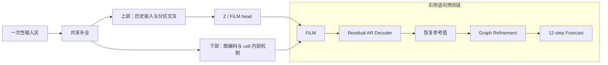

# ALFNet 架构图第二阶段：参考样式与布局提案

日期：2026-10-19。阶段：设计提案，不是正式架构图。推荐方案 A；等待用户选择或修订后进入第三阶段。

事实依据：[第一阶段实现核验](STAGE1_IMPLEMENTATION_AUDIT_CN.md)。本轮不改变其模型、数据流和维度结论。名称沿用第一阶段建议，尚不视为用户已确认的正式命名。

## 1. 推荐结论

采用一张横向、上下分支的连续大图：左侧一次性呈现输入，随后一次性展开共享补全；右上是时间条件分支，右下是图预测路径，最终预测位于最右侧。复杂机制在所属区域内展开，不设置第二套 Overall Architecture 或底部重复模块图。

以参考图 5 的留白、容器层级和正交连线作为基础，以参考图 4 的张量/日历/运算符和参考图 3 的图节点作为图元来源。整体风格统一为浅色、细线、正式字体；保留参考图中适合 PPT 的形状组合，不保留其其他模型机制。

## 2. 参考图逐项分析与复用位置

以下编号直接指 Reference_Image 文件名，不是原始 PPT 页码。本地提供的是 PNG，不能从 PNG 中提取原生 PPT 对象；用户若持有对应 PPT，可按下述位置复制原对象。否则在第三阶段用相同基础图元制作 SVG 模块。

| 参考图 | 值得借鉴的视觉特点 | 对应 ALFNet 用途 | 具体 PPT 图形组成 | 取舍 |
|---|---|---|---|---|
| [1.png](../architecture_20261017/Reference_Image/1.png) | 曲线区与观测状态图例容易识别，区域配色明确 | 左侧有缺口的交通历史、小型场景轨迹 | 折线/自由曲线、圆点、短虚线、文本框 | 不复制地图底图、散点群或动机分面 |
| [2.png](../architecture_20261017/Reference_Image/2.png) | 同一节点在各时刻保持身份，图与邻接矩阵对应 | 静态图节点风格、补全示意中的节点一致性 | 圆、直线、矩形矩阵、颜色复用 | 不采用事故图标、多时刻完整路网或动态边热图 |
| [3.png](../architecture_20261017/Reference_Image/3.png) | 黑色正交箭头、清晰圈加/乘、浅色算子块、薄张量片 | 五专家传播、代表性 GRU、FiLM 与残差加法 | 连接符、圆+符号、小矩形、平行四边形侧面 | 不照搬下采样、多尺度蒸馏、动态/自适应图、memory |
| [4.png](../architecture_20261017/Reference_Image/4.png) | 日历/时钟、拼接向量、立体特征块、局部嵌套和底部图例 | 历史/日历/结构 embedding，分区张量，Z 与 FiLM 参数 | 网格矩形、薄侧面、短特征条、括号、concat 标记 | 避免照搬复杂 memory/prototype/prompt 网络；减少细小装饰 |
| [5.png](../architecture_20261017/Reference_Image/5.png) | 分区干净、上下模块对齐、浅蓝/浅绿/浅橙容器、留白充分 | 推荐方案的整体视觉骨架 | 浅色圆角矩形、白色内部算子、正交箭头 | 不沿用其独立右侧 Core Component 面板；内部细节并入本图所属区域 |
| [6.png](../architecture_20261017/Reference_Image/6.png) | 可见局部变化的曲线、突出局部 token 的浅色矩阵 | 观测/缺失区分、空间分区槽位高亮 | 曲线、矩形阵列、细括号、高亮色块 | 这是动机解释风格，不沿用大段解释、对错图标或多视图对比 |
| [7.png](../architecture_20261017/Reference_Image/7.png) | 输入—嵌套计算—输出的连续阅读，内部机制在容器内展开 | 单图嵌套层级、补全的双方向、单独训练目标区 | 圆角框、短箭头、薄特征片、公式文本 | 不借用频率分解、双输出头、重建损失或 Frozen Encoder |

参考图部分使用手写字、拼写检查红波浪线、强渐变和较厚轮廓。这些不是本图的目标样式；第三阶段统一清理为可出版的字体和线型。

## 3. 方案 A：左侧共享补全，右侧上下分支（推荐）

### 3.1 空间分配

初始宽高比约 1.8–1.9:1，允许为了通栏可读性增加高度，不强制塞进 16:9。按内容宽度先预留：输入约 14%，共享补全约 21%，双分支与输出约 65%；图上/下分支高度约为 40%/60%，下部需要容纳代表性 cell 和 refiner。

这些是排版起点而非锁死坐标。第三阶段优先检查约 180 mm 通栏宽度下 7.5–8 pt 正文字号是否足够，再调整区域比例。

概念结构如下，省略静态图、上下文和参考值的辅助连线；这不是最终图的形状、比例或完整连线清单：

### 3.2 区域一：输入，只画一次

左列按上/中/下排列三个输入容器：

1. **Visible Traffic History**：画 2–3 条代表节点的 12 步曲线，缺测处断开，已观测位置实心点；不要用穿越缺口的完整曲线暗示已知缺失真值。保留 t−11…t 的历史轴，节点数用省略号表示。
2. **Lifecycle Context**：上方四条短状态轨迹标 Unseen / Steady / Join / Fault；下方一行简洁 `S_t=[R_t,a_t,M_t]`，配角色色带、年龄小条及一次 mask 矩阵。场景条用于解释状态变化，不另加场景 one-hot 输入。图注说明 R 的固定角色顺序；避免在狭窄输入区同时堆四套长定义。
3. **Static Graph**：一个简洁路网加一块小邻接矩阵。节点位置和颜色保持一致；静态图属性注记 `topology (+ coordinates, when available)`，流量数据不暗示有 GPS。

日历来自历史时间戳，在 ALFTemporal 入口画小时钟/日历图标即可，不再复制输入曲线。S 是 12 步逐时刻上下文，不能仅画最后时刻向量。

### 3.3 区域二：SAHC，顺序展开，不按 q 分互斥路径

浅红色容器内以竖向小流程节省宽度：

`Bidirectional graph reconstruction (GRIN/BiGRIL)` → `Keep observations` → `Visible-window interpolation*` → `Reference centering*` → `Filled History`。

- 重建区域内画上下两条相反时间方向的图循环带，各用 2 个时刻示意加省略号；上下对齐后汇入 Merge。两条带接收同一输入，不能把前向结果串入后向网络。
- 用一个小图传播符号体现邻居消息，不再复制左侧完整路网和邻接。
- 观测保留只用一个短 mask 选择表达；插值节点标 `missing slots, q>0`，脚注说明 q=0 保留 GRIN。可选阶段用星号，不用虚线条件箭头伪装为开关网络。
- 只在共享出口显示一个简短的 filled 特征条或曲线片段；两支路仅用 Xbar 标签继续传递，不各画一套 filled 曲线。
- 局部小注标明 `q=Σ M_t`；不画 Visibility 输入。
- 参考值 `c v` 从观测支持统计处引出到右侧 Restore Reference，表示有配对的减/加操作。

基础 GRIN 用常规名称明确归属。该区域不需要把 GRIL 内部三个门全部展开；否则会与图预测区域的 cell 示意争夺空间。

### 3.4 区域三：ALFTemporal，主要展示分区与注意力

绿色上部容器由三个连续段构成：

**嵌入段**：共享历史与 S、归一化日历进入 `12-step Conv`；末时刻 ToD/DoW embedding 和结构 MLP 的输出从侧面进入 concat。结构 MLP 用小图属性条→MLP→32维条表示；不再画完整输入图。

**分区交互段**：一个明确标 `1 temporal patch` 的薄矩阵，经 Reorder/Pad 表示为 P×C 槽位。仅画少数示意分区与省略号，文字标 P=32、C dataset-specific；示意块个数不代表真实数量。

- 跨分区：高亮各分区同一槽位，用横向连接表示它们的注意力范围。
- 分区内：画一个代表分区的槽位阵列，连接 **4 个** latent tokens；以 `Gather → Broadcast` 两步表示汇聚与回传。不要画成普通槽位自注意力矩阵。
- 两阶段依次连接，边缘小注 `Residual + Norm + FFN`，不再拆出四个 Norm 和两个重复 MLP。

**输出段**：`Restore node order` → Z 特征条（N×160）→ `FiLM head`。head 输出用一组双行特征条标 Δγ、β（各 N×64）。FiLM 参数连接沿上下分支之间预留通道走折线，落到图编码末状态处；宁可使用一次清晰的折线路由，不为追求直线而破坏时间分支阅读顺序。

这里只显示一个交互块；不加 ×5、×L 或多个 temporal patches。4 个 latent tokens 不命名为 lifecycle router。

### 3.5 区域四：ALFGraph 与图输出修正

下部横向主线为：`Graph Encoder ×2 layers` → `FiLM` → `Residual AR Decoder ×2 layers` → `Restore Reference*` → `Graph Refinement`。

- Encoder/Decoder 采用参考图 5 的白色内框与轻微双层叠片，仅标两层，不展开 12 个时刻。
- FiLM 用一个黄色框，内有圈乘、圈加和唯一一条公式 `H'=(1+Δγ)⊙H+β`；不另设重复的 FiLM 细节面板。
- Decoder 下方画一条小自回归回环，并明确标前一步预测作为下一步输入。共享历史的末值 Xbar_L 通过单独细实线接 decoder 初始输入；它不从 Encoder 输出中假想产生。
- 参考恢复是小型 `+ c v` 运算框，与左侧 centering 配对；标星号表示按数据集启用。
- Refiner 在原位置用三条紧凑特征条表示 `[Y0, P+Y0, P−Y0]`，随后 `MLP → tanh → ×0.05 s(R_L) → +Y0`。这里不给通用路网图标取代计算链，也不另画一张 refiner 子图。

在 Encoder/Decoder 所属蓝色区域内部预留一个 **cell 定义框**，只完整展开一次：

- 上半段为代表性 GRU 的 r/u/c 更新和隐藏状态回路；
- 下半段为图传播算子的 5 个专家槽位 + Linear→Softmax 权重 + 加权求和；
- 用细无箭头引线注明该定义用于 encoder/decoder cells，且不同层/门参数独立。定义框不会作为一个额外串联计算节点。

五槽位采用 I、Mean、Weighted Mean、Forward、Backward 的短标题和小矩阵图元，不画五套大路网。Weighted Mean 与 Forward 用同一传播图样、不同参数标记 Θ_j，并用小括注或图注说明传播形式重合。

为尊重代码归属，蓝色核心标题只覆盖图编码/解码；外围可统称 Graph Forecasting Path。FiLM、参考恢复和 refiner 可紧邻其右侧，但不要暗示它们都声明在 ALFGraph 类里。

### 3.6 区域五：输出与训练注记

右端只画一个 Forecast 框，内含代表节点未来 12 步曲线，横轴 t+1…t+12。不画额外的时间分支预测、重建输出或 ground-truth 对比。

底部只留一条窄区域：`Training only: 0.9 L_mean + 0.1 L_role + L_route`，另以短文字注明 masked teacher forcing。预测/路由到损失的引用可用带名称的小端口，不让训练线贯穿主图。图例与数据集开关说明置于同一底部区域或正式图注，不占单独大面板。

## 4. 方案 B：中央共享历史，上下计算，右侧调制与输出

第二方案的差别是把中心画布更多空间交给 ALFTemporal 和图传播细节：输入与竖向补全仍在左侧，中央上下是时间编码/图编码，右侧一列依次为 FiLM、残差解码、参考恢复、图修正和输出。

区域内部的图元、模块次序和真实条件接口与方案 A 相同；仅改变位置。右侧竖向链使 refiner 可以获得更宽的局部空间，完整 cell 定义放在中央下方，较少压缩主线标签。FiLM 以两条正交线接收左侧编码状态和上侧条件参数。

代价是总体阅读在右侧由左→右转成上→下，输出位于右下；共享历史末值、参考值、末角色到右侧多个节点的辅助连接较集中。适用于接近 1.55–1.65:1 的较高画幅，或后续发现方案 A 的下部细节难以保持字号时。

## 5. 两方案比较

| 标准 | A：横向图预测主线 | B：右侧竖向预测链 |
|---|---|---|
| 一眼看清完整预测顺序 | 更强，图分支连续左→右 | 中央汇合后需要转向 |
| FiLM 调制关系 | 上支路参数进入下支路编码末状态，直观 | 右侧汇合集中，接口明确 |
| 内部细节空间 | 蓝色下部需严格控制宽度与文字 | cell 和 refiner 较宽裕 |
| 条件/参考值布线 | 可利用上下分支间及下方通道 | 右侧容易集中多条入线 |
| 论文通栏适配 | 更适合作为横向总体架构 | 更适合允许较高图幅的版面 |
| PPT 复现 | 基本矩形、对齐、分组，步骤直观 | 同样可复现，但跨区域定位更多 |
| 本轮建议 | 首选 | 可读性验证不通过时的备选 |

不再提出第三套主图+子图方案，因为当前实现没有证据表明必须采用重复分面才能讲清楚。

## 6. 统一视觉规范

| 元素 | 设计规范 |
|---|---|
| 背景 | 白色，不加整页渐变、阴影或大型 ALFNet 标题横幅 |
| 生命周期 | 填充 #F1EAF8；条件线 #8761A8 |
| 共享补全 | 填充 #FBE9E8；边线 #C97D79 |
| ALFTemporal | 填充 #EAF4E8；边线 #7DA36D |
| ALFGraph | 填充 #E8F1FA；边线 #6C99C6 |
| FiLM | 填充 #FFF3D1；边线 #CAA24E |
| Refiner | 填充 #FFF0DF；边线 #D3A270 |
| 字体 | 英文标签统一 Arial；数学符号用 Cambria Math 或统一衬线数学字体；第三阶段检查可用字体。不要混入参考图手写字体 |
| 字号 | 以最终约 180 mm 宽输出为准：区标题约 9–10 pt，标签 7.5–8 pt，附注尽量不低于 7 pt。数值是设计目标，须缩放视觉验证 |
| 边线/箭头 | 最终尺寸主线约 0.9–1.1 pt，内框约 0.6–0.8 pt；统一箭头大小；避免粗箭头压过内容 |
| 圆角 | 仅容器小圆角；内部算子用矩形或统一更小圆角，不混椭圆、胶囊、斜框 |
| 张量 | 平面网格为主，必要时加薄侧面；禁止用厚立体块暗示不存在的层数或时间 patch 数 |
| 曲线 | 用可编辑折线/自由曲线和圆点，避免截图或渐变位图；代表曲线明确是示意，不使用实验数据 |
| 运算符 | 圈加表示加法；圈内点/⊙表示逐元素乘；Concat 用并排条或括号，不能借用加法图标 |

颜色只编码模块/信息类型，不同时拿同一套色彩表示“节点身份”“场景”“专家重要性”。缺失读数用空心点/断线区分，不能只靠颜色。

## 7. 布线与端点清单

| 信号 | 起点 | 实际终点 | 画法 |
|---|---|---|---|
| Xvis | 历史曲线 | GRIN 与可见窗口统计 | 深灰实线，在 SAHC 内分叉 |
| R_t、a_t、M_t | 唯一 Lifecycle Context | GRIN 辅助/掩码接口，时间嵌入，图编码输入/router | 紫色虚线，分叉点加圆点并标接口 |
| S_L | 生命周期末步端口 | 解码 router | 紫色虚线，明确 hold-last-state |
| R_L | 生命周期末角色端口 | refiner 的固定角色倍率 | 紫色虚线，不能标成完整 S 进入 MLP |
| A | 唯一静态图 | GRIN、图 supports、结构特征、refiner | 细灰实线；必要时用一致 A 端口避免长距离交叉。端口只是同一输入引用，不重复画图 |
| 静态布局/坐标 | 左侧静态属性端口 | 分区布局、结构特征 | 小标签；不将有坐标数据的 KD-tree 错画成仅由 A 推出 |
| Xbar | SAHC 唯一输出 | 两分支，以及 decoder 初始末值 | 主分叉两条实线；Xbar_L 单独细实线 |
| 历史 timestamps | 历史输入时间轴 | 时间分支日历构造 | 细实线，不引入预测未来真值 |
| Δγ、β | Z 后的 FiLM head | 编码末状态调制 | 一组配对参数线，深灰实线；两分支间预留专用通道 |
| c v | SAHC 当前窗口参考统计 | Restore Reference | 细深灰实线，沿区域边缘；不混入紫色生命周期条件线 |
| 代表性 cell 定义 | 内嵌定义框 | Encoder/Decoder 的 cell 标记 | 细灰无箭头引线，表达“内部定义”，不是数据流 |
| 训练目标引用 | Forecast / graph router | 底部 training-only 区 | 小型带名称端口或短点线；必须有独立图例 |

普通线交叉不加圆点；只有实际分叉/汇合有圆点。箭头止于形状边界，不穿过标题或文本。紫色虚线只表示生命周期条件，不能同时表示可选模块、放大框和辅助损失。

## 8. PPT 原生复现与后续素材库规划

先复制/重建容器与大区，再处理主线，最后填内部机制。优先使用 PPT 的矩形、圆、线条、连接符、文本框、组合和对齐功能；不要求自由手绘复杂图案。

后续 SVG module library 按可独立粘贴的对象组提供，建议包括：

1. 带缺口的历史曲线与12步预测曲线；
2. 四场景状态轨迹、R/a/M 描述条；
3. 静态路网与邻接矩阵；
4. BiGRIL 双方向与观测保留选择；
5. 可见窗口插值、参考中心化/恢复配对图元；
6. 日历、结构 MLP、embedding concat；
7. P×C 分区阵列及跨分区交互；
8. 4 latent tokens 的分区内 gather/broadcast；
9. 代表性图 GRU 与五专家 mixture；
10. Z、FiLM head 和编码状态调制；
11. 残差自回归回环；
12. 图修正的三路特征与角色缩放残差；
13. 通用箭头、端口、圈加、逐元素乘、图例。

这是素材规划，不在本阶段先制作零散精细模块。第三阶段先完成整图布局，再抽取实际使用的对象形成素材库，避免先做素材后硬拼画布。原生 PPT 的 SVG 拆分结果留到交付阶段实际核验或明确说明未验证。

## 9. 信息密度控制与第三阶段验收条件

- 同一主输入、共享补全、时间分支、FiLM 调制、完整预测序列均只详细展示一次；允许带名称的信号端口和代表性内部 cell。
- 图中保留关键维度：L=H=12、1 temporal patch、P=32、C可变、Z=N×160、图状态每层 N×64、encoder/decoder各2层。batch轴可统一省略。
- C=7/16/10/6、插值开关、d和c取值放图注/配套表，不另画四套模型。
- 完整 loss 元素公式、所有 GRIN 门公式、每个 attention 的 Norm 明细移至方法文档。主图保留五专家求和、FiLM、refiner 关键关系。
- 在目标宽度下检查文字、缺测点、箭头和4 latent tokens是否可辨；若不足，先减少解释文字/装饰，其次增加高度，再考虑方案B，不直接缩小字体。
- 参考恢复必须在 refiner 前；refiner 后的预测不能反馈至自回归 decoder；两分支不能各画 forecast。
- 本阶段只新增本设计说明；未开始最终 SVG/PNG 绘制，无模型/配置/数据/实验结果更改。
