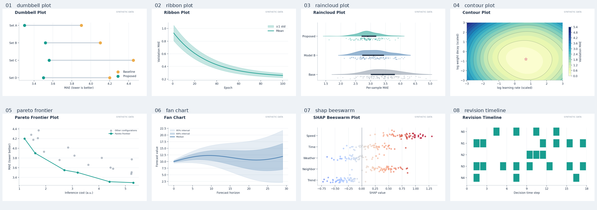

# 深度学习论文实验结果可视化图鉴：75 种图形与选型指南

> **用途**：科研写作、超参数敏感性分析、算法性能比较、时空预测与强化学习实验展示。  
> **覆盖范围**：8 大类、75 种图形；**每种图形均包含 1 张实际绘制的示意图**，附有 PNG 和 SVG。  
> **重要说明**：所有示例图均采用**模拟/演示数据（Synthetic Data）**，不是任何论文或真实数据集的实验结论。部分流程图、SHAP、t-SNE、UMAP、CKA 和 CD 图仅示意视觉形式，不代表已计算真实方法输出或统计显著性。



> 上图仅用于快速预览；每种图形的清晰示例和 SVG 矢量版本见下文对应章节。

## 快速导航

1. [性能对比与算法排名](#1-性能对比与算法排名)
2. [训练过程与动态趋势](#2-训练过程与动态趋势)
3. [统计分布与误差分析](#3-统计分布与误差分析)
4. [超参数敏感性与搜索](#4-超参数敏感性与搜索)
5. [计算成本与性能权衡](#5-计算成本与性能权衡)
6. [预测质量与诊断](#6-预测质量与诊断)
7. [表示学习与可解释性](#7-表示学习与可解释性)
8. [时空预测与动态决策](#8-时空预测与动态决策)
9. [论文实验图快速选择表](#9-论文实验图快速选择表)
10. [科研作图原则与常见误区](#10-科研作图原则与常见误区)

## 图形类型全局概览

| 主要类别 | 图形数量 | 在论文中回答的问题 |
|---|---:|---|
| 性能对比与算法排名 | 9 | 我们的模型相对基线是否更好？ |
| 训练过程与动态趋势 | 8 | 是否收敛？是否稳定？训练行为是什么？ |
| 统计分布与误差分析 | 10 | 提升是否普遍？尾部与异常误差怎样？ |
| 超参数敏感性与搜索 | 9 | 方法对参数敏感吗？参数之间有交互吗？ |
| 计算成本与性能权衡 | 8 | 精度提升是否值得增加的资源成本？ |
| 预测质量与诊断 | 11 | 错误从哪里来？预测有没有偏差或失准？ |
| 表示学习与可解释性 | 10 | 模型特征、归因与决策机制怎样？ |
| 时空预测与动态决策 | 10 | 何时、何处修正有效？如何受预算影响？ |
| **总计** | **75** |  |

### 与三种基础图的区别

折线图（Line Plot）、柱状图（Bar Chart）和热力图（Heatmap）仍然非常实用。本图鉴更关注**如何用其他图形表达差异、分布、统计不确定性、联合参数空间与成本权衡**。例如，单纯平均 MAE 适合表格或点图；想证明绝大多数样本获益，应进一步展示 ECDF 或收益分布；想证明效率，应画精度—成本 Pareto 图。

---
## 1. 性能对比与算法排名

本类共有 **9** 种展示形式。先看适用场景表，再看下方图片，便于快速筛选适合论文的实验图。

| 编号 | 图形（英文 / 中文） | 主要用途 | 使用时注意 |
|---:|---|---|---|
| 1.1 | **Dot Plot**（点图） | 不同模型的单指标对比 | 指标方向要一致；低值更好时不要反向排序。 |
| 1.2 | **Lollipop Chart**（棒棒糖图） | 消融或模型排名 | 若从 0 截断轴，应说明坐标含义。 |
| 1.3 | **Dumbbell Plot**（哑铃图） | 同一数据集上改进前后的差值 | 仅对同一测试条件下的成对结果连接。 |
| 1.4 | **Slope Chart**（斜率图） | 两个条件下的性能变化 | 只有两个条件时表达最清晰；避免标签相互遮挡。 |
| 1.5 | **Forest Plot**（森林图） | 效应量及置信区间 | 明确效应量定义、区间计算方法和样本独立性。 |
| 1.6 | **Waterfall Chart**（瀑布图） | 模块累计增益与损失 | 只有顺序添加模块时才能解释为累计增量。 |
| 1.7 | **Radar Chart**（雷达图） | 归一化后的多目标概览 | 多个指标必须归一化，且“越大越好”语义一致。 |
| 1.8 | **Critical Difference Diagram**（临界差异图（CD 图）） | 跨数据集平均排名；显著性需另行检验 | CD 连线必须来自合法统计检验；示意图不代表显著性。 |
| 1.9 | **Bump Chart**（排名变化图） | 跨任务算法名次变化 | 排名依赖候选集合；注意同名次与并列情况。 |

### 对应图形示例

> 以下图片均为模拟数据绘制，仅用于理解图形形式；点击各图片下方的 SVG 链接可查看对应矢量图。

<table>
<tr>
  <td width="50%" valign="top">
    <b>Dot Plot · 点图</b><br>
    <br>
    <small>不同模型的单指标对比</small><br>
    <a href="figures_svg/dot_plot.svg">下载 SVG 矢量版</a>
  </td>
  <td width="50%" valign="top">
    <b>Lollipop Chart · 棒棒糖图</b><br>
    <br>
    <small>消融或模型排名</small><br>
    <a href="figures_svg/lollipop_plot.svg">下载 SVG 矢量版</a>
  </td>
</tr>
<tr>
  <td width="50%" valign="top">
    <b>Dumbbell Plot · 哑铃图</b><br>
    <br>
    <small>同一数据集上改进前后的差值</small><br>
    <a href="figures_svg/dumbbell_plot.svg">下载 SVG 矢量版</a>
  </td>
  <td width="50%" valign="top">
    <b>Slope Chart · 斜率图</b><br>
    <br>
    <small>两个条件下的性能变化</small><br>
    <a href="figures_svg/slope_chart.svg">下载 SVG 矢量版</a>
  </td>
</tr>
<tr>
  <td width="50%" valign="top">
    <b>Forest Plot · 森林图</b><br>
    <br>
    <small>效应量及置信区间</small><br>
    <a href="figures_svg/forest_plot.svg">下载 SVG 矢量版</a>
  </td>
  <td width="50%" valign="top">
    <b>Waterfall Chart · 瀑布图</b><br>
    <br>
    <small>模块累计增益与损失</small><br>
    <a href="figures_svg/waterfall_chart.svg">下载 SVG 矢量版</a>
  </td>
</tr>
<tr>
  <td width="50%" valign="top">
    <b>Radar Chart · 雷达图</b><br>
    <br>
    <small>归一化后的多目标概览</small><br>
    <a href="figures_svg/radar_chart.svg">下载 SVG 矢量版</a>
  </td>
  <td width="50%" valign="top">
    <b>Critical Difference Diagram · 临界差异图（CD 图）</b><br>
    <br>
    <small>跨数据集平均排名；显著性需另行检验</small><br>
    <a href="figures_svg/critical_difference.svg">下载 SVG 矢量版</a>
  </td>
</tr>
<tr>
  <td width="50%" valign="top">
    <b>Bump Chart · 排名变化图</b><br>
    <br>
    <small>跨任务算法名次变化</small><br>
    <a href="figures_svg/bump_chart.svg">下载 SVG 矢量版</a>
  </td>
  <td width="50%"></td>
</tr>
</table>

---

## 2. 训练过程与动态趋势

本类共有 **8** 种展示形式。先看适用场景表，再看下方图片，便于快速筛选适合论文的实验图。

| 编号 | 图形（英文 / 中文） | 主要用途 | 使用时注意 |
|---:|---|---|---|
| 2.1 | **Learning Curve**（学习曲线） | 训练损失和验证损失随 epoch 变化 | 区分训练与验证曲线，并标注平滑策略。 |
| 2.2 | **Ribbon Plot**（带状趋势图） | 均值与波动区间 | 阴影必须说明是 SD、SE 还是 CI。 |
| 2.3 | **Area Plot**（面积图） | 累计指标随训练推进变化 | 面积图适合累计量，非零基线会改变视觉含义。 |
| 2.4 | **Stacked Area Plot**（堆叠面积图） | 多个损失分量的组成 | 只有可加和分量才应使用堆叠图。 |
| 2.5 | **Step Plot**（阶梯图） | 阶梯学习率或阈值策略 | 使用 post/pre 标签明确阶梯跳变时刻。 |
| 2.6 | **Spaghetti Plot**（多运行轨迹图） | 多个随机种子训练轨迹 | 多种子轨迹不要选择性只显示最好的运行。 |
| 2.7 | **Learning Curve vs Data Size**（数据规模学习曲线） | 样本规模与模型性能 | 不同规模下保持其他训练预算/条件可比。 |
| 2.8 | **Event-Aligned Plot**（事件对齐图） | 事件发生前后的指标演变 | 清楚标注事件时刻和时间对齐方式。 |

### 对应图形示例

> 以下图片均为模拟数据绘制，仅用于理解图形形式；点击各图片下方的 SVG 链接可查看对应矢量图。

<table>
<tr>
  <td width="50%" valign="top">
    <b>Learning Curve · 学习曲线</b><br>
    <br>
    <small>训练损失和验证损失随 epoch 变化</small><br>
    <a href="figures_svg/learning_curve.svg">下载 SVG 矢量版</a>
  </td>
  <td width="50%" valign="top">
    <b>Ribbon Plot · 带状趋势图</b><br>
    <br>
    <small>均值与波动区间</small><br>
    <a href="figures_svg/ribbon_plot.svg">下载 SVG 矢量版</a>
  </td>
</tr>
<tr>
  <td width="50%" valign="top">
    <b>Area Plot · 面积图</b><br>
    <br>
    <small>累计指标随训练推进变化</small><br>
    <a href="figures_svg/area_plot.svg">下载 SVG 矢量版</a>
  </td>
  <td width="50%" valign="top">
    <b>Stacked Area Plot · 堆叠面积图</b><br>
    <br>
    <small>多个损失分量的组成</small><br>
    <a href="figures_svg/stacked_area.svg">下载 SVG 矢量版</a>
  </td>
</tr>
<tr>
  <td width="50%" valign="top">
    <b>Step Plot · 阶梯图</b><br>
    <br>
    <small>阶梯学习率或阈值策略</small><br>
    <a href="figures_svg/step_plot.svg">下载 SVG 矢量版</a>
  </td>
  <td width="50%" valign="top">
    <b>Spaghetti Plot · 多运行轨迹图</b><br>
    <br>
    <small>多个随机种子训练轨迹</small><br>
    <a href="figures_svg/spaghetti_plot.svg">下载 SVG 矢量版</a>
  </td>
</tr>
<tr>
  <td width="50%" valign="top">
    <b>Learning Curve vs Data Size · 数据规模学习曲线</b><br>
    <br>
    <small>样本规模与模型性能</small><br>
    <a href="figures_svg/data_size_learning_curve.svg">下载 SVG 矢量版</a>
  </td>
  <td width="50%" valign="top">
    <b>Event-Aligned Plot · 事件对齐图</b><br>
    <br>
    <small>事件发生前后的指标演变</small><br>
    <a href="figures_svg/event_aligned_plot.svg">下载 SVG 矢量版</a>
  </td>
</tr>
</table>

---

## 3. 统计分布与误差分析

本类共有 **10** 种展示形式。先看适用场景表，再看下方图片，便于快速筛选适合论文的实验图。

| 编号 | 图形（英文 / 中文） | 主要用途 | 使用时注意 |
|---:|---|---|---|
| 3.1 | **Box Plot**（箱线图） | 中位数、四分位数与离群点 | 五数概括之外最好报告样本规模。 |
| 3.2 | **Violin Plot**（小提琴图） | 不同方法的误差密度 | 小样本 KDE 容易失真；可叠加原始点。 |
| 3.3 | **Raincloud Plot**（雨云图） | 密度、样本点与摘要统计 | 密度、散点与箱线摘要的量纲应一致。 |
| 3.4 | **Beeswarm Plot**（蜂群图） | 尽量避免点遮挡的个体观测分布 | 点数过多时可能拥挤，必要时分层抽样。 |
| 3.5 | **Strip Plot**（条带散点图） | 单个样本或重复实验结果 | 抖动只能用于显示点，不可改变真实数据值。 |
| 3.6 | **Ridge Plot**（山峦图） | 多条件下的误差分布 | 多个山脊共享同一横轴尺度，谨慎比较曲线高度。 |
| 3.7 | **KDE Plot**（核密度图） | 连续误差密度比较 | 带宽选择直接影响峰值数量和视觉形状。 |
| 3.8 | **ECDF Plot**（经验累积分布图） | 误差低于阈值的比例 | 误差越小越好时，曲线越靠左上通常越优。 |
| 3.9 | **Histogram**（直方图） | 误差频次或尾部分布 | 统一直方图区间，避免 bin 不同导致误读。 |
| 3.10 | **Q-Q Plot**（Q-Q 分位数图） | 检验误差分布与参考分布的匹配程度 | Q-Q 图不能单凭接近对角线证明模型充分校准。 |

### 对应图形示例

> 以下图片均为模拟数据绘制，仅用于理解图形形式；点击各图片下方的 SVG 链接可查看对应矢量图。

<table>
<tr>
  <td width="50%" valign="top">
    <b>Box Plot · 箱线图</b><br>
    <br>
    <small>中位数、四分位数与离群点</small><br>
    <a href="figures_svg/box_plot.svg">下载 SVG 矢量版</a>
  </td>
  <td width="50%" valign="top">
    <b>Violin Plot · 小提琴图</b><br>
    <br>
    <small>不同方法的误差密度</small><br>
    <a href="figures_svg/violin_plot.svg">下载 SVG 矢量版</a>
  </td>
</tr>
<tr>
  <td width="50%" valign="top">
    <b>Raincloud Plot · 雨云图</b><br>
    <br>
    <small>密度、样本点与摘要统计</small><br>
    <a href="figures_svg/raincloud_plot.svg">下载 SVG 矢量版</a>
  </td>
  <td width="50%" valign="top">
    <b>Beeswarm Plot · 蜂群图</b><br>
    <br>
    <small>尽量避免点遮挡的个体观测分布</small><br>
    <a href="figures_svg/beeswarm_plot.svg">下载 SVG 矢量版</a>
  </td>
</tr>
<tr>
  <td width="50%" valign="top">
    <b>Strip Plot · 条带散点图</b><br>
    <br>
    <small>单个样本或重复实验结果</small><br>
    <a href="figures_svg/strip_plot.svg">下载 SVG 矢量版</a>
  </td>
  <td width="50%" valign="top">
    <b>Ridge Plot · 山峦图</b><br>
    <br>
    <small>多条件下的误差分布</small><br>
    <a href="figures_svg/ridge_plot.svg">下载 SVG 矢量版</a>
  </td>
</tr>
<tr>
  <td width="50%" valign="top">
    <b>KDE Plot · 核密度图</b><br>
    <br>
    <small>连续误差密度比较</small><br>
    <a href="figures_svg/kde_plot.svg">下载 SVG 矢量版</a>
  </td>
  <td width="50%" valign="top">
    <b>ECDF Plot · 经验累积分布图</b><br>
    <br>
    <small>误差低于阈值的比例</small><br>
    <a href="figures_svg/ecdf_plot.svg">下载 SVG 矢量版</a>
  </td>
</tr>
<tr>
  <td width="50%" valign="top">
    <b>Histogram · 直方图</b><br>
    <br>
    <small>误差频次或尾部分布</small><br>
    <a href="figures_svg/histogram.svg">下载 SVG 矢量版</a>
  </td>
  <td width="50%" valign="top">
    <b>Q-Q Plot · Q-Q 分位数图</b><br>
    <br>
    <small>检验误差分布与参考分布的匹配程度</small><br>
    <a href="figures_svg/qq_plot.svg">下载 SVG 矢量版</a>
  </td>
</tr>
</table>

---

## 4. 超参数敏感性与搜索

本类共有 **9** 种展示形式。先看适用场景表，再看下方图片，便于快速筛选适合论文的实验图。

| 编号 | 图形（英文 / 中文） | 主要用途 | 使用时注意 |
|---:|---|---|---|
| 4.1 | **Contour Plot**（等高线图） | 两个超参数的联合性能曲面 | 格点较稀疏时不要通过插值暗示已观测的中间结果。 |
| 4.2 | **3D Surface Plot**（三维曲面图） | 二维参数与损失的三维映射 | 三维透视可能掩盖差异，最好配二维图。 |
| 4.3 | **Scatter Plot**（散点图） | 参数取值与性能关联 | 相关并不意味着因果；注意交互与混杂变量。 |
| 4.4 | **Bubble Chart**（气泡图） | 参数、得分与资源量三重编码 | 气泡面积而非直径应与数值对应。 |
| 4.5 | **Parallel Coordinates Plot**（平行坐标图） | 多超参数组合与最终得分 | 参数轴最好按可比范围归一化，突出表现最优的组合。 |
| 4.6 | **Scatter Matrix / Pair Plot**（散点矩阵图） | 参数之间的成对关系 | 散点矩阵很多子图，控制变量数量。 |
| 4.7 | **Response Surface Plot**（响应曲面图） | 拟合的响应曲面与采样点 | 明确区分真实观测点与拟合/插值区域。 |
| 4.8 | **Small Multiples / Facet Grid**（分面图） | 跨数据集参数响应对比 | 每个小图尽可能共享坐标轴范围。 |
| 4.9 | **Ternary Plot**（三元图） | 总和固定的三个权重 | 仅适合三权重非负、相加为固定值的情形。 |

### 对应图形示例

> 以下图片均为模拟数据绘制，仅用于理解图形形式；点击各图片下方的 SVG 链接可查看对应矢量图。

<table>
<tr>
  <td width="50%" valign="top">
    <b>Contour Plot · 等高线图</b><br>
    <br>
    <small>两个超参数的联合性能曲面</small><br>
    <a href="figures_svg/contour_plot.svg">下载 SVG 矢量版</a>
  </td>
  <td width="50%" valign="top">
    <b>3D Surface Plot · 三维曲面图</b><br>
    <br>
    <small>二维参数与损失的三维映射</small><br>
    <a href="figures_svg/surface_3d.svg">下载 SVG 矢量版</a>
  </td>
</tr>
<tr>
  <td width="50%" valign="top">
    <b>Scatter Plot · 散点图</b><br>
    <br>
    <small>参数取值与性能关联</small><br>
    <a href="figures_svg/hyper_scatter.svg">下载 SVG 矢量版</a>
  </td>
  <td width="50%" valign="top">
    <b>Bubble Chart · 气泡图</b><br>
    <br>
    <small>参数、得分与资源量三重编码</small><br>
    <a href="figures_svg/hyper_bubble.svg">下载 SVG 矢量版</a>
  </td>
</tr>
<tr>
  <td width="50%" valign="top">
    <b>Parallel Coordinates Plot · 平行坐标图</b><br>
    <br>
    <small>多超参数组合与最终得分</small><br>
    <a href="figures_svg/parallel_coordinates.svg">下载 SVG 矢量版</a>
  </td>
  <td width="50%" valign="top">
    <b>Scatter Matrix / Pair Plot · 散点矩阵图</b><br>
    <br>
    <small>参数之间的成对关系</small><br>
    <a href="figures_svg/scatter_matrix.svg">下载 SVG 矢量版</a>
  </td>
</tr>
<tr>
  <td width="50%" valign="top">
    <b>Response Surface Plot · 响应曲面图</b><br>
    <br>
    <small>拟合的响应曲面与采样点</small><br>
    <a href="figures_svg/response_surface.svg">下载 SVG 矢量版</a>
  </td>
  <td width="50%" valign="top">
    <b>Small Multiples / Facet Grid · 分面图</b><br>
    <br>
    <small>跨数据集参数响应对比</small><br>
    <a href="figures_svg/small_multiples.svg">下载 SVG 矢量版</a>
  </td>
</tr>
<tr>
  <td width="50%" valign="top">
    <b>Ternary Plot · 三元图</b><br>
    <br>
    <small>总和固定的三个权重</small><br>
    <a href="figures_svg/ternary_plot.svg">下载 SVG 矢量版</a>
  </td>
  <td width="50%"></td>
</tr>
</table>

---

## 5. 计算成本与性能权衡

本类共有 **8** 种展示形式。先看适用场景表，再看下方图片，便于快速筛选适合论文的实验图。

| 编号 | 图形（英文 / 中文） | 主要用途 | 使用时注意 |
|---:|---|---|---|
| 5.1 | **Pareto Frontier Plot**（帕累托前沿图） | 性能与成本间的非支配关系（示意） | 前沿需由非支配解计算，不能随意连线。 |
| 5.2 | **Accuracy–Latency Scatter**（精度—延迟散点图） | 精度与推理延迟的取舍 | 需说明硬件、批量大小、精度模式和预热。 |
| 5.3 | **Cost Bubble Plot**（成本气泡图） | 延迟、性能与模型规模 | 保证所有点的气泡尺寸在同一尺度上。 |
| 5.4 | **Roofline Plot**（屋顶线图） | 硬件峰值与计算访存瓶颈 | 理论屋顶依赖硬件测量，并非通用固定数值。 |
| 5.5 | **Stacked Cost Breakdown**（成本组成图） | 多个模块的推理耗时 | 组成项必须可加，口径保持一致。 |
| 5.6 | **Sankey / Flow Diagram**（桑基/流量图） | 计算、数据或样本流向（示意） | 流量宽度原则上应反映数量；此图只是流程风格示意。 |
| 5.7 | **Gantt Chart**（甘特图） | 推理流水线耗时和时序 | 时序叠加表示可并行执行，别误当串行。 |
| 5.8 | **Speedup Plot**（加速比图） | 扩展资源量下的加速比 | 同环境下测量；展示理想线有助于解释瓶颈。 |

### 对应图形示例

> 以下图片均为模拟数据绘制，仅用于理解图形形式；点击各图片下方的 SVG 链接可查看对应矢量图。

<table>
<tr>
  <td width="50%" valign="top">
    <b>Pareto Frontier Plot · 帕累托前沿图</b><br>
    <br>
    <small>性能与成本间的非支配关系（示意）</small><br>
    <a href="figures_svg/pareto_frontier.svg">下载 SVG 矢量版</a>
  </td>
  <td width="50%" valign="top">
    <b>Accuracy–Latency Scatter · 精度—延迟散点图</b><br>
    <br>
    <small>精度与推理延迟的取舍</small><br>
    <a href="figures_svg/accuracy_latency.svg">下载 SVG 矢量版</a>
  </td>
</tr>
<tr>
  <td width="50%" valign="top">
    <b>Cost Bubble Plot · 成本气泡图</b><br>
    <br>
    <small>延迟、性能与模型规模</small><br>
    <a href="figures_svg/efficiency_bubble.svg">下载 SVG 矢量版</a>
  </td>
  <td width="50%" valign="top">
    <b>Roofline Plot · 屋顶线图</b><br>
    <br>
    <small>硬件峰值与计算访存瓶颈</small><br>
    <a href="figures_svg/roofline_plot.svg">下载 SVG 矢量版</a>
  </td>
</tr>
<tr>
  <td width="50%" valign="top">
    <b>Stacked Cost Breakdown · 成本组成图</b><br>
    <br>
    <small>多个模块的推理耗时</small><br>
    <a href="figures_svg/cost_breakdown.svg">下载 SVG 矢量版</a>
  </td>
  <td width="50%" valign="top">
    <b>Sankey / Flow Diagram · 桑基/流量图</b><br>
    <br>
    <small>计算、数据或样本流向（示意）</small><br>
    <a href="figures_svg/sankey_cost.svg">下载 SVG 矢量版</a>
  </td>
</tr>
<tr>
  <td width="50%" valign="top">
    <b>Gantt Chart · 甘特图</b><br>
    <br>
    <small>推理流水线耗时和时序</small><br>
    <a href="figures_svg/gantt_chart.svg">下载 SVG 矢量版</a>
  </td>
  <td width="50%" valign="top">
    <b>Speedup Plot · 加速比图</b><br>
    <br>
    <small>扩展资源量下的加速比</small><br>
    <a href="figures_svg/speedup_plot.svg">下载 SVG 矢量版</a>
  </td>
</tr>
</table>

---

## 6. 预测质量与诊断

本类共有 **11** 种展示形式。先看适用场景表，再看下方图片，便于快速筛选适合论文的实验图。

| 编号 | 图形（英文 / 中文） | 主要用途 | 使用时注意 |
|---:|---|---|---|
| 6.1 | **Prediction vs Ground Truth Scatter**（预测—真实散点图） | 预测值与实际值的一致性 | 加 y=x 参考线；远离对角线的点值得检查。 |
| 6.2 | **Residual Plot**（残差图） | 是否存在系统性残差模式 | 残差应检查异方差、偏差和极端值。 |
| 6.3 | **Bland–Altman Plot**（Bland–Altman 一致性图） | 预测与真实值之间的一致性差异 | 一致性界限不能替代对预测误差阈值的任务判断。 |
| 6.4 | **Fan Chart**（扇形预测图） | 不同置信/预测区间的不确定性扩张 | 概率区间需经过有效的统计校准或评估。 |
| 6.5 | **Quantile Band Plot**（分位数带图） | 多个预测分位数及真值 | 不同覆盖概率的区间不能交叉；标注分位数。 |
| 6.6 | **Error Profile**（误差剖面图） | 预测步长与绝对误差 | 预测步长与单位应统一。 |
| 6.7 | **Taylor Diagram**（泰勒图） | 相关性、标准差与中心化 RMSE | 泰勒图的相关性、标准差和中心化 RMSE 有几何关联。 |
| 6.8 | **Coverage Plot**（覆盖率图） | 名义覆盖率与经验覆盖率 | 明确校准集与独立测试集的划分。 |
| 6.9 | **Reliability Diagram**（可靠性图） | 分类概率校准程度 | 概率校准不等于分类精度，建议配 Brier/ECE。 |
| 6.10 | **ROC / PR Curves**（ROC/PR 曲线） | 分类阈值下的精度—召回权衡 | 类别不平衡时 PR 通常更有信息量。 |
| 6.11 | **Confusion Matrix**（混淆矩阵） | 各分类之间的混淆情况 | 若类别分布不均衡，同时给出归一化矩阵。 |

### 对应图形示例

> 以下图片均为模拟数据绘制，仅用于理解图形形式；点击各图片下方的 SVG 链接可查看对应矢量图。

<table>
<tr>
  <td width="50%" valign="top">
    <b>Prediction vs Ground Truth Scatter · 预测—真实散点图</b><br>
    <br>
    <small>预测值与实际值的一致性</small><br>
    <a href="figures_svg/prediction_scatter.svg">下载 SVG 矢量版</a>
  </td>
  <td width="50%" valign="top">
    <b>Residual Plot · 残差图</b><br>
    <br>
    <small>是否存在系统性残差模式</small><br>
    <a href="figures_svg/residual_plot.svg">下载 SVG 矢量版</a>
  </td>
</tr>
<tr>
  <td width="50%" valign="top">
    <b>Bland–Altman Plot · Bland–Altman 一致性图</b><br>
    <br>
    <small>预测与真实值之间的一致性差异</small><br>
    <a href="figures_svg/bland_altman.svg">下载 SVG 矢量版</a>
  </td>
  <td width="50%" valign="top">
    <b>Fan Chart · 扇形预测图</b><br>
    <br>
    <small>不同置信/预测区间的不确定性扩张</small><br>
    <a href="figures_svg/fan_chart.svg">下载 SVG 矢量版</a>
  </td>
</tr>
<tr>
  <td width="50%" valign="top">
    <b>Quantile Band Plot · 分位数带图</b><br>
    <br>
    <small>多个预测分位数及真值</small><br>
    <a href="figures_svg/quantile_band.svg">下载 SVG 矢量版</a>
  </td>
  <td width="50%" valign="top">
    <b>Error Profile · 误差剖面图</b><br>
    <br>
    <small>预测步长与绝对误差</small><br>
    <a href="figures_svg/error_profile.svg">下载 SVG 矢量版</a>
  </td>
</tr>
<tr>
  <td width="50%" valign="top">
    <b>Taylor Diagram · 泰勒图</b><br>
    <br>
    <small>相关性、标准差与中心化 RMSE</small><br>
    <a href="figures_svg/taylor_diagram.svg">下载 SVG 矢量版</a>
  </td>
  <td width="50%" valign="top">
    <b>Coverage Plot · 覆盖率图</b><br>
    <br>
    <small>名义覆盖率与经验覆盖率</small><br>
    <a href="figures_svg/coverage_plot.svg">下载 SVG 矢量版</a>
  </td>
</tr>
<tr>
  <td width="50%" valign="top">
    <b>Reliability Diagram · 可靠性图</b><br>
    <br>
    <small>分类概率校准程度</small><br>
    <a href="figures_svg/reliability_diagram.svg">下载 SVG 矢量版</a>
  </td>
  <td width="50%" valign="top">
    <b>ROC / PR Curves · ROC/PR 曲线</b><br>
    <br>
    <small>分类阈值下的精度—召回权衡</small><br>
    <a href="figures_svg/roc_pr_curve.svg">下载 SVG 矢量版</a>
  </td>
</tr>
<tr>
  <td width="50%" valign="top">
    <b>Confusion Matrix · 混淆矩阵</b><br>
    <br>
    <small>各分类之间的混淆情况</small><br>
    <a href="figures_svg/confusion_matrix.svg">下载 SVG 矢量版</a>
  </td>
  <td width="50%"></td>
</tr>
</table>

---

## 7. 表示学习与可解释性

本类共有 **10** 种展示形式。先看适用场景表，再看下方图片，便于快速筛选适合论文的实验图。

| 编号 | 图形（英文 / 中文） | 主要用途 | 使用时注意 |
|---:|---|---|---|
| 7.1 | **t-SNE Projection**（特征 t-SNE 投影图） | 高维表示的二维可视化示意 | 此处是示意点云；实际应用必须对真实特征运行 t-SNE。 |
| 7.2 | **UMAP Projection**（特征 UMAP 投影图） | 嵌入样本的局部和全局结构展示 | 此处是示意点云；实际应用必须对真实特征运行 UMAP。 |
| 7.3 | **PCA Projection**（主成分 PCA 投影图） | 主成分空间的投影展示 | 真实 PCA 应基于拟合的主成分得分。 |
| 7.4 | **SHAP Beeswarm Plot**（SHAP 蜂群图） | 特征归因的方向和分布 | 示意归因图；实际 SHAP 值需由解释算法计算。 |
| 7.5 | **SHAP Waterfall Plot**（SHAP 瀑布图） | 单样本预测的特征贡献 | 示意累加贡献；真实图应由样本归因值构造。 |
| 7.6 | **Network Graph**（网络拓扑图） | 节点和边的拓扑结构 | 图布局改变视觉邻近，不一定改变拓扑。 |
| 7.7 | **Sankey / Alluvial Plot**（状态流转图） | 状态与路径转移 | 示意流带非严格面积守恒，论文用定量真实流量。 |
| 7.8 | **Activation Map**（激活图） | 模型的空间激活强度 | 激活强度高不等于因果重要性高。 |
| 7.9 | **Decision Boundary Plot**（决策边界图） | 二维特征空间中的分类边界 | 二维切片不代表完整高维决策边界。 |
| 7.10 | **CKA Similarity Matrix**（CKA 相似性矩阵） | 模型层间表示相似度 | CKA 值需用真实激活特征计算，并说明层对齐。 |

### 对应图形示例

> 以下图片均为模拟数据绘制，仅用于理解图形形式；点击各图片下方的 SVG 链接可查看对应矢量图。

<table>
<tr>
  <td width="50%" valign="top">
    <b>t-SNE Projection · 特征 t-SNE 投影图</b><br>
    <br>
    <small>高维表示的二维可视化示意</small><br>
    <a href="figures_svg/tsne_projection.svg">下载 SVG 矢量版</a>
  </td>
  <td width="50%" valign="top">
    <b>UMAP Projection · 特征 UMAP 投影图</b><br>
    <br>
    <small>嵌入样本的局部和全局结构展示</small><br>
    <a href="figures_svg/umap_projection.svg">下载 SVG 矢量版</a>
  </td>
</tr>
<tr>
  <td width="50%" valign="top">
    <b>PCA Projection · 主成分 PCA 投影图</b><br>
    <br>
    <small>主成分空间的投影展示</small><br>
    <a href="figures_svg/pca_projection.svg">下载 SVG 矢量版</a>
  </td>
  <td width="50%" valign="top">
    <b>SHAP Beeswarm Plot · SHAP 蜂群图</b><br>
    <br>
    <small>特征归因的方向和分布</small><br>
    <a href="figures_svg/shap_beeswarm.svg">下载 SVG 矢量版</a>
  </td>
</tr>
<tr>
  <td width="50%" valign="top">
    <b>SHAP Waterfall Plot · SHAP 瀑布图</b><br>
    <br>
    <small>单样本预测的特征贡献</small><br>
    <a href="figures_svg/shap_waterfall.svg">下载 SVG 矢量版</a>
  </td>
  <td width="50%" valign="top">
    <b>Network Graph · 网络拓扑图</b><br>
    <br>
    <small>节点和边的拓扑结构</small><br>
    <a href="figures_svg/network_graph.svg">下载 SVG 矢量版</a>
  </td>
</tr>
<tr>
  <td width="50%" valign="top">
    <b>Sankey / Alluvial Plot · 状态流转图</b><br>
    <br>
    <small>状态与路径转移</small><br>
    <a href="figures_svg/sankey_alluvial.svg">下载 SVG 矢量版</a>
  </td>
  <td width="50%" valign="top">
    <b>Activation Map · 激活图</b><br>
    <br>
    <small>模型的空间激活强度</small><br>
    <a href="figures_svg/activation_map.svg">下载 SVG 矢量版</a>
  </td>
</tr>
<tr>
  <td width="50%" valign="top">
    <b>Decision Boundary Plot · 决策边界图</b><br>
    <br>
    <small>二维特征空间中的分类边界</small><br>
    <a href="figures_svg/decision_boundary.svg">下载 SVG 矢量版</a>
  </td>
  <td width="50%" valign="top">
    <b>CKA Similarity Matrix · CKA 相似性矩阵</b><br>
    <br>
    <small>模型层间表示相似度</small><br>
    <a href="figures_svg/cka_similarity.svg">下载 SVG 矢量版</a>
  </td>
</tr>
</table>

---

## 8. 时空预测与动态决策

本类共有 **10** 种展示形式。先看适用场景表，再看下方图片，便于快速筛选适合论文的实验图。

| 编号 | 图形（英文 / 中文） | 主要用途 | 使用时注意 |
|---:|---|---|---|
| 8.1 | **Spatial Error Map**（空间误差图） | 节点/道路传感器的误差空间分布 | 节点位置应来自真实地理位置或明确标注抽象布局。 |
| 8.2 | **Node-Level Improvement Plot**（节点改善图） | 不同节点的修正收益 | 收益正负号与指标定义要写清楚。 |
| 8.3 | **Temporal Error Profile**（时间/预测步长误差图） | 不同预测 horizon 的误差曲线 | 不同步长应基于相同样本协议统计。 |
| 8.4 | **Spatio-Temporal Surface**（时空三维曲面图） | 时间、节点与误差的联合变化 | 三维面容易遮挡，必要时给二维切片。 |
| 8.5 | **Graph Overlay Plot**（图网络叠加图） | 在空间网络上展示关键决策 | 边、节点大小和颜色分别代表什么需说明。 |
| 8.6 | **Event-Aligned Trajectory**（事件对齐预测轨迹图） | 异常事件前后新旧预测比较 | 标明事件开始时间，排除由未来信息泄露产生的改善。 |
| 8.7 | **Revision Timeline**（修正决策时间轴） | 逐时刻记录节点修正动作 | 有动作与无动作都应编码，读者才能判断密度。 |
| 8.8 | **Gain Distribution Plot**（收益分布图） | 有益与有害修正的分布 | 要同时展示负收益比例，避免只报平均改善。 |
| 8.9 | **Budget–Performance Curve**（预算—性能曲线） | 有限修正预算下的误差变化 | 预算是调用次数、节点比例还是 FLOPs，必须说明。 |
| 8.10 | **State Transition Diagram**（状态转移图） | 策略中的状态和行动路径 | 状态转移边应来自可解释的动作/概率定义。 |

### 对应图形示例

> 以下图片均为模拟数据绘制，仅用于理解图形形式；点击各图片下方的 SVG 链接可查看对应矢量图。

<table>
<tr>
  <td width="50%" valign="top">
    <b>Spatial Error Map · 空间误差图</b><br>
    <br>
    <small>节点/道路传感器的误差空间分布</small><br>
    <a href="figures_svg/spatial_error_map.svg">下载 SVG 矢量版</a>
  </td>
  <td width="50%" valign="top">
    <b>Node-Level Improvement Plot · 节点改善图</b><br>
    <br>
    <small>不同节点的修正收益</small><br>
    <a href="figures_svg/node_improvement.svg">下载 SVG 矢量版</a>
  </td>
</tr>
<tr>
  <td width="50%" valign="top">
    <b>Temporal Error Profile · 时间/预测步长误差图</b><br>
    <br>
    <small>不同预测 horizon 的误差曲线</small><br>
    <a href="figures_svg/temporal_error_profile.svg">下载 SVG 矢量版</a>
  </td>
  <td width="50%" valign="top">
    <b>Spatio-Temporal Surface · 时空三维曲面图</b><br>
    <br>
    <small>时间、节点与误差的联合变化</small><br>
    <a href="figures_svg/spatiotemporal_surface.svg">下载 SVG 矢量版</a>
  </td>
</tr>
<tr>
  <td width="50%" valign="top">
    <b>Graph Overlay Plot · 图网络叠加图</b><br>
    <br>
    <small>在空间网络上展示关键决策</small><br>
    <a href="figures_svg/graph_overlay.svg">下载 SVG 矢量版</a>
  </td>
  <td width="50%" valign="top">
    <b>Event-Aligned Trajectory · 事件对齐预测轨迹图</b><br>
    <br>
    <small>异常事件前后新旧预测比较</small><br>
    <a href="figures_svg/event_trajectory.svg">下载 SVG 矢量版</a>
  </td>
</tr>
<tr>
  <td width="50%" valign="top">
    <b>Revision Timeline · 修正决策时间轴</b><br>
    <br>
    <small>逐时刻记录节点修正动作</small><br>
    <a href="figures_svg/revision_timeline.svg">下载 SVG 矢量版</a>
  </td>
  <td width="50%" valign="top">
    <b>Gain Distribution Plot · 收益分布图</b><br>
    <br>
    <small>有益与有害修正的分布</small><br>
    <a href="figures_svg/gain_distribution.svg">下载 SVG 矢量版</a>
  </td>
</tr>
<tr>
  <td width="50%" valign="top">
    <b>Budget–Performance Curve · 预算—性能曲线</b><br>
    <br>
    <small>有限修正预算下的误差变化</small><br>
    <a href="figures_svg/budget_performance.svg">下载 SVG 矢量版</a>
  </td>
  <td width="50%" valign="top">
    <b>State Transition Diagram · 状态转移图</b><br>
    <br>
    <small>策略中的状态和行动路径</small><br>
    <a href="figures_svg/state_transition.svg">下载 SVG 矢量版</a>
  </td>
</tr>
</table>

---

---

## 9. 论文实验图快速选择表

| 论文实验内容 | 主要推荐 | 适合补充 | 你要证明的结论 |
|---|---|---|---|
| Main Results（总体性能） | Table、Dot、Dumbbell | Forest、CD | 相对基线的优势及跨数据集普遍性 |
| Ablation Study（消融） | Table、Waterfall | Lollipop、Forest | 模块贡献和叠加效果 |
| Hyperparameter Sensitivity（参数敏感性） | Contour、Small Multiples | Parallel Coordinates、Ternary | 超参数容忍度及交互影响 |
| Convergence（收敛） | Learning Curve | Ribbon、Spaghetti | 收敛速度与多种子稳定性 |
| Robustness（鲁棒性） | ECDF、Raincloud | Ridge、Box、Forest | 尾部风险、波动性和异常场景表现 |
| Efficiency（效率） | Pareto Frontier | Cost Breakdown、Roofline | 性能改进与时间/FLOPs 的代价 |
| Forecasting（预测） | Error Profile、Residual | Fan、Taylor、Coverage | 不同步长的误差模式和不确定性 |
| Interpretability（可解释性） | SHAP、Activation、Network | CKA、Representation | 模型依赖哪些信息与特征 |
| Dynamic Revision（动态修正） | Revision Timeline、Gain Distribution | Spatial Error、Budget–Performance | 修正发生在何时何处、何时值得修正 |

### 时空预测 / Forecast Revision / 强化学习实验的推荐组合

如果在论文中只安排有限数量的分析图，可以优先考虑这组**互补而不重复**的证据：

1. **Dumbbell + Forest**：不同数据集或不同预测任务的改善幅度与不确定性。
2. **ECDF + Gain Distribution**：样本级收益是否普遍，以及有害修正（negative gain）比例。
3. **Horizon Error Profile**：短期、中期、长期预测中谁受益最多。
4. **Budget–Performance + Pareto**：修正预算提升是否值得额外推理时间。
5. **Spatial Error Map + Revision Timeline**：在哪些空间节点、哪个时刻触发修正。
6. **Contour + Ribbon**：超参数敏感性与不同随机种子训练稳定性。

注意：这些只是图形表达建议，不能替代合理的实验设计、真实指标计算以及独立测试集评估。

## 10. 科研作图原则与常见误区

**一、图形与指标语义匹配。** 例如 MAE 越低越好，Accuracy 越高越好；增益符号需定义清楚，如 $\Delta\mathrm{MAE}=\mathrm{MAE}_{base}-\mathrm{MAE}_{proposed}$，正值代表误差减少。

**二、重复实验与统计区间。** 模型种子数量、重复训练与采样单位不同。若 5 个随机种子对应上万预测窗口，不能简单把所有窗口当作独立随机种子去推断模型间显著性。时序数据相关性和跨节点相关性也应纳入统计处理。

**三、避免视觉夸大。** 不要仅通过截断坐标轴、误差棒缺失、过度平滑或 3D 透视制造优势。若变量只有少量离散观测，不宜画成连续、无缝的响应曲面。

**四、预算与效率必须可复现。** 说明 GPU/CPU、批量大小、精度设置、是否预热、是否包含数据预处理或模型加载，才能解读 latency、FLOPs 或速度对比。

**五、统计图需要明确统计量。** 森林图写明效应量和 CI 计算方式；CD 图应对应具体显著性检验；小提琴/雨云图注明样本单位，避免多重相关样本误导。

**六、不要将示意图当真实解释结果。** 实际 t-SNE、UMAP、PCA、SHAP、CKA 必须使用模型输出或中间特征计算。论文中所有合成示意均应明确注明，不可冒充真实实验结果。

**七、统一排版。** 优先白底、细网格、统一线宽与字体，检查单栏缩小后的标签可读性。使用适合黑白打印与色觉差异读者的配色，并区分线型或标记以避免仅依赖颜色。

### 如何使用本图鉴和源码

解压后的目录结构：

```text
deep_learning_visualization_atlas/
├── README.md                   # 本图鉴，75 种图形及用途说明
├── figures/                   # 75 张 PNG 示例图
├── figures_svg/               # 75 张 SVG 矢量示例图
├── generate_gallery.py        # 重新绘制全部示例图
└── build_markdown.py          # 重新生成图鉴文档
```

- 推荐通过 **VS Code / Typora / Obsidian / GitHub Markdown Preview** 阅读 `README.md`。
- 复制科研论文中的图形风格时，优先使用 `figures_svg/` 下的矢量文件；投稿时应从真实实验数据重新生成图形，而不是修改示意数值。
- 需要重新生成示例图时，可在 Python 环境中安装：`numpy matplotlib scipy seaborn networkx pandas`，随后运行 `python generate_gallery.py`。
- 为确保图片能够显示，**不要将 README.md 和 figures/ 分开保存**；整个文件夹移动、压缩或上传时应保持相对路径不变。

*图鉴版本：2026-10-12。所有示例均为教学/论文排版演示用途。*
