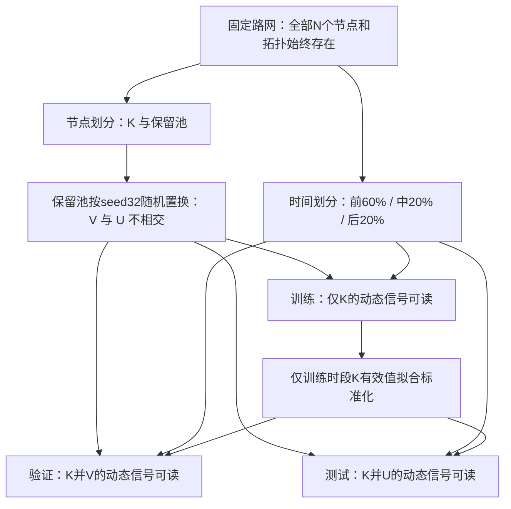
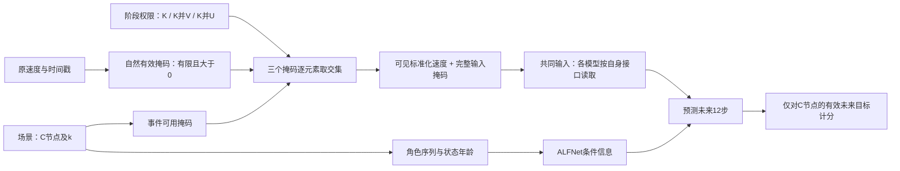
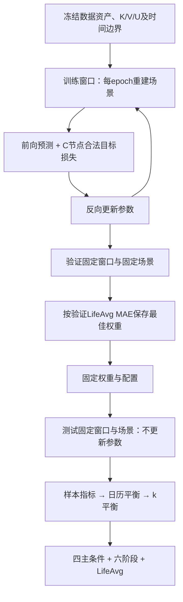
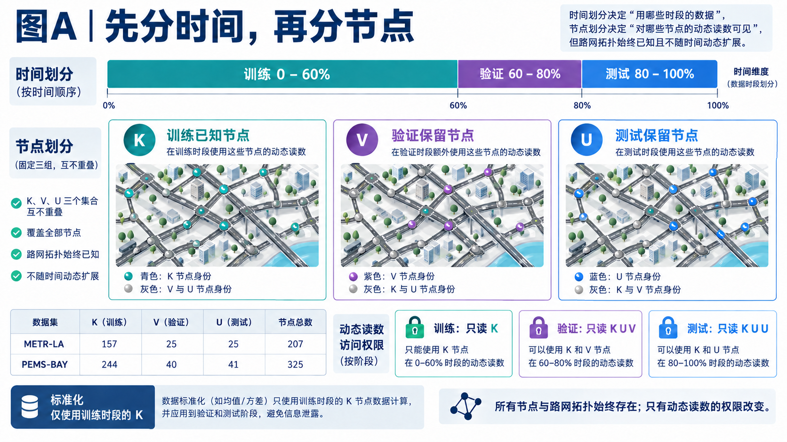
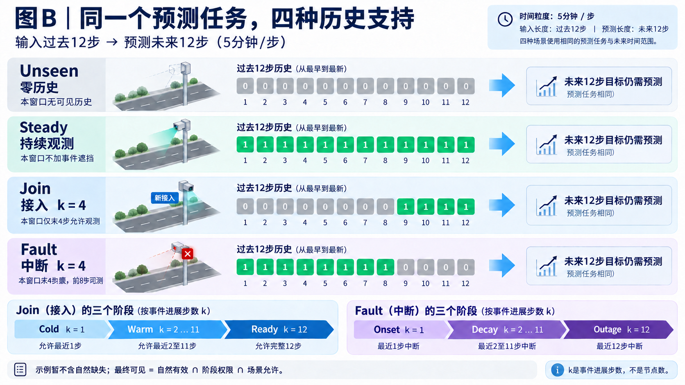
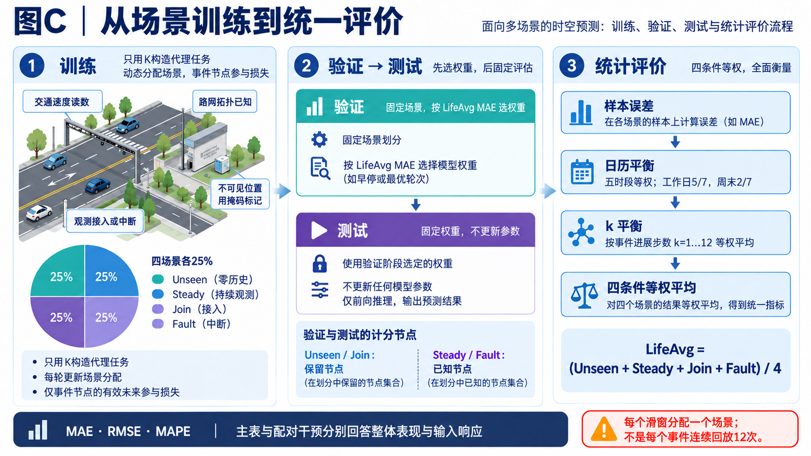

# ALFNet 实验协议说明：从问题定义到训练、验证与测试

## 1. 先用一句话说明我们在做什么

**路网位置和连接已知，但并非所有位置的交通读数都参与训练；部署时，一个位置能提供的历史读数还会随加入、持续运行或中断而变化。我们预测这些位置未来一小时的交通速度。**

这里有两个不同的问题，必须同时说明：

- **训练信号覆盖不足**：某些节点的任何训练期速度都不能用于模型学习。测试这些节点，才涉及本文的信号归纳泛化。
- **当前窗口的支持变化**：某个节点过去一小时可能全有、全无，或只保留部分读数。它决定这一次预测能利用什么信息。

节点可以“从未参与训练，但推理时已有几步观测”，也可以“参与过训练，但当前一小时全部中断”。所以，**训练身份不是观测状态，观测状态也不是永久的节点类别。**

我们不删除物理节点，不模拟道路拓扑扩张，也不在接入时更新模型参数。生命周期是构造变化观测支持的实验场景，不是预测传感器寿命的任务。

## 2. 数据如何进入实验

| 项目 | METR-LA | PEMS-BAY |
|---|---:|---:|
| 节点数 N | 207 | 325 |
| 时间点数 T | 34,272 | 52,116 |
| 采样间隔 | 5分钟 | 5分钟 |
| 输入／预测长度 | 12／12步 | 12／12步 |
| 训练已知节点 K | 157 | 244 |
| 验证保留节点 V | 25 | 40 |
| 测试保留节点 U | 25 | 41 |

为避免与时间长度 T 混淆，本文把测试保留节点记为 U；代码中相应字段为 `test_unseen`。

数据资产包含速度序列、时间戳、节点索引、有向加权邻接及位置坐标。当前载入文件有三个通道，模型任务只取清单指定的速度通道（索引2），不能把三个通道解释为三项预测目标。所有节点顺序与图、坐标一致。

**自然有效观测的实现定义为：有限且大于0。** 非有限值、零值及负值均作为不可用读数。这是本项目现有数据处理约定，不是“交通速度在物理上不能为零”的判断；也意味着报告指标没有覆盖被这一约定排除的零值。

均值和标准差只用训练时段 K 节点的有效速度计算。不可见输入在标准化后置零，并同时保留掩码；这里的零是训练均值的占位，不是实际速度为0，也不代表观测存在。模型可利用图传播形成不可观测节点表示，但不能把这些节点隐藏的真实读数重新填回输入。

## 3. 两个互相独立的划分：时间与节点

### 3.1 时间轴：严格按先后切分

时间比例为60%／20%／20%，不是旧图中的50%／10%／40%。边界用整数截断，索引区间左闭右开：

| 数据集 | 训练时段 | 验证时段 | 测试时段 |
|---|---|---|---|
| METR-LA | [0,20563) | [20563,27417) | [27417,34272) |
| PEMS-BAY | [0,31269) | [31269,41692) | [41692,52116) |

每个样本需要连续24步，前12步输入、后12步目标；这24步必须全部位于对应时间段内，不能从训练尾部借历史给第一个验证窗口。滑动步长为1。若当前阶段允许读取的节点在整个24步中完全没有自然观测，则窗口被排除；因此“每5分钟滑动”不等于所有候选窗口一定进入有效统计。

代码的 `origin` 是输入窗口起点 s，而不是最后观测时刻。若令预测起点为 t=s+11，则输入为 [t−11,t]，目标为 [t+1,t+12]。

### 3.2 节点轴：K、V、U互不相交

K 是训练已知节点。清单内保存的 `unknown_nodes.npy` 是保留节点总池：METR-LA为50个，PEMS-BAY为81个。当前代码将该池排序后按 seed32 随机置换，前 `floor(池大小/2)` 个划入 V，其余划入 U。**不是40%／60%，也不是在此步骤按图度分层。** 原始保留池的生成来源与当前二次划分是两件事，不能仅凭场景采样存在度分层，就声称整个节点划分经过度分层。

**图1　时间与节点的双重隔离。** 图拓扑可见不等于动态信号可见；“可读”只是阶段允许的上限，还需经过自然缺失和本次场景掩码。

| 阶段 | 所有N个节点及图是否存在 | 输入信号允许范围 | 场景监督／计分节点 |
|---|---|---|---|
| 训练 | 是 | K | 本次选中的K节点 |
| 验证 | 是 | K∪V | Unseen／Join取V；Steady／Fault取K |
| 测试 | 是 | K∪U | Unseen／Join取U；Steady／Fault取K |

例如，测试中的某个 U 节点可以接受邻居 K 的消息，也可以在 Join 场景中暴露最近几步自己的速度；但它的训练期速度从未作为训练信号。V 节点在测试时仍在图上，其动态信号被屏蔽，不充当额外观测源。

## 4. 一个窗口如何生成四种观测场景

每个窗口先选一个场景，再选本次参与事件与评价的节点集合 C（cohort）。场景只修改 C 的历史可用性。**不是每次都把全图所有节点变成同一种状态。** 非C节点仍按阶段允许范围和自然缺失提供上下文。

| 场景 | 对C历史做什么 | 训练时C来自 | 验证／测试时C来自 | 回答什么 |
|---|---|---|---|---|
| Zero-history／Unseen | 整个输入窗口隐藏 | K | V／U | 无本地历史能否预测 |
| Steady | 不加事件遮挡 | K | K | 持续提供历史时如何预测 |
| Join | 只允许最近k步 | K | V／U | 历史逐步积累时如何预测 |
| Fault | 隐藏最近k步 | K | K | 历史逐步中断时如何预测 |

训练中的 Zero-history 是**训练已知节点的零历史代理任务**。模型可能在其他训练窗口见过这个节点，所以不能把它等同于真正的未见节点泛化。验证／测试的 Unseen 才在对应保留节点上计分。

### 4.1 k的精确定义

`k=evidence_steps`，范围1到12，表示事件在输入窗口内已影响的步数。Join 中是允许接入的最近k步，Fault 中是已中断的最近k步。它不是节点数、空间邻居数、专家数，也不是预测长度。自然缺失存在时，Join 的实际有效观测数可以小于k。

以下假设没有自然缺失；从左到右为最旧到最新，1是允许观测，0是事件隐藏：

| 状态 | k | 12步事件可用掩码 | 对应阶段 |
|---|---:|---|---|
| Unseen | 不适用 | `000000000000` | 主条件，无六阶段标签 |
| Steady | 不适用 | `111111111111` | 主条件，无六阶段标签 |
| Join | 1 | `000000000001` | Cold |
| Join | 4 | `000000001111` | Warm |
| Join | 12 | `111111111111` | Ready |
| Fault | 1 | `111111111110` | Onset |
| Fault | 4 | `111111110000` | Decay |
| Fault | 12 | `000000000000` | Outage |

**六阶段是两个过程各自的细分，不是一条六状态生命周期链。** Cold／Warm／Ready属于Join，Onset／Decay／Outage属于Fault。Warm与Decay对应k=2…11；Cold有1步允许观测，零历史应叫Unseen。Ready只说明接入已覆盖12步，不代表模型经过在线适应，也不保证自然观测完整。

### 4.2 同一个掩码可以有不同的状态含义

Unseen与Outage的事件掩码都可以全0，但前者表示无历史可读的节点，后者表示已知节点中断；Ready与Steady都可全1，但前者仍属于加入过程。代码将角色和状态年龄与自然掩码分开构造：

- 持续活跃：AAS，年龄为1。
- 未观测：VS，年龄为0。
- Join最后k步：NAS，年龄依次为1/12、2/12、…、k/12；之前为VS。
- Fault最后k步：FS，年龄依次为1/12、…、k/12；之前为AAS、年龄1。

这里的年龄是事件进展的标准化编码，不是传感器服役年限，也不是“距上次自然有效读数的时间”。一处自然缺失不会自动把活跃节点改标为Fault。

**图2　从原始数据到观测支持。** 对节点i和时刻u，最终输入可用性为 `自然有效(u,i) AND 阶段允许(i) AND 事件允许(u,i)`。角色年龄来自协议，不读取未来速度；基线不接入ALFNet专属状态编码、重建或调制模块。

### 4.3 用一个自然缺失例子检查理解

令C中某节点Join、k=4，事件掩码为 `000000001111`。假设自然掩码为 `111111111011`（第10步缺失），阶段允许该节点，则最终输入掩码为 `000000001011`。该样本仍是Warm、k=4，但实际观测数q=3。第10步角色仍为NAS，年龄仍为2/12；不会因为自然缺失重置加入年龄。

如果未来第2步也自然缺失，该位置不计分；其他有效未来仍可以计分。**输入不可见不意味着未来目标不计分**，否则Unseen和Outage便失去评价意义。

## 5. 怎样选场景、事件规模和空间位置

训练、验证、测试使用相同场景规则。四种场景的全局配额各25%，有限样本按整数配额分配，不要求每个batch恰好四等分。Join、Fault内部的k=1…12做均衡分配，日历层内及全局尽量均衡；各k数量最大差不超过1。训练每epoch按seed和epoch重建场景分配，窗口和节点集合不变；验证与测试的场景按固定设计种子12026、epoch0生成。

### 5.1 日历分层

以输入最后一步时间戳标记日历层。工作日／周末各分五段，共10层：

| 时段 | 实际小时区间 |
|---|---|
| EarlyAM | [00:00,07:00) |
| AMPeak | [07:00,10:00) |
| Midday | [10:00,16:00) |
| PMPeak | [16:00,19:00) |
| Evening | [19:00,24:00) |

它们不是旧图中的五个等长时段。这样可以覆盖早晚高峰及其他时段，又避免工作日与周末被混成同一维度。

### 5.2 事件规模与空间结构

事件规模有全图N的2.5%、5%、10%三档，分配权重分别为0.25、0.50、0.25。人数按 `max(1, round(N×比例))` 取整，并受当前可选节点池大小限制：METR-LA对应5／10／21个，PEMS-BAY对应8／16／32个。百分比的分母是全图节点数，不是当前可见节点数。

空间模式分为约50%的聚集与50%的分散。拓扑分析使用全图去自环后的绝对边权入出度之和；按候选池节点的全图度排序分为低、中、高三档。两种模式都尽量保持度档配额及节点参与次数均衡，聚集模式额外优先选全图跳数距离较近的节点。用于跳数分析的无向结构不替换模型传播使用的原有向加权邻接。

这些配额在日历、场景及适用的k层内分配，整数取整意味着小单元无法严格实现所有比例。它们是覆盖不同实验条件的采样安排，不代表真实故障率，也不是额外的模型输入。

## 6. 训练、验证与测试分别做什么

**图3　训练与评价流程。** 验证／测试可复现，是因为各自时间段、节点权限、场景构造规则和种子固定；它们不是共享同一批观测样本。

训练只对C节点且未来自然有效、阶段合法的位置计算预测损失；不是对全图所有输出统一监督。训练期允许使用教师强制，但还受到样本末步可见性与合法未来目标的限制；比例在前40轮衰减。验证、测试均关闭教师强制，未来真值只交给损失和评价端，不能作为推理输入。

每个滑窗在当前schedule内分配一个场景，Join／Fault各有一个k。相邻滑窗可对应不同事件节点、不同k，不应当画成同一真实传感器事件的连续跟踪。验证／测试固定该分配，保证模型之间和epoch之间可比较。旧版“每个事件起点回放k=1…12”的LCE示意不能用来描述当前主表的数据采样。

代码仍提供Join→Zero-history、Fault→Steady的配对反事实接口，它可以固定窗口和C产生对照，但**接口存在不代表主表每行都来自这种配对**。当前论文单独的观测干预图使用专门的已归档配对分析，不与主表采样方式混用。

## 7. 怎样从预测得到论文表格

对一个窗口，只汇总C节点、12个预测步中掩码合法的目标。预测与目标恢复原速度尺度，得到该窗口的MAE、RMSE、MAPE。随后：

1. 在同一主条件、同一k、同一日历层内，平均各有效窗口的指标。
2. 同一天类型内五个时段等权；工作日与周末按5/7、2/7加权。缺失日历层剔除并重归一化。
3. Join／Fault对k=1…12的有效结果等权平均。阶段表分别只汇总k=1、k=2…11、k=12。
4. 四个主条件等权平均得到LifeAvg。

因此，`LifeAvg=(Unseen+Steady+Join+Fault)/4`。**它不是所有预测单元直接混合后的微平均。** RMSE是在样本层先开方再逐层平均，也不同于合并全体平方误差后开方。Warm包含10个k，故Join不能用Cold、Warm、Ready三者简单等权平均；在k齐全时应按1:10:1组合。Fault同理。

正式汇总为 `(4个主条件+LifeAvg+6个阶段)×3个指标=33个数值`。WorstGroup已不属于当前主表。33格相互有关联，不能当成33次独立实验。

## 8. 主结果与配对支持分析的区别

| 内容 | 主表／阶段表 | 当前论文图3、4、6对应分析 |
|---|---|---|
| 样本 | 对应阶段的合法滑窗，分配场景 | 筛选历史和未来自然完整的配对窗口 |
| 节点 | Unseen／Join为保留节点；另两类为K | 正文聚焦64个已知节点窗口 |
| 变量 | 场景、k、事件节点均由schedule决定 | 固定目标、非干预上下文，仅改焦点节点支持 |
| 指标 | 日历与k平衡的LifeAvg及阶段指标 | 配对窗口平均误差、残差分布 |
| 用途 | 归纳设置下的整体与条件表现 | 解释支持改变时的预测响应 |

配对数量—布局实验中q是实际保留的历史读数数，取0／3／6／9／12；角色与年龄固定为成熟活跃。它与自然缺失叠加下的主协议k不是同一变量。正文已知节点的“加入”干预也不能称为未见节点冷启动。完整保留节点配对结果已有独立记录，不能用已知节点结论替代。

## 9. 对三张旧图的逐项核验

| 旧图 | 可保留的思想 | 需要纠正的内容 |
|---|---|---|
| 图一：Introduction与模型示意 | 同一节点的可用历史随时间变化 | 不应概括所有已有方法为静态二分；六阶段名称错配，Cold不等于零历史，Adapted不是当前阶段；当前模型不采用“时间预测残差受预算修正图锚点”的路径 |
| 图二：训练设置 | 标准化只见训练时段K；四类代理任务；规模／空间／日历覆盖 | 时间比例改60/20/20；节点池划分改近半；不声称池划分按度分层；k不是同一窗口内同时跨越Cold到Ready的时间标签；自然缺失要独立画出 |
| 图三：评价设置 | 同目标配对比较的原则；k=4的理想Join／Fault掩码 | 主表不是逐事件12次连续回放；五时段改真实边界；删除WorstGroup；验证测试各自冻结，不能写共用同一事件manifest；训练身份与场景状态分开 |

当前方法的信息流是：共享历史重建向ALFGraph与ALFTemporal提供输入；ALFTemporal生成条件表示，经FiLM调制图循环预测，形成单一预测输出。旧图的独立时间候选、预算门控残差修正、已适应状态，不能继续作为当前实现说明。

文档中的三张Mermaid图是针对协议重新绘制的矢量流程图，可在支持Mermaid的Markdown阅读器中显示；掩码表用于精确表达12步样本，避免装饰性图片造成数值与方向错误。原三张图片不作为当前协议图复用。

## 10. 向导师口头讲解的顺序

以下三张图用于现场汇报，建议合计约5分钟。图A／B／C是协议讲解图，不使用论文图1–6的编号。前文的公式、掩码和代码说明用于导师会后查阅。

### 10.1 图A：先解释“没见过训练信号”是什么意思（约90秒）

**指图顺序：上方时间轴 → 中间三类节点 → 下方读取权限 → 标准化。** 中间路网是节点身份示意，实际动态读取权限以下方三个卡片为准。

“首先有两个独立划分。上面是时间，按先后分为60%训练、20%验证、20%测试。每次预测都用本时段内的过去12步预测未来12步，不跨边界借数据。

中间是节点。K是参与动态信号训练的位置，V是验证保留位置，U是测试保留位置。比如METR-LA共207个节点，其中157个属于K，25个属于V，25个属于U。三组互不重叠。

整张路网一直存在，改变的是读数权限：训练只读K；验证可以读K加V；测试可以读K加U。因此，所谓未见节点，是它的动态信号没有参与训练，并不是模型从来不知道这个路口存在。

标准化也只由训练时段的K节点计算。这一步保证验证、测试位置的速度不进入训练统计。下面再在这些权限之内加入具体场景，决定本次窗口究竟能读到哪些历史。”

**导师若问：测试节点为什么能提供历史？** “没有训练信号”与“预测时没有输入”不同。Join就是测试保留节点开始提供几步历史，而Unseen在整个输入窗口隐藏该节点。

### 10.2 图B：拿12步掩码解释四类观测支持（约2分钟）

**指图顺序：统一12→12任务 → 四行掩码 → Join与Fault两组阶段 → 底部掩码交集。** 数字从最旧到最新，1表示事件允许观测，0表示事件遮挡；这是排除自然缺失后的理想示例。

“无论输入怎样变化，我们都预测未来一小时。第一行Unseen把过去12步全部隐藏；第二行Steady不施加事件遮挡。

第三行Join以k=4为例，前8步隐藏，只允许最后4步。第四行Fault相反，前8步仍可用，最后4步中断。所以k表示事件在窗口内的进展，不是节点数。

下面的六阶段不是一条连续链。Join的k=1叫Cold，2到11叫Warm，12叫Ready；Fault的k=1叫Onset，2到11叫Decay，12叫Outage。Cold已有1步允许观测，不能叫零历史；Ready也只表示12步都落在接入后，不表示重新训练或适应完成。

图上还没叠加自然缺失。真正输入是自然有效、阶段允许和事件允许三个条件的交集。比如Join允许最近4步，其中又有一步自然缺失，实际只能用3步，但事件年龄仍然按4步进展编码。

这些遮挡作用于本次选中的一小组节点，其他合法节点仍提供空间上下文。训练时用K节点模拟零历史和接入，验证、测试时则在对应保留节点上考察这两种场景。因此，训练代理任务与真正的归纳评价是分开的。”

**导师若问：无历史怎么计算误差？** 输入被隐藏不代表未来真实目标被删除；我们仍用这些节点自然有效的未来读数评价预测，真值只在监督／计分端使用。

### 10.3 图C：说明怎样训练、选权重与统计（约90秒）

**指图顺序：训练四场景 → 验证选点 → 固定模型测试 → 右侧指标聚合。** 箭头展示计算流程，不表示测试在整个研究过程中仅被访问过一次；研究历史见第11节。

“训练中四种场景各占约四分之一，每轮重新分配，但数据划分和节点身份不变。每个滑窗只分配一种场景和一个k，并不是把每个真实事件连续播放12遍。事件规模覆盖全图约2.5%、5%和10%的节点，同时考虑聚集、分散以及不同日历时段。

验证使用固定场景，按LifeAvg MAE保存权重；测试固定权重、不更新参数。验证和测试都让Unseen和Join在各自保留节点上计分，Steady和Fault在K节点上计分。

右边是汇总顺序。先算一个窗口内事件节点的误差，再按日历与k平衡，最后对四类条件等权平均，形成LifeAvg。它不是把所有节点和所有误差直接混在一起，所以不会仅由常规持续观测样本决定排名。

在这套整体评价之外，我们还固定同一节点、同一真实未来，只改变历史支持，做配对分析。主表回答在统一协议下能不能预测好，配对图回答模型面对信息变化时怎样响应。接下来我就按这两种证据介绍论文结果。”

### 10.4 汇报材料入口

协议讲完后，接 [论文汇报讲稿](advisor_paper_talk_cn.md)，顺序为引言 → 三方向相关工作 → ALFNet信息流 → 主表 → 条件图 → 消融 → 轨迹／布局 → 敏感性 → 残差图。三张原尺寸PNG在 `paper/advisor_figures/`，可直接插入幻灯片；完整生成提示词与检查记录见 [图片说明](advisor_figures/README.md)。

## 11. 评价历史与证据范围

以上是数据暴露和固定场景评价的代码协议。它不自动保证整个研究过程从未根据测试反馈调整过配置。现有研究记录显示，测试结果可见后曾开展PEMS-BAY容量调整及METR-LA候选测试比较；因此目前结果属于包含测试反馈的探索性开发过程，不能向导师描述为全过程只使用一次测试集的独立确认。当前结果也主要为seed32，不等于多种子均值。这个历史事实与“加载器是否发生非法信号暴露”应分别讨论。

## 12. 关键实现依据

- [v4协议常量](../lib/lcbt_v4.py)：60/20/20、滑窗步长、训练场景比例、教师强制。
- [运行上下文](../lib/runtime_context.py)：节点池二次划分、K/V/U权限和静态图资产。
- [数据加载器](../data_provider/v4_lifecycle_loader.py)：自然有效值、标准化、窗口、掩码、场景节点池、角色与年龄。
- [场景调度](../data_provider/v4_schedule.py)：k均衡、事件规模、空间聚集与图度分层。
- [日历定义](../data_provider/calendar_strata.py)：五时段和5/7、2/7权重；其中历史事件选择函数不能直接等同当前v4主表路径。
- [评价收集器](../experiments/v4_validation_collector.py)与[指标聚合](../data_provider/v4_metrics.py)：样本、日历、k与LifeAvg的汇总。
- [数据清单](../configs/paper/v4_data_manifests/)：节点规模、目标通道和保留节点资产。清单中的旧readiness或布局默认字段不替代当前运行配置。
- [当前方法前向](../model/ALFNet/ALFNet.py)：共享重建与FiLM条件化关系。

本次仅核对代码、静态节点索引及已有报告，未载入新的测试速度样本，未训练或重新评价模型。
