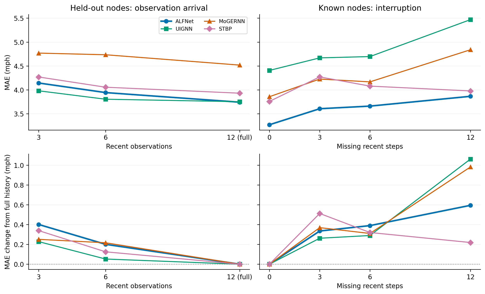
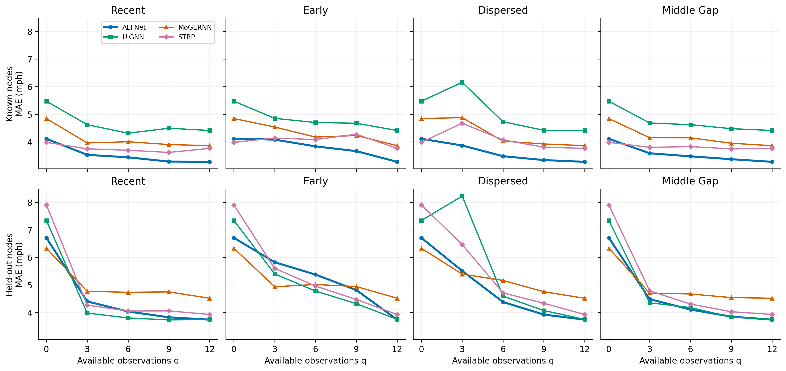
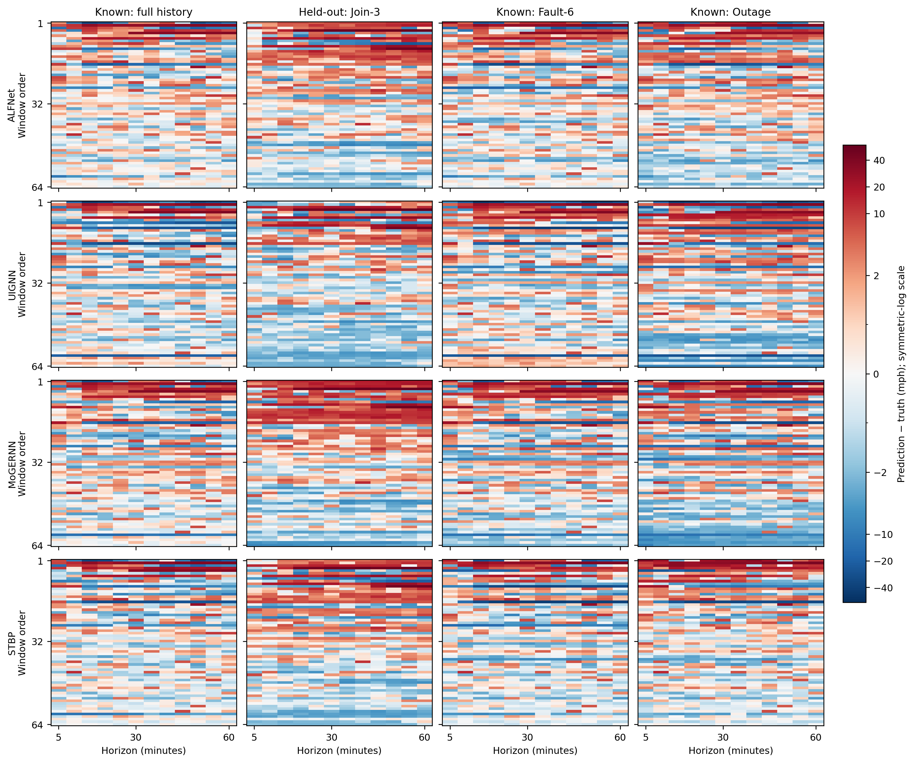

# 实验补充材料

正文图3、图4和图6复用已完成的最终模型配对预测，聚焦已知节点；保留节点结果与完整分组图见 A.11、A.13，本次排版未重新推理。以下 A.1–A.6 保留历史 Full 配方的验证集分析与图像，不作为最终 Focal 模型的结果。

## A.1 观测条件的完整指标

**表 A1　METR-LA 四个主条件及六个阶段的绝对误差。** 最优基线按条件和指标分别确定，误差降低为（基线误差 − ALFNet 误差）/基线误差。保留逐条件最优基线比较作为正文的补充；其参照可随单元格改变，与正文图 2 固定使用 MoGERNN 的口径不同。

| 条件 | 指标 | ALFNet↓ | 最优基线 | 基线值↓ | 误差降低(%)↑ |
|---|---|---:|---|---:|---:|
| Unseen | MAE | 6.609 | MoGERNN | 6.744 | 2.00 |
| Unseen | RMSE | 9.021 | MoGERNN | 9.193 | 1.87 |
| Unseen | MAPE | 20.274 | MoGERNN | 19.690 | -2.97 |
| Steady | MAE | 3.447 | STBP | 3.441 | -0.18 |
| Steady | RMSE | 5.376 | STBP | 5.630 | 4.51 |
| Steady | MAPE | 10.173 | STBP | 9.542 | -6.61 |
| Join | MAE | 4.426 | FCLSTM | 4.257 | -3.95 |
| Join | RMSE | 6.630 | STID | 6.969 | 4.86 |
| Join | MAPE | 15.539 | FCLSTM | 13.721 | -13.25 |
| Fault | MAE | 4.071 | STBP | 4.135 | 1.56 |
| Fault | RMSE | 6.200 | STBP | 6.557 | 5.44 |
| Fault | MAPE | 12.520 | STBP | 12.661 | 1.11 |
| Cold | MAE | 5.341 | FCLSTM | 4.727 | -12.99 |
| Cold | RMSE | 7.462 | STID | 7.503 | 0.54 |
| Cold | MAPE | 19.424 | STGODE | 16.170 | -20.12 |
| Warm | MAE | 4.361 | FCLSTM | 4.197 | -3.91 |
| Warm | RMSE | 6.564 | STID | 6.885 | 4.67 |
| Warm | MAPE | 15.338 | FCLSTM | 13.508 | -13.54 |
| Ready | MAE | 4.155 | FCLSTM | 4.393 | 5.42 |
| Ready | RMSE | 6.467 | STBP | 7.197 | 10.16 |
| Ready | MAPE | 13.662 | FCLSTM | 12.736 | -7.27 |
| Onset | MAE | 3.439 | STBP | 3.578 | 3.89 |
| Onset | RMSE | 5.487 | STBP | 5.844 | 6.11 |
| Onset | MAPE | 10.371 | STBP | 10.490 | 1.14 |
| Decay | MAE | 4.095 | STBP | 4.164 | 1.65 |
| Decay | RMSE | 6.219 | STBP | 6.580 | 5.48 |
| Decay | MAPE | 12.699 | STBP | 12.755 | 0.44 |
| Outage | MAE | 4.462 | STBP | 4.409 | -1.20 |
| Outage | RMSE | 6.727 | STBP | 7.040 | 4.44 |
| Outage | MAPE | 12.881 | MoGERNN | 13.138 | 1.95 |

## A.2 分节点群体的观测轨迹干预

固定节点划分包含 157 个训练已知节点、25 个验证保留节点和 25 个测试保留节点。训练信号来自已知节点集；验证可以使用已知节点和验证保留节点的合法历史，后者的动态信号不参与训练。模型可见全部物理拓扑，因此这里的归纳约束针对动态信号暴露。

既有配对样本中，原 Join 调度选取的 64 个窗口均来自验证保留节点，覆盖 23 个节点；原 Fault 调度选取的 64 个窗口均来自训练已知节点，覆盖 53 个节点。正文图 3 使用前一子集，图 A1 使用后一子集。来源标签用于识别节点群体，各群体内均施加全部六种支持轨迹，不随干预更改节点划分。两组各有 64 个不同历史起点，图中报告描述性均值，不据此作统计显著性判断。

**表 A2　METR-LA 配对轨迹干预的分群三指标结果。** 两类节点分开汇总，每个群体的六种条件使用相同的 64 个窗口。RMSE 由窗口与预测步的平方误差统一开方计算。MoGERNN 是外部比较基线，Mask-only 是 ALFNet 内部机制控制。

| 节点群体 | 轨迹 | 模型 | MAE↓ | RMSE↓ | MAPE(%)↓ |
|---|---|---|---:|---:|---:|
| 验证保留 | Full | ALFNet | 3.713 | 7.940 | 15.821 |
| 验证保留 | Full | MoGERNN | 4.518 | 8.782 | 18.169 |
| 验证保留 | Full | Mask-only | 3.574 | 7.423 | 14.153 |
| 验证保留 | Join-3 | ALFNet | 4.146 | 8.231 | 17.255 |
| 验证保留 | Join-3 | MoGERNN | 4.769 | 8.834 | 18.290 |
| 验证保留 | Join-3 | Mask-only | 4.286 | 8.139 | 16.307 |
| 验证保留 | Join-6 | ALFNet | 4.029 | 8.244 | 17.080 |
| 验证保留 | Join-6 | MoGERNN | 4.734 | 8.870 | 18.495 |
| 验证保留 | Join-6 | Mask-only | 3.904 | 7.825 | 15.321 |
| 验证保留 | Fault-3 | ALFNet | 4.233 | 8.305 | 17.589 |
| 验证保留 | Fault-3 | MoGERNN | 4.942 | 8.992 | 18.980 |
| 验证保留 | Fault-3 | Mask-only | 4.408 | 8.609 | 18.157 |
| 验证保留 | Fault-6 | ALFNet | 4.428 | 8.366 | 18.143 |
| 验证保留 | Fault-6 | MoGERNN | 5.016 | 8.909 | 18.571 |
| 验证保留 | Fault-6 | Mask-only | 4.845 | 8.947 | 19.593 |
| 验证保留 | Outage | ALFNet | 6.266 | 10.030 | 23.007 |
| 验证保留 | Outage | MoGERNN | 6.331 | 10.033 | 21.662 |
| 验证保留 | Outage | Mask-only | 6.840 | 10.698 | 24.812 |
| 训练已知 | Full | ALFNet | 3.196 | 6.289 | 7.924 |
| 训练已知 | Full | MoGERNN | 3.857 | 7.486 | 9.505 |
| 训练已知 | Full | Mask-only | 3.286 | 6.587 | 8.215 |
| 训练已知 | Join-3 | ALFNet | 3.350 | 6.416 | 8.258 |
| 训练已知 | Join-3 | MoGERNN | 3.956 | 7.681 | 9.644 |
| 训练已知 | Join-3 | Mask-only | 3.449 | 6.604 | 8.408 |
| 训练已知 | Join-6 | ALFNet | 3.228 | 6.257 | 8.001 |
| 训练已知 | Join-6 | MoGERNN | 3.999 | 7.725 | 9.698 |
| 训练已知 | Join-6 | Mask-only | 3.314 | 6.587 | 8.223 |
| 训练已知 | Fault-3 | ALFNet | 3.437 | 6.609 | 8.587 |
| 训练已知 | Fault-3 | MoGERNN | 4.226 | 8.119 | 10.185 |
| 训练已知 | Fault-3 | Mask-only | 3.782 | 6.807 | 9.253 |
| 训练已知 | Fault-6 | ALFNet | 3.628 | 6.891 | 9.022 |
| 训练已知 | Fault-6 | MoGERNN | 4.167 | 7.719 | 10.165 |
| 训练已知 | Fault-6 | Mask-only | 3.897 | 6.879 | 9.463 |
| 训练已知 | Outage | ALFNet | 4.031 | 7.170 | 9.779 |
| 训练已知 | Outage | MoGERNN | 4.839 | 8.120 | 11.217 |
| 训练已知 | Outage | Mask-only | 4.097 | 6.853 | 9.931 |

**图 A1　训练已知节点上的配对观测轨迹干预。** 面板顺序与正文图 3 相同，分别显示支持轨迹、ALFNet 与 MoGERNN 的 MAE、完整 ALFNet 相对于 Mask-only 的 MAE 降低比例。本图使用独立于正文保留节点子集的 64 个已知节点窗口。

验证保留节点在 Outage 下的预测误差高于训练已知节点，且 ALFNet 相对于 MoGERNN 的收益明显收窄。群体间差异说明，是否具备节点训练信号会影响观测中断条件下的表现；将两类节点直接混合会掩盖归纳预测的边界。原 128 窗口汇总保留在结果文件中，未用于正文图 3。

## A.3 可用观测数量与时间布局

令历史位置 \(i=0,\ldots,11\) 按从早到近排列，对应预测前第 12 步至第 1 步。1 表示可用观测，0 表示隐藏观测。实际生成规则为：

- Recent：保留 \(i\geq12-q\) 的位置。
- Early：保留 \(i<q\) 的位置。
- Dispersed：保留 \(i=\lfloor(j+0.5)12/q\rfloor\)，其中 \(j=0,\ldots,q-1\)；\(q=0\) 时全部隐藏。
- Middle gap：从全可见窗口出发，将起点为 \(\lfloor q/2\rfloor\)、长度为 \(12-q\) 的连续区间设为 0。因此，奇数 q 时两端保留观测数相差 1。

**表 A3（a）　实际代码生成的 12 步掩码。** 每个示例中的 1 的数量严格等于 q；实验输入再与自然可用掩码取交集。所选窗口自然历史完整，因此交集后观测数仍为 q。

| q | Recent | Early | Dispersed | Middle gap |
|---:|---|---|---|---|
| 3 | `000000000111` | `111000000000` | `001000100010` | `100000000011` |
| 6 | `000000111111` | `111111000000` | `010101010101` | `111000000111` |
| 9 | `000111111111` | `111111111000` | `101110111011` | `111100011111` |

**表 A3（b）　METR-LA 的 q × 时间布局完整结果。** 与轨迹干预使用相同窗口，但保持成熟活跃角色不变，只改变实际可用观测位置。各 q 的 Recent、Early、Dispersed 和 middle_gap 分别表示近期、早期、分散观测和中间连续缺口。共同端点只计一次；Mask-only 为额外控制。

| q | 布局 | 模型 | MAE↓ | RMSE↓ | MAPE(%)↓ |
|---:|---|---|---:|---:|---:|
| 0 | 共同端点 | ALFNet | 5.365 | 9.078 | 17.014 |
| 0 | 共同端点 | MoGERNN | 5.585 | 9.126 | 16.440 |
| 0 | 共同端点 | Mask-only | 5.469 | 8.984 | 17.371 |
| 3 | recent | ALFNet | 3.911 | 7.528 | 13.059 |
| 3 | recent | MoGERNN | 4.362 | 8.278 | 13.967 |
| 3 | recent | Mask-only | 3.867 | 7.411 | 12.357 |
| 3 | early | ALFNet | 4.727 | 8.243 | 15.159 |
| 3 | early | MoGERNN | 4.735 | 8.618 | 14.306 |
| 3 | early | Mask-only | 4.675 | 8.209 | 15.403 |
| 3 | dispersed | ALFNet | 4.628 | 8.228 | 14.882 |
| 3 | dispersed | MoGERNN | 5.133 | 8.779 | 15.696 |
| 3 | dispersed | Mask-only | 4.793 | 8.170 | 14.545 |
| 3 | middle_gap | ALFNet | 3.857 | 7.311 | 12.600 |
| 3 | middle_gap | MoGERNN | 4.424 | 8.309 | 14.172 |
| 3 | middle_gap | Mask-only | 3.891 | 7.260 | 12.165 |
| 6 | recent | ALFNet | 3.743 | 7.417 | 12.705 |
| 6 | recent | MoGERNN | 4.367 | 8.317 | 14.096 |
| 6 | recent | Mask-only | 3.609 | 7.233 | 11.772 |
| 6 | early | ALFNet | 4.447 | 8.010 | 14.543 |
| 6 | early | MoGERNN | 4.592 | 8.335 | 14.368 |
| 6 | early | Mask-only | 4.371 | 7.981 | 14.528 |
| 6 | dispersed | ALFNet | 3.818 | 7.452 | 12.460 |
| 6 | dispersed | MoGERNN | 4.592 | 8.543 | 15.501 |
| 6 | dispersed | Mask-only | 3.956 | 7.530 | 12.589 |
| 6 | middle_gap | ALFNet | 3.652 | 7.219 | 12.207 |
| 6 | middle_gap | MoGERNN | 4.407 | 8.272 | 14.028 |
| 6 | middle_gap | Mask-only | 3.682 | 7.255 | 11.845 |
| 9 | recent | ALFNet | 3.563 | 7.270 | 12.292 |
| 9 | recent | MoGERNN | 4.323 | 8.344 | 14.160 |
| 9 | recent | Mask-only | 3.516 | 7.185 | 11.556 |
| 9 | early | ALFNet | 4.099 | 7.706 | 13.743 |
| 9 | early | MoGERNN | 4.584 | 8.567 | 14.582 |
| 9 | early | Mask-only | 4.095 | 7.760 | 13.705 |
| 9 | dispersed | ALFNet | 3.533 | 7.101 | 11.905 |
| 9 | dispersed | MoGERNN | 4.337 | 8.321 | 14.770 |
| 9 | dispersed | Mask-only | 3.578 | 7.161 | 11.547 |
| 9 | middle_gap | ALFNet | 3.525 | 7.150 | 11.978 |
| 9 | middle_gap | MoGERNN | 4.244 | 8.182 | 13.869 |
| 9 | middle_gap | Mask-only | 3.530 | 7.047 | 11.325 |
| 12 | 共同端点 | ALFNet | 3.455 | 7.163 | 11.872 |
| 12 | 共同端点 | MoGERNN | 4.187 | 8.160 | 13.837 |
| 12 | 共同端点 | Mask-only | 3.430 | 7.017 | 11.184 |

所有 q/布局的掩码均从自然可用观测中删减得到。选择完整历史窗口使各组合可以在相同样本上比较，但同时限制了结论的适用人群。图 4 与表 A3（b）沿用 128 个窗口的均衡总体：已知节点与保留节点各 64 个。它们描述数量与布局对两类节点的总体响应，不与图 3 的保留节点均值混用。完整数据同时保留两类节点的分组结果。

## A.4 预测案例

**图 A2　METR-LA 不同观测支持条件下的预测示例。** 黑点为实际可用历史，灰色阴影为不可观测位置，黑线为真实未来，蓝线与橙线分别为 ALFNet 和 MoGERNN。案例沿用既有分析中按固定规则选取的八个窗口，未按预测收益重新筛选。本图展示具体预测形态，配对轨迹响应由正文图 3 单独分析。

这些案例同时包含预测较好的情形与误差仍较大的情形。例如，Steady 与 Onset 案例中 ALFNet 更接近真实未来，而 Cold、Unseen 与 Outage 案例并未体现同样优势。由于案例对应不同节点和时刻，它们适合作为结果的直观补充，不用于归因观测支持的独立作用。

## A.5 跨数据集消融补充

**表 A4　PEMS-BAY 的替代式消融结果。** 指标与正文总体表采用相同 LifeAvg 口径。

| 模型 | LifeAvg MAE↓ | RMSE↓ | MAPE(%)↓ |
|---|---:|---:|---:|
| Full ALFNet | 3.040 | 4.638 | 7.996 |
| Mask-only | 3.020 | 4.630 | 7.885 |
| Static Propagation | 3.035 | 4.621 | 7.852 |
| Local Temporal Context | 3.339 | 4.987 | 8.547 |

Local Temporal Context 的三个综合指标均高于完整模型，与 METR-LA 的方向一致。Mask-only 与 Static Propagation 在 PEMS-BAY 的三个综合指标上略优于完整模型，但其 Join MAE 分别上升 6.54% 和 6.22%。这表明显式状态和条件化传播的收益随数据集及观测条件变化，正文的机制解释以实际观察到的条件性收益为依据。

## A.6 优化器参数分组

ALFNet 的优化器将共享历史重建器与 ALFGraph 分为一组，学习率为 \(5\times10^{-4}\)；ALFTemporal 单独一组，学习率为 \(10^{-4}\)。其余参数组的学习率为 \(5\times10^{-5}\)，实际包含 FiLM 调制头（`film_head`）、图输出修正模块（`graph_refiner`）及 `state_encoder`。当前前向过程虽计算 `state_encoder`，但其输出未用于最终预测，因此它不属于有效预测机制。正文采用参与预测的真实模块名称描述学习率，不将这一优化器分组称为独立的“条件化参数组”。

## A.7 PEMS-BAY最终测试与超参数补充

A.1–A.5旧数值仍属早期Full/validation，不与此节最终Focal/test混淆。最终两数据集10模型的完整四表保留在[test表](test_seed32_hparam_patch16_20260918/test_tables.md)，Excel、CSV和权重来源位于同目录。PEMS-BAY为Focal容量16，METR-LA仍容量8。

PEMS-BAY最终test主表15格中第一10格、第二4格；阶段18格中第一7格、第二6格。Fault与LifeAvg三指标均第一；Unseen RMSE次于UIGNN，Steady MAPE次于PatchSTG，Join三指标由ST-FiT领先。阶段中Onset/Decay三指标与Warm RMSE由ALFNet领先；Cold MAE/RMSE、Warm MAE/MAPE、Ready三指标由ST-FiT领先，Cold MAPE由UIGNN领先，Outage三指标由PatchSTG领先。

**PEMS-BAY 已完成结果。** 下表是 validation LifeAvg，固定 seed32 和其余配置；容量基准11，学习率倍率基准1。容量16是唯一通过预先固定门槛的候选：MAE 至少改善0.5%，RMSE/MAPE退化不超过0.5%，Unseen MAE退化不超过1%，Cold/Warm/Ready平均MAE不退化。结果来自[已核验超参数分析](hparams_pemsbay_20260917/RESULTS_ANALYSIS_20260920.md)。

| 配置 | MAE↓ | RMSE↓ | MAPE(%)↓ |
|---|---:|---:|---:|
| 原Focal，容量11／倍率1 | 2.964150 | 4.656433 | 7.733960 |
| 容量12 | 2.998468 | 4.704424 | 7.895783 |
| 容量14 | 2.970974 | 4.678924 | 7.840531 |
| 容量16 | **2.912363** | **4.578590** | **7.536298** |
| 学习率倍率0.5 | 2.987420 | 4.706672 | 7.855707 |
| 学习率倍率2 | 2.968604 | 4.677559 | 7.931256 |

容量16相对原配置的 validation 三指标降低1.75%、1.67%、2.56%，33格中31格改善；Onset MAE/RMSE分别退化约1.25%/1.23%。容量12和14没有带来一致提升，不能推断容量越大越好。两个学习率倍率都没有同时改善三指标。以上是有限范围、单种子的敏感性证据。

## A.8 历史METR-LA Full配方消融档案

以下从正文移入，保留原数值和解释，均为历史validation证据，不是最终Focal结果。新实验完成前不将其重命名或填入新表。

### 早期Full验证实验

**证据范围。** 本历史消融及正文4.5–4.6节来自早期 Full 训练配方与验证集，未按最终 Focal 目标重训或重评估。它们支持原配方下的机制观察，不能视作表1最终模型的配套 test 消融，也不能将其数值与最终 test 直接求差。

为考察观测状态、条件化传播和空间上下文各自的作用，在 METR-LA 上构造三种替代模型，保持预测任务和训练流程一致。

**Mask-only** 保留完整观测掩码，用掩码特征替代显式角色与观测年龄输入，并将输出修正中的角色相关尺度固定为常数。训练时的角色平衡监督保持不变，因此该比较考察显式状态在预测前向过程中的作用。**Static Propagation** 保留 ALFGraph 的传播算子、循环结构和解码器，将输入相关的传播混合替换为可学习的全局固定混合。**Local Temporal Context** 保留 ALFTemporal 的时间表示结构与调制接口，使其逐节点处理时间片，取消该分支的跨节点动态上下文交互；历史重建和图推理分支仍保留空间信息。Mask-only 与 Local Temporal Context 的参数量与完整模型相同，Static Propagation 的参数量仅减少约 0.064%。

**表 2　METR-LA 历史 Full 配方的 validation 替代式消融结果。** 三种变体分别检验显式观测状态、观测条件化传播和跨节点时间上下文的作用，均保留相应分支的基本预测功能。指标为 LifeAvg，粗体表示最优结果。

| 模型 | LifeAvg MAE↓ | RMSE↓ | MAPE(%)↓ | 参数量 |
|---|---:|---:|---:|---:|
| 历史 Full ALFNet | **4.638** | **6.807** | 14.626 | 1,037,529 |
| Mask-only | 4.818 | 6.942 | **14.382** | 1,037,529 |
| Static Propagation | 4.914 | 7.033 | 14.610 | 1,036,869 |
| Local Temporal Context | 5.035 | 7.072 | 14.665 | 1,037,529 |

**显式观测状态提供的归纳偏置。** 仅使用完整掩码时，四个主条件的 MAE 均上升，LifeAvg MAE 和 RMSE 分别上升 3.89% 和 1.99%。其中，Unseen 与 Fault 的 MAE 分别上升 5.45% 和 4.08%，表明显式状态条件化的收益覆盖零历史和观测中断情形。在相同训练监督下，这一差异支持将角色与观测年龄显式提供给预测过程：它们为模型解释当前历史支持提供了结构化条件，从而有助于组织重建和后续时空计算。这种作用体现为一种归纳偏置，而非要求状态变量含有完整掩码之外的新信息。Mask-only 的 MAPE 更低，说明显式状态的优势主要体现在本实验的 MAE 与 RMSE 上。

**条件化传播对有限历史的作用。** 使用全局固定混合后，LifeAvg MAE 和 RMSE 分别上升 5.96% 和 3.32%，其中 Unseen 的 MAE 上升 12.02%，Join 上升 4.11%，高于 Fault 的 1.21%。传播算子保持不变时，较大的差距集中在缺乏本地历史的 Unseen 条件，说明固定的算子组合难以充分适配不同节点可用的历史证据。ALFGraph 的条件化混合允许传播策略随输入条件调整，这一设计有助于在本地时间信息不足时利用空间证据。该现象也表明，图推理的作用应从不同历史支持条件来理解，而不局限于故障场景。

**跨节点上下文对时间表示的作用。** 将时间分支限制为局部上下文带来三项消融中最大的综合 MAE 增幅，LifeAvg MAE 和 RMSE 分别上升 8.55% 和 3.90%。Unseen 与 Join 的 MAE 分别上升 12.49% 和 7.53%，四个主条件的 MAE 均有所恶化。该变体仍保留图推理和空间重建，因而这一差异说明，预测上下文中的跨节点交互能够在已有空间传播之外补充局部时间表示。参数量不变时仍出现上述退化，支持 ALFTemporal 将空间上下文用于时间表示条件化的设计。

三项替代均提高了综合 MAE 与 RMSE，但 MAPE 的排序有所不同，其中 Mask-only 与 Static Propagation 略优于完整模型。消融结果因此呈现出明确的指标侧重：显式条件信息、可调整传播和跨节点上下文共同支持较低的绝对预测误差，而其对相对误差的影响并不完全一致。

## A.9 最终Focal配方的validation消融记录

本表保留test评估之前已有的validation结果，与正文最终test消融分开。Full为同一checkpoint，但validation与test的时间段及保留节点不同，绝对值不应跨划分比较。第一/第二按本表未舍入值标记，MAE变化相对validation Full。

| 变体 | LifeAvg MAE↓ | RMSE↓ | MAPE(%)↓ | MAE变化 | 参数量 |
|---|---:|---:|---:|---:|---:|
| Full Focal | <u>4.537516</u> | 6.911326 | <u>13.475396</u> | +0.00% | 1,037,529 |
| Mask-only | 4.708369 | 7.041516 | 14.146587 | +3.77% | 1,037,529 |
| w/o Age | 4.587968 | 6.948337 | 14.046956 | +1.11% | 1,037,529 |
| Static Propagation | 4.700020 | 7.148288 | 13.688266 | +3.58% | 1,036,869 |
| Local Temporal Context | 4.872125 | 7.203986 | 15.366381 | +7.37% | 1,037,529 |
| w/o Learned Imputation | 4.769413 | 7.157512 | 14.207141 | +5.11% | 841,618 |
| w/o Temporal–FiLM Branch | 5.222572 | 7.909987 | 15.301730 | +15.10% | 575,225 |
| w/o Graph Refinement | **4.517377** | <u>6.902648</u> | **13.306786** | -0.44% | 1,037,368 |
| Plain MAE | 4.569423 | 6.982496 | 13.904046 | +0.70% | 1,037,529 |
| w/o Role Balance | 4.544842 | **6.883298** | 13.531969 | +0.16% | 1,037,529 |

开发阶段，去掉图输出修正改善全部LifeAvg指标但损害Unseen/Cold；去掉角色平衡改善RMSE以及部分Steady/Fault指标，却损害Unseen/Cold。完整33格和分析仍见[validation报告](ablations_metrla_20260920/RESULTS_ANALYSIS_20260921.md)，不得用test结果覆盖这些历史观察。

## A.10 实现适配与补充配置评价

主表使用共同的数据划分、观测支持和评价规则，各比较方法保留其预测主干。SLPF 为单阶段预测适配，未复现原方法的完整三阶段过程；STBP 采用离线固定图版本。ST-FiT 保留源模型的 Gumbel 随机采样；由于历史检查点未保存该随机状态，发布评价前使用固定随机状态完成归档代码与当前实现的配对一致性检查。详细对应关系见[比较模型适配说明](../docs/comparison_model_audit.md)。

PEMS-BAY 在原测试结果可见后开展了容量与学习率敏感性分析。容量16通过预先设定的验证集筛选条件后接受测试评价，并用于更新主表。METR-LA 随后额外评价了学习率加倍和容量12，两者的测试 LifeAvg MAE/RMSE/MAPE 分别为4.0771/6.2886/10.3469和4.0791/6.3094/10.6218，原配置为3.9315/6.1916/10.4261，最终保留原配置。这些补充比较属于已有测试反馈下的探索性评价；测试集并非全过程只使用一次的独立确认集。全部实验为单一种子，未估计训练种子引起的不确定性。

完整记录见[METR-LA补充配置评价](hparams_metrla_20260920/TWO_CANDIDATE_TEST_20260920.md)与[PEMS-BAY容量评价](hparams_pemsbay_20260917/RESULTS_ANALYSIS_20260920.md)。正文表2报告七项结构消融，目标函数的两项消融见 A.12；全部九项的条件和阶段结果见[消融完整表](ablations_metrla_test_20260921/tables.md)。

## A.11 最终模型的配对机制分析

图3、图4及图6采用最终 ALFNet/Focal、UIGNN、MoGERNN 和 STBP 的 seed32 权重，均在验证集推理，不更新参数。后三者分别是在三类比较方法中验证集 LifeAvg MAE 最低的模型，对应5.371565、5.059101和5.062040。所有方法共享样本、掩码、真实未来、标准化与拓扑；评价时教师强制为零。

以固定随机种子20260908，从历史及未来各12步自然完整的窗口中选取64个验证保留节点窗口和64个训练已知节点窗口，分别覆盖23和53个节点。六种轨迹使用加载器的角色与年龄规则。数量—布局实验保持成熟活跃角色；布局位置规则沿用 A.3。每个模型评价20种不同干预，共产生10,240条窗口预测记录。不同窗口可能涉及相同节点或重叠时段，不能视为独立的模型训练重复。

正文图3将接入轨迹限制在保留节点，将中断轨迹限制在已知节点；图4分别展示两类节点，不再仅显示混合平均。图4的零观测及完整观测端点在各布局共享，不是额外样本。跨身份的其他干预及完整 RMSE、MAPE 仍保留在完整结果中。主图使用 MAE，并不表示所有指标具有同样排序。

中心案例属于对现有结果的事后描述性分析：仅以真实未来12步速度的均值、标准差与首末差构成三个特征，计算到各维中位数的绝对距离之和，各维按四分位距归一化；取距离最小的窗口，同距按 pair_id 排序，不使用模型预测或误差。已知组得到 pair98／节点190，保留组得到 pair54／节点55。由于真实未来在各干预下不变，已知节点三个条件选中同一窗口，构成配对展示；它们不是三个独立案例。中心规则偏向当前样本中的常见速度状态，不代表极端拥堵，也不用于估计总体精度。对应[中心案例曲线](support_cohorts_20260922/cases_truth_center.png)保留于本附录，正文图6改为全体窗口的残差分布。

此前按随机顺序前四项得到的案例，包括节点52明显速度下降时四个模型共同预测失败的情形，仍完整保留于[原案例图](final_support_20260922/cases.png)，不以新图替换原始证据。

完整三指标、已知／保留节点分组与图像见[最终机制分析](final_support_20260922/README.md)。原始逐窗口预测、样本清单及权重配置散列保留在该报告链接的独立评估目录中。

分组新版图像、逐点数值与案例规则见[分组展示说明](support_cohorts_20260922/README.md)。

## A.12 训练目标消融

令原速度尺度上的绝对误差为 $e$，训练标准差为 $s$。普通 MAE 的单元素项为 $e/s$，当前回归 Focal 项为 $\ell=(e/s)[2\sigma(0.2e)-1]=(e/s)\tanh(0.1e)$。小误差附近近似 $0.1e^2/s$，大误差时趋近普通 MAE；权重参与梯度计算。该目标相对降低小误差项的权重，不是分类 Focal 或 MAPE 损失。Full 使用0.9基础均值与0.1角色平衡项的混合，并保留辅助损失。

目标函数消融与正文结构消融使用相同的测试划分、seed32及验证集检查点选择规则。w/o Focal Weighting（原 Plain MAE）仅将 Focal 基础目标替换为普通 MAE，保留角色平衡和辅助项；w/o Role Balance 移除角色平衡项，保留 Focal 基础目标。表中粗体和下划线分别表示本表最优与次优，排名按未舍入值计算。

| 目标配置 | LifeAvg MAE↓ | RMSE↓ | MAPE(%)↓ |
|---|---:|---:|---:|
| ALFNet | 3.931467 | <u>6.191635</u> | <u>10.426073</u> |
| w/o Focal Weighting | **3.839516** | 6.197255 | 10.700275 |
| w/o Role Balance | <u>3.888205</u> | **6.141107** | **10.394597** |

普通 MAE 改善平均 MAE，但 MAPE 上升2.63%。移除角色平衡改善平均三指标，却使 Join 的 MAE、RMSE、MAPE 分别上升3.58%、2.37%、3.35%。这些结果体现目标函数对不同条件与指标的取舍，而非所有设计均改善平均精度。

## A.13 配对机制分析的跨指标比较

下表统计 ALFNet 在四个代表模型、14个不同数量—布局组合中的最优数量，端点各计一次。不同指标对应不同误差侧重，正文统一使用 MAE，全部三指标见[完整分组结果](support_metric_audit_20260922/all_metrics.csv)。

| 指标 | 已知节点最优组合数 | 保留节点最优组合数 |
|---|---:|---:|
| MAE | 13/14 | 4/14 |
| RMSE | 14/14 | 3/14 |
| MAPE | 12/14 | 3/14 |

三项指标均显示 ALFNet 在已知节点组具有较广泛的优势，保留节点组的排序则随支持布局变化。固定权重的 Join-3 与 Join-6 轨迹在三项指标上均由 UIGNN 优于 ALFNet；这些轨迹对应3与6步近期观测，不等于正式阶段表中仅1步观测的 Cold。

完整残差图使用四个固定条件各64个窗口，每个窗口12步预测、四模型，共12,288个有符号误差单元；正文图6展示其中三个已知节点条件的9,216个单元。同一已知节点窗口在三个条件中重复出现。排序只依据真实未来均速，各模型共享，所有误差均保留。公共对称对数色标在±2 mph内线性，外部对数压缩，不对不同模型分别归一化。绘图矩阵与汇总见[残差分析](support_metric_audit_20260922/README.md)。

## A.14 联合状态对照

w/o Role–Age Conditioning（原 Mask-only）以重复掩码替换角色和年龄输入，同时将角色相关图修正尺度改为共享均值0.5625；其余结构及角色平衡损失保持不变。因此，该变体是联合干预，不是独立的角色输入消融，正文围绕单项能力组织表2，将此对照列于附录。全部原始消融结果见[完整测试表](ablations_metrla_test_20260921/tables.md)。

| 变体 | LifeAvg MAE↓ | RMSE↓ | MAPE(%)↓ |
|---|---:|---:|---:|
| ALFNet | <u>3.931467</u> | <u>6.191635</u> | <u>10.426073</u> |
| w/o Role–Age Conditioning | **3.870300** | **6.007921** | **10.410904** |

联合对照的平均三指标分别改善1.56%、2.97%和0.15%，但 Cold 三指标分别增加2.06%、0.67%和6.33%。因此，平均误差与极短历史条件体现不同取舍，不能由正文表2推断完整模型优于全部已运行变体。
