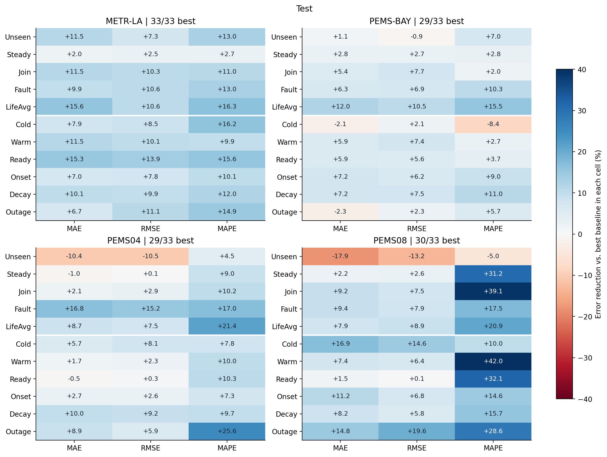
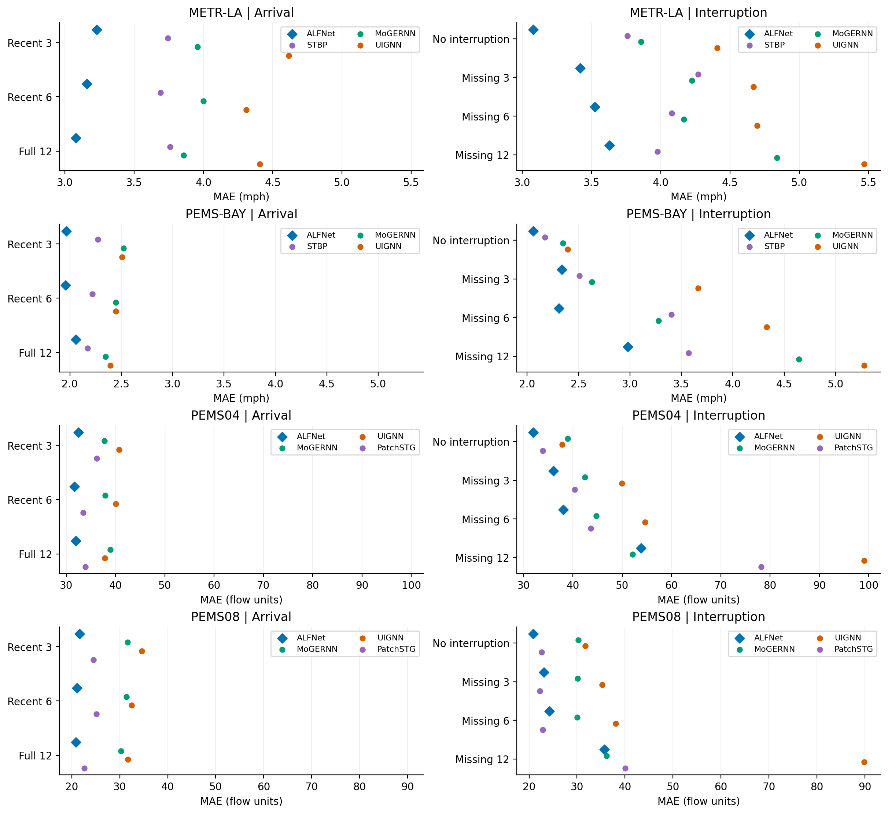
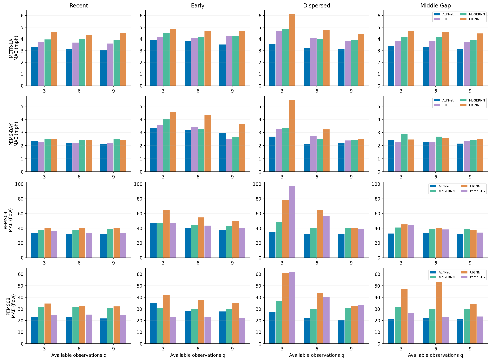
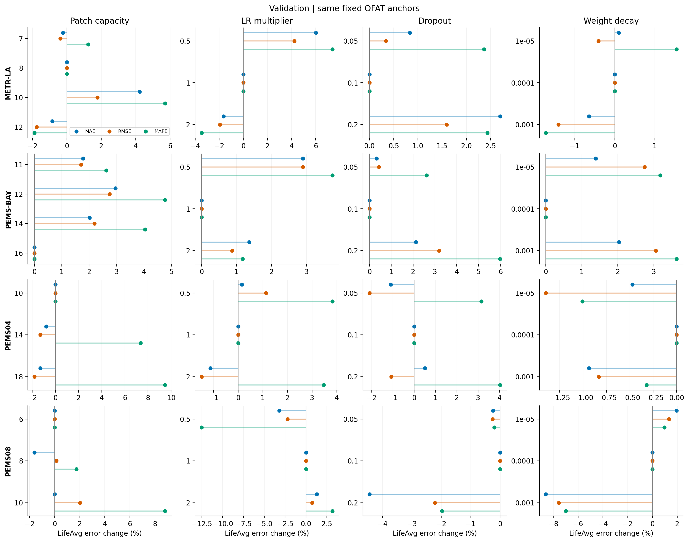
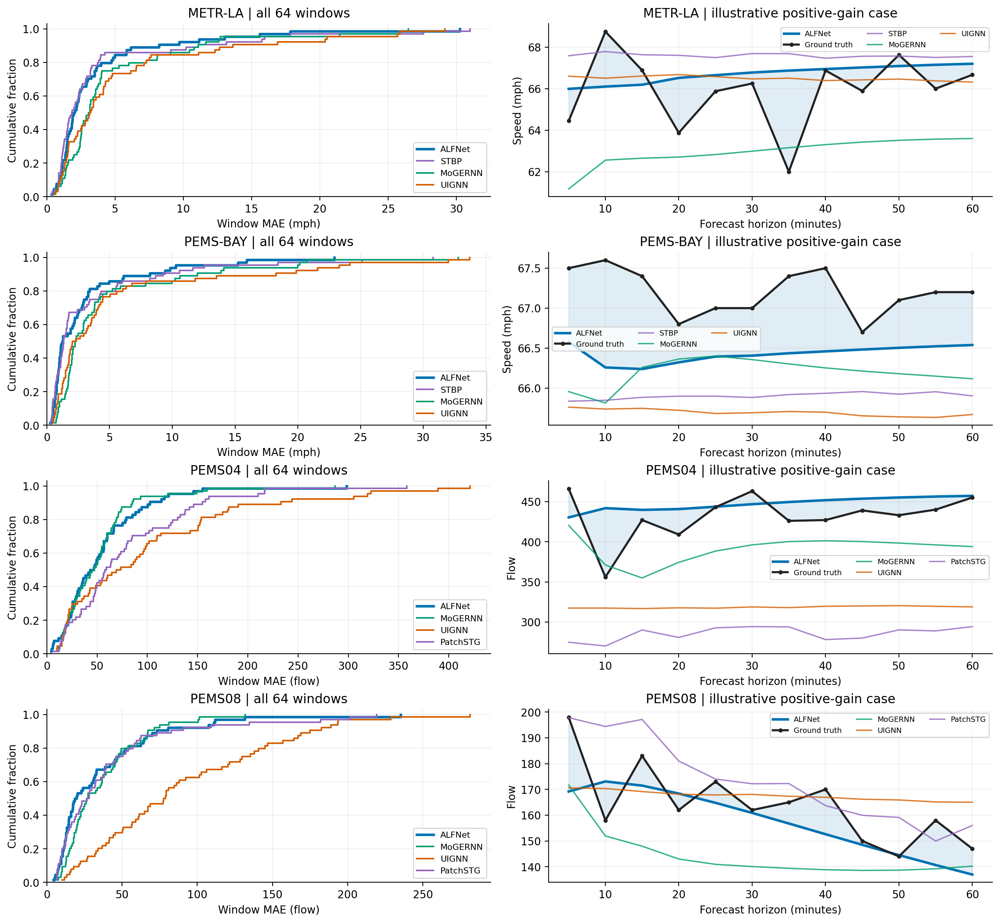

# ALFNet：动态观测支持下的归纳时空预测

<!-- v6 中文工作稿（2026-10-27 第四轮修改）。本文件是编辑源头，sections/*.tex 由 _scripts/md_to_tex.py 从本文件生成；历史版本见 git 记录。逐条修改依据见 ../notes/V6_CHANGELOG_CN.md。 -->

## 摘要

实际路网中，各位置的观测情况各不相同，而且在不断变化：持续可用传感器（AAS）在训练与推理期间稳定提供读数；新增传感器（NAS）在训练期没有记录，接入后才开始积累读数；失效传感器（FS）原本正常工作，后因设备故障或通信异常中断读数；虚拟传感器（VS）则是没有可读观测、只需要预测的位置。因此，预测窗口内可用观测的位置、数量与时间分布，即观测支持（OS），会随节点在这四类状态之间的转换而变化。本文研究路网拓扑已知、部分节点不参与训练时动态 OS 下的归纳时空预测，并提出 ALFNet。ALFNet 以逐步的观测角色（AAS、NAS、VS 或 FS）、状态进度与观测掩码描述 OS，并把它作为组织预测计算的条件：观测支持感知历史补全（SAHC）为全部节点补全一份共享历史；空间上下文时间条件分支（ALFTemporal）从按空间分区组织的跨节点历史中生成条件特征，经特征级线性调制（FiLM）作用于图编码状态；观测条件化图预测（ALFGraph）在编码时依据逐步的观测角色、状态进度与掩码组合五种图传播算子，以残差自回归方式解码，并在输出端施加由末步观测角色控制幅度的有界图修正。按目标节点在窗口内的观测角色轨迹，我们定义四类评价场景：零历史（Unseen）场景中目标节点全程为 VS，稳定观测（Steady）场景中全程为 AAS，新增接入（Join）场景中由 VS 转为 NAS，故障中断（Fault）场景中由 AAS 转为 FS。记 $m$ 为接入或失效之后已经持续的步数：Join 中 $m$ 越大，窗口内的新读数越多，按 $m=1$、$2\le m\le 11$ 与 $m=12$ 分为冷启动（Cold）、预热（Warm）与就绪（Ready）三个阶段；Fault 中 $m$ 越大，缺失的近期读数越多，按相同区间分为中断初期（Onset）、证据衰减（Decay）与完全中断（Outage）三个阶段，以检验模型能否随本地证据的增减调整预测。在 METR-LA、PEMS-BAY、PEMS04 和 PEMS08 四个真实世界数据集上的统一评价表明，ALFNet 跨场景平均误差（LifeAvg）的三项误差指标均优于八个代表性比较方法，平均绝对误差（MAE）降低7.86%–15.63%；Join 与 Fault 场景的三项指标在四个数据集上均优于这些比较方法。组件消融表明跨节点时间上下文的贡献最大，OS 条件化传播与状态进度带来较小但方向基本一致的改进。

## 1 引言

交通预测为路网运行管理、出行规划与拥堵预警提供前瞻性信息，而预测所依赖的传感网络在不断变化：路网扩建会带来新装的检测器，设备故障与通信异常会使原有检测器中断，受预算限制，许多需要预测的位置也从未安装传感器 [1,2]。这些变化直接体现在模型读到的历史中。一个刚接入的检测器，在历史窗口里只有最近几步读数；一个刚失效的检测器保留了较早的读数，却失去了最近的读数；还有一些位置在窗口内始终没有读数。同一位置在不同窗口之间，甚至在同一个窗口之内，可用的信息都可能不同。本文将历史窗口内实际可用观测的位置、数量及其时间分布统称为观测支持（OS）。

已有研究从多个角度处理过这类情形。归纳预测把模型推广到训练期没有动态信号的位置，能够预测无传感器位置的未来状态，或在只有少数节点提供训练数据时泛化到其余节点 [2–6]；不完整观测下的预测处理输入中的缺失，其中一些方法让计算依赖掩码、距上次观测的时间间隔等缺失信息 [7–10]；面对传感网络的演化，持续学习、少步适应与分布外泛化方法分别通过增量训练、少量目标观测或不更新参数的方式处理新增节点 [11–17]。因此，未观测位置、读数缺失与传感器配置变化本身都不是新问题。较少被显式刻画的，是这些变化作为事件的过程：已有方法多以掩码或节点所属的配置描述观测是否可用，部分方法还记录距上次观测的时间；而一个位置是刚接入还是刚失效、事件已经持续了多久，较少作为显式变量参与空间信息交换的组织，评价时也较少按事件持续的步数区分预测表现。

本文因此研究动态 OS 下的归纳时空预测：路网拓扑已知，部分节点的动态信号不参与训练，推理时模型参数固定，而各位置的 OS 可以在历史窗口内变化。按目标位置在窗口内的观测轨迹，我们考察四类场景：训练中没有动态信号的保留节点全程没有读数（零历史，Unseen），或在窗口内接入并开始提供读数（新增接入，Join）；参与训练的已知节点全程可读（稳定观测，Steady），或在窗口内中断（故障中断，Fault）。本文假设各位置的接入与失效状态已知，实际中可由接入记录与故障检测获得；模型只依据历史窗口内的 OS 进行预测，不预测未来观测状态的变化。在此设置下，本文的核心问题是：**当目标位置的 OS 在历史窗口内变化、而模型参数固定时，预测计算应如何依据 OS 调整对本地历史与空间上下文的利用。**

我们的核心认识是，**OS 不仅描述哪些输入有效，也应作为组织预测计算的条件**。为此，我们用三类逐步变量描述 OS。观测掩码标明读数是否可用。观测角色沿用已有研究对传感器的划分 [2]：持续可用传感器（AAS）在训练与推理期间稳定提供读数，新增传感器（NAS）在训练期没有记录、接入后才开始积累读数，失效传感器（FS）原本正常工作、后来中断读数，虚拟传感器（VS）没有可读观测、只需要预测；窗口内全无读数时，掩码不能区分从未接入与已经失效，观测角色可以。状态进度（state progress）描述接入或失效已经持续的比例，同时刻画接入后证据的积累与失效后证据的流失，而距上次观测的时间间隔只刻画后者。这些变量需要在计算的几个环节发挥作用：补全缺失读数之后，后续计算仍应知道哪些值来自观测；本地读数很少或已经中断时，预测需要借助关联位置的历史；空间信息的交换方式也应能随观测状态改变。

据此，我们提出 ALFNet（Adaptive Lifecycle Forecasting Network），其中"自适应"指计算随输入的 OS 而变化，推理时模型参数保持固定。观测支持感知历史补全（SAHC）依据可见读数、OS 与路网关联，为全部节点补全一份共享历史，OS 随这份历史一起交给后续两个分支。空间上下文时间条件分支（ALFTemporal）把节点组织为空间分区，从跨节点的共享历史与 OS 中生成逐节点的条件特征，经特征级线性调制（FiLM）作用于图预测分支的编码状态，为本地历史不足的节点提供来自关联位置的依据。观测条件化图预测（ALFGraph）在编码时由每一步的 OS 决定多种图传播算子的组合，使空间信息的交换随观测状态改变，接受调制后再解码生成预测，解码沿用历史窗口末步的 OS。三个模块分别借鉴了图循环插补 [18]、空间分区交互 [19]、两阶段注意力 [20]、特征级线性调制 [21]、图专家混合 [2,22] 与扩散卷积循环网络 [23] 的思想。与最接近的 MoGERNN 相比，ALFNet 同样使用图专家混合，区别在于路由的依据与作用位置：MoGERNN 依据节点输入特征稀疏地选择专家，并在进入编码—解码器之前为未观测节点构造表示；ALFNet 的路由只由 OS 决定、不读取信号值，并作用于编码器每一步的门控图传播。

我们在 METR-LA、PEMS-BAY、PEMS04 与 PEMS08 四个数据集上，与归纳预测、缺失感知预测与时空表示三类共八个方法统一比较。ALFNet 跨场景平均误差（LifeAvg）的三项误差指标均优于所列方法，平均绝对误差（MAE）降低7.86%–15.63%；在本地证据逐步积累或中断的 Join 与 Fault 场景下，四个数据集的三项指标均为所列方法中最优；在全程没有本地历史的 Unseen 场景下，优势依赖数据集，两个流量数据集的 MAE 与 RMSE 尚未取得最优。组件消融中，去除跨节点上下文或整个时间条件分支时误差上升最多；以全局权重替代 OS 路由、以掩码替代状态进度，也使多数数据集与指标上的误差上升。固定预测目标的观测干预显示，模型的预测随本地历史的加入与中断而变化，相同数量的可见读数集中在近期时误差更低。

本文的贡献概括为三点：（1）在已有传感器类型划分的基础上，提出动态 OS 下归纳预测的评价协议：按目标位置的观测角色轨迹划分场景，并按接入或失效后的持续步数划分阶段，用以检验预测能否随本地证据的积累与流失而调整；（2）提出 ALFNet，使 OS 同时进入共享补全、跨节点时间条件与图传播路由，三者共用同一份补全历史，并由时间条件分支调制图预测的编码状态；（3）四个数据集上的统一比较表明，ALFNet 的跨场景平均误差优于所列八个方法，优势在 Join 与 Fault 场景上最稳定；组件消融与观测干预进一步表明，跨节点上下文的贡献最大，预测会随 OS 的变化作出相应调整。

## 2 相关工作

本节前三小节对应引言提到的三类已有研究：未观测位置的归纳预测与部分感知（2.1）、不完整观测下的时空预测（2.2）、传感网络演化下的泛化与适应（2.3）；2.4节讨论贯穿三者的时空表示与条件化计算机制。各方向之间有交叉，部分方法同时涉及多个方向。

### 2.1 未观测位置的归纳预测与部分感知

这一方向的工作可以按目标位置在训练与推理时的观测条件来区分。同一时段的估计是它的任务边界：时空克里金利用已观测位置估计同一时段未观测位置的值，IGNNK、INCREASE 与 KITS 分别通过随机子图训练、异质空间关系建模和向训练图加入虚拟节点，使模型无需重新训练即可用于新位置 [24–26]，但它们不预测未来。

面向未来，最直接的情形是目标位置在训练与推理时都没有读数。FUNS 只在已观测位置上优化模型，预测完全没有传感器的位置 [3]；UIGNN 进一步给出预测的不确定性 [4]；FRIGATE 在只有部分路段装有传感器的路网上以一小时历史预测一小时，并在冻结参数下检验了路网拓扑变化与历史快照缺失的影响 [5]；STSM 与 GenCast 把对象扩展到连续的无观测区域，分别借助道路与兴趣点等静态特征以及物理约束与天气信息 [27,28]。MoGERNN 以图专家混合为未观测节点构造表示，并在同一模型中考察了测试期新增与失效的传感器 [2]。另一种情形是目标位置在训练期没有信号、推理时有历史：ST-FiT 通过时间数据增强与图拓扑学习，泛化到只有输入历史而没有训练数据的节点 [6]；SCPT 在推理时利用新道路两天的数据生成其空间表示 [29]。还有工作允许训练期获得目标位置的临时观测：SLPF 利用未感知位置的临时观测学习向推理期的空间转移，用于长期部分感知预测 [30]。

在这些工作中，哪些位置有观测通常按评价配置确定，训练时多在已知节点上遮蔽部分节点以模拟未观测；已观测位置的读数可以缺失，但接入与失效作为事件及其持续程度较少被显式表示。ALFNet 同样在已知节点上模拟不同的观测情形，区别在于用观测角色与状态进度表示接入与失效事件，并让同一组参数既处理全程没有读数的保留节点，也处理在窗口内开始积累读数的保留节点。

### 2.2 不完整观测下的时空预测

这一方向的方法可以沿两条相互交叉的设计轴理解。第一条是插补与预测如何组织。GRIN 与 PriSTI 等插补方法可以先重建缺失序列，再交给预测器 [18,31]，但插补误差会传入预测，重建历史的目标也与预测未来不同。联合建模试图缓解这一问题：GMN 把相邻时刻全网状态的转移视为图马尔可夫过程，逐步推断缺失状态并预测 [32]；GSTAE 把插补与预测作为并行任务顺序训练 [33]；GinAR 则以插值注意力与自适应图卷积，端到端地处理部分变量整段历史缺失下的预测 [7]。

第二条是缺失信息如何参与计算。GCN-M 把观测掩码与多尺度历史记忆、动态图卷积结合 [34]；GRU-D 把掩码与距上次观测的时间间隔引入循环更新 [10]，MAS-Mamba 以二者调节状态空间模型的更新，使中断期间的状态得以保持或衰减 [35]；HD-TTS 对输入进行分层时空下采样，并以观测与缺失模式为条件组合多尺度表示 [9]。GinAR+ 与 Merlin 则从训练方式入手，分别以不同缺失率的数据构造对比样本、以完整观测教师进行知识蒸馏与多视图对比学习，使一个模型适应变化的缺失率 [8,36]。2.1节的 UIGNN 也以缺失数据的视角处理没有历史记录的位置。

这些研究说明，缺失信息本身可以作为调整计算的依据。它们大多在直推设置下进行，缺失的节点在训练期仍提供标签；ALFNet 的保留节点从未提供训练信号，补全不能依赖目标节点自身的训练统计。在组织方式上，ALFNet 对全部节点只补全一次，结果由两个分支共享，且只通过预测损失训练；在信息使用上，ALFNet 除掩码外还使用观测角色与状态进度，区分"从未可读"与"曾经可读、随后失效"，并对接入与失效两个方向描述事件已持续的比例。

### 2.3 传感网络演化下的泛化与适应

真实的传感网络随时间扩张与演化，XXLTraffic 整理了跨度最长 23 年、节点逐年增加的交通数据 [1]。按是否更新参数、是否使用目标数据，已有工作可分为三种设置。持续学习在网络扩张后利用新数据增量更新模型并缓解遗忘，如 TrafficStream、PECPM、EAC 以及带可扩展上下文模式库的 STBP [11–13,37]。少步适应使用少量目标观测，如利用新传感器一至七天支持数据的 SC-SAMG [14]；SIML-MSIGN 则把不同观测布局组织为任务，训练时同时监督观测与未观测节点，并报告了零步与少步适应的结果 [15]。固定参数的泛化不更新参数，如在测试期加入新节点的 STONE 与 STOP，分别借助对结构偏移不敏感的空间嵌入和以上下文单元为中介的集中式消息机制 [16,17]；2.1节的 MoGERNN 与 FRIGATE 也在不重新训练的条件下考察了传感器或路网的变化。

ALFNet 属于固定参数的设置，推理时不使用目标节点的标签，也不更新参数；这一设置与窗口内的读数缺失都不是 ALFNet 特有的。差异在于变化的刻画方式：ALFNet 面对的是单个历史窗口内的接入与中断，用观测角色与状态进度显式表示事件及其进度，并让它们决定图传播的组合，评价时再按事件持续的步数分阶段考察。持续学习与少步适应可与之互补。

### 2.4 时空表示与条件化计算

空间依赖建模是交通预测利用关联位置的基本途径。STGCN 结合图卷积与时间卷积 [38]，DCRNN 以扩散卷积刻画有向路网上的传播 [23]，Graph WaveNet 与 AGCRN 以可学习的节点表示构造自适应邻接 [39,40]。学到的关系在推理时通常不随输入窗口变化，逐节点的可训练参数也不利于迁移到训练中未出现的节点，Cini 等系统分析了全局共享参数与节点特定参数之间的取舍 [41]。STID 表明，具有时空身份信息的简洁模型也能形成有竞争力的预测基线 [42]。在交互范围与计算规模上，PDFormer 在长程注意力中建模传播时延 [43]，PatchSTG 通过空间分块组织块内与块间交互，提高大规模路网上的效率 [19]。

另一类工作让计算随条件变化，它们贯穿上述三个方向。图专家混合使节点自适应地选择不同跳数的聚合专家 [22]；TESTAM 在恒等、静态图与动态图三类空间建模专家之间按交通状况路由 [44]；MoGERNN 以稀疏门控为未观测节点组合图聚合器 [2]；在多模态学习中，Flex-MoE 依据可用模态的组合组织专家 [45]；FiLM 提供了以条件特征缩放与平移中间表示的一般方式 [21]；2.2节的 HD-TTS 与 GRU-D 则让计算依赖缺失信息。ALFNet 借鉴专家混合与特征调制的思想，但条件的来源与作用位置不同：图专家的路由只由 OS 决定、不读取信号值，编码时作用于每一步、每个门的传播，解码时沿用末步 OS；FiLM 的参数来自跨节点的时间上下文，OS 只经由其输入进入；空间分区注意力只用于生成条件特征，不直接输出预测。

## 3 方法

图1给出 ALFNet 的总体架构。3.1节定义问题与 OS 的表示，对应图中左列的输入；3.2–3.4节依次介绍 SAHC、ALFTemporal 与 ALFGraph，分别对应图中第二列、右上与右下部分；3.5节给出训练目标。

<!-- 图1：使用 PDF 矢量架构图。 -->

**图1　ALFNet 总体架构。** 左列为输入：可见历史 $\mathbf{X}$、生命周期上下文 $\mathbf{S}=[\mathbf{R},\mathbf{a},\mathbf{M}]$ 与静态路网（3.1节）；第二列为 SAHC（3.2节）；右上为 ALFTemporal 及其 FiLM 参数头（3.3节）；右下为 ALFGraph，包括 OS 路由的图编码器、FiLM 调制、残差自回归解码、参考恢复与角色缩放图修正（3.4节）。

### 3.1 问题设置

路网表示为有向加权图 $\mathcal{G}=(\mathcal{V},\mathbf{A})$，其中 $|\mathcal{V}|=N$，$\mathbf{A}\in\mathbb{R}_{\ge 0}^{N\times N}$ 为加权邻接矩阵，全部节点的拓扑及静态属性在训练与推理中均可见。节点划分为已知节点 $\mathcal{V}_K$ 以及验证、测试保留节点 $\mathcal{V}_V$、$\mathcal{V}_T$：训练只读取 $\mathcal{V}_K$ 的动态信号，验证与测试分别加入 $\mathcal{V}_V$ 与 $\mathcal{V}_T$ 的历史；标准化统计量仅由训练时段的 $\mathcal{V}_K$ 计算。给定历史长度 $L=12$ 与预测长度 $H=12$，记标准化后的历史为 $\mathbf{X}\in\mathbb{R}^{L\times N}$，未来目标为 $\mathbf{Y}\in\mathbb{R}^{H\times N}$，观测掩码为 $\mathbf{M}\in\{0,1\}^{L\times N}$；$\mathbf{x}_t,\mathbf{m}_t\in\mathbb{R}^{N}$ 为第 $t$ 步全部节点的读数与掩码，即 $\mathbf{X}$ 与 $\mathbf{M}$ 的第 $t$ 行。不可用位置的输入值置零。

**观测角色与状态进度。** 除掩码外，OS 还由两类逐步的显式描述刻画。在第 $t$ 步，每个节点属于以下四类观测角色之一：AAS 表示节点处于当前阶段的信号暴露范围内，且没有发生接入或失效事件；NAS 表示节点在窗口内接入，接入后开始提供读数；FS 表示节点原本可读，在窗口内失效后不再提供读数；VS 表示节点在该步没有可读历史，包括尚未接入的节点以及不在当前阶段信号暴露范围内的节点（如训练时的保留节点）。$\mathbf{R}_t\in\{0,1\}^{N\times4}$ 依次按 AAS、NAS、VS、FS 对观测角色做 one-hot 编码。状态进度 $\mathbf{a}_t\in[0,1]^{N}$ 描述接入或失效已持续的比例：
$$
a_{t,n}=\begin{cases}1, & \text{节点 } n \text{ 在第 } t \text{ 步为 AAS},\\ 0, & \text{节点 } n \text{ 在第 } t \text{ 步为 VS},\\ \lambda/L, & \text{节点 } n \text{ 在第 } t \text{ 步为 NAS 或 FS，且处于接入或失效后的第 } \lambda \text{ 步}.\end{cases}
\tag{1}
$$
观测掩码由读数的自然有效性与观测角色共同决定：$M_{t,n}=1$ 当且仅当该读数自然有效且节点在第 $t$ 步为 AAS 或 NAS。自然缺失只改变 $\mathbf{M}$，不改变观测角色，因此 AAS 的偶发缺测仍记为 AAS。三者逐步拼接为生命周期上下文
$$
\mathbf{S}_t=[\mathbf{R}_t,\ \mathbf{a}_t,\ \mathbf{m}_t]\in\mathbb{R}^{N\times 6},\qquad t=1,\dots,L.
\tag{2}
$$

**场景。** 按目标节点在窗口内的观测角色轨迹，OS 的变化归纳为四类场景。记 $m\in\{1,\dots,L\}$ 为接入或失效之后已经持续的步数（事件持续步数）：Unseen 中目标节点全程为 VS；Steady 中全程为 AAS；Join 中前 $L-m$ 步为 VS、最后 $m$ 步为 NAS；Fault 中前 $L-m$ 步为 AAS、最后 $m$ 步为 FS。因此，Join 中 $m$ 越大，窗口内可读的新读数越多；Fault 中 $m$ 越大，缺失的近期读数越多。$m$ 在 $1$ 至 $L$ 内均匀抽取；训练时四类场景均在已知节点上模拟。窗口内可见读数数 $q_n=\sum_{t}M_{t,n}$ 只用于描述 OS 的多少，不作为额外输入。本文假设观测角色与状态进度已知，实际应用中可由传感器接入记录与故障检测获得。

**预测任务。** 在上述设置下，预测是在固定模型参数下学习映射
$$
\hat{\mathbf{Y}}=f\big(\mathbf{X}\odot\mathbf{M},\ \mathbf{S}_{1:L},\ \mathbf{A},\ \mathcal{T}\big)\in\mathbb{R}^{H\times N},
\tag{3}
$$
其中 $\mathcal{T}$ 为窗口内各步的日历信息（日内时段与星期）。同一节点在不同窗口中可以处于不同观测角色与布局，因此模型应依据当前窗口的 OS 组织计算，而不是依据节点是否参与过训练。

### 3.2 观测支持感知历史补全（SAHC）

SAHC 对全部 $N$ 个节点、完整的 $L$ 步历史只运行一次，依次进行双向图循环补全、窗口内插值与参考中心化。记 $\mathrm{rn}(\cdot)$ 为矩阵的行归一化（每行除以该行元素之和，全零行保持不变），前向与后向转移矩阵为 $\mathbf{P}_{\mathrm f}=\mathrm{rn}(\mathbf{A})$ 与 $\mathbf{P}_{\mathrm b}=\mathrm{rn}(\mathbf{A}^{\top})$。

**图门控循环单元。** SAHC 与 ALFGraph 都以图门控循环单元为递推单元。给定输入 $\mathbf{x}$ 与上一隐藏状态 $\mathbf{h}$，单元按
$$
\begin{aligned}
\mathbf{r}&=\sigma\big(\Phi_r([\mathbf{x},\mathbf{h}])\big),\qquad \mathbf{u}=\sigma\big(\Phi_u([\mathbf{x},\mathbf{h}])\big),\\
\tilde{\mathbf{h}}&=\tanh\big(\Phi_c([\mathbf{x},\mathbf{r}\odot\mathbf{h}])\big),\qquad \mathbf{h}'=\mathbf{u}\odot\mathbf{h}+(\mathbf{1}-\mathbf{u})\odot\tilde{\mathbf{h}}
\end{aligned}
\tag{4}
$$
更新隐藏状态，其中 $\mathbf{r}$、$\mathbf{u}$ 为重置门与更新门，$\tilde{\mathbf{h}}$ 为候选状态，$\sigma(\cdot)$ 为 sigmoid；$\Phi_r$、$\Phi_u$、$\Phi_c$ 为三个参数独立的图变换，输出宽度均为64。SAHC 中三个图变换均取二阶扩散卷积 $\mathcal{D}(\mathbf{U})=[\mathbf{U},\mathbf{P}_{\mathrm f}\mathbf{U},\mathbf{P}_{\mathrm f}^{2}\mathbf{U},\mathbf{P}_{\mathrm b}\mathbf{U},\mathbf{P}_{\mathrm b}^{2}\mathbf{U}]\,\mathbf{W}_{\mathcal{D}}$，记该单元为 $\mathrm{GRU}_{\mathcal{D}}$；ALFGraph 中的图变换在3.4节给出。

**双向图循环补全。** SAHC 沿时间正、反两个方向各运行一个图循环补全层。以正向为例，隐藏状态 $\mathbf{h}_0=\mathbf{0}\in\mathbb{R}^{N\times64}$。对 $t=1,\dots,L$，先由上一隐藏状态给出初步估计，并保留可见位置的观测值：
$$
\hat{\mathbf{x}}^{(1)}_t=\mathbf{h}_{t-1}\mathbf{W}_1,\qquad \mathbf{x}^{(1)}_t=\mathbf{m}_t\odot\mathbf{x}_t+(\mathbf{1}-\mathbf{m}_t)\odot\hat{\mathbf{x}}^{(1)}_t.
\tag{5}
$$
随后通过一次空间消息传递修正估计：
$$
\begin{aligned}
\mathbf{z}_t&=[\mathbf{x}^{(1)}_t,\ \mathbf{S}_t,\ \mathbf{h}_{t-1}]\,\mathbf{W}_{\mathrm{in}},\\
\boldsymbol{\rho}_t&=\Big[\mathrm{PReLU}\big(\big[[\mathbf{P}_{\mathrm f}\mathbf{z}_t,\ \mathbf{P}_{\mathrm b}\mathbf{z}_t]\,\mathbf{W}_{\mathrm s},\ \mathbf{h}_{t-1}\big]\,\mathbf{W}_{\mathrm o}\big),\ \mathbf{h}_{t-1}\Big],\qquad \hat{\mathbf{x}}^{(2)}_t=\boldsymbol{\rho}_t\mathbf{W}_2,
\end{aligned}
\tag{6}
$$
其中 $\mathbf{z}_t\in\mathbb{R}^{N\times64}$ 为投影后的输入，$\boldsymbol{\rho}_t\in\mathbb{R}^{N\times128}$ 为该步的节点表示。修正后的估计同样只填入缺失位置，再与生命周期上下文一起更新隐藏状态：
$$
\mathbf{x}^{(2)}_t=\mathbf{m}_t\odot\mathbf{x}_t+(\mathbf{1}-\mathbf{m}_t)\odot\hat{\mathbf{x}}^{(2)}_t,\qquad \mathbf{h}_t=\mathrm{GRU}_{\mathcal{D}}\big([\mathbf{x}^{(2)}_t,\ \mathbf{S}_t],\ \mathbf{h}_{t-1}\big).
\tag{7}
$$
反向层在时间反转的序列上执行相同计算，参数独立。记正向与反向在第 $t$ 步的节点表示为 $\overrightarrow{\boldsymbol{\rho}}_t$ 与 $\overleftarrow{\boldsymbol{\rho}}_t$，二者在每个历史位置上与掩码拼接，经多层感知机（MLP）融合为重建值，最后保留可见读数：
$$
\mathbf{x}^{\mathrm{rec}}_t=\mathrm{ReLU}\big([\overrightarrow{\boldsymbol{\rho}}_t,\ \overleftarrow{\boldsymbol{\rho}}_t,\ \mathbf{m}_t]\,\mathbf{W}_3\big)\mathbf{W}_4,\qquad \mathbf{X}^{\mathrm{c}}=\mathbf{M}\odot\mathbf{X}+(\mathbf{1}-\mathbf{M})\odot\mathbf{X}^{\mathrm{rec}},
\tag{8}
$$
其中 $\mathbf{X}^{\mathrm{rec}}=[\mathbf{x}^{\mathrm{rec}}_1,\dots,\mathbf{x}^{\mathrm{rec}}_L]^{\top}$ 为重建结果。式(5)–(8)中的 $\mathbf{W}_{\ast}$ 均为可学习矩阵，偏置省略，隐藏宽度与融合 MLP 的宽度均为64。生命周期上下文进入两个方向的每一步递推，掩码还用于保留可见读数与融合。SAHC 没有独立的重建损失，只通过下游预测损失训练。

**窗口内插值。** 设 $\iota\in\{0,1\}$ 为插值开关。$\iota=1$ 时，对至少有一个可见读数（$q_n>0$）的节点，用窗口内可见读数的线性插值覆盖其缺失位置：
$$
X^{\mathrm{fill}}_{t,n}=\begin{cases}X_{t^{-},n}+\dfrac{t-t^{-}}{t^{+}-t^{-}}\big(X_{t^{+},n}-X_{t^{-},n}\big), & \iota=1,\ M_{t,n}=0,\ q_n>0,\\[6pt] X^{\mathrm{c}}_{t,n}, & \text{其他情况},\end{cases}
\tag{9}
$$
其中 $t^{-}$ 与 $t^{+}$ 为 $t$ 之前与之后最近的可见步；$t$ 位于第一个可见步之前或最后一个可见步之后时，二者都取最近的可见步并令分式为0，即取最近的可见值。没有可见读数的节点保留 $\mathbf{X}^{\mathrm{c}}$ 中的补全值，因此插值与图循环补全不是按 $q_n$ 互斥的两条支路。

**参考中心化。** 记 $t^{\ast}_n=\max\{t:M_{t,n}=1\}$ 为节点 $n$ 的最后一个可见步，参考值与中心化后的共享历史为
$$
v_n=\begin{cases}X_{t^{\ast}_n,n}, & q_n>0,\\ 0, & q_n=0,\end{cases}\qquad \bar{\mathbf{X}}=\mathbf{X}^{\mathrm{fill}}-\alpha\,\mathbf{1}_L\mathbf{v}^{\top},
\tag{10}
$$
其中 $\alpha\ge0$ 为中心化强度，$\mathbf{1}_L$ 为全1列向量，即 $\mathbf{v}$ 沿时间维广播；$\mathbf{S}$ 保持不变。中心化在输出端由式(26)加回。上述处理均不使用未来或被遮蔽的真值。保留观测值发生在中心化之前，中心化后可见位置的数值也随之平移。ALFTemporal 与 ALFGraph 读取同一份 $\bar{\mathbf{X}}$。

### 3.3 空间上下文时间条件分支（ALFTemporal）

ALFTemporal 从跨节点历史生成逐节点的条件特征。它只为 ALFGraph 提供条件，不产生独立预测；计算上先由它得到调制参数，再执行 ALFGraph。

**时间嵌入。** 对每个节点 $n$，ALFTemporal 读取 $\mathbf{F}_n=[\bar{\mathbf{X}}_{:,n},\ \mathbf{S}_{1:L,n},\ \boldsymbol{\tau}/288,\ \boldsymbol{\delta}/7]\in\mathbb{R}^{L\times9}$，其中 $\bar{\mathbf{X}}_{:,n}$ 为 $\bar{\mathbf{X}}$ 的第 $n$ 列，$\mathbf{S}_{1:L,n}\in\mathbb{R}^{L\times6}$ 为节点 $n$ 在各步的生命周期上下文，$\tau_t=12\cdot\mathrm{hour}_t+\lfloor\mathrm{minute}_t/5\rfloor\in\{0,\dots,287\}$ 为日内时段，$\delta_t\in\{0,\dots,6\}$ 为星期。卷积核长度与步长均为 $L$ 的时间卷积把整个窗口映射为一个64维向量，等价于
$$
\mathbf{e}_n=\mathrm{vec}(\mathbf{F}_n)\,\mathbf{W}_e+\mathbf{b}_e\in\mathbb{R}^{64},\qquad \mathbf{W}_e\in\mathbb{R}^{9L\times64},
\tag{11}
$$
因此每个节点只有一个时间 patch，窗口内读数的位置信息由 $\mathbf{W}_e$ 的不同行保留。随后拼接日历与结构嵌入：
$$
\mathbf{z}^{0}_n=\big[\mathbf{e}_n\ \|\ \mathbf{E}^{\mathrm{tod}}_{\tau_L}\ \|\ \mathbf{E}^{\mathrm{dow}}_{\delta_L}\ \|\ \phi(\mathbf{g}_n)\big]\in\mathbb{R}^{160},
\tag{12}
$$
其中 $\|$ 表示拼接，$\mathbf{E}^{\mathrm{tod}}\in\mathbb{R}^{288\times32}$ 与 $\mathbf{E}^{\mathrm{dow}}\in\mathbb{R}^{7\times32}$ 为可学习的日历嵌入表，按末步的日内时段与星期取行。

**结构嵌入。** 模型不使用逐节点可训练的身份嵌入，以免为保留节点引入可训练的身份参数；结构嵌入由所有节点共享的映射 $\phi$ 作用于静态结构特征 $\mathbf{g}_n\in\mathbb{R}^{7}$ 得到。记 $d^{\mathrm{in}}_n=\sum_{n'\ne n}A_{n'n}$、$d^{\mathrm{out}}_n=\sum_{n'\ne n}A_{nn'}$、$d^{\mathrm{tot}}_n=d^{\mathrm{in}}_n+d^{\mathrm{out}}_n$，$(o^{1}_n,o^{2}_n)$ 为节点的两维坐标（无坐标时置零），则
$$
\begin{aligned}
\mathbf{g}_n&=\big[\nu(\mathbf{o}^{1})_n,\ \nu(\mathbf{o}^{2})_n,\ \nu(\mathbf{d}^{\mathrm{in}})_n,\ \nu(\mathbf{d}^{\mathrm{out}})_n,\ \nu(\mathbf{d}^{\mathrm{tot}})_n,\ \nu\big(\log(1+\mathbf{d}^{\mathrm{tot}})\big)_n,\ \mathbb{I}[d^{\mathrm{tot}}_n=0]\big],\\
\nu(\mathbf{s})_n&=\frac{s_n-\bar{s}}{\max_{n'}|s_{n'}-\bar{s}|},
\end{aligned}
\tag{13}
$$
其中 $\mathbf{o}^{1}$、$\mathbf{d}^{\mathrm{in}}$ 等表示由全部节点的相应取值组成的向量，$\bar{s}$ 为向量 $\mathbf{s}$ 在全部节点上的均值，$\mathbb{I}[\cdot]$ 为指示函数；$\phi$ 为两层 MLP（$7\to64\to32$，ReLU 激活）。

**空间分区。** 训练前，节点被划分为 $P=32$ 个分区，每个分区含 $C$ 个槽位：节点坐标可靠时按坐标以 KD-tree 划分，否则依据图拓扑做考虑连通分量的广度优先搜索（BFS）划分。记 $\pi(p,c)$ 为第 $p$ 个分区第 $c$ 个槽位对应的节点；节点不足 $C$ 个的分区以邻接排序的真实节点补足，这些补足副本只提供上下文，不产生输出。按 $\pi$ 排列得到分区张量 $\mathbf{T}\in\mathbb{R}^{P\times C\times160}$，其中 $\mathbf{T}_{p,c}=\mathbf{z}^{0}_{\pi(p,c)}$；下文以 $\mathbf{T}_{:,c}\in\mathbb{R}^{P\times160}$ 表示各分区第 $c$ 个槽位组成的切片，以 $\mathbf{T}_{p,:}\in\mathbb{R}^{C\times160}$ 表示第 $p$ 个分区的全部槽位。

**两阶段注意力。** 分区张量经一个两阶段注意力块处理。记单头注意力与前馈层为
$$
\mathrm{Attn}(\mathbf{Q},\mathbf{K},\mathbf{V})=\mathrm{softmax}\Big(\frac{(\mathbf{Q}\mathbf{W}^{Q})(\mathbf{K}\mathbf{W}^{K})^{\top}}{\sqrt{160}}\Big)\mathbf{V}\mathbf{W}^{V}\mathbf{W}^{O},\qquad \mathrm{FFN}(\cdot)=\mathrm{GELU}\big((\cdot)\,\mathbf{W}^{F}_{1}\big)\mathbf{W}^{F}_{2},
\tag{14}
$$
其中各投影矩阵均为 $160\times160$，偏置省略；每次出现的 Attn 与 FFN 各有独立参数。第一阶段为跨分区注意力：对每个槽位 $c$，在 $P$ 个分区的同位 token $\mathbf{T}_{:,c}$ 之间做自注意力，
$$
\tilde{\mathbf{T}}_{:,c}=\mathrm{LN}\big(\mathbf{T}_{:,c}+\mathrm{Attn}_1(\mathbf{T}_{:,c},\mathbf{T}_{:,c},\mathbf{T}_{:,c})\big),\qquad \mathbf{T}'_{:,c}=\mathrm{LN}\big(\tilde{\mathbf{T}}_{:,c}+\mathrm{FFN}_1(\tilde{\mathbf{T}}_{:,c})\big),
\tag{15}
$$
其中 LN 为层归一化。对 $c=1,\dots,C$ 执行式(15)，得到第一阶段输出 $\mathbf{T}'\in\mathbb{R}^{P\times C\times160}$，其中每个 $\mathbf{T}'_{p,c}$ 都已融合其他分区同一槽位的信息。第二阶段在每个分区内部进行：对分区 $p$ 取 $\mathbf{T}'_{p,:}$，由4个可学习的潜在 token $\mathbf{Q}_p\in\mathbb{R}^{4\times160}$ 先从 $C$ 个槽位汇聚信息，再回传给各槽位，
$$
\begin{aligned}
\mathbf{B}_p&=\mathrm{Attn}_2(\mathbf{Q}_p,\mathbf{T}'_{p,:},\mathbf{T}'_{p,:}),\\
\tilde{\mathbf{T}}_{p,:}&=\mathrm{LN}\big(\mathbf{T}'_{p,:}+\mathrm{Attn}_3(\mathbf{T}'_{p,:},\mathbf{B}_p,\mathbf{B}_p)\big),\qquad \mathbf{T}''_{p,:}=\mathrm{LN}\big(\tilde{\mathbf{T}}_{p,:}+\mathrm{FFN}_2(\tilde{\mathbf{T}}_{p,:})\big).
\end{aligned}
\tag{16}
$$
其中 $\mathbf{B}_p\in\mathbb{R}^{4\times160}$ 为汇聚得到的分区摘要。对 $p=1,\dots,P$ 执行式(16)，得到 $\mathbf{T}''\in\mathbb{R}^{P\times C\times160}$。由于第二阶段的输入已经包含跨分区信息，分区内汇聚与回传后，每个槽位同时获得分区内与分区间的上下文；分区内的交互经过4个 token 的瓶颈，而不是 $C\times C$ 的直接注意力。注意力权重与各残差分支上使用 dropout。最后按 $\pi$ 从 $\mathbf{T}''$ 中取回每个真实节点的输出，恢复原始节点顺序，得到条件特征 $\mathbf{Z}\in\mathbb{R}^{N\times160}$，其第 $n$ 行记为 $\mathbf{z}_n$。

**FiLM 参数头。** FiLM 参数头把 $\mathbf{z}_n$ 映射为逐节点的缩放与平移参数：
$$
[\Delta\boldsymbol{\gamma}_n,\ \boldsymbol{\beta}_n]=\mathrm{ReLU}\big(\mathbf{z}_n\mathbf{W}_{\gamma,1}+\mathbf{b}_{\gamma,1}\big)\mathbf{W}_{\gamma,2}+\mathbf{b}_{\gamma,2},\qquad \Delta\boldsymbol{\gamma}_n,\ \boldsymbol{\beta}_n\in\mathbb{R}^{64},
\tag{17}
$$
其中 $\mathbf{W}_{\gamma,1}\in\mathbb{R}^{160\times32}$，$\mathbf{W}_{\gamma,2}\in\mathbb{R}^{32\times128}$。最后一层零初始化，训练开始时调制为恒等映射。OS 对调制参数的影响只经由 ALFTemporal 的输入 $\mathbf{S}$，参数头本身不读取 $\mathbf{S}$。

### 3.4 观测条件化图预测（ALFGraph）

ALFGraph 由 OS 路由的图编码器、FiLM 调制、残差自回归解码器、参考恢复与角色缩放图修正组成，输出唯一的预测 $\hat{\mathbf{Y}}$。

**OS 路由的图专家混合。** ALFGraph 采用专家混合（mixture of experts，MoE）的思想组织图传播：每个图专家由一个传播算子及其投影组成，路由器依据生命周期上下文为每个节点分配各专家的权重。五个专家的传播算子依次为恒等矩阵 $\mathbf{P}_1=\mathbf{I}$、二值邻接的行归一化 $\mathbf{P}_2=\mathrm{rn}(\mathbb{I}[\mathbf{A}>0])$、加权邻接的行归一化 $\mathbf{P}_3=\mathrm{rn}(\mathbf{A})$，以及前向与后向转移矩阵 $\mathbf{P}_4=\mathbf{P}_{\mathrm f}$、$\mathbf{P}_5=\mathbf{P}_{\mathrm b}$，其中 $\mathbb{I}[\cdot]$ 逐元素取指示函数；第3与第4个专家的传播算子相同，但投影参数与路由权重独立。第 $t$ 步的路由权重只由生命周期上下文决定：
$$
\mathbf{w}_t=\mathrm{softmax}\big(\mathbf{S}_t\mathbf{W}_g\big)\in\mathbb{R}^{N\times5},
\tag{18}
$$
其中 $\mathbf{W}_g\in\mathbb{R}^{6\times5}$ 为路由矩阵，softmax 对每个节点在5个专家上归一化。给定输入 $\mathbf{U}\in\mathbb{R}^{N\times F}$，图专家混合的输出为
$$
G(\mathbf{U},\mathbf{S}_t)=\sum_{j=1}^{5}\mathbf{w}_{t,j}\odot\big(\mathbf{P}_j\,\mathbf{U}\,\boldsymbol{\Theta}_j\big)+\mathbf{b},
\tag{19}
$$
其中 $\mathbf{w}_{t,j}\in\mathbb{R}^{N}$ 为 $\mathbf{w}_t$ 的第 $j$ 列，即各节点分配给第 $j$ 个专家的权重，沿特征维广播；$\boldsymbol{\Theta}_j\in\mathbb{R}^{F\times64}$ 为第 $j$ 个专家的投影，$\mathbf{b}\in\mathbb{R}^{64}$ 为偏置。五个专家全部参与加权，不做 top-$k$ 截断，也不加入噪声。路由器读取 OS 而非信号值：经过 SAHC 后，一个 NAS 节点与一个 AAS 节点可能具有相似的输入数值，而二者的生命周期上下文仍然不同。

为避免路由集中到少数专家，每次调用图专家混合时计算负载平衡损失。记该次调用中批次内全部样本、全部节点的路由权重为 $w_{n,j}$（$n$ 遍历这些节点，$j=1,\dots,5$），则
$$
\mathrm{imp}_j=\sum_{n}w_{n,j},\qquad \mathrm{load}_j=\sum_{n}\mathbb{I}[w_{n,j}>0],\qquad \ell_{\mathrm{bal}}=0.01\big[\mathrm{CV}^2(\mathbf{imp})+\mathrm{CV}^2(\mathbf{load})\big],
\tag{20}
$$
其中 $\mathbf{imp}=(\mathrm{imp}_1,\dots,\mathrm{imp}_5)$ 与 $\mathbf{load}$ 分别为各专家获得的权重总和与被分配的节点数，$\mathrm{CV}^2(\cdot)$ 为平方变异系数，即向量各分量的方差除以均值的平方（分母加 $10^{-10}$）。ALFGraph 共有12个图专家混合模块（编码器与解码器各两层，每层三个门）。记 $\mathcal{C}_g$ 为第 $g$ 个模块在一次前向计算中各次调用的平衡损失组成的集合，路由平衡损失为
$$
\mathcal{L}_{\mathrm{route}}=\frac{1}{12}\sum_{g=1}^{12}\frac{1}{|\mathcal{C}_g|}\sum_{\ell_{\mathrm{bal}}\in\mathcal{C}_g}\ell_{\mathrm{bal}}.
\tag{21}
$$
由于五个专家全部参与加权，$\mathbf{load}$ 的各分量相同，$\mathrm{CV}^2(\mathbf{load})=0$，起作用的是 importance 项。

**图编码器。** ALFGraph 的图门控循环单元沿用式(4)的门控形式，三个图变换 $\Phi_r$、$\Phi_u$、$\Phi_c$ 分别取为各带路由器的图专家混合 $G_r(\cdot,\mathbf{S})$、$G_u(\cdot,\mathbf{S})$、$G_c(\cdot,\mathbf{S})$，隐藏宽度为64，记为 $\mathbf{h}'=\mathrm{Cell}(\mathbf{x},\mathbf{h},\mathbf{S})$。各模块参数在递推步之间共享。编码器从零状态出发，对 $t=1,\dots,L$ 递推
$$
\mathbf{h}^{(1)}_t=\mathrm{Cell}^{(1)}_{\mathrm{enc}}\big([\bar{\mathbf{x}}_t,\mathbf{S}_t],\ \mathbf{h}^{(1)}_{t-1},\ \mathbf{S}_t\big),\qquad \mathbf{h}^{(2)}_t=\mathrm{Cell}^{(2)}_{\mathrm{enc}}\big(\mathbf{h}^{(1)}_t,\ \mathbf{h}^{(2)}_{t-1},\ \mathbf{S}_t\big),
\tag{22}
$$
其中 $\bar{\mathbf{x}}_t$ 为 $\bar{\mathbf{X}}$ 的第 $t$ 行，第一层输入 $[\bar{\mathbf{x}}_t,\mathbf{S}_t]\in\mathbb{R}^{N\times7}$，$\mathbf{h}^{(l)}_t$ 为第 $l$ 层在第 $t$ 步的隐藏状态。由于观测角色与状态进度逐步进入路由，Join 节点在接入前后、Fault 节点在失效前后会使用不同的专家组合。

**FiLM 调制。** 编码完成后，ALFTemporal 给出的参数在解码开始前一次性调制两层编码末状态：
$$
\mathbf{h}^{(l)}_{\mathrm{mod}}=(\mathbf{1}+\Delta\boldsymbol{\gamma})\odot\mathbf{h}^{(l)}_L+\boldsymbol{\beta},\qquad l=1,2,
\tag{23}
$$
其中 $\Delta\boldsymbol{\gamma},\boldsymbol{\beta}\in\mathbb{R}^{N\times64}$ 由式(17)逐节点堆叠得到。同一组参数广播到两层，不在每个预测步重新生成。

**残差自回归解码。** 解码器以调制后的状态为初始隐藏状态，记 $\mathbf{h}^{(l)}_{L}\leftarrow\mathbf{h}^{(l)}_{\mathrm{mod}}$，并以 $\mathbf{y}_0=\bar{\mathbf{x}}_L$ 为初值；该初值来自补全与中心化后的历史，不一定是最后一次真实观测。对 $k=1,\dots,H$，
$$
\begin{aligned}
\mathbf{h}^{(1)}_{L+k}&=\mathrm{Cell}^{(1)}_{\mathrm{dec}}\big(\mathbf{y}^{\mathrm{in}}_{k-1},\ \mathbf{h}^{(1)}_{L+k-1},\ \mathbf{S}_L\big),\qquad \mathbf{h}^{(2)}_{L+k}=\mathrm{Cell}^{(2)}_{\mathrm{dec}}\big(\mathbf{h}^{(1)}_{L+k},\ \mathbf{h}^{(2)}_{L+k-1},\ \mathbf{S}_L\big),\\
\mathbf{y}_k&=\mathbf{y}^{\mathrm{in}}_{k-1}+d\cdot\big(\mathbf{h}^{(2)}_{L+k}\mathbf{W}_y+b_y\big),
\end{aligned}
\tag{24}
$$
其中 $\mathbf{y}^{\mathrm{in}}_{k-1}$ 为第 $k$ 步的解码输入，$\mathbf{y}^{\mathrm{in}}_0=\mathbf{y}_0$；$\mathbf{W}_y\in\mathbb{R}^{64\times1}$ 与 $b_y$ 为输出投影，$d$ 为解码残差倍率；$\mathbf{h}^{(l)}_{L+k}$ 表示解码第 $k$ 步第 $l$ 层的隐藏状态，解码单元与编码单元参数独立。解码阶段没有未来的生命周期上下文，路由统一使用末步上下文 $\mathbf{S}_L$，不对未来观测角色的演变建模。下一步的输入 $\mathbf{y}^{\mathrm{in}}_k$ 在推理时等于未经修正的 $\mathbf{y}_k$；训练时采用受合法目标掩码约束的 Teacher Forcing：
$$
\mathbf{y}^{\mathrm{in}}_k=\boldsymbol{\kappa}_k\odot\big(\mathbf{y}^{\ast}_k-\alpha\mathbf{v}\big)+(\mathbf{1}-\boldsymbol{\kappa}_k)\odot\mathbf{y}_k,\qquad \boldsymbol{\kappa}_k=\xi_k\,\boldsymbol{\mu}_k,\qquad \xi_k\sim\mathrm{Bernoulli}\big(\max(0,\,1-i/40)\big),
\tag{25}
$$
其中 $\mathbf{y}^{\ast}_k$ 为 $\mathbf{Y}$ 的第 $k$ 行，减去 $\alpha\mathbf{v}$ 使其与解码器处于同一中心化尺度；$\boldsymbol{\mu}_k\in\{0,1\}^{N}$ 标记第 $k$ 步可合法读取的目标；$i$ 为训练轮次，每个样本的每个预测步独立抽取 $\xi_k$。因此 Teacher Forcing 的比例在前40轮线性衰减至零，推理时 $\boldsymbol{\kappa}_k=\mathbf{0}$。

**参考恢复。** 完成 $H$ 步解码后加回中心化参考值：
$$
\tilde{\mathbf{Y}}=[\mathbf{y}_1,\dots,\mathbf{y}_H]^{\top}+\alpha\,\mathbf{1}_H\mathbf{v}^{\top}.
\tag{26}
$$
这一步只恢复式(10)减去的参考值，不是标准化的逆变换；误差计算时再用训练时段的标准化统计量还原到原始单位。

**角色缩放图修正。** 输出端施加一个有界的邻域修正。令 $\mathbf{P}^{+}=\mathrm{rn}(\mathbf{A}+\mathbf{I})$、$\mathbf{P}^{-}=\mathrm{rn}\big((\mathbf{A}+\mathbf{I})^{\top}\big)$，$\tilde{\mathbf{y}}_k$ 为 $\tilde{\mathbf{Y}}$ 的第 $k$ 行，对每个预测步，
$$
\mathbf{D}_k=\mathrm{GELU}\big([\tilde{\mathbf{y}}_k,\ \mathbf{P}^{+}\tilde{\mathbf{y}}_k,\ \mathbf{P}^{-}\tilde{\mathbf{y}}_k]\,\mathbf{W}_{r,1}+\mathbf{b}_{r,1}\big)\mathbf{W}_{r,2}+\mathbf{b}_{r,2},\qquad \hat{\mathbf{y}}_k=\tilde{\mathbf{y}}_k+0.05\cdot s(\mathbf{R}_L)\odot\tanh(\mathbf{D}_k),
\tag{27}
$$
其中拼接沿每个节点的特征维进行，$\mathbf{W}_{r,1}\in\mathbb{R}^{3\times32}$，$\mathbf{W}_{r,2}\in\mathbb{R}^{32\times1}$ 与 $\mathbf{b}_{r,2}$ 零初始化；$s(\mathbf{R}_L)=\mathbf{R}_L\boldsymbol{\varsigma}$ 按末步观测角色取固定倍率，$\boldsymbol{\varsigma}=(0,1,1,0.25)^{\top}$ 依次对应 AAS、NAS、VS、FS。最终预测为 $\hat{\mathbf{Y}}=[\hat{\mathbf{y}}_1,\dots,\hat{\mathbf{y}}_H]^{\top}$。由于 tanh 有界，修正量的绝对值在标准化单位下不超过0.05。末步为 AAS 的节点自身不被修正，但仍作为邻居参与其他节点的修正。该模块只读取末步观测角色，不读取状态进度与掩码，也没有独立的路由器；修正结果不回送解码器。

### 3.5 训练目标

令 $\hat{y}$ 与 $y$ 为原始单位下的预测值与真实值，$e=|\hat{y}-y|$ 为绝对误差，$\sigma_{\mathrm{data}}$ 为训练时段目标变量的标准差。逐元素损失为
$$
\ell(e)=\frac{e}{\sigma_{\mathrm{data}}}\tanh(0.1\,e).
\tag{28}
$$
该损失在小误差附近近似 $0.1e^2/\sigma_{\mathrm{data}}$，大误差时趋近标准化 MAE；权重项参与梯度计算。记 $\Omega$ 为一个批次内真值可用的目标元素，$\Omega_r$ 为其中末步观测角色为 $r$ 的节点所对应的元素，$\mathcal{R}_b$ 为该批次实际出现的观测角色集合，则
$$
\mathcal{L}_{\mathrm{mean}}=\frac{1}{|\Omega|}\sum_{\Omega}\ell(e),\qquad
\mathcal{L}_{\mathrm{role}}=\frac{1}{|\mathcal{R}_b|}\sum_{r\in\mathcal{R}_b}\frac{1}{|\Omega_r|}\sum_{\Omega_r}\ell(e),
\tag{29}
$$
其中 $\mathcal{L}_{\mathrm{mean}}$ 为全部目标元素上的平均损失；$\mathcal{L}_{\mathrm{role}}$ 先在每个观测角色内部平均，再对批次中出现的角色取平均，使样本较少的角色在优化中获得与其他角色相同的权重。总训练目标为
$$
\mathcal{L}=0.9\,\mathcal{L}_{\mathrm{mean}}+0.1\,\mathcal{L}_{\mathrm{role}}+\mathcal{L}_{\mathrm{route}},
\tag{30}
$$
其中 $\mathcal{L}_{\mathrm{route}}$ 为式(21)的路由平衡损失。训练目标不含独立的重建损失或额外预测头。

## 4 实验

OS 的变化不仅改变输入的缺失模式，也改变可用历史与空间信息参与预测的方式。实验围绕四个问题展开：**RQ1**，ALFNet 能否在动态 OS 下取得跨数据集、跨场景的预测收益；**RQ2**，哪些条件化组件贡献了这些收益；**RQ3**，在预测目标不变时，模型的预测如何响应本地历史的加入与中断以及可见读数的时间布局；**RQ4**，样本层面的预测行为如何。实验覆盖 METR-LA、PEMS-BAY、PEMS04 和 PEMS08 四个数据集。总体比较与消融使用测试集；固定权重的配对机制分析与单因素敏感性实验使用验证集，分别回答预测能力、行为解释与参数作用三类问题。

### 4.1 实验设置

**数据集与任务。** METR-LA 与 PEMS-BAY 来自 [23]，PEMS04 与 PEMS08 来自 [46]。四个数据集均以5分钟为采样间隔，使用过去12步预测未来12步。METR-LA 与 PEMS-BAY 预测交通速度，PEMS04 与 PEMS08 预测交通流量；速度与流量在各自原始单位下评价，不跨数据集平均绝对误差。

| 数据集 | 节点数 | 时间点数 | 预测变量 | 空间分区依据 |
|---|---:|---:|---|---|
| METR-LA | 207 | 34,272 | 速度 | 地理坐标，KD-tree |
| PEMS-BAY | 325 | 52,116 | 速度 | 地理坐标，KD-tree |
| PEMS04 | 307 | 16,992 | 流量 | 图拓扑，BFS |
| PEMS08 | 170 | 17,856 | 流量 | 图拓扑，BFS |

时间按60%／20%／20%顺序划分为训练、验证和测试时段。在拓扑已知的归纳设置下，训练仅使用已知节点的动态信号，验证与测试分别引入各自的保留节点；标准化统计量仅由训练时段的已知节点计算。所有实验使用相同的随机种子（32）。

**场景与阶段协议。** Unseen、Steady、Join 与 Fault 四类场景（3.1节）等配额。评价时，Unseen 与 Join 在对应阶段的保留节点上构造，Steady 与 Fault 在已知节点上构造。为观察本地证据的积累与流失，再按事件持续步数 $m$ 划分阶段：Join 分为冷启动（Cold，$m=1$）、预热（Warm，$2\le m\le 11$）与就绪（Ready，$m=12$），Fault 按相同区间分为中断初期（Onset）、证据衰减（Decay）与完全中断（Outage）。Ready 与 Steady 的整个窗口都处于可读状态，Outage 与 Unseen 的窗口内都没有本地读数，但它们并不是相同的评价条件：Ready 与 Unseen 在训练中没有动态信号的保留节点上评价，Steady 与 Outage 在已知节点上评价；四者的观测角色与状态进度输入也不同，Ready 为 NAS 且状态进度由 $1/12$ 增至1，Steady 为 AAS 且状态进度恒为1，Outage 为 FS 且状态进度由 $1/12$ 增至1，Unseen 为 VS 且状态进度为0。因此，场景之间的误差差异同时来自窗口内的 OS 与评价节点群体，不能只归因于前者。自然缺失与协议共同决定最终掩码，因此阶段长度不总等于有效观测数。所有方法共享划分、预测目标、数据暴露边界与评价掩码。由于场景构造、保留节点与 LifeAvg 汇总方式不同于常见的全节点直推设置，本文的数值不能与各基线原论文报告的结果直接比较。

**比较方法。** 比较方法共八个，按第2节的方向归为三组。未观测位置的归纳预测与部分感知（2.1）选取 MoGERNN、UIGNN 与 SLPF，分别代表图专家混合的归纳预测、带不确定性的无历史位置预测和部分感知的空间转移预测；其中 SLPF 只运行其预测主干，原方法的历史重建与聚合两个阶段在训练中需要未感知位置的监督，与本文的训练信号边界不符，未予执行。不完整观测下的时空预测（2.2）选取 GinAR，代表变量整段缺失下的插值注意力—自适应图卷积递归预测。时空表示主干（2.4）选取 STGCN、STID、PatchSTG 与 STBP，分别代表固定图卷积、时空身份表示、空间分块交互与频域—图注意力主干；其中 STBP 的逐节点模式库替换为共享的结构编码，不执行模式库扩展与持续训练，因此不代表其持续学习流程。GinAR、SLPF、STID、PatchSTG 与 STBP 中逐节点可训练的身份参数，统一替换为由冻结路网的度数与可用坐标计算的共享结构编码，使保留节点不获得可训练的身份参数。

**评价指标。** MAE、均方根误差（RMSE）与平均绝对百分比误差（MAPE）均在原速度（流量）尺度上计算，MAPE 以百分比表示，其分母为目标值的绝对值并以 $10^{-6}$ 为下限，因此流量数据的 MAPE 对低流量目标很敏感，部分基线的 MAPE 超过100%。各场景内按日历与事件进展分层平衡汇总，再对四类场景等权平均得到 LifeAvg；LifeAvg RMSE 是场景级 RMSE 的平均。三项指标分别反映绝对误差、大残差和相对误差。

**训练与实现。** 四个数据集的 ALFNet 采用相同的网络结构，均含1,037,529个参数，训练目标见3.5节。模型使用 AdamW 优化器训练，批大小为64，最多训练100轮，第40轮起以耐心值10提前停止，并按验证集 LifeAvg MAE 保存权重。图预测分支的学习率为 $5\times10^{-4}$，其余模块使用较小的固定学习率，各数据集再统一乘以下表中的学习率倍率。数据集之间只在下表所列的设置上不同，这些设置在训练前确定：分区数与分区容量对应3.3节的 $P$ 与 $C$，窗口插值对应式(9)中的开关 $\iota$，解码残差倍率与中心化强度分别对应式(24)中的 $d$ 与式(10)中的 $\alpha$。ALFTemporal 的 dropout 均为0.1。

| 数据集 | 分区数 | 分区容量 | 学习率倍率 | 权重衰减 | 窗口插值 | 解码残差倍率 | 中心化强度 |
|---|---:|---:|---:|---:|---|---:|---:|
| METR-LA | 32 | 7 | 1 | $10^{-4}$ | 关闭 | 0.3 | 0 |
| PEMS-BAY | 32 | 16 | 2 | $10^{-5}$ | 关闭 | 0.3 | 0 |
| PEMS04 | 32 | 10 | 1 | $10^{-4}$ | 开启 | 1 | 0 |
| PEMS08 | 32 | 6 | 1 | $10^{-3}$ | 开启 | 1 | 0.5 |

### 4.2 总体预测性能（RQ1）

在所列八个比较方法中，ALFNet 在速度与流量数据上均取得三项 LifeAvg 最优，表明 ALFNet 的综合收益覆盖了不同的预测变量与路网。表1中，四个数据集相对各指标最强基线的 MAE 降幅依次为15.63%、11.95%、8.66%和7.86%；RMSE 降幅为7.51%–10.56%，MAPE 降幅为15.49%–21.42%。三类误差同步改善，说明收益并非来自对某一种误差尺度的优化。

**表1　四个数据集的总体预测性能（测试集 LifeAvg）。** 最优加粗，次优加下划线，排名与正文降幅均按未舍入值计算；各数据集独立比较，速度与流量的绝对误差不可横向比较。

<table>
  <thead>
    <tr>
      <th rowspan="2" scope="col">模型</th>
      <th colspan="3" scope="colgroup">METR-LA</th>
      <th colspan="3" scope="colgroup">PEMS-BAY</th>
      <th colspan="3" scope="colgroup">PEMS04</th>
      <th colspan="3" scope="colgroup">PEMS08</th>
    </tr>
    <tr>
      <th>MAE↓</th><th>RMSE↓</th><th>MAPE(%)↓</th>
      <th>MAE↓</th><th>RMSE↓</th><th>MAPE(%)↓</th>
      <th>MAE↓</th><th>RMSE↓</th><th>MAPE(%)↓</th>
      <th>MAE↓</th><th>RMSE↓</th><th>MAPE(%)↓</th>
    </tr>
  </thead>
  <tbody>
    <tr><td>UIGNN</td><td>4.593</td><td>6.971</td><td>12.547</td><td><u>3.093</u></td><td>4.773</td><td>7.559</td><td><u>43.317</u></td><td><u>57.680</u></td><td><u>29.598</u></td><td>41.924</td><td>53.363</td><td><u>54.342</u></td></tr>
    <tr><td>GinAR</td><td>7.092</td><td>10.201</td><td>23.129</td><td>5.059</td><td>7.246</td><td>13.488</td><td>91.079</td><td>113.366</td><td>57.981</td><td>87.273</td><td>107.519</td><td>151.591</td></tr>
    <tr><td>MoGERNN</td><td><u>4.554</u></td><td><u>6.803</u></td><td><u>12.352</u></td><td>3.116</td><td><u>4.693</u></td><td><u>7.426</u></td><td>49.996</td><td>64.598</td><td>40.308</td><td>58.770</td><td>72.800</td><td>100.006</td></tr>
    <tr><td>SLPF</td><td>5.878</td><td>8.101</td><td>16.362</td><td>4.017</td><td>5.684</td><td>9.700</td><td>93.898</td><td>116.595</td><td>61.203</td><td>86.911</td><td>109.265</td><td>166.290</td></tr>
    <tr><td>STGCN</td><td>4.970</td><td>7.405</td><td>13.857</td><td>3.169</td><td>4.888</td><td>7.844</td><td>45.608</td><td>60.451</td><td>33.381</td><td>44.279</td><td>55.443</td><td>62.934</td></tr>
    <tr><td>STID</td><td>4.923</td><td>7.479</td><td>13.752</td><td>3.239</td><td>5.007</td><td>7.695</td><td>46.385</td><td>60.235</td><td>29.819</td><td><u>39.917</u></td><td><u>51.097</u></td><td>68.921</td></tr>
    <tr><td>PatchSTG</td><td>5.557</td><td>8.045</td><td>17.921</td><td>3.220</td><td>4.842</td><td>7.717</td><td>48.627</td><td>63.670</td><td>32.134</td><td>42.677</td><td>54.924</td><td>74.820</td></tr>
    <tr><td>STBP</td><td>4.965</td><td>7.546</td><td>13.697</td><td>3.186</td><td>4.887</td><td>7.722</td><td>46.905</td><td>61.023</td><td>31.755</td><td>41.698</td><td>53.428</td><td>61.022</td></tr>
    <tr><td>ALFNet</td><td><b>3.842</b></td><td><b>6.085</b></td><td><b>10.337</b></td><td><b>2.723</b></td><td><b>4.201</b></td><td><b>6.276</b></td><td><b>39.565</b></td><td><b>53.346</b></td><td><b>23.257</b></td><td><b>36.780</b></td><td><b>46.567</b></td><td><b>43.000</b></td></tr>
  </tbody>
</table>

一个值得注意的现象是，各数据集上的最强基线并不相同：次优 MAE 在 METR-LA 上来自 MoGERNN，在 PEMS-BAY 与 PEMS04 上来自 UIGNN，在 PEMS08 上来自 STID。归纳预测方法与时空表示主干各自在某些路网上有竞争力，而 ALFNet 在全部数据集上保持领先。这一总体比较只说明综合收益，不能单独说明收益来自哪一部分设计，收益来源由4.4–4.6节检验。LifeAvg 对四类场景等权汇总，反映的是跨场景的综合表现；收益是否覆盖不同 OS，由下一节检验。

### 4.3 不同场景与阶段下的预测性能（RQ1）

总体优势是否仅由某个容易预测的场景拉低平均误差？图2将四个数据集的33项结果（4个场景、LifeAvg、6个阶段，各3项指标）置于同一版面，并以**每一格最强基线**为参照，比固定单一基线更严格地呈现优势的覆盖范围。

**图2　四数据集的场景与阶段收益（测试集）。** 数值为 $100\times(1-E_{\mathrm{ALFNet}}/\min_b E_b)$，正值表示优于八个基线中该格的最优者。四个面板共享对称色标，保留全部正负收益；每个面板上部为四类场景与 LifeAvg，下部为 Join 与 Fault 的阶段。

ALFNet 在 METR-LA、PEMS-BAY、PEMS04、PEMS08 上分别取得33/33、29/33、29/33、30/33项第一。最稳定的结果出现在本地证据逐步形成或被打断的场景：Join 与 Fault 的三项指标在四个数据集上均优于所列八个基线，说明当保留节点开始提供少量观测、或已知节点失去近期读数时，条件化的信息利用能够持续带来收益。这与引言提出的预测要求一致：Join 场景需要在有限的本地证据与空间上下文之间协调，Fault 场景则需要在历史连续性降低后维持预测依据。

边界同样清晰。在没有任何本地历史的 Unseen 场景下，优势依赖于数据集：METR-LA 上三项指标均为第一，PEMS-BAY 上 MAE 与 MAPE 为第一而 RMSE 比该指标最强基线高0.9%；流量数据上，PEMS04 的 MAE 与 RMSE 分别高10.4%和10.5%（MAPE 仍降低4.5%），PEMS08 的三项误差分别高17.9%、13.2%和5.0%。其余未取得第一的格子集中在本地历史接近缺失的端点（PEMS-BAY 的 Cold 与 Outage），以及 PEMS04 中 Steady 与 Ready 的 MAE（差距分别为1.0%和0.5%）。因此，流量数据上的收益主要来自本地证据存在或部分存在时对历史与空间信息的利用，Unseen 场景的泛化则是另一类问题。

### 4.4 条件化组件的贡献（RQ2）

表2显示，跨节点时间上下文与时间条件分支对预测收益的贡献最大，由生命周期上下文决定的空间路由与状态进度带来幅度较小的改进。在本次运行中，移除 Adaptive Routing、Spatial Context 或 ALFTemporal–FiLM 均使四个数据集的三项 LifeAvg 变差；移除 State Progress 在12个数据集—指标格中使11格变差。所有变体与对应完整模型共享超参数、随机种子、数据划分和检查点准则。

**表2　四数据集四项组件消融（测试集 LifeAvg）。** 每行为一个变体，各数据集每项指标的最优值加粗、次优值加下划线，按未舍入值排名。

<table>
  <thead>
    <tr>
      <th rowspan="2" scope="col">模型</th>
      <th colspan="3" scope="colgroup">METR-LA</th>
      <th colspan="3" scope="colgroup">PEMS-BAY</th>
      <th colspan="3" scope="colgroup">PEMS04</th>
      <th colspan="3" scope="colgroup">PEMS08</th>
    </tr>
    <tr>
      <th scope="col">MAE↓</th><th scope="col">RMSE↓</th><th scope="col">MAPE(%)↓</th>
      <th scope="col">MAE↓</th><th scope="col">RMSE↓</th><th scope="col">MAPE(%)↓</th>
      <th scope="col">MAE↓</th><th scope="col">RMSE↓</th><th scope="col">MAPE(%)↓</th>
      <th scope="col">MAE↓</th><th scope="col">RMSE↓</th><th scope="col">MAPE(%)↓</th>
    </tr>
  </thead>
  <tbody>
    <tr>
      <td>ALFNet</td>
      <td><b>3.842</b></td><td><b>6.085</b></td><td><b>10.337</b></td>
      <td><b>2.723</b></td><td><b>4.201</b></td><td><b>6.276</b></td>
      <td><b>39.565</b></td><td><u>53.346</u></td><td><b>23.257</b></td>
      <td><b>36.780</b></td><td><b>46.567</b></td><td><b>43.000</b></td>
    </tr>
    <tr>
      <td>w/o State Progress</td>
      <td><u>3.878</u></td><td><u>6.097</u></td><td><u>10.423</u></td>
      <td><u>2.732</u></td><td><u>4.248</u></td><td><u>6.464</u></td>
      <td><u>39.757</u></td><td><b>53.136</b></td><td>24.957</td>
      <td><u>38.162</u></td><td><u>47.792</u></td><td><u>48.701</u></td>
    </tr>
    <tr>
      <td>w/o Adaptive Routing</td>
      <td>3.920</td><td>6.127</td><td>10.602</td>
      <td>2.770</td><td>4.280</td><td>6.514</td>
      <td>39.826</td><td>53.401</td><td><u>23.415</u></td>
      <td>38.783</td><td>49.591</td><td>58.378</td>
    </tr>
    <tr>
      <td>w/o Spatial Context</td>
      <td>4.400</td><td>6.645</td><td>12.529</td>
      <td>2.958</td><td>4.493</td><td>7.011</td>
      <td>40.292</td><td>54.694</td><td>24.877</td>
      <td>42.382</td><td>53.475</td><td>53.061</td>
    </tr>
    <tr>
      <td>w/o ALFTemporal–FiLM</td>
      <td>4.264</td><td>6.560</td><td>11.760</td>
      <td>2.890</td><td>4.487</td><td>6.992</td>
      <td>42.137</td><td>56.293</td><td>26.361</td>
      <td>40.906</td><td>51.874</td><td>52.003</td>
    </tr>
  </tbody>
</table>

在表2所列四项消融中，完整模型在 METR-LA、PEMS-BAY 与 PEMS08 上三项指标均最优，在 PEMS04 上取得 MAE 与 MAPE 最优；唯一例外是 PEMS04 的 w/o State Progress 的 RMSE（53.136，较完整模型低0.39%）。本文按观测值报告，未将小差异解释为统计显著。

**跨节点上下文与时间条件分支贡献最稳定。** w/o Spatial Context 保持参数规模不变，只让同一组时间处理模块逐节点工作，不再利用跨节点分区上下文；其 MAE 增幅在四个数据集上为1.84%–15.23%，在 METR-LA 与 PEMS08 上超过14%。w/o ALFTemporal–FiLM 移除整个时间条件分支及其调制，MAE 增幅为6.1%–11.2%。前者排除了“单纯参数增多”的解释，后者说明完整分支对预测有实质作用；两项干预的范围有重叠，不视作互不相关的贡献相加。

**OS 条件化的传播在本次运行的四个数据集上均降低误差。** w/o Adaptive Routing 保留五个图专家，仅以与输入无关的全局可学习权重替代由生命周期上下文决定的路由，四个数据集的三项误差均上升；除 PEMS08 外，上升幅度为0.10%–3.80%，PEMS08 的 MAPE 增幅则达35.76%。在专家不变的前提下，随 OS 变化的专家组合仍然有益，支持依据 OS 调整空间信息交换的设计。

**状态进度提供补充性的阶段区分信息。** w/o State Progress 用掩码替代状态进度通道并保留观测角色输入，在 METR-LA、PEMS-BAY 和 PEMS08 上使三项指标同时上升，在 PEMS08 上对 MAPE 的影响尤为明显（增幅13.26%）。这支持状态进度在不同历史阶段之间提供区分信息；PEMS04 的 RMSE 例外说明该补充并非在所有误差尺度上同等重要，也不能由这一干预单独推断观测角色编码本身的贡献。

### 4.5 观测轨迹下的预测响应（RQ3）

条件平均无法区分交通目标变化和观测变化的影响。为隔离 OS 变化，每个数据集固定64个历史与未来自然完整的已知节点验证窗口，保持预测目标、图结构和其他节点输入不变，只干预焦点节点；样本按固定随机规则选取，不依据预测误差筛选。加入干预保留最近3步或6步，以完整12步为参照；中断干预删除最近3步、6步或全部历史，并同步更新观测角色与状态进度。模型参数固定，因此结果反映对可用证据的响应而非在线学习效果；这是已知节点上的受控输入实验，不等同于保留节点上的 Join 或 Unseen 场景。

对比的代表基线沿用机制分析冻结时的选择规则：在当时的三组比较方法（UIGNN 与 GinAR；MoGERNN 与 SLPF；STGCN、STID、PatchSTG 与 STBP）中，按各数据集完整验证集 LifeAvg MAE 各取最优，结果为 UIGNN、MoGERNN，以及速度数据上的 STBP 和流量数据上的 PatchSTG。这一分组早于第2节的现行组织；按现行组织，UIGNN 与 MoGERNN 都属于2.1节，2.2节的 GinAR 未进入机制分析。后文4.6与4.8沿用这一选择。图3、图4与图6均使用与表1一致的最终权重；正文统一展示验证集，按相同抽样与干预规则得到的测试集结果在4.8节末段核验。两套结果完整保留，不在不同图或数据集之间按结果择优切换划分。

**图3　固定目标下的观测加入与中断（验证集）。** 每行为一个数据集，左列为加入，右列为中断。点为同一组64个窗口、全部12个预测步上的平均 MAE，越靠左越好；同一行共享横轴尺度，离散干预点不连成在线学习曲线。

在加入干预下，ALFNet 在四个数据集的三个设置中均低于三个代表基线，其误差在 METR-LA 与 PEMS08 上随近期历史增加而下降。在中断干预下，速度数据的全部设置中 ALFNet 保持最低误差，完全中断时 MAE 分别为3.628（METR-LA）和2.979（PEMS-BAY）；流量数据上，PEMS08 在完全中断时仍优于三个代表基线，PEMS04 则在部分历史可用时保持优势，完全中断端点略高于 MoGERNN。PEMS08 的部分中断劣于 PatchSTG：中断3步与6步时 MAE 分别为23.126／22.232和24.270／22.880，误差高约4.0%与6.1%，因此不能概括为所有中断强度均占优。整体上，新增本地观测的利用与失去本地观测后的空间补偿共同决定模型响应，而不是单一的缺失率决定性能。这些受控响应与条件化设计相符，可与表2的消融结果结合理解，但仅凭这些响应不能区分条件化计算与补全质量各自的作用。

### 4.6 观测数量与时间布局（RQ3）

相同数量的观测并不提供相同的信息。沿用图3的配对窗口，固定 AAS 观测角色与状态进度，只改变可见读数在12步历史中的位置：Recent 保留近期历史，Early 保留早期历史，Dispersed 分散保留，Middle Gap 保留中间连续缺口两侧的读数。所有布局只删除自然存在的读数，不合成新观测。

**图4　观测数量与时间布局的比较（验证集）。** 行为数据集、列为布局，每组比较相同 $q=3,6,9$ 下的四个模型；柱轴从零开始，同一数据集的各布局共享尺度。共享端点 $q=0$ 与 $q=12$ 不在四种布局中重复展示。

四个数据集都体现出近期信息的价值：固定 $q=6$ 时，ALFNet 在 Recent 与 Early 布局下的 MAE 分别为3.164／3.808（METR-LA）、2.188／3.165（PEMS-BAY）、32.336／40.265（PEMS04）和22.822／28.404（PEMS08），Recent 一致更低。除 METR-LA 外，其余三个数据集上的分散历史略优于单独保留近期历史，说明新近程度与时间覆盖共同决定有效信息，单纯统计可见数量不足以刻画预测条件。这一观察对应引言的论点：观测数量只描述有多少信息，时间布局还决定信息来自何时。

在各数据集12个数量—布局组合中，ALFNet 分别在12、8、11、9个组合上取得最低 MAE，收益覆盖近期、分散与连续缺口等不同模式。未取得最低的组合主要出现在 PEMS-BAY（由 STBP 取得）以及 PEMS08 的 Early 布局（由 PatchSTG 取得），即该布局中最近观测缺失、仅保留早期读数的情形；这与4.3中优势在本地证据偏弱时更不稳定的观察方向一致。

### 4.7 超参数敏感性

在各数据集固定锚点上，每次只改变分区容量、学习率倍率、ALFTemporal dropout 或 AdamW 权重衰减中的一项，其余设置不变。所有配置以相同种子训练，并按验证集 LifeAvg MAE 选择检查点。速度数据复用已完成的固定锚点实验，流量数据使用最终插值、倍率与中心化方案下的单因素实验。

| 数据集 | 锚点（容量／LR／dropout／权重衰减） | 容量候选 | LR 候选 | dropout 候选 | 权重衰减候选 |
|---|---|---|---|---|---|
| METR-LA | 8 / 1 / 0.1 / 1e-4 | 7、8、10、12 | 0.5、1、2 | 0.05、0.1、0.2 | 1e-5、1e-4、1e-3 |
| PEMS-BAY | 16 / 1 / 0.1 / 1e-4 | 11、12、14、16 | 0.5、1、2 | 0.05、0.1、0.2 | 1e-5、1e-4、1e-3 |
| PEMS04 | 10 / 1 / 0.1 / 1e-4 | 10、14、18 | 0.5、1、2 | 0.05、0.1、0.2 | 1e-5、1e-4、1e-3 |
| PEMS08 | 6 / 1 / 0.1 / 1e-4 | 6、8、10 | 0.5、1、2 | 0.05、0.1、0.2 | 1e-5、1e-4、1e-3 |

**图5　单因素敏感性（验证集）。** 行为数据集、列为参数；每个参数值用三种颜色表示 LifeAvg MAE、RMSE、MAPE 相对本数据集锚点的百分比变化。零线为锚点，负值更优；线段连接零线与实测值，不表示参数间插值或置信区间。

参数作用具有数据集依赖性。速度数据上，MAE 的变化多在3%以内，例外是 METR-LA 的学习率减半（MAE 上升6.00%）与容量10（上升4.23%）；两个数据集均在 dropout 0.1 下取得三项指标的最低值。PEMS-BAY 的锚点容量16为所测最大值，较小容量在三项指标上均变差，说明该数据集上更大的分区容量有利。流量数据则呈现更明显的容量—误差尺度取舍：PEMS04 增大容量降低 MAE 与 RMSE，却使 MAPE 上升（容量18时约上升9.5%）；PEMS08 对正则化更敏感，权重衰减 $10^{-3}$ 将三项指标分别降低8.60%、7.56%和6.99%。

部分非锚点配置在验证集上优于锚点（如 METR-LA 的学习率加倍），因此单因素实验只用于说明各参数的作用，误差变化均相对本数据集锚点计算。

### 4.8 样本层面的预测行为（RQ4）

为观察本地历史完全不可用时预测如何偏离真实值，我们将分析分为全部窗口的误差分布与具体预测目标两部分。图6使用图3相同的64个已知节点窗口，在完全中断干预下比较各模型。

**图6　完全中断干预下的分布与案例分析（验证集）。** 左列为全部64个窗口 MAE 的经验累积分布，同一误差阈值下曲线越高表示更多窗口达到该精度，不截去大误差。右列为优势示例：先确定本数据集该干预下平均 MAE 最低的代表基线，再从 ALFNet 优于它的窗口中选取收益最接近正收益中位数的一个。该选择用于展示实际存在的优势，不代表随机案例或总体胜率；黑线为真值，浅蓝色带为 ALFNet 与真值的差距，不是置信区间。

从分布看，速度数据上 ALFNet 的窗口 MAE 第90百分位均低于三个代表基线，表明速度数据的总体收益包含对较大窗口误差的控制。相对该干预下平均 MAE 最低的代表基线，ALFNet 在四个数据集上的窗口胜率依次为54.7%、51.6%、50.0%和62.5%，说明总体平均排序不等同于逐窗口占优；仅由这些胜率不能推断所有数据集的收益均来自尾部误差抑制。案例曲线仅用于直观展示预测水平：PEMS04 示例中 ALFNet 较好地维持了真实流量区间，减轻了其他方法的持续低估；PEMS08 示例中其预测跟随流量下降趋势，并减轻部分基线持续低估的偏差。局部波动仍无法完全追随，但预测依据并未因焦点节点失去历史而消失。由于案例按正收益中位数选取，本文不据此推导逐样本结论。

**跨划分核验。** 在相同最终权重和抽样规则下，测试集图3的四数据集六个唯一干预点均取得最低MAE；图4的最优组合数依次为12、5、12、9，与验证集的12、8、11、9并不一致。因此，轨迹收益在测试集上得到补充支持，但布局优势具有样本和划分依赖性；两套结果不能通过逐图择优拼成一组结论。

## 5 结论

本文研究路网拓扑已知、部分节点不参与动态信号训练时，窗口内 OS 变化下的归纳时空预测，并提出 ALFNet。ALFNet 以逐步的观测角色、状态进度和观测掩码描述 OS：SAHC 为两个分支提供同一份历史，ALFTemporal 从跨节点历史生成条件特征并经 FiLM 调制图编码状态，ALFGraph 依据生命周期上下文组合图传播算子并解码，输出端再施加由末步观测角色控制的有界修正。

在 METR-LA、PEMS-BAY、PEMS04 与 PEMS08 上，ALFNet 的 LifeAvg 三项指标均优于八个比较方法，Join 与 Fault 场景的优势在四个数据集上一致；组件消融表明，跨节点时间上下文与时间条件分支的作用最大，OS 条件化传播与状态进度带来较小但方向基本一致的改进；在预测目标与非干预输入保持不变的配对干预中，加入或删除本地历史、改变可见读数的时间位置都伴随相应的预测响应。这些结果与本文的核心认识一致：OS 不仅描述输入是否有效，也可以作为组织预测计算的条件。需要说明的是，四项消融分别以掩码替代状态进度、以全局权重替代 OS 路由、以逐节点上下文替代跨节点上下文和去除整个时间条件分支，共享补全与观测角色编码没有单独消融；配对干预反映的是预测对 OS 变化的响应。因此，现有结果尚不能确定各 OS 入口的独立贡献。

后续工作可从两方面展开。其一，在本地历史完全缺失的 Unseen 场景下，ALFNet 的优势依赖数据集，在两个流量数据集上尚未取得最优，需要进一步加强对空间证据的利用。其二，本文的观测角色与状态进度由评价协议给出，实际应用中它们来自接入记录与故障检测，可能存在延迟或误判；考察这类误差的影响，并在预测窗口内建模观测角色的演变，有助于模型在真实传感网络中的应用。

## 参考文献

[1] Yin et al. XXLTraffic: Expanding and Extremely Long Traffic Forecasting beyond Test Adaptation. ACM SIGSPATIAL, 2025, pp. 511–521. doi:10.1145/3748636.3762762.

[2] Zhou et al. MoGERNN: An Inductive Traffic Predictor for Unobserved Locations. Transportation Research Part C, 2025. doi:10.1016/j.trc.2025.105080.

[3] Roth, Liebig. Forecasting Unobserved Node States with spatio-temporal Graph Neural Networks. IEEE ICDM Workshops (ICDMW), 2022, pp. 740–747. doi:10.1109/ICDMW58026.2022.00101.

[4] Mei et al. Uncertainty-aware Traffic Prediction under Missing Data. ICDM, 2023.

[5] Gupta, Kodamana, Ranu. Frigate: Frugal Spatio-temporal Forecasting on Road Networks. KDD, 2023, pp. 649–660. doi:10.1145/3580305.3599357.

[6] Lei et al. ST-FiT: Inductive Spatial-Temporal Forecasting with Limited Training Data. AAAI, 2025, 39(11): 12031–12039. doi:10.1609/aaai.v39i11.33310.

[7] Yu et al. GinAR: An End-To-End Multivariate Time Series Forecasting Model Suitable for Variable Missing. KDD, 2024.

[8] Yu et al. Merlin: Multi-View Representation Learning for Robust Multivariate Time Series Forecasting with Unfixed Missing Rates. KDD, 2025, pp. 3633–3644. doi:10.1145/3711896.3737046.

[9] Marisca, Alippi, Bianchi. Graph-based Forecasting with Missing Data through Spatiotemporal Downsampling. ICML, 2024, PMLR 235: 34846–34865.

[10] Che et al. Recurrent Neural Networks for Multivariate Time Series with Missing Values. Scientific Reports, 2018, 8: 6085. doi:10.1038/s41598-018-24271-9.

[11] Chen, Wang, Xie. TrafficStream: A Streaming Traffic Flow Forecasting Framework Based on Graph Neural Networks and Continual Learning. IJCAI, 2021, pp. 3620–3626. doi:10.24963/ijcai.2021/498.

[12] Wang et al. Pattern Expansion and Consolidation on Evolving Graphs for Continual Traffic Prediction. KDD, 2023, pp. 2223–2232. doi:10.1145/3580305.3599463.

[13] Liu et al. A General Spatio-Temporal Backbone with Scalable Contextual Pattern Bank for Urban Continual Forecasting. ICLR, 2026.

[14] Wang et al. Cold-Start Traffic State Forecasting at Unseen Sensor Locations via Support-Conditioned Meta-Graph Learning. Sensors, 2026.

[15] Zhao et al. Structure-inductive Meta-learning Empowers Partial-to-global Traffic State Forecasting in Dynamic Sensor Networks. Transportation Research Part C, 2026.

[16] Wang et al. STONE: A Spatio-temporal OOD Learning Framework Kills Both Spatial and Temporal Shifts. KDD, 2024, pp. 2948–2959. doi:10.1145/3637528.3671680.

[17] Ma et al. Robust Spatio-Temporal Centralized Interaction for OOD Learning. ICML, 2025, PMLR 267: 42165–42192.

[18] Cini et al. Filling the G_ap_s: Multivariate Time Series Imputation by Graph Neural Networks. ICLR, 2022.

[19] Fang et al. Efficient Large-Scale Traffic Forecasting with Transformers: A Spatial Data Management Perspective. KDD, 2025.

[20] Zhang, Yan. Crossformer: Transformer Utilizing Cross-Dimension Dependency for Multivariate Time Series Forecasting. ICLR, 2023.

[21] Perez et al. FiLM: Visual Reasoning with a General Conditioning Layer. AAAI, 2018.

[22] Wang et al. Graph Mixture of Experts: Learning on Large-Scale Graphs with Explicit Diversity Modeling. NeurIPS, 2023, pp. 50825–50837. doi:10.52202/075280-2211.

[23] Li, Yu, Shahabi, Liu. Diffusion Convolutional Recurrent Neural Network: Data-Driven Traffic Forecasting. ICLR, 2018. arXiv:1707.01926.

[24] Wu et al. Inductive Graph Neural Networks for Spatiotemporal Kriging. AAAI, 2021.

[25] Zheng et al. INCREASE: Inductive Graph Representation Learning for Spatio-Temporal Kriging. WWW, 2023, pp. 673–683. doi:10.1145/3543507.3583525.

[26] Xu et al. KITS: Inductive Spatio-Temporal Kriging with Increment Training Strategy. AAAI, 2025, 39(12): 12945–12953. doi:10.1609/aaai.v39i12.33412.

[27] Su et al. Spatial-temporal Forecasting for Regions without Observations. EDBT, 2024. doi:10.48786/edbt.2024.42.

[28] Su et al. Generalising Traffic Forecasting to Regions Without Traffic Observations. AAAI, 2026, 40(18): 15761–15769. doi:10.1609/aaai.v40i18.38607.

[29] Prabowo et al. Traffic Forecasting on New Roads Using Spatial Contrastive Pre-Training (SCPT). Data Mining and Knowledge Discovery, 2024, 38: 913–937. doi:10.1007/s10618-023-00982-0.

[30] Liu et al. Spatio-temporal Partial Sensing Forecast of Long-term Traffic. TMLR, 2025.

[31] Liu et al. PriSTI: A Conditional Diffusion Framework for Spatiotemporal Imputation. ICDE, 2023.

[32] Cui et al. Graph Markov Network for Traffic Forecasting with Missing Data. Transportation Research Part C, 2020, 117: 102671. doi:10.1016/j.trc.2020.102671.

[33] Wang et al. Traffic Prediction With Missing Data: A Multi-Task Learning Approach. IEEE Transactions on Intelligent Transportation Systems, 2023, 24: 4189–4202. doi:10.1109/TITS.2022.3233890.

[34] Zuo et al. Graph Convolutional Networks for Traffic Forecasting with Missing Values. Data Mining and Knowledge Discovery, 2023.

[35] Huang, Chang. MAS-Mamba: A Compact Missing-Aware Selective State-Space Model With Calibrated Uncertainty for Short-Term Traffic Forecasting Under Sensor Outages. IET Intelligent Transport Systems, 2026, 20: e70304. doi:10.1049/itr2.70304.

[36] Yu et al. GinAR+: A Robust End-to-End Framework for Multivariate Time Series Forecasting With Missing Values. IEEE Transactions on Knowledge and Data Engineering, 2025, 37: 4635–4648. doi:10.1109/TKDE.2025.3569649.

[37] Chen, Liang. Expand and Compress: Exploring Tuning Principles for Continual Spatio-Temporal Graph Forecasting. ICLR, 2025. arXiv:2410.12593.

[38] Yu et al. Spatio-Temporal Graph Convolutional Networks: A Deep Learning Framework for Traffic Forecasting. IJCAI, 2018.

[39] Wu et al. Graph WaveNet for Deep Spatial-Temporal Graph Modeling. IJCAI, 2019.

[40] Bai et al. Adaptive Graph Convolutional Recurrent Network for Traffic Forecasting. NeurIPS, 2020.

[41] Cini et al. Taming Local Effects in Graph-based Spatiotemporal Forecasting. NeurIPS, 2023, pp. 55375–55393. doi:10.52202/075280-2417.

[42] Shao et al. Spatial-Temporal Identity: A Simple yet Effective Baseline for Multivariate Time Series Forecasting. CIKM, 2022.

[43] Jiang et al. PDFormer: Propagation Delay-Aware Dynamic Long-Range Transformer for Traffic Flow Prediction. AAAI, 2023.

[44] Lee, Ko. TESTAM: A Time-Enhanced Spatio-Temporal Attention Model with Mixture of Experts. ICLR, 2024. arXiv:2403.02600.

[45] Yun et al. Flex-MoE: Modeling Arbitrary Modality Combination via the Flexible Mixture-of-Experts. NeurIPS, 2024, pp. 98782–98805. doi:10.52202/079017-3135.

[46] Guo et al. Attention Based Spatial-Temporal Graph Convolutional Networks for Traffic Flow Forecasting. AAAI, 2019, 33(01): 922–929. doi:10.1609/aaai.v33i01.3301922.
