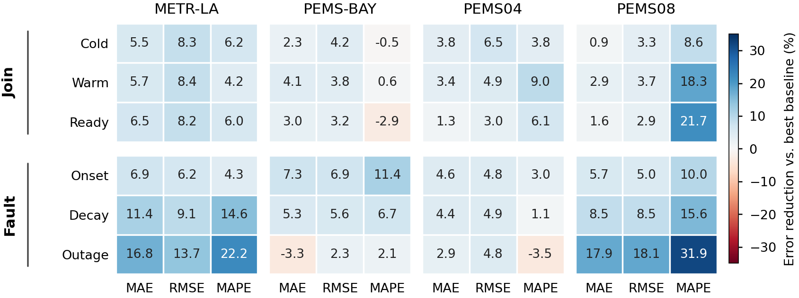
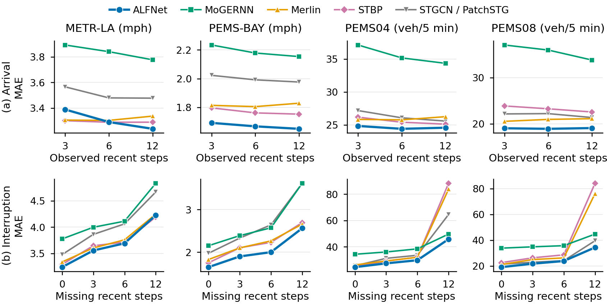
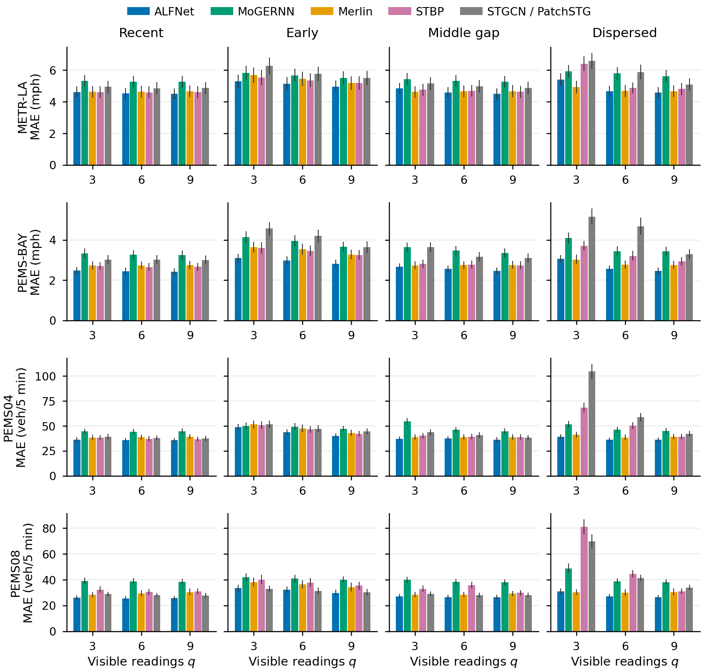
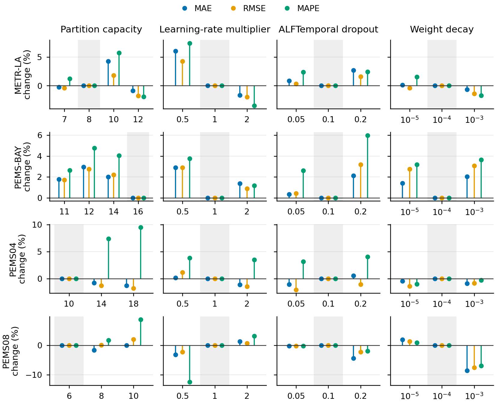
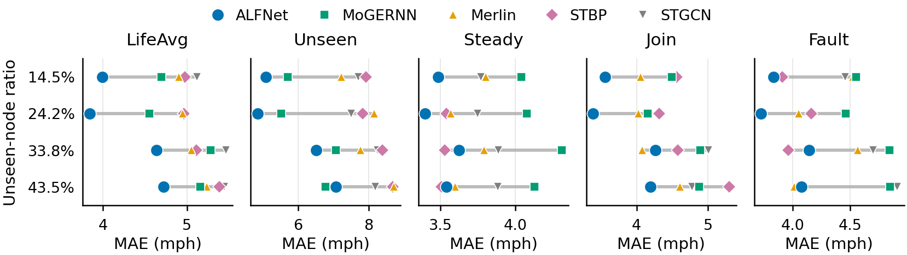
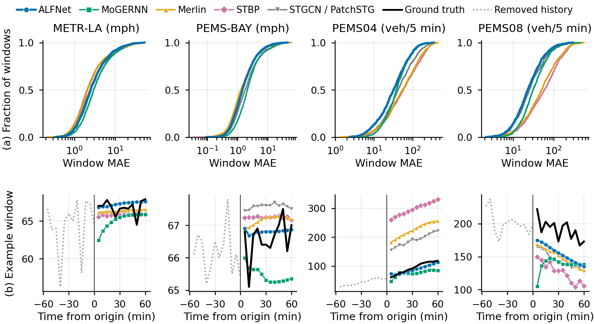
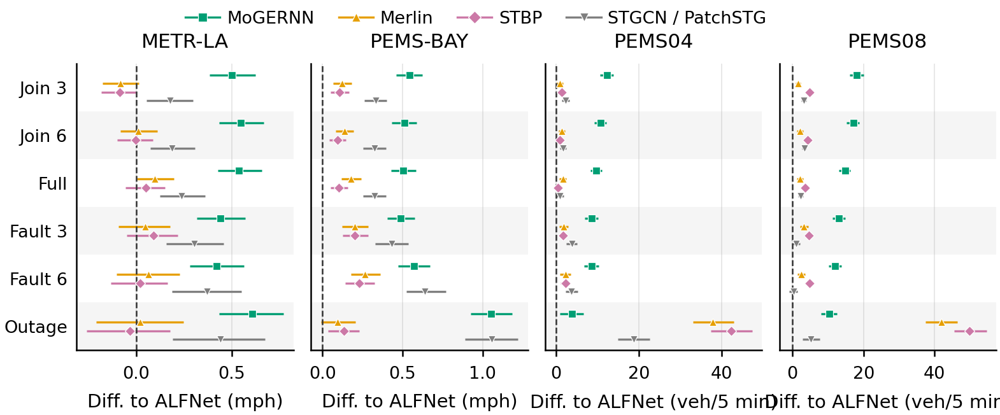
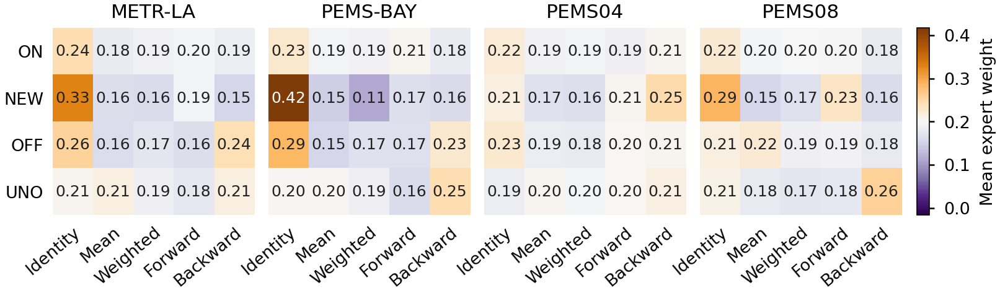

# ALFNet：动态观测支持下的归纳时空预测

<!-- v6 中文工作稿（2026-11-12 第十轮修改：主表只列四类场景、五项消融、METR-LA 配对分析改用四组各自最优的代表基线、新增附录；2026-11-13 第十一轮：附录正文并入本文件，4.5/4.6/4.8 改为四个数据集的全窗口分析，4.7 增加保留节点比例实验；第十二轮：按 ../notes/WRITING_RULES_CN.md 重写结果分析，图4 改为柱状图、图6 改为点图、图7 改为两行，比较方法的实现移至附录A.5，删除计算开销）。本文件是编辑源头，sections/*.tex 由 _scripts/md_to_tex.py 从本文件生成；历史版本见 git 记录。逐条修改依据见 ../notes/V6_CHANGELOG_CN.md。 -->

## 摘要

交通预测依赖路网上各传感器的历史读数，而传感器的状况并不固定：有的位置始终没有传感器，有的传感器刚刚接入、只有最近几步读数，有的传感器中途失效、丢掉了最近的读数。本文研究这种情形下的归纳时空预测：路网拓扑已知，部分节点的读数不参与训练，历史窗口内可以发生传感器的接入或失效，推理时模型参数不更新。我们把历史窗口内实际可用读数的位置、数量和时间分布称为观测支持（OS），并把它表示为逐步的输入：观测角色（在线 ON、新接入 NEW、无观测 UNO、已失效 OFF）与观测掩码，辅以接入或失效已持续的比例（状态进度）。在此基础上，我们提出 ALFNet，它由三个模块组成：观测支持感知历史补全（SAHC）为全部节点补出一份共享的历史；空间上下文时间条件分支（ALFTemporal）从其他节点的历史中提取条件特征，经特征级线性调制（FiLM）作用于图预测分支；观测条件化图预测（ALFGraph）依据 OS 组合五种图传播算子，并解码得到预测。评价按目标节点在窗口内的观测轨迹分为四类场景：全程无读数（Unseen）、全程可读（Steady）、窗口内接入（Join）与窗口内失效（Fault）；Join 与 Fault 再按接入或失效后的持续步数各分为三个阶段。在 METR-LA、PEMS-BAY、PEMS04 和 PEMS08 四个数据集上，我们与十一个方法在三个随机种子下做了统一比较。ALFNet 四类场景平均误差（LifeAvg）的三项指标在四个数据集上均为最低，平均绝对误差（MAE）比最强的比较方法低5.59%–14.95%；在本地读数随接入而增加、随失效而中断的 Join 与 Fault 场景下，三项指标在四个数据集上均为最低。消融实验表明，去除 OS 输入、SAHC、ALFTemporal 或 OS 路由中的任何一项，四个数据集上的 LifeAvg MAE 都会上升。

## 1 引言

交通预测根据路网上传感器的历史读数预测未来的速度或流量，是信号控制、路径诱导和拥堵预警的基础。多数预测模型默认每个位置在历史窗口内都有完整的读数，但实际的传感网络做不到这一点：受预算限制，许多需要预测的位置从未安装传感器；路网扩建会接入新的传感器，它们起初只有很短的历史；设备故障或通信异常又会让原本正常的传感器中断读数 [1,2]。于是，在同一时刻的路网上，有的位置历史完整，有的位置只有最近几步读数，有的位置刚丢掉最近的读数，还有的位置完全没有读数。本文关心的就是这种情形下的预测：路网拓扑已知，部分位置的读数不参与训练，历史窗口内可以发生传感器的接入或失效，模型在推理时不更新参数，需要用同一组参数预测所有位置未来的交通状态。我们称之为动态观测支持下的归纳时空预测，其中观测支持（OS）指历史窗口内实际可用读数的位置、数量和时间分布。

已有研究分别处理过其中的一部分。归纳预测方法把模型推广到没有训练数据的位置，可以预测无传感器位置的未来状态 [2–6]；面向缺失数据的预测方法处理输入中缺失的读数，其中一些还把掩码或距上次观测的时间间隔作为输入 [7–10]；面向传感网络变化的方法通过持续学习、少量样本适应或分布外泛化来应对新增的节点 [11–17]。这些方法大多用掩码或节点所属的类别来描述读数是否可用。然而，掩码只说明某一步有没有读数：当一个位置在窗口内完全没有读数时，掩码分不清它是从未接入还是刚刚失效；当它只有几步读数时，掩码也不说明接入或失效已经持续了多久。这两点恰恰关系到预测应当依靠什么：刚接入的位置只有很少的本地读数，需要更多地借助关联位置；刚失效的位置还保留着较早的读数，这些读数的参考价值会随失效时间变长而下降。MoGERNN [2] 在同一个模型中考察了新增与失效的传感器，与本文最为接近，但它依据节点的输入特征选择图专家，没有把接入或失效的进程作为显式的输入。

因此，本文要回答的核心问题是：*当各位置的本地读数随接入而增加、随失效而减少时，如何用同一组固定的参数，预测处于不同观测状态的所有位置？* 回答这一问题面临两个相互关联的挑战：*（1）如何描述每个位置的观测状态，使模型能够区分“从未接入”“刚刚接入”与“已经失效”等不同情形；（2）如何依据观测状态，协调各位置自身的历史读数与来自关联位置的空间信息。*

针对这两个挑战，我们提出 ALFNet（Adaptive Lifecycle Forecasting Network）。对于第一个挑战，ALFNet 把 OS 表示为逐步的输入：观测角色标明节点在该步是在线（ON）、新接入（NEW）、无观测（UNO）还是已失效（OFF），观测掩码标明该步的读数是否可用，并辅以接入或失效已持续的比例（状态进度）。对于第二个挑战，ALFNet 让 OS 参与三个模块的计算。观测支持感知历史补全（SAHC）利用可见读数和路网关联，为全部节点补出一份完整的历史，供后续模块共用。空间上下文时间条件分支（ALFTemporal）把节点划分为空间分区，从其他节点的历史中提取条件特征，再经特征级线性调制（FiLM）作用于图预测分支，为本地读数不足的节点提供参考。观测条件化图预测（ALFGraph）配有五种图传播算子，编码的每一步都由 OS 决定它们的组合权重，使空间信息的交换方式随观测状态而变，最后解码得到预测。名称中的“自适应”指计算随输入的 OS 变化，模型参数在推理时保持不变。这些模块借鉴了图循环插补 [18]、空间分区交互 [19]、两阶段注意力 [20]、特征级线性调制 [21]、图专家混合 [2,22] 与扩散卷积循环网络 [23] 的做法。与 MoGERNN 相比，ALFNet 同样使用图专家混合，区别在于路由的依据与作用位置：ALFNet 的路由只由 OS 决定、不读取信号值，并作用于编码器每一步的图传播。

我们在 METR-LA、PEMS-BAY、PEMS04 与 PEMS08 四个数据集上，与四类共十一个方法在三个随机种子下做了统一比较。评价按目标位置在窗口内的观测轨迹分为四类场景：全程无读数（Unseen）、全程可读（Steady）、窗口内接入（Join）与窗口内失效（Fault）。ALFNet 四类场景平均误差（LifeAvg）的三项指标在四个数据集上均为最低，平均绝对误差（MAE）比最强的比较方法低5.59%–14.95%；在本地读数逐步增加或中断的 Join 与 Fault 场景下，三项指标在四个数据集上均为最低。

本文的贡献概括为三点：（1）问题与评价：提出动态观测支持下的归纳时空预测设置及其评价协议，按目标位置的观测轨迹划分四类场景，并按接入或失效后的持续步数划分阶段，用来检验预测能否随本地读数的增减而调整；（2）方法：提出 ALFNet，把 OS 表示为逐步的输入（观测角色、观测掩码及状态进度），并让它参与历史补全、跨节点条件特征的提取和图传播的路由；（3）实验：四个数据集、十一个比较方法、三个随机种子的统一比较表明，ALFNet 的 LifeAvg 三项指标均为最低，Join 与 Fault 场景的三项指标在四个数据集上也均为最低；五项消融表明，去除 OS 输入、SAHC、ALFTemporal 内部的跨节点交互、整个时间条件分支或 OS 路由中的任何一项，四个数据集上的 LifeAvg MAE 都会上升，各组件都对预测有贡献。

## 2 相关工作

本节按四个方向回顾已有研究：未观测位置的归纳预测（2.1）、不完整观测下的预测（2.2）、传感网络变化与跨路网泛化（2.3）、时空预测主干与条件化计算（2.4）。每个小节先按时间顺序介绍相关方法，再说明与 ALFNet 的区别；加粗的方法是本文实验中的比较方法。各方向之间有交叉，部分方法同时涉及多个方向。

### 2.1 未观测位置的归纳预测

这一方向关注训练时没有读数的位置。较早的工作是时空克里金，它利用已观测位置估计同一时段未观测位置的值：IGNNK、INCREASE 与 KITS 分别通过随机子图训练、异质空间关系建模和向训练图加入虚拟节点，使模型无需重新训练即可用于新位置 [24–26]。这些方法只做同一时段的估计，不预测未来。面向未来的工作中，FUNS 只在已观测位置上优化模型，预测完全没有传感器的位置 [3]；UIGNN 进一步给出预测的不确定性 [4]；FRIGATE 在只有部分路段装有传感器的路网上做预测，并在冻结参数下检验了路网拓扑变化与历史快照缺失的影响 [5]。SCPT 在推理时利用新道路两天的数据生成其空间表示 [29]；STSM 把对象扩展到连续的无观测区域，并借助道路与兴趣点等静态特征 [27]；ST-FiT 通过时间数据增强与图拓扑学习，泛化到只有输入历史而没有训练数据的节点 [6]；GenCast 则为无观测区域的预测引入物理约束与天气信息 [28]。**MoGERNN** 以图专家混合为未观测节点构造表示，并在同一模型中考察了测试期新增与失效的传感器 [2]；**SLPF** 利用未感知位置的临时观测学习向推理期的空间转移，用于长期的部分感知预测 [30]。

在这些工作中，哪些位置有读数通常由评价配置事先确定，接入与失效作为事件及其持续时间较少被显式表示。ALFNet 用观测角色与状态进度表示这两类事件，并让同一组参数既处理全程没有读数的位置，也处理在窗口内刚开始有读数的位置。

### 2.2 不完整观测下的预测

这一方向处理输入中缺失的读数。GRU-D 把掩码与距上次观测的时间间隔引入循环更新 [10]。GMN 把相邻时刻全网状态的转移视为图马尔可夫过程，逐步推断缺失状态并预测 [32]。GRIN 与 PriSTI 等插补方法可以先重建缺失序列，再交给预测器 [18,31]，但插补误差会传入预测，重建历史的目标也与预测未来不同；GSTAE 把插补与预测作为并行任务顺序训练 [33]。GCN-M 把观测掩码与多尺度历史记忆、动态图卷积结合 [34]；HD-TTS 对输入进行分层时空下采样，并依据观测与缺失的模式组合多尺度表示 [9]。GinAR+ 以不同缺失率的数据构造对比样本，使一个模型适应变化的缺失率 [36]；MAS-Mamba 以掩码与时间间隔调节状态空间模型的更新，使中断期间的状态得以保持或衰减 [35]。**GinAR** 以插值注意力与自适应图卷积，端到端地处理部分变量整段历史缺失下的预测 [7]；**Merlin** 以完整观测的教师模型做知识蒸馏，并结合多视图对比学习，使一个模型适应不固定的缺失率 [8]。

这些研究说明，缺失信息本身可以作为调整计算的依据。它们大多在直推设置下进行，缺失的节点在训练期仍提供标签；本文的保留节点从未提供训练信号。此外，ALFNet 除掩码外还使用观测角色与状态进度，以区分“从未可读”与“曾经可读、随后失效”，并记录接入或失效已持续的比例。

### 2.3 传感网络变化与跨路网泛化

真实的传感网络随时间扩张和变化，XXLTraffic 整理了跨度最长23年、节点逐年增加的交通数据 [1]。一类工作在网络扩张后利用新数据增量更新模型并缓解遗忘，如 TrafficStream、PECPM 与 EAC [11,12,37]。另一类工作使用少量目标观测做适应：SC-SAMG 利用新传感器一至七天的数据 [14]；SIML-MSIGN 把不同的观测布局组织为任务，训练时同时监督观测与未观测节点，并报告了零步与少步适应的结果 [15]。还有工作在不更新参数的条件下泛化到变化后的网络，如以上下文单元为中介进行集中式消息传递的 STOP [17]。**STONE** 借助对结构偏移不敏感的空间嵌入，在测试期加入新节点时不更新参数 [16]；**MCPST** 面向跨城市的少样本预测，从扩散、同步与谱嵌入三个角度刻画交通动态并融合各自的预测，再以元学习适应数据很少的新城市 [47]；**STBP** 是带可扩展上下文模式库的持续预测主干 [13]。

ALFNet 属于不更新参数的设置，推理时不使用目标节点的标签。与上述工作的区别在于变化发生的尺度与表示方式：ALFNet 面对的是单个历史窗口内的接入与中断，并用观测角色与状态进度显式表示事件及其进度。持续学习与少步适应可以与之互补。

### 2.4 时空预测主干与条件化计算

空间依赖建模是交通预测利用关联位置的基本途径。DCRNN 以扩散卷积刻画有向路网上的传播 [23]，Graph WaveNet 与 AGCRN 以可学习的节点表示构造自适应邻接 [39,40]。逐节点的可训练参数不利于迁移到训练中未出现的节点，Cini 等系统分析了全局共享参数与节点特定参数之间的取舍 [41]。PDFormer 在长程注意力中建模传播时延 [43]。另一些工作让计算随条件变化：FiLM 提供了以条件特征缩放与平移中间表示的一般方式 [21]；图专家混合使节点自适应地选择不同跳数的聚合专家 [22]；TESTAM 在恒等、静态图与动态图三类空间建模专家之间按交通状况路由 [44]；在多模态学习中，Flex-MoE 依据可用模态的组合组织专家 [45]。**STGCN** 结合图卷积与时间卷积 [38]；**STID** 表明，带有时空身份信息的简洁模型也能形成有竞争力的预测基线 [42]；**PatchSTG** 通过空间分块组织块内与块间的交互，提高大规模路网上的效率 [19]；**MetaDG** 由输入动态生成节点表示，并据此构造动态图与图卷积循环单元的参数 [48]。

ALFNet 借鉴专家混合与特征调制的思想，但条件的来源与作用位置不同：图专家的路由只由 OS 决定、不读取信号值；FiLM 的参数来自跨节点的时间上下文；空间分区注意力只用于生成条件特征，不直接输出预测。

## 3 方法

图1给出 ALFNet 的总体架构。3.1节定义问题与 OS 的表示，对应图中左列的输入；3.2–3.4节依次介绍 SAHC、ALFTemporal 与 ALFGraph，分别对应图中第二列、右上与右下部分；3.5节给出训练目标。

<!-- 图1：使用 PDF 矢量架构图。 -->

**图1　ALFNet 总体架构。** 左列为输入：可见历史 $\mathbf{X}$、生命周期上下文 $\mathbf{S}=[\mathbf{R},\mathbf{a},\mathbf{M}]$ 与静态路网（3.1节）；第二列为 SAHC（3.2节）；右上为 ALFTemporal 及其 FiLM 参数头（3.3节）；右下为 ALFGraph，包括 OS 路由的图编码器、FiLM 调制、残差自回归解码、参考恢复与角色缩放图修正（3.4节）。

### 3.1 问题设置

**任务。** 本文研究动态观测支持下的归纳时空预测：给定路网和各节点在历史窗口内可见的读数，预测全部节点未来的交通状态；其中一部分节点的读数从不参与训练，窗口内可以发生传感器的接入或失效，模型在推理时不更新参数。预测的对象始终是未来的交通数值；历史补全、空间分区与专家路由是 ALFNet 为完成预测采用的手段，不属于任务本身。

**路网、节点划分与数据。** 路网表示为有向加权图 $\mathcal{G}=(\mathcal{V},\mathbf{A})$，其中 $|\mathcal{V}|=N$，$\mathbf{A}\in\mathbb{R}_{\ge 0}^{N\times N}$ 为加权邻接矩阵，全部节点的拓扑及静态属性在训练与推理中均可见。节点划分为已知节点 $\mathcal{V}_K$ 以及验证、测试保留节点 $\mathcal{V}_V$、$\mathcal{V}_T$：训练只读取 $\mathcal{V}_K$ 的动态信号，验证与测试分别加入 $\mathcal{V}_V$ 与 $\mathcal{V}_T$ 的历史；标准化统计量仅由训练时段的 $\mathcal{V}_K$ 计算。给定历史长度 $L=12$ 与预测长度 $H=12$，记标准化后的历史为 $\mathbf{X}\in\mathbb{R}^{L\times N}$，未来目标为 $\mathbf{Y}\in\mathbb{R}^{H\times N}$，观测掩码为 $\mathbf{M}\in\{0,1\}^{L\times N}$；$\mathbf{x}_t,\mathbf{m}_t\in\mathbb{R}^{N}$ 为第 $t$ 步全部节点的读数与掩码，即 $\mathbf{X}$ 与 $\mathbf{M}$ 的第 $t$ 行。不可用位置的输入值置零。

**观测角色与状态进度。** 窗口内哪些读数可用由 OS 描述。除掩码外，本文再用两个逐步变量刻画 OS。在第 $t$ 步，每个节点属于以下四种观测角色之一：在线（ON）表示节点处于当前阶段的信号暴露范围内，且没有发生接入或失效事件；新接入（NEW）表示节点在窗口内接入，接入后开始提供读数；已失效（OFF）表示节点原本可读，在窗口内失效后不再提供读数；无观测（UNO）表示节点在该步没有可读历史，包括尚未接入的节点以及不在当前阶段信号暴露范围内的节点（如训练时的保留节点）。这四种角色与 MoGERNN 对传感器的四类划分（持续可用、新增、失效与虚拟传感器）相对应 [2]；不同的是，本文的角色逐步定义，同一节点在一个窗口内可以由 UNO 变为 NEW，或由 ON 变为 OFF。$\mathbf{R}_t\in\{0,1\}^{N\times4}$ 依次按 ON、NEW、UNO、OFF 对观测角色做 one-hot 编码。状态进度 $\mathbf{a}_t\in[0,1]^{N}$ 描述接入或失效已持续的比例：
$$
a_{t,n}=\begin{cases}1, & \text{节点 } n \text{ 在第 } t \text{ 步为 ON},\\ 0, & \text{节点 } n \text{ 在第 } t \text{ 步为 UNO},\\ \lambda/L, & \text{节点 } n \text{ 在第 } t \text{ 步为 NEW 或 OFF，且处于接入或失效后的第 } \lambda \text{ 步}.\end{cases}
\tag{1}
$$
观测掩码由读数的自然有效性与观测角色共同决定：$M_{t,n}=1$ 当且仅当该读数自然有效且节点在第 $t$ 步为 ON 或 NEW。自然缺失只改变 $\mathbf{M}$，不改变观测角色，因此 ON 的偶发缺测仍记为 ON。三者逐步拼接为生命周期上下文
$$
\mathbf{S}_t=[\mathbf{R}_t,\ \mathbf{a}_t,\ \mathbf{m}_t]\in\mathbb{R}^{N\times 6},\qquad t=1,\dots,L.
\tag{2}
$$

**场景。** 按目标节点在窗口内的观测角色轨迹，OS 的变化归纳为四类场景。记 $m\in\{1,\dots,L\}$ 为接入或失效之后已经持续的步数（事件持续步数）：Unseen 中目标节点全程为 UNO；Steady 中全程为 ON；Join 中前 $L-m$ 步为 UNO、最后 $m$ 步为 NEW；Fault 中前 $L-m$ 步为 ON、最后 $m$ 步为 OFF。因此，Join 中 $m$ 越大，窗口内可读的新读数越多；Fault 中 $m$ 越大，缺失的近期读数越多。$m$ 在 $1$ 至 $L$ 内均匀抽取；训练时四类场景均在已知节点上模拟。窗口内可见读数数 $q_n=\sum_{t}M_{t,n}$ 只用于描述 OS 的多少，不作为额外输入。本文假设观测角色与状态进度已知，实际应用中可由传感器接入记录与故障检测获得。

**预测任务。** 在上述设置下，预测任务是学习映射
$$
\hat{\mathbf{Y}}=f_{\theta}\big(\mathbf{X}\odot\mathbf{M},\ \mathbf{S}_{1:L},\ \mathbf{A},\ \mathcal{T}\big)\in\mathbb{R}^{H\times N},
\tag{3}
$$
其中 $\mathcal{T}$ 为窗口内各步的日历信息（日内时段与星期）。参数 $\theta$ 只用训练时段已知节点 $\mathcal{V}_K$ 的读数学习，验证与测试时保持不变，也不使用保留节点的标签。同一节点在不同窗口中可以处于不同的观测角色与布局，因此模型应依据当前窗口的 OS 组织计算，而不是依据节点是否参与过训练。

**任务条件与本文的做法。** 上述设置中，属于任务条件的有四点：全部节点的拓扑与静态属性已知；保留节点的读数不参与训练；各节点在窗口内的接入与失效状态已知；推理时不更新参数。用 $\mathbf{R}$、$\mathbf{a}$ 与 $\mathbf{M}$ 拼成 $\mathbf{S}$ 来表示 OS，是 ALFNet 的做法，其他方法可以采用别的表示；$m$ 的均匀抽取与四类场景的等配额属于实验协议（4.1节）。

### 3.2 观测支持感知历史补全（SAHC）

SAHC 对全部 $N$ 个节点、完整的 $L$ 步历史只运行一次，依次进行双向图循环补全、窗口内插值与参考中心化。记 $\mathrm{rn}(\cdot)$ 为矩阵的行归一化（每行除以该行元素之和，全零行保持不变），前向与后向转移矩阵为 $\mathbf{P}_{\mathrm f}=\mathrm{rn}(\mathbf{A})$ 与 $\mathbf{P}_{\mathrm b}=\mathrm{rn}(\mathbf{A}^{\top})$。

**图门控循环单元。** SAHC 与 ALFGraph 都以图门控循环单元为递推单元。给定输入 $\mathbf{x}$ 与上一隐藏状态 $\mathbf{h}$，单元按
$$
\begin{aligned}
\mathbf{r}&=\sigma\big(\Phi_r([\mathbf{x},\mathbf{h}])\big),\qquad \mathbf{u}=\sigma\big(\Phi_u([\mathbf{x},\mathbf{h}])\big),\\
\tilde{\mathbf{h}}&=\tanh\big(\Phi_c([\mathbf{x},\mathbf{r}\odot\mathbf{h}])\big),\qquad \mathbf{h}'=\mathbf{u}\odot\mathbf{h}+(\mathbf{1}-\mathbf{u})\odot\tilde{\mathbf{h}}
\end{aligned}
\tag{4}
$$
更新隐藏状态，其中 $\mathbf{r}$、$\mathbf{u}$ 为重置门与更新门，$\tilde{\mathbf{h}}$ 为候选状态，$\sigma(\cdot)$ 为 sigmoid；$\Phi_r$、$\Phi_u$、$\Phi_c$ 为三个参数独立的图变换，输出宽度均为64。SAHC 中三个图变换均取二阶扩散卷积 $\mathcal{D}(\mathbf{U})=[\mathbf{U},\mathbf{P}_{\mathrm f}\mathbf{U},\mathbf{P}_{\mathrm f}^{2}\mathbf{U},\mathbf{P}_{\mathrm b}\mathbf{U},\mathbf{P}_{\mathrm b}^{2}\mathbf{U}]\,\mathbf{W}_{\mathcal{D}}$，记该单元为 $\mathrm{GRU}_{\mathcal{D}}$；ALFGraph 中的图变换在3.4节给出。

**双向图循环补全。** SAHC 沿时间正、反两个方向各运行一个图循环补全层。以正向为例，隐藏状态 $\mathbf{h}_0=\mathbf{0}\in\mathbb{R}^{N\times64}$。对 $t=1,\dots,L$，先由上一隐藏状态给出初步估计，并保留可见位置的观测值：
$$
\hat{\mathbf{x}}^{(1)}_t=\mathbf{h}_{t-1}\mathbf{W}_1,\qquad \mathbf{x}^{(1)}_t=\mathbf{m}_t\odot\mathbf{x}_t+(\mathbf{1}-\mathbf{m}_t)\odot\hat{\mathbf{x}}^{(1)}_t.
\tag{5}
$$
随后通过一次空间消息传递修正估计：
$$
\begin{aligned}
\mathbf{z}_t&=[\mathbf{x}^{(1)}_t,\ \mathbf{S}_t,\ \mathbf{h}_{t-1}]\,\mathbf{W}_{\mathrm{in}},\\
\boldsymbol{\rho}_t&=\Big[\mathrm{PReLU}\big(\big[[\mathbf{P}_{\mathrm f}\mathbf{z}_t,\ \mathbf{P}_{\mathrm b}\mathbf{z}_t]\,\mathbf{W}_{\mathrm s},\ \mathbf{h}_{t-1}\big]\,\mathbf{W}_{\mathrm o}\big),\ \mathbf{h}_{t-1}\Big],\qquad \hat{\mathbf{x}}^{(2)}_t=\boldsymbol{\rho}_t\mathbf{W}_2,
\end{aligned}
\tag{6}
$$
其中 $\mathbf{z}_t\in\mathbb{R}^{N\times64}$ 为投影后的输入，$\boldsymbol{\rho}_t\in\mathbb{R}^{N\times128}$ 为该步的节点表示。修正后的估计同样只填入缺失位置，再与生命周期上下文一起更新隐藏状态：
$$
\mathbf{x}^{(2)}_t=\mathbf{m}_t\odot\mathbf{x}_t+(\mathbf{1}-\mathbf{m}_t)\odot\hat{\mathbf{x}}^{(2)}_t,\qquad \mathbf{h}_t=\mathrm{GRU}_{\mathcal{D}}\big([\mathbf{x}^{(2)}_t,\ \mathbf{S}_t],\ \mathbf{h}_{t-1}\big).
\tag{7}
$$
反向层在时间反转的序列上执行相同计算，参数独立。记正向与反向在第 $t$ 步的节点表示为 $\overrightarrow{\boldsymbol{\rho}}_t$ 与 $\overleftarrow{\boldsymbol{\rho}}_t$，二者在每个历史位置上与掩码拼接，经多层感知机（MLP）融合为重建值，最后保留可见读数：
$$
\mathbf{x}^{\mathrm{rec}}_t=\mathrm{ReLU}\big([\overrightarrow{\boldsymbol{\rho}}_t,\ \overleftarrow{\boldsymbol{\rho}}_t,\ \mathbf{m}_t]\,\mathbf{W}_3\big)\mathbf{W}_4,\qquad \mathbf{X}^{\mathrm{c}}=\mathbf{M}\odot\mathbf{X}+(\mathbf{1}-\mathbf{M})\odot\mathbf{X}^{\mathrm{rec}},
\tag{8}
$$
其中 $\mathbf{X}^{\mathrm{rec}}=[\mathbf{x}^{\mathrm{rec}}_1,\dots,\mathbf{x}^{\mathrm{rec}}_L]^{\top}$ 为重建结果。式(5)–(8)中的 $\mathbf{W}_{\ast}$ 均为可学习矩阵，偏置省略，隐藏宽度与融合 MLP 的宽度均为64。生命周期上下文进入两个方向的每一步递推，掩码还用于保留可见读数与融合。SAHC 没有独立的重建损失，只通过下游预测损失训练。

**窗口内插值。** 设 $\iota\in\{0,1\}$ 为插值开关。$\iota=1$ 时，对至少有一个可见读数（$q_n>0$）的节点，用窗口内可见读数的线性插值覆盖其缺失位置：
$$
X^{\mathrm{fill}}_{t,n}=\begin{cases}X_{t^{-},n}+\dfrac{t-t^{-}}{t^{+}-t^{-}}\big(X_{t^{+},n}-X_{t^{-},n}\big), & \iota=1,\ M_{t,n}=0,\ q_n>0,\\[6pt] X^{\mathrm{c}}_{t,n}, & \text{其他情况},\end{cases}
\tag{9}
$$
其中 $t^{-}$ 与 $t^{+}$ 为 $t$ 之前与之后最近的可见步；$t$ 位于第一个可见步之前或最后一个可见步之后时，二者都取最近的可见步并令分式为0，即取最近的可见值。没有可见读数的节点保留 $\mathbf{X}^{\mathrm{c}}$ 中的补全值，因此插值与图循环补全不是按 $q_n$ 互斥的两条支路。

**参考中心化。** 记 $t^{\ast}_n=\max\{t:M_{t,n}=1\}$ 为节点 $n$ 的最后一个可见步，参考值与中心化后的共享历史为
$$
v_n=\begin{cases}X_{t^{\ast}_n,n}, & q_n>0,\\ 0, & q_n=0,\end{cases}\qquad \bar{\mathbf{X}}=\mathbf{X}^{\mathrm{fill}}-\alpha\,\mathbf{1}_L\mathbf{v}^{\top},
\tag{10}
$$
其中 $\alpha\ge0$ 为中心化强度，$\mathbf{1}_L$ 为全1列向量，即 $\mathbf{v}$ 沿时间维广播；$\mathbf{S}$ 保持不变。中心化在输出端由式(26)加回。上述处理均不使用未来或被遮蔽的真值。保留观测值发生在中心化之前，中心化后可见位置的数值也随之平移。ALFTemporal 与 ALFGraph 读取同一份 $\bar{\mathbf{X}}$。

### 3.3 空间上下文时间条件分支（ALFTemporal）

ALFTemporal 从跨节点历史生成逐节点的条件特征。它只为 ALFGraph 提供条件，不产生独立预测；计算上先由它得到调制参数，再执行 ALFGraph。

**时间嵌入。** 对每个节点 $n$，ALFTemporal 读取 $\mathbf{F}_n=[\bar{\mathbf{X}}_{:,n},\ \mathbf{S}_{1:L,n},\ \boldsymbol{\tau}/288,\ \boldsymbol{\delta}/7]\in\mathbb{R}^{L\times9}$，其中 $\bar{\mathbf{X}}_{:,n}$ 为 $\bar{\mathbf{X}}$ 的第 $n$ 列，$\mathbf{S}_{1:L,n}\in\mathbb{R}^{L\times6}$ 为节点 $n$ 在各步的生命周期上下文，$\tau_t=12\cdot\mathrm{hour}_t+\lfloor\mathrm{minute}_t/5\rfloor\in\{0,\dots,287\}$ 为日内时段，$\delta_t\in\{0,\dots,6\}$ 为星期。卷积核长度与步长均为 $L$ 的时间卷积把整个窗口映射为一个64维向量，等价于
$$
\mathbf{e}_n=\mathrm{vec}(\mathbf{F}_n)\,\mathbf{W}_e+\mathbf{b}_e\in\mathbb{R}^{64},\qquad \mathbf{W}_e\in\mathbb{R}^{9L\times64},
\tag{11}
$$
因此每个节点只有一个时间 patch，窗口内读数的位置信息由 $\mathbf{W}_e$ 的不同行保留。随后拼接日历与结构嵌入：
$$
\mathbf{z}^{0}_n=\big[\mathbf{e}_n\ \|\ \mathbf{E}^{\mathrm{tod}}_{\tau_L}\ \|\ \mathbf{E}^{\mathrm{dow}}_{\delta_L}\ \|\ \phi(\mathbf{g}_n)\big]\in\mathbb{R}^{160},
\tag{12}
$$
其中 $\|$ 表示拼接，$\mathbf{E}^{\mathrm{tod}}\in\mathbb{R}^{288\times32}$ 与 $\mathbf{E}^{\mathrm{dow}}\in\mathbb{R}^{7\times32}$ 为可学习的日历嵌入表，按末步的日内时段与星期取行。

**结构嵌入。** 模型不使用逐节点可训练的身份嵌入，以免为保留节点引入可训练的身份参数；结构嵌入由所有节点共享的映射 $\phi$ 作用于静态结构特征 $\mathbf{g}_n\in\mathbb{R}^{7}$ 得到。记 $d^{\mathrm{in}}_n=\sum_{n'\ne n}A_{n'n}$、$d^{\mathrm{out}}_n=\sum_{n'\ne n}A_{nn'}$、$d^{\mathrm{tot}}_n=d^{\mathrm{in}}_n+d^{\mathrm{out}}_n$，$(o^{1}_n,o^{2}_n)$ 为节点的两维坐标（无坐标时置零），则
$$
\begin{aligned}
\mathbf{g}_n&=\big[\nu(\mathbf{o}^{1})_n,\ \nu(\mathbf{o}^{2})_n,\ \nu(\mathbf{d}^{\mathrm{in}})_n,\ \nu(\mathbf{d}^{\mathrm{out}})_n,\ \nu(\mathbf{d}^{\mathrm{tot}})_n,\ \nu\big(\log(1+\mathbf{d}^{\mathrm{tot}})\big)_n,\ \mathbb{I}[d^{\mathrm{tot}}_n=0]\big],\\
\nu(\mathbf{s})_n&=\frac{s_n-\bar{s}}{\max_{n'}|s_{n'}-\bar{s}|},
\end{aligned}
\tag{13}
$$
其中 $\mathbf{o}^{1}$、$\mathbf{d}^{\mathrm{in}}$ 等表示由全部节点的相应取值组成的向量，$\bar{s}$ 为向量 $\mathbf{s}$ 在全部节点上的均值，$\mathbb{I}[\cdot]$ 为指示函数；$\phi$ 为两层 MLP（$7\to64\to32$，ReLU 激活）。

**空间分区。** 训练前，节点被划分为 $P=32$ 个分区，每个分区含 $C$ 个槽位：节点坐标可靠时按坐标以 KD-tree 划分，否则依据图拓扑做考虑连通分量的广度优先搜索（BFS）划分。记 $\pi(p,c)$ 为第 $p$ 个分区第 $c$ 个槽位对应的节点；节点不足 $C$ 个的分区以邻接排序的真实节点补足，这些补足副本只提供上下文，不产生输出。按 $\pi$ 排列得到分区张量 $\mathbf{T}\in\mathbb{R}^{P\times C\times160}$，其中 $\mathbf{T}_{p,c}=\mathbf{z}^{0}_{\pi(p,c)}$；下文以 $\mathbf{T}_{:,c}\in\mathbb{R}^{P\times160}$ 表示各分区第 $c$ 个槽位组成的切片，以 $\mathbf{T}_{p,:}\in\mathbb{R}^{C\times160}$ 表示第 $p$ 个分区的全部槽位。

**两阶段注意力。** 分区张量经一个两阶段注意力块处理。记单头注意力与前馈层为
$$
\mathrm{Attn}(\mathbf{Q},\mathbf{K},\mathbf{V})=\mathrm{softmax}\Big(\frac{(\mathbf{Q}\mathbf{W}^{Q})(\mathbf{K}\mathbf{W}^{K})^{\top}}{\sqrt{160}}\Big)\mathbf{V}\mathbf{W}^{V}\mathbf{W}^{O},\qquad \mathrm{FFN}(\cdot)=\mathrm{GELU}\big((\cdot)\,\mathbf{W}^{F}_{1}\big)\mathbf{W}^{F}_{2},
\tag{14}
$$
其中各投影矩阵均为 $160\times160$，偏置省略；每次出现的 Attn 与 FFN 各有独立参数。第一阶段为跨分区注意力：对每个槽位 $c$，在 $P$ 个分区的同位 token $\mathbf{T}_{:,c}$ 之间做自注意力，
$$
\tilde{\mathbf{T}}_{:,c}=\mathrm{LN}\big(\mathbf{T}_{:,c}+\mathrm{Attn}_1(\mathbf{T}_{:,c},\mathbf{T}_{:,c},\mathbf{T}_{:,c})\big),\qquad \mathbf{T}'_{:,c}=\mathrm{LN}\big(\tilde{\mathbf{T}}_{:,c}+\mathrm{FFN}_1(\tilde{\mathbf{T}}_{:,c})\big),
\tag{15}
$$
其中 LN 为层归一化。对 $c=1,\dots,C$ 执行式(15)，得到第一阶段输出 $\mathbf{T}'\in\mathbb{R}^{P\times C\times160}$，其中每个 $\mathbf{T}'_{p,c}$ 都已融合其他分区同一槽位的信息。第二阶段在每个分区内部进行：对分区 $p$ 取 $\mathbf{T}'_{p,:}$，由4个可学习的潜在 token $\mathbf{Q}_p\in\mathbb{R}^{4\times160}$ 先从 $C$ 个槽位汇聚信息，再回传给各槽位，
$$
\begin{aligned}
\mathbf{B}_p&=\mathrm{Attn}_2(\mathbf{Q}_p,\mathbf{T}'_{p,:},\mathbf{T}'_{p,:}),\\
\tilde{\mathbf{T}}_{p,:}&=\mathrm{LN}\big(\mathbf{T}'_{p,:}+\mathrm{Attn}_3(\mathbf{T}'_{p,:},\mathbf{B}_p,\mathbf{B}_p)\big),\qquad \mathbf{T}''_{p,:}=\mathrm{LN}\big(\tilde{\mathbf{T}}_{p,:}+\mathrm{FFN}_2(\tilde{\mathbf{T}}_{p,:})\big).
\end{aligned}
\tag{16}
$$
其中 $\mathbf{B}_p\in\mathbb{R}^{4\times160}$ 为汇聚得到的分区摘要。对 $p=1,\dots,P$ 执行式(16)，得到 $\mathbf{T}''\in\mathbb{R}^{P\times C\times160}$。由于第二阶段的输入已经包含跨分区信息，分区内汇聚与回传后，每个槽位同时获得分区内与分区间的上下文；分区内的交互经过4个 token 的瓶颈，而不是 $C\times C$ 的直接注意力。注意力权重与各残差分支上使用 dropout。最后按 $\pi$ 从 $\mathbf{T}''$ 中取回每个真实节点的输出，恢复原始节点顺序，得到条件特征 $\mathbf{Z}\in\mathbb{R}^{N\times160}$，其第 $n$ 行记为 $\mathbf{z}_n$。

**FiLM 参数头。** FiLM 参数头把 $\mathbf{z}_n$ 映射为逐节点的缩放与平移参数：
$$
[\Delta\boldsymbol{\gamma}_n,\ \boldsymbol{\beta}_n]=\mathrm{ReLU}\big(\mathbf{z}_n\mathbf{W}_{\gamma,1}+\mathbf{b}_{\gamma,1}\big)\mathbf{W}_{\gamma,2}+\mathbf{b}_{\gamma,2},\qquad \Delta\boldsymbol{\gamma}_n,\ \boldsymbol{\beta}_n\in\mathbb{R}^{64},
\tag{17}
$$
其中 $\mathbf{W}_{\gamma,1}\in\mathbb{R}^{160\times32}$，$\mathbf{W}_{\gamma,2}\in\mathbb{R}^{32\times128}$。最后一层零初始化，训练开始时调制为恒等映射。OS 对调制参数的影响只经由 ALFTemporal 的输入 $\mathbf{S}$，参数头本身不读取 $\mathbf{S}$。

### 3.4 观测条件化图预测（ALFGraph）

ALFGraph 由 OS 路由的图编码器、FiLM 调制、残差自回归解码器、参考恢复与角色缩放图修正组成，输出唯一的预测 $\hat{\mathbf{Y}}$。

**OS 路由的图专家混合。** ALFGraph 采用专家混合（mixture of experts，MoE）的思想组织图传播：每个图专家由一个传播算子及其投影组成，路由器依据生命周期上下文为每个节点分配各专家的权重。五个专家的传播算子依次为恒等矩阵 $\mathbf{P}_1=\mathbf{I}$、二值邻接的行归一化 $\mathbf{P}_2=\mathrm{rn}(\mathbb{I}[\mathbf{A}>0])$、加权邻接的行归一化 $\mathbf{P}_3=\mathrm{rn}(\mathbf{A})$，以及前向与后向转移矩阵 $\mathbf{P}_4=\mathbf{P}_{\mathrm f}$、$\mathbf{P}_5=\mathbf{P}_{\mathrm b}$，其中 $\mathbb{I}[\cdot]$ 逐元素取指示函数；第3与第4个专家的传播算子相同，但投影参数与路由权重独立。第 $t$ 步的路由权重只由生命周期上下文决定：
$$
\mathbf{w}_t=\mathrm{softmax}\big(\mathbf{S}_t\mathbf{W}_g\big)\in\mathbb{R}^{N\times5},
\tag{18}
$$
其中 $\mathbf{W}_g\in\mathbb{R}^{6\times5}$ 为路由矩阵，softmax 对每个节点在5个专家上归一化。给定输入 $\mathbf{U}\in\mathbb{R}^{N\times F}$，图专家混合的输出为
$$
G(\mathbf{U},\mathbf{S}_t)=\sum_{j=1}^{5}\mathbf{w}_{t,j}\odot\big(\mathbf{P}_j\,\mathbf{U}\,\boldsymbol{\Theta}_j\big)+\mathbf{b},
\tag{19}
$$
其中 $\mathbf{w}_{t,j}\in\mathbb{R}^{N}$ 为 $\mathbf{w}_t$ 的第 $j$ 列，即各节点分配给第 $j$ 个专家的权重，沿特征维广播；$\boldsymbol{\Theta}_j\in\mathbb{R}^{F\times64}$ 为第 $j$ 个专家的投影，$\mathbf{b}\in\mathbb{R}^{64}$ 为偏置。五个专家全部参与加权，不做 top-$k$ 截断，也不加入噪声。路由器读取 OS 而非信号值：经过 SAHC 后，一个 NEW 节点与一个 ON 节点可能具有相似的输入数值，而二者的生命周期上下文仍然不同。

为避免路由集中到少数专家，每次调用图专家混合时计算负载平衡损失。记该次调用中批次内全部样本、全部节点的路由权重为 $w_{n,j}$（$n$ 遍历这些节点，$j=1,\dots,5$），则
$$
\mathrm{imp}_j=\sum_{n}w_{n,j},\qquad \mathrm{load}_j=\sum_{n}\mathbb{I}[w_{n,j}>0],\qquad \ell_{\mathrm{bal}}=0.01\big[\mathrm{CV}^2(\mathbf{imp})+\mathrm{CV}^2(\mathbf{load})\big],
\tag{20}
$$
其中 $\mathbf{imp}=(\mathrm{imp}_1,\dots,\mathrm{imp}_5)$ 与 $\mathbf{load}$ 分别为各专家获得的权重总和与被分配的节点数，$\mathrm{CV}^2(\cdot)$ 为平方变异系数，即向量各分量的方差除以均值的平方（分母加 $10^{-10}$）。ALFGraph 共有12个图专家混合模块（编码器与解码器各两层，每层三个门）。记 $\mathcal{C}_g$ 为第 $g$ 个模块在一次前向计算中各次调用的平衡损失组成的集合，路由平衡损失为
$$
\mathcal{L}_{\mathrm{route}}=\frac{1}{12}\sum_{g=1}^{12}\frac{1}{|\mathcal{C}_g|}\sum_{\ell_{\mathrm{bal}}\in\mathcal{C}_g}\ell_{\mathrm{bal}}.
\tag{21}
$$
由于五个专家全部参与加权，$\mathbf{load}$ 的各分量相同，$\mathrm{CV}^2(\mathbf{load})=0$，起作用的是 importance 项。

**图编码器。** ALFGraph 的图门控循环单元沿用式(4)的门控形式，三个图变换 $\Phi_r$、$\Phi_u$、$\Phi_c$ 分别取为各带路由器的图专家混合 $G_r(\cdot,\mathbf{S})$、$G_u(\cdot,\mathbf{S})$、$G_c(\cdot,\mathbf{S})$，隐藏宽度为64，记为 $\mathbf{h}'=\mathrm{Cell}(\mathbf{x},\mathbf{h},\mathbf{S})$。各模块参数在递推步之间共享。编码器从零状态出发，对 $t=1,\dots,L$ 递推
$$
\mathbf{h}^{(1)}_t=\mathrm{Cell}^{(1)}_{\mathrm{enc}}\big([\bar{\mathbf{x}}_t,\mathbf{S}_t],\ \mathbf{h}^{(1)}_{t-1},\ \mathbf{S}_t\big),\qquad \mathbf{h}^{(2)}_t=\mathrm{Cell}^{(2)}_{\mathrm{enc}}\big(\mathbf{h}^{(1)}_t,\ \mathbf{h}^{(2)}_{t-1},\ \mathbf{S}_t\big),
\tag{22}
$$
其中 $\bar{\mathbf{x}}_t$ 为 $\bar{\mathbf{X}}$ 的第 $t$ 行，第一层输入 $[\bar{\mathbf{x}}_t,\mathbf{S}_t]\in\mathbb{R}^{N\times7}$，$\mathbf{h}^{(l)}_t$ 为第 $l$ 层在第 $t$ 步的隐藏状态。由于观测角色与状态进度逐步进入路由，Join 节点在接入前后、Fault 节点在失效前后会使用不同的专家组合。

**FiLM 调制。** 编码完成后，ALFTemporal 给出的参数在解码开始前一次性调制两层编码末状态：
$$
\mathbf{h}^{(l)}_{\mathrm{mod}}=(\mathbf{1}+\Delta\boldsymbol{\gamma})\odot\mathbf{h}^{(l)}_L+\boldsymbol{\beta},\qquad l=1,2,
\tag{23}
$$
其中 $\Delta\boldsymbol{\gamma},\boldsymbol{\beta}\in\mathbb{R}^{N\times64}$ 由式(17)逐节点堆叠得到。同一组参数广播到两层，不在每个预测步重新生成。

**残差自回归解码。** 解码器以调制后的状态为初始隐藏状态，记 $\mathbf{h}^{(l)}_{L}\leftarrow\mathbf{h}^{(l)}_{\mathrm{mod}}$，并以 $\mathbf{y}_0=\bar{\mathbf{x}}_L$ 为初值；该初值来自补全与中心化后的历史，不一定是最后一次真实观测。对 $k=1,\dots,H$，
$$
\begin{aligned}
\mathbf{h}^{(1)}_{L+k}&=\mathrm{Cell}^{(1)}_{\mathrm{dec}}\big(\mathbf{y}^{\mathrm{in}}_{k-1},\ \mathbf{h}^{(1)}_{L+k-1},\ \mathbf{S}_L\big),\qquad \mathbf{h}^{(2)}_{L+k}=\mathrm{Cell}^{(2)}_{\mathrm{dec}}\big(\mathbf{h}^{(1)}_{L+k},\ \mathbf{h}^{(2)}_{L+k-1},\ \mathbf{S}_L\big),\\
\mathbf{y}_k&=\mathbf{y}^{\mathrm{in}}_{k-1}+d\cdot\big(\mathbf{h}^{(2)}_{L+k}\mathbf{W}_y+b_y\big),
\end{aligned}
\tag{24}
$$
其中 $\mathbf{y}^{\mathrm{in}}_{k-1}$ 为第 $k$ 步的解码输入，$\mathbf{y}^{\mathrm{in}}_0=\mathbf{y}_0$；$\mathbf{W}_y\in\mathbb{R}^{64\times1}$ 与 $b_y$ 为输出投影，$d$ 为解码残差倍率；$\mathbf{h}^{(l)}_{L+k}$ 表示解码第 $k$ 步第 $l$ 层的隐藏状态，解码单元与编码单元参数独立。解码阶段没有未来的生命周期上下文，路由统一使用末步上下文 $\mathbf{S}_L$，不对未来观测角色的演变建模。下一步的输入 $\mathbf{y}^{\mathrm{in}}_k$ 在推理时等于未经修正的 $\mathbf{y}_k$；训练时采用受合法目标掩码约束的 Teacher Forcing：
$$
\mathbf{y}^{\mathrm{in}}_k=\boldsymbol{\kappa}_k\odot\big(\mathbf{y}^{\ast}_k-\alpha\mathbf{v}\big)+(\mathbf{1}-\boldsymbol{\kappa}_k)\odot\mathbf{y}_k,\qquad \boldsymbol{\kappa}_k=\xi_k\,\boldsymbol{\mu}_k,\qquad \xi_k\sim\mathrm{Bernoulli}\big(\max(0,\,1-i/40)\big),
\tag{25}
$$
其中 $\mathbf{y}^{\ast}_k$ 为 $\mathbf{Y}$ 的第 $k$ 行，减去 $\alpha\mathbf{v}$ 使其与解码器处于同一中心化尺度；$\boldsymbol{\mu}_k\in\{0,1\}^{N}$ 标记第 $k$ 步可合法读取的目标；$i$ 为训练轮次，每个样本的每个预测步独立抽取 $\xi_k$。因此 Teacher Forcing 的比例在前40轮线性衰减至零，推理时 $\boldsymbol{\kappa}_k=\mathbf{0}$。

**参考恢复。** 完成 $H$ 步解码后加回中心化参考值：
$$
\tilde{\mathbf{Y}}=[\mathbf{y}_1,\dots,\mathbf{y}_H]^{\top}+\alpha\,\mathbf{1}_H\mathbf{v}^{\top}.
\tag{26}
$$
这一步只恢复式(10)减去的参考值，不是标准化的逆变换；误差计算时再用训练时段的标准化统计量还原到原始单位。

**角色缩放图修正。** 输出端施加一个有界的邻域修正。令 $\mathbf{P}^{+}=\mathrm{rn}(\mathbf{A}+\mathbf{I})$、$\mathbf{P}^{-}=\mathrm{rn}\big((\mathbf{A}+\mathbf{I})^{\top}\big)$，$\tilde{\mathbf{y}}_k$ 为 $\tilde{\mathbf{Y}}$ 的第 $k$ 行，对每个预测步，
$$
\mathbf{D}_k=\mathrm{GELU}\big([\tilde{\mathbf{y}}_k,\ \mathbf{P}^{+}\tilde{\mathbf{y}}_k,\ \mathbf{P}^{-}\tilde{\mathbf{y}}_k]\,\mathbf{W}_{r,1}+\mathbf{b}_{r,1}\big)\mathbf{W}_{r,2}+\mathbf{b}_{r,2},\qquad \hat{\mathbf{y}}_k=\tilde{\mathbf{y}}_k+0.05\cdot s(\mathbf{R}_L)\odot\tanh(\mathbf{D}_k),
\tag{27}
$$
其中拼接沿每个节点的特征维进行，$\mathbf{W}_{r,1}\in\mathbb{R}^{3\times32}$，$\mathbf{W}_{r,2}\in\mathbb{R}^{32\times1}$ 与 $\mathbf{b}_{r,2}$ 零初始化；$s(\mathbf{R}_L)=\mathbf{R}_L\boldsymbol{\varsigma}$ 按末步观测角色取固定倍率，$\boldsymbol{\varsigma}=(0,1,1,0.25)^{\top}$ 依次对应 ON、NEW、UNO、OFF。最终预测为 $\hat{\mathbf{Y}}=[\hat{\mathbf{y}}_1,\dots,\hat{\mathbf{y}}_H]^{\top}$。由于 tanh 有界，修正量的绝对值在标准化单位下不超过0.05。末步为 ON 的节点自身不被修正，但仍作为邻居参与其他节点的修正。该模块只读取末步观测角色，不读取状态进度与掩码，也没有独立的路由器；修正结果不回送解码器。

### 3.5 训练目标

令 $\hat{y}$ 与 $y$ 为原始单位下的预测值与真实值，$e=|\hat{y}-y|$ 为绝对误差，$\sigma_{\mathrm{data}}$ 为训练时段目标变量的标准差。逐元素损失为
$$
\ell(e)=\frac{e}{\sigma_{\mathrm{data}}}\tanh(0.1\,e).
\tag{28}
$$
该损失在小误差附近近似 $0.1e^2/\sigma_{\mathrm{data}}$，大误差时趋近标准化 MAE；权重项参与梯度计算。记 $\Omega$ 为一个批次内真值可用的目标元素，$\Omega_r$ 为其中末步观测角色为 $r$ 的节点所对应的元素，$\mathcal{R}_b$ 为该批次实际出现的观测角色集合，则
$$
\mathcal{L}_{\mathrm{mean}}=\frac{1}{|\Omega|}\sum_{\Omega}\ell(e),\qquad
\mathcal{L}_{\mathrm{role}}=\frac{1}{|\mathcal{R}_b|}\sum_{r\in\mathcal{R}_b}\frac{1}{|\Omega_r|}\sum_{\Omega_r}\ell(e),
\tag{29}
$$
其中 $\mathcal{L}_{\mathrm{mean}}$ 为全部目标元素上的平均损失；$\mathcal{L}_{\mathrm{role}}$ 先在每个观测角色内部平均，再对批次中出现的角色取平均，使样本较少的角色在优化中获得与其他角色相同的权重。总训练目标为
$$
\mathcal{L}=0.9\,\mathcal{L}_{\mathrm{mean}}+0.1\,\mathcal{L}_{\mathrm{role}}+\mathcal{L}_{\mathrm{route}},
\tag{30}
$$
其中 $\mathcal{L}_{\mathrm{route}}$ 为式(21)的路由平衡损失。训练目标不含独立的重建损失或额外预测头。

## 4 实验

实验回答四个问题。**RQ1**：在动态 OS 下，ALFNet 的预测误差是否低于已有方法，优势出现在哪些场景和阶段？**RQ2**：ALFNet 的各个组件分别起多大作用？**RQ3**：预测目标不变时，ALFNet 的预测如何随本地历史的加入、中断以及可见读数的时间位置而变化？**RQ4**：在单个样本上，预测行为是什么样的？实验使用 METR-LA、PEMS-BAY、PEMS04 和 PEMS08 四个数据集。与其他方法的比较（4.2、4.3节）在测试集上进行，并在三个随机种子上重复；组件消融（4.4节）在测试集上进行，使用一个种子；固定权重的配对机制分析（4.5、4.6、4.8节）与单因素超参数敏感性实验（4.7节）在四个数据集的验证集上进行，保留节点比例实验（4.7节）在 METR-LA 的测试集上进行，三者都使用一个种子。完整的分阶段结果、消融结果、保留节点比例结果、比较方法的实现以及配对干预与路由权重的补充分析见附录。

### 4.1 实验设置

**数据集与任务。** METR-LA 与 PEMS-BAY 来自 [23]，PEMS04 与 PEMS08 来自 [46]。四个数据集均以5分钟为采样间隔，使用过去12步预测未来12步。METR-LA 与 PEMS-BAY 预测交通速度，PEMS04 与 PEMS08 预测交通流量；速度与流量在各自原始单位下评价，不跨数据集平均绝对误差。

| 数据集 | 节点数 | 时间点数 | 预测变量 | 空间分区依据 |
|---|---:|---:|---|---|
| METR-LA | 207 | 34,272 | 速度 | 地理坐标，KD-tree |
| PEMS-BAY | 325 | 52,116 | 速度 | 地理坐标，KD-tree |
| PEMS04 | 307 | 16,992 | 流量 | 图拓扑，BFS |
| PEMS08 | 170 | 17,856 | 流量 | 图拓扑，BFS |

时间按60%／20%／20%顺序划分为训练、验证和测试时段。在拓扑已知的归纳设置下，训练仅使用已知节点的动态信号，验证与测试分别引入各自的保留节点；标准化统计量仅由训练时段的已知节点计算。与其他方法的比较在三个随机种子（32、42、52）上重复。随机种子同时决定节点划分（哪些节点是已知节点、哪些是验证或测试的保留节点）与模型初始化，因此不同种子之间的差异既包含训练的随机性，也包含节点划分的不同。表1与表2报告三个种子的均值与样本标准差；消融、机制分析与敏感性实验只使用种子32。

**场景与阶段协议。** Unseen、Steady、Join 与 Fault 四类场景（3.1节）等配额。评价时，Unseen 与 Join 在对应阶段的保留节点上构造，Steady 与 Fault 在已知节点上构造。为观察本地证据的积累与流失，再按事件持续步数 $m$ 划分阶段：Join 分为冷启动（Cold，$m=1$）、预热（Warm，$2\le m\le 11$）与就绪（Ready，$m=12$），Fault 按相同区间分为中断初期（Onset）、证据衰减（Decay）与完全中断（Outage）。Ready 与 Steady 的整个窗口都处于可读状态，Outage 与 Unseen 的窗口内都没有本地读数，它们的评价节点与 OS 输入各不相同：Ready 与 Unseen 在训练中没有动态信号的保留节点上评价，Steady 与 Outage 在已知节点上评价；四者的观测角色与状态进度输入也不同，Ready 为 NEW 且状态进度由 $1/12$ 增至1，Steady 为 ON 且状态进度恒为1，Outage 为 OFF 且状态进度由 $1/12$ 增至1，Unseen 为 UNO 且状态进度为0。自然缺失与协议共同决定最终掩码，因此阶段长度不总等于有效观测数。所有方法共享划分、预测目标、数据暴露边界与评价掩码。

**比较方法。** 比较方法共十一个，按其原本面向的研究方向归入第2节的四组，表1与表2按同样的分组排列。（1）未观测位置的归纳预测（2.1节）：MoGERNN [2] 与 SLPF [30]。（2）不完整观测下的预测（2.2节）：GinAR [7] 与 Merlin [8]。（3）传感网络变化与跨路网泛化（2.3节）：STONE [16]、MCPST [47] 与 STBP [13]。（4）时空预测主干（2.4节）：STGCN [38]、STID [42]、PatchSTG [19] 与 MetaDG [48]。所有方法都在本文的协议下重新训练：使用相同的节点划分、输入信息、预测目标与评价掩码，推理时都不更新参数；各方法的实现见附录A.5。

**评价指标。** MAE、均方根误差（RMSE）与平均绝对百分比误差（MAPE）均在原速度（流量）尺度上计算，MAPE 以百分比表示，其分母为目标值的绝对值并以 $10^{-6}$ 为下限，因此流量数据的 MAPE 对低流量目标很敏感，部分基线的 MAPE 超过100%。各场景内按日历与事件进展分层平衡汇总，再对四类场景等权平均得到 LifeAvg；LifeAvg RMSE 是场景级 RMSE 的平均。三项指标分别反映绝对误差、大残差和相对误差。

**训练与实现。** 四个数据集的 ALFNet 采用相同的网络结构，均含1,037,529个参数，训练目标见3.5节。模型使用 AdamW 优化器训练，批大小为64，最多训练100轮，第40轮起以耐心值10提前停止，并按验证集 LifeAvg MAE 保存权重。图预测分支的学习率为 $5\times10^{-4}$，其余模块使用较小的固定学习率，各数据集再统一乘以下表中的学习率倍率。数据集之间只在下表所列的设置上不同，这些设置在训练前确定：分区数与分区容量对应3.3节的 $P$ 与 $C$，窗口插值对应式(9)中的开关 $\iota$，解码残差倍率与中心化强度分别对应式(24)中的 $d$ 与式(10)中的 $\alpha$。ALFTemporal 的 dropout 均为0.1。

| 数据集 | 分区数 | 分区容量 | 学习率倍率 | 权重衰减 | 窗口插值 | 解码残差倍率 | 中心化强度 |
|---|---:|---:|---:|---:|---|---:|---:|
| METR-LA | 32 | 7 | 1 | $10^{-4}$ | 关闭 | 0.3 | 0 |
| PEMS-BAY | 32 | 16 | 2 | $10^{-5}$ | 关闭 | 0.3 | 0 |
| PEMS04 | 32 | 10 | 1 | $10^{-4}$ | 开启 | 1 | 0 |
| PEMS08 | 32 | 6 | 1 | $10^{-3}$ | 开启 | 1 | 0.5 |

### 4.2 总体与分场景预测性能（RQ1）

表1与表2给出四个数据集上各方法在四类场景上的测试集结果，每格依次为 MAE、RMSE 与 MAPE；四类场景的平均（LifeAvg）见附录表A1。

**表1　METR-LA 与 PEMS-BAY（速度）上的预测性能（测试集）。** 每格为 MAE / RMSE / MAPE(%)，数值为三个随机种子的均值，其后的小号数字为样本标准差。每个数据集的每项指标中，最优结果以红色加粗表示，次优结果以蓝色下划线表示，排名按未舍入的均值计算。比较方法按第2节的四个方向分组，括号内为发表的会议或期刊与年份。

<table>
  <thead>
    <tr><th>方法</th><th>Unseen</th><th>Steady</th><th>Join</th><th>Fault</th></tr>
  </thead>
  <tbody>
    <tr><td colspan="5" align="center"><i>METR-LA（速度）</i></td></tr>
    <tr><td>MoGERNN (TR-C, 2025)</td><td><u style="color:#1f4e9c">6.10</u>±0.54 / <u style="color:#1f4e9c">8.37</u>±0.40 / <u style="color:#1f4e9c">16.28</u>±2.74</td><td>4.04±0.07 / 6.18±0.12 / 11.70±0.37</td><td>4.69±0.46 / 6.98±0.54 / 13.62±2.24</td><td>4.56±0.11 / <u style="color:#1f4e9c">6.71</u>±0.07 / <u style="color:#1f4e9c">13.26</u>±0.51</td></tr>
    <tr><td>SLPF (TMLR, 2025)</td><td>7.22±0.14 / 9.71±0.37 / 21.17±3.20</td><td>5.37±0.88 / 7.63±0.96 / 16.95±2.40</td><td>6.68±0.22 / 9.00±0.46 / 19.37±2.93</td><td>5.75±1.11 / 8.20±1.29 / 18.84±4.01</td></tr>
    <tr><td>GinAR (KDD, 2024)</td><td>8.14±0.28 / 11.03±0.57 / 25.52±3.45</td><td>21.15±25.26 / 54.72±78.27 / 81.72±101.39</td><td>8.37±0.34 / 11.36±0.56 / 27.72±4.87</td><td>6.31±0.54 / 9.22±0.66 / 21.90±1.85</td></tr>
    <tr><td>Merlin (KDD, 2025)</td><td>7.77±0.34 / 10.85±0.36 / 24.43±3.49</td><td>3.77±0.19 / 6.15±0.27 / 10.79±0.39</td><td>4.26±0.23 / <u style="color:#1f4e9c">6.91</u>±0.46 / <u style="color:#1f4e9c">12.10</u>±1.56</td><td>4.53±0.42 / 7.04±0.45 / 14.06±1.40</td></tr>
    <tr><td>STONE (KDD, 2024)</td><td>12.55±0.44 / 13.77±0.35 / 30.31±2.75</td><td>10.22±0.40 / 10.99±0.43 / 23.89±1.96</td><td>10.58±0.36 / 11.44±0.44 / 24.79±2.29</td><td>10.69±0.23 / 11.56±0.26 / 25.19±1.32</td></tr>
    <tr><td>MCPST (arXiv, 2026)</td><td>7.16±0.52 / 9.29±0.66 / 20.22±2.56</td><td>4.32±0.10 / 6.51±0.06 / 12.70±0.70</td><td>4.59±0.34 / 7.00±0.54 / 13.59±2.08</td><td>5.54±0.07 / 7.81±0.04 / 16.75±0.69</td></tr>
    <tr><td>STBP (ICLR, 2026)</td><td>7.82±0.08 / 11.11±0.11 / 24.33±4.09</td><td><u style="color:#1f4e9c">3.64</u>±0.10 / <u style="color:#1f4e9c">5.94</u>±0.15 / <u style="color:#1f4e9c">10.56</u>±0.43</td><td>4.38±0.06 / 6.98±0.26 / 12.73±1.35</td><td><u style="color:#1f4e9c">4.34</u>±0.22 / 6.87±0.30 / 13.44±0.85</td></tr>
    <tr><td>STGCN (IJCAI, 2018)</td><td>7.22±0.26 / 10.00±0.15 / 20.62±1.78</td><td>3.76±0.03 / 6.11±0.02 / 11.10±0.22</td><td>4.55±0.34 / 7.14±0.54 / 13.27±1.72</td><td>4.46±0.05 / 6.97±0.06 / 13.87±0.33</td></tr>
    <tr><td>STID (CIKM, 2022)</td><td>7.84±0.29 / 11.03±0.32 / 24.97±4.34</td><td>3.68±0.19 / 6.02±0.27 / 10.79±0.70</td><td>4.47±0.11 / 7.11±0.28 / 12.67±1.23</td><td>4.61±0.49 / 7.24±0.64 / 14.98±2.20</td></tr>
    <tr><td>PatchSTG (KDD, 2025)</td><td>7.53±0.23 / 10.38±0.40 / 24.58±1.24</td><td>3.97±0.36 / 6.29±0.33 / 11.98±1.28</td><td>4.63±0.51 / 7.18±0.74 / 13.74±1.58</td><td>5.11±1.03 / 7.75±1.14 / 17.22±4.46</td></tr>
    <tr><td>MetaDG (AAAI, 2026)</td><td>7.43±0.89 / 10.66±1.02 / 24.74±4.94</td><td>3.92±0.08 / 6.34±0.10 / 11.84±0.34</td><td><u style="color:#1f4e9c">4.25</u>±0.40 / 6.96±0.57 / 12.85±2.24</td><td>4.74±0.13 / 7.44±0.04 / 15.35±0.61</td></tr>
    <tr><td>ALFNet</td><td><b style="color:#c00000">5.74</b>±0.78 / <b style="color:#c00000">8.03</b>±0.69 / <b style="color:#c00000">14.82</b>±3.29</td><td><b style="color:#c00000">3.48</b>±0.13 / <b style="color:#c00000">5.66</b>±0.17 / <b style="color:#c00000">10.21</b>±0.75</td><td><b style="color:#c00000">3.97</b>±0.51 / <b style="color:#c00000">6.32</b>±0.71 / <b style="color:#c00000">11.55</b>±2.66</td><td><b style="color:#c00000">3.83</b>±0.21 / <b style="color:#c00000">6.07</b>±0.29 / <b style="color:#c00000">11.24</b>±0.82</td></tr>
    <tr><td colspan="5" align="center"><i>PEMS-BAY（速度）</i></td></tr>
    <tr><td>MoGERNN (TR-C, 2025)</td><td><u style="color:#1f4e9c">4.60</u>±0.27 / <b style="color:#c00000">6.48</b>±0.35 / <u style="color:#1f4e9c">11.49</u>±1.03</td><td>2.39±0.08 / 3.81±0.06 / 5.71±0.46</td><td>2.76±0.15 / 4.40±0.18 / 6.89±0.87</td><td>3.00±0.11 / 4.60±0.20 / 7.71±0.84</td></tr>
    <tr><td>SLPF (TMLR, 2025)</td><td>5.23±0.30 / 7.29±0.46 / 13.18±1.32</td><td>3.20±0.02 / 4.70±0.05 / 8.02±0.22</td><td>4.64±0.16 / 6.46±0.29 / 10.99±0.77</td><td>3.46±0.07 / 5.09±0.10 / 8.81±0.44</td></tr>
    <tr><td>GinAR (KDD, 2024)</td><td>6.20±0.50 / 8.57±0.78 / 16.89±2.25</td><td>3.99±0.24 / 5.96±0.30 / 11.02±0.84</td><td>6.21±0.49 / 8.55±0.75 / 16.73±2.24</td><td>4.02±0.33 / 6.00±0.45 / 11.17±1.40</td></tr>
    <tr><td>Merlin (KDD, 2025)</td><td>6.11±0.16 / 8.67±0.37 / 16.28±1.01</td><td>2.01±0.03 / 3.40±0.03 / 4.87±0.12</td><td><u style="color:#1f4e9c">2.45</u>±0.09 / <u style="color:#1f4e9c">4.10</u>±0.18 / 5.91±0.33</td><td>2.66±0.16 / 4.29±0.23 / 6.83±0.66</td></tr>
    <tr><td>STONE (KDD, 2024)</td><td>6.17±0.28 / 8.01±0.40 / 15.71±1.00</td><td>4.03±0.41 / 4.81±0.39 / 8.08±0.75</td><td>4.22±0.22 / 5.22±0.11 / 9.05±0.26</td><td>4.40±0.37 / 5.40±0.34 / 9.20±0.55</td></tr>
    <tr><td>MCPST (arXiv, 2026)</td><td>4.89±0.35 / 6.86±0.47 / 12.61±1.70</td><td>2.34±0.02 / 3.81±0.04 / 5.53±0.06</td><td>2.73±0.02 / 4.39±0.05 / 6.50±0.34</td><td>3.40±0.04 / 5.02±0.04 / 8.64±0.36</td></tr>
    <tr><td>STBP (ICLR, 2026)</td><td>5.97±0.41 / 8.42±0.40 / 15.88±1.84</td><td>1.96±0.04 / 3.32±0.08 / 4.61±0.12</td><td>2.51±0.08 / 4.19±0.15 / <u style="color:#1f4e9c">5.87</u>±0.15</td><td>2.69±0.16 / 4.28±0.26 / 6.92±0.56</td></tr>
    <tr><td>STGCN (IJCAI, 2018)</td><td>5.31±0.41 / 7.53±0.59 / 13.99±1.81</td><td>2.11±0.02 / 3.61±0.03 / 5.12±0.14</td><td>2.52±0.05 / 4.24±0.11 / 6.25±0.27</td><td>3.03±0.03 / 4.80±0.08 / 7.99±0.19</td></tr>
    <tr><td>STID (CIKM, 2022)</td><td>6.09±0.47 / 8.63±0.62 / 16.02±2.61</td><td>1.97±0.03 / 3.34±0.04 / 4.68±0.17</td><td>2.62±0.05 / 4.35±0.15 / 6.06±0.23</td><td>2.72±0.12 / 4.35±0.21 / 6.86±0.56</td></tr>
    <tr><td>PatchSTG (KDD, 2025)</td><td>5.96±0.31 / 8.40±0.32 / 15.55±1.19</td><td><u style="color:#1f4e9c">1.82</u>±0.04 / <u style="color:#1f4e9c">3.08</u>±0.06 / <b style="color:#c00000">4.27</b>±0.13</td><td>2.74±0.12 / 4.48±0.24 / 6.46±0.49</td><td><u style="color:#1f4e9c">2.36</u>±0.04 / <u style="color:#1f4e9c">3.86</u>±0.04 / <u style="color:#1f4e9c">5.83</u>±0.13</td></tr>
    <tr><td>MetaDG (AAAI, 2026)</td><td>6.25±0.55 / 8.93±0.54 / 18.08±2.10</td><td>2.14±0.08 / 3.61±0.13 / 5.10±0.12</td><td>2.62±0.09 / 4.34±0.09 / 6.30±0.46</td><td>2.91±0.11 / 4.67±0.13 / 7.55±0.46</td></tr>
    <tr><td>ALFNet</td><td><b style="color:#c00000">4.60</b>±0.26 / <u style="color:#1f4e9c">6.59</u>±0.36 / <b style="color:#c00000">11.25</b>±1.07</td><td><b style="color:#c00000">1.82</b>±0.02 / <b style="color:#c00000">3.06</b>±0.04 / <u style="color:#1f4e9c">4.33</u>±0.04</td><td><b style="color:#c00000">2.36</b>±0.05 / <b style="color:#c00000">3.94</b>±0.12 / <b style="color:#c00000">5.81</b>±0.34</td><td><b style="color:#c00000">2.26</b>±0.03 / <b style="color:#c00000">3.65</b>±0.08 / <b style="color:#c00000">5.44</b>±0.22</td></tr>
  </tbody>
</table>

**表2　PEMS04 与 PEMS08（流量）上的预测性能（测试集）。** 记号与表1相同。速度与流量的绝对误差不可横向比较。

<table>
  <thead>
    <tr><th>方法</th><th>Unseen</th><th>Steady</th><th>Join</th><th>Fault</th></tr>
  </thead>
  <tbody>
    <tr><td colspan="5" align="center"><i>PEMS04（流量）</i></td></tr>
    <tr><td>MoGERNN (TR-C, 2025)</td><td><b style="color:#c00000">70.63</b>±4.40 / <b style="color:#c00000">91.05</b>±5.07 / 73.71±21.07</td><td>32.09±0.99 / 42.72±1.18 / 24.53±4.26</td><td>46.88±4.22 / 61.79±5.23 / 42.39±5.76</td><td>38.61±1.37 / 50.17±1.58 / 34.18±4.91</td></tr>
    <tr><td>SLPF (TMLR, 2025)</td><td>88.52±10.32 / 110.09±10.66 / <u style="color:#1f4e9c">66.69</u>±4.36</td><td>82.12±8.76 / 105.19±8.77 / 55.50±7.20</td><td>87.70±11.46 / 109.38±11.75 / 62.91±4.57</td><td>83.30±7.70 / 106.17±7.59 / 55.70±6.59</td></tr>
    <tr><td>GinAR (KDD, 2024)</td><td>92.03±6.11 / 114.42±6.72 / 70.35±7.32</td><td>82.22±1.08 / 104.15±1.25 / 53.69±0.06</td><td>91.64±5.97 / 113.87±6.78 / 67.35±7.23</td><td>82.76±1.56 / 104.45±1.83 / 54.20±1.78</td></tr>
    <tr><td>Merlin (KDD, 2025)</td><td>95.41±6.39 / 117.63±6.16 / 75.00±11.71</td><td>25.89±0.42 / 36.26±0.56 / 16.93±0.35</td><td>26.59±0.58 / 38.24±0.96 / 20.09±3.54</td><td>36.57±0.65 / 49.14±0.73 / 24.50±0.66</td></tr>
    <tr><td>STONE (KDD, 2024)</td><td>102.91±3.49 / 121.29±2.79 / 129.36±24.03</td><td>64.22±3.98 / 72.15±3.45 / 77.20±20.66</td><td>63.73±1.37 / 72.14±1.30 / 94.20±22.16</td><td>66.87±3.79 / 77.33±2.94 / 91.11±14.11</td></tr>
    <tr><td>MCPST (arXiv, 2026)</td><td>79.63±8.11 / 99.94±9.63 / 76.07±27.51</td><td>29.42±0.39 / 39.99±0.43 / 21.35±0.32</td><td>31.39±1.02 / 43.26±1.24 / 27.36±5.96</td><td>43.26±1.24 / 56.55±1.59 / 34.57±1.44</td></tr>
    <tr><td>STBP (ICLR, 2026)</td><td>93.94±4.90 / 116.38±4.84 / 74.02±7.92</td><td>25.26±0.14 / 35.15±0.23 / 17.40±1.15</td><td>26.99±0.75 / 38.41±1.37 / 21.96±3.65</td><td>36.95±0.47 / 49.20±0.48 / 25.81±0.87</td></tr>
    <tr><td>STGCN (IJCAI, 2018)</td><td>78.91±3.47 / 101.61±4.82 / 79.48±20.18</td><td>26.89±0.17 / 37.11±0.36 / 18.52±1.08</td><td>31.61±1.50 / 43.18±2.03 / 25.40±2.57</td><td>40.56±0.56 / 53.95±0.62 / 32.15±0.83</td></tr>
    <tr><td>STID (CIKM, 2022)</td><td>94.06±5.48 / 115.65±4.83 / 76.97±12.78</td><td><u style="color:#1f4e9c">24.15</u>±0.41 / 34.04±0.52 / 16.30±0.61</td><td><u style="color:#1f4e9c">26.51</u>±0.30 / <u style="color:#1f4e9c">38.19</u>±0.58 / 21.76±4.74</td><td>37.30±0.81 / 49.71±0.63 / 26.21±1.74</td></tr>
    <tr><td>PatchSTG (KDD, 2025)</td><td>102.72±4.33 / 126.49±5.32 / 82.38±19.99</td><td>24.37±1.00 / <u style="color:#1f4e9c">34.01</u>±1.69 / 18.62±0.93</td><td>35.79±6.55 / 50.94±8.61 / 30.43±8.64</td><td><u style="color:#1f4e9c">31.96</u>±4.32 / <u style="color:#1f4e9c">43.10</u>±5.56 / 23.33±3.21</td></tr>
    <tr><td>MetaDG (AAAI, 2026)</td><td>93.48±5.15 / 115.27±4.34 / 74.79±13.14</td><td>24.48±0.26 / 34.44±0.39 / <u style="color:#1f4e9c">15.22</u>±1.03</td><td>27.88±1.09 / 40.18±1.69 / <u style="color:#1f4e9c">20.08</u>±2.45</td><td>34.87±0.11 / 46.92±0.19 / <u style="color:#1f4e9c">22.25</u>±0.23</td></tr>
    <tr><td>ALFNet</td><td><u style="color:#1f4e9c">72.08</u>±5.23 / <u style="color:#1f4e9c">92.62</u>±7.71 / <b style="color:#c00000">55.35</b>±13.42</td><td><b style="color:#c00000">23.66</b>±0.31 / <b style="color:#c00000">33.12</b>±0.36 / <b style="color:#c00000">14.36</b>±0.34</td><td><b style="color:#c00000">25.48</b>±0.83 / <b style="color:#c00000">36.16</b>±1.55 / <b style="color:#c00000">18.05</b>±3.00</td><td><b style="color:#c00000">30.14</b>±0.18 / <b style="color:#c00000">40.90</b>±0.33 / <b style="color:#c00000">19.73</b>±0.42</td></tr>
    <tr><td colspan="5" align="center"><i>PEMS08（流量）</i></td></tr>
    <tr><td>MoGERNN (TR-C, 2025)</td><td>94.94±3.77 / 117.82±6.14 / 170.01±15.55</td><td>33.31±1.20 / 43.19±1.52 / 33.28±9.70</td><td>69.52±2.56 / 85.49±3.65 / 140.19±21.41</td><td>36.55±2.02 / 47.17±2.11 / 37.89±8.26</td></tr>
    <tr><td>SLPF (TMLR, 2025)</td><td>101.01±8.38 / 127.65±9.68 / 219.57±14.08</td><td>81.92±2.22 / 100.71±1.96 / 99.37±18.33</td><td>100.62±9.79 / 126.21±11.76 / 232.19±23.17</td><td>80.33±2.73 / 98.47±2.82 / 93.39±21.94</td></tr>
    <tr><td>GinAR (KDD, 2024)</td><td>96.14±4.08 / 117.77±4.93 / 184.56±15.75</td><td>84.36±2.34 / 103.20±1.78 / 106.10±3.74</td><td>97.54±4.42 / 118.95±5.24 / 193.13±29.25</td><td>84.38±2.58 / 103.23±2.29 / 103.93±3.21</td></tr>
    <tr><td>Merlin (KDD, 2025)</td><td>94.03±4.61 / 115.41±5.92 / 182.50±13.93</td><td>20.74±0.57 / 28.90±1.02 / 14.98±0.52</td><td>21.11±2.22 / 29.69±3.12 / <u style="color:#1f4e9c">23.37</u>±3.16</td><td>29.56±0.38 / 39.55±0.80 / <u style="color:#1f4e9c">25.50</u>±2.13</td></tr>
    <tr><td>STONE (KDD, 2024)</td><td>94.14±8.55 / 112.55±8.73 / 199.87±27.04</td><td>52.69±2.94 / 58.18±2.89 / 65.85±9.23</td><td>53.19±3.04 / 59.12±2.73 / 94.18±13.90</td><td>53.89±2.35 / 61.73±3.31 / 73.96±2.33</td></tr>
    <tr><td>MCPST (arXiv, 2026)</td><td><b style="color:#c00000">81.30</b>±1.04 / <b style="color:#c00000">99.61</b>±1.41 / <b style="color:#c00000">130.40</b>±21.47</td><td>24.70±0.82 / 32.84±1.08 / 23.91±2.69</td><td>26.63±2.78 / 35.00±3.34 / 33.90±0.81</td><td>39.86±2.15 / 50.44±2.70 / 48.78±1.80</td></tr>
    <tr><td>STBP (ICLR, 2026)</td><td>95.67±5.28 / 117.57±6.59 / 173.20±16.21</td><td>21.28±1.16 / 29.09±1.60 / 18.36±2.22</td><td>22.17±1.31 / 30.57±1.67 / 29.41±3.77</td><td>31.28±0.25 / 41.08±0.40 / 33.91±5.06</td></tr>
    <tr><td>STGCN (IJCAI, 2018)</td><td>94.18±2.92 / 114.31±4.61 / 158.10±18.94</td><td>22.77±0.41 / 30.51±0.31 / 17.18±1.41</td><td>31.25±1.93 / 40.47±3.14 / 51.24±10.70</td><td>34.37±1.36 / 45.30±1.81 / 28.14±0.40</td></tr>
    <tr><td>STID (CIKM, 2022)</td><td>93.70±4.58 / 115.11±5.54 / 180.52±13.04</td><td><u style="color:#1f4e9c">19.21</u>±0.39 / <u style="color:#1f4e9c">26.86</u>±0.71 / 18.37±2.93</td><td><u style="color:#1f4e9c">20.80</u>±1.79 / <u style="color:#1f4e9c">28.90</u>±2.49 / 28.96±1.14</td><td>31.32±1.21 / 40.97±1.46 / 35.61±6.32</td></tr>
    <tr><td>PatchSTG (KDD, 2025)</td><td>102.27±6.66 / 127.29±7.37 / 205.83±8.60</td><td>21.31±0.63 / 28.57±0.68 / 22.70±1.73</td><td>29.29±1.32 / 39.61±3.50 / 46.58±7.44</td><td><u style="color:#1f4e9c">28.54</u>±2.33 / <u style="color:#1f4e9c">37.77</u>±2.85 / 28.35±7.79</td></tr>
    <tr><td>MetaDG (AAAI, 2026)</td><td>93.54±5.01 / 114.47±5.69 / 177.70±22.13</td><td>20.95±0.52 / 28.61±0.32 / <u style="color:#1f4e9c">14.00</u>±0.46</td><td>22.80±1.85 / 30.94±2.64 / 27.30±6.50</td><td>30.17±2.01 / 39.74±2.38 / 26.38±4.35</td></tr>
    <tr><td>ALFNet</td><td><u style="color:#1f4e9c">92.78</u>±6.57 / <u style="color:#1f4e9c">110.56</u>±7.92 / <u style="color:#1f4e9c">144.98</u>±25.17</td><td><b style="color:#c00000">18.81</b>±0.28 / <b style="color:#c00000">26.14</b>±0.51 / <b style="color:#c00000">12.17</b>±0.72</td><td><b style="color:#c00000">19.96</b>±1.94 / <b style="color:#c00000">27.60</b>±2.54 / <b style="color:#c00000">19.21</b>±0.92</td><td><b style="color:#c00000">24.25</b>±0.57 / <b style="color:#c00000">32.82</b>±0.76 / <b style="color:#c00000">17.13</b>±0.32</td></tr>
  </tbody>
</table>

**总体结果。** 在四类场景的平均（LifeAvg，附录表A1）上，ALFNet 的三项指标在四个数据集上均为最低。相对各指标上最强的比较方法，MAE 在 METR-LA、PEMS-BAY、PEMS04 与 PEMS08 上分别降低12.25%、13.54%、14.95%和5.59%，RMSE 降低6.95%–14.02%，MAPE 降低12.85%–18.77%。按单个种子分别比较，ALFNet 的 LifeAvg 三项指标在三个种子、四个数据集上也都是最低，这一优势在不同的节点划分与初始化下保持一致。四个数据集的路网规模、预测变量与误差量级各不相同，ALFNet 以相同的网络结构在其上都取得了最低的综合误差，说明把 OS 作为输入并据此协调本地读数与空间信息的做法，对速度与流量预测都有效。

**分场景结果。** ALFNet 在四类场景上都有优势。四个数据集、四类场景、三项指标共48项结果中，ALFNet 有41项最低，其余7项为次低，即每一项都位列前两名。在本地读数随接入而增加、随失效而中断的 Join 与 Fault 场景下，ALFNet 的三项指标在四个数据集上全部最低：Join 的 MAE 比最强的比较方法低3.86%–6.55%，Fault 的 MAE 低4.57%–15.02%。这两类场景正是本文关注的观测变化，结果与引言的设想一致：用观测角色与状态进度描述接入和失效的进程之后，模型在读数增减时的预测更准确。在读数完整的 Steady 场景下，ALFNet 的 MAE 与 RMSE 在四个数据集上同样最低，MAE 低0.34%–4.32%，说明对观测变化的建模同时保持了常规条件下的精度。在全程没有本地读数的 Unseen 场景下，ALFNet 的三项指标在四个数据集上均位列前两名，在 METR-LA 上比最强的比较方法低4.00%–8.97%。

各场景上最强的比较方法并不相同。以 METR-LA 的 MAE 为例，Unseen 场景下是 MoGERNN，Steady 与 Fault 场景下是 STBP，Join 场景下是 MetaDG。ALFNet 用同一组参数在四类场景上都位列前两名，因此四类场景平均后的降幅（5.59%–14.95%）大于多数单个场景的降幅。

### 4.3 接入与失效各阶段的预测性能（RQ1）

Join 与 Fault 场景按事件持续步数 $m$ 各分为三个阶段（4.1节），用来观察预测如何随本地读数的增加或减少而变化。图2给出 ALFNet 在每个阶段、每项指标上相对最强比较方法的误差降幅，由三个种子的均值计算；各方法在每个阶段的均值与样本标准差见附录表A2–A5。

**图2　四个数据集上各阶段的误差降幅（测试集，三个种子的均值）。** 每个面板为一个数据集，行为阶段，列为指标；上三行为 Join 的三个阶段（Cold、Warm、Ready），下三行为 Fault 的三个阶段（Onset、Decay、Outage）。数值为 $100\times(1-E_{\mathrm{ALFNet}}/\min_b E_b)$，其中 $E$ 为三个种子的平均误差，$\min_b E_b$ 为十一个比较方法在该格的最低平均误差；正值表示 ALFNet 的误差更低。四个面板共用对称的色标，正负值全部保留。

四个数据集、六个阶段、三项指标共72项结果中，ALFNet 有68项最低；六个阶段的 RMSE 在四个数据集上全部最低，METR-LA 与 PEMS08 的18项全部最低。ALFNet 在 Join 与 Fault 场景的各个阶段都有优势。

在 Join 的三个阶段，ALFNet 的 MAE 与 RMSE 在四个数据集上均为最低。MAE 的降幅在只有一步本地读数的 Cold 阶段为0.86%–5.49%，在读数逐步增多的 Warm 阶段为2.88%–5.65%，在整个窗口都有读数的 Ready 阶段为1.34%–6.51%。优势贯穿接入的全过程：读数刚出现时，ALFNet 能借助关联位置做出预测；读数增多后，它能把新增的读数用起来。

在 Fault 的 Onset 与 Decay 阶段，ALFNet 的三项指标在四个数据集上全部最低，MAE 降幅分别为4.59%–7.29%和4.40%–11.38%。在整个窗口都没有读数的 Outage 阶段，ALFNet 的 RMSE 在四个数据集上均为最低，降幅为2.29%–18.08%；METR-LA 与 PEMS08 上的 MAE 降幅达到16.75%和17.86%。从读数刚中断到完全中断，ALFNet 都保持了优势，说明它在本地读数流失后能够转而依靠空间信息。

### 4.4 各组件的作用（RQ2）

引言提出了两个挑战：如何描述观测状态，以及如何依据观测状态协调本地读数与空间信息。表3按这两个挑战安排了五项消融。针对第一个挑战，w/o OS 让模型中所有可学习的计算都不再接收观测角色、状态进度与掩码，掩码只用来在补全时保留观测值以及计算损失。针对第二个挑战的三个模块有四项：w/o SAHC 去掉图循环补全、窗口内插值与参考中心化；w/o Spatial Context 保留两阶段注意力的参数与 FiLM 调制，只把 ALFTemporal 内部的跨节点交互改为逐节点处理，SAHC 与 ALFGraph 使用的空间信息不变；w/o ALFTemporal–FiLM 去掉整个时间条件分支及其调制；w/o Adaptive Routing 保留五个图专家，但用与输入无关的全局可学习权重代替由 OS 决定的路由。所有变体与完整模型使用相同的超参数、随机种子（32）、节点划分与权重选择准则，训练目标不变。表3中各行均为种子32的结果，下文的百分比相对完整模型（ALFNet 一行）计算。四类场景与六个阶段上的完整消融结果见附录表A6与表A7。

**表3　五项组件消融（测试集 LifeAvg，种子32）。** 每行为一个变体，按所对应的组件分组。每个数据集的每项指标中，最优结果以红色加粗表示，次优结果以蓝色下划线表示，按未舍入值排名。

<table>
  <thead>
    <tr><th rowspan="2">对应组件</th><th rowspan="2">变体</th><th colspan="3">METR-LA</th><th colspan="3">PEMS-BAY</th><th colspan="3">PEMS04</th><th colspan="3">PEMS08</th></tr>
    <tr><th>MAE↓</th><th>RMSE↓</th><th>MAPE(%)↓</th><th>MAE↓</th><th>RMSE↓</th><th>MAPE(%)↓</th><th>MAE↓</th><th>RMSE↓</th><th>MAPE(%)↓</th><th>MAE↓</th><th>RMSE↓</th><th>MAPE(%)↓</th></tr>
  </thead>
  <tbody>
    <tr><td>—</td><td>ALFNet</td><td><b style="color:#c00000">3.842</b></td><td><b style="color:#c00000">6.085</b></td><td><b style="color:#c00000">10.337</b></td><td><b style="color:#c00000">2.723</b></td><td><b style="color:#c00000">4.201</b></td><td><b style="color:#c00000">6.276</b></td><td><b style="color:#c00000">39.565</b></td><td><u style="color:#1f4e9c">53.346</u></td><td><b style="color:#c00000">23.257</b></td><td><b style="color:#c00000">36.780</b></td><td><b style="color:#c00000">46.567</b></td><td><b style="color:#c00000">43.000</b></td></tr>
    <tr><td>OS 表示</td><td>w/o OS</td><td>4.302</td><td>6.485</td><td>11.597</td><td>2.784</td><td>4.281</td><td>6.470</td><td>41.680</td><td>55.474</td><td>25.766</td><td>44.136</td><td>56.079</td><td>70.715</td></tr>
    <tr><td>SAHC</td><td>w/o SAHC</td><td>4.070</td><td>6.396</td><td>10.791</td><td><u style="color:#1f4e9c">2.731</u></td><td><u style="color:#1f4e9c">4.259</u></td><td><u style="color:#1f4e9c">6.432</u></td><td><u style="color:#1f4e9c">39.609</u></td><td><b style="color:#c00000">52.894</b></td><td>24.676</td><td>39.649</td><td>50.301</td><td>63.115</td></tr>
    <tr><td>ALFTemporal</td><td>w/o Spatial Context</td><td>4.400</td><td>6.645</td><td>12.529</td><td>2.958</td><td>4.493</td><td>7.011</td><td>40.292</td><td>54.694</td><td>24.877</td><td>42.382</td><td>53.475</td><td>53.061</td></tr>
    <tr><td></td><td>w/o ALFTemporal–FiLM</td><td>4.264</td><td>6.560</td><td>11.760</td><td>2.890</td><td>4.487</td><td>6.992</td><td>42.137</td><td>56.293</td><td>26.361</td><td>40.906</td><td>51.874</td><td><u style="color:#1f4e9c">52.003</u></td></tr>
    <tr><td>ALFGraph</td><td>w/o Adaptive Routing</td><td><u style="color:#1f4e9c">3.920</u></td><td><u style="color:#1f4e9c">6.127</u></td><td><u style="color:#1f4e9c">10.602</u></td><td>2.770</td><td>4.280</td><td>6.514</td><td>39.826</td><td>53.401</td><td><u style="color:#1f4e9c">23.415</u></td><td><u style="color:#1f4e9c">38.783</u></td><td><u style="color:#1f4e9c">49.591</u></td><td>58.378</td></tr>
  </tbody>
</table>

完整模型的 LifeAvg MAE 在四个数据集上均低于全部五个变体，三项指标共12列中有11列最低。去除任何一个组件，误差都会上升，各组件都对预测有贡献。

**OS 表示。** 去掉全部 OS 输入后，12列误差全部上升，MAE 在四个数据集上分别上升11.97%、2.24%、5.34%和20.00%。把观测角色、状态进度与掩码作为输入，使模型能够区分不同的观测状态，这对应引言的第一个挑战。

**历史补全。** 去掉 SAHC 后，四个数据集的 MAE 与 MAPE 全部上升：MAE 在 METR-LA 与 PEMS08 上分别上升5.94%和7.80%，PEMS08 的 MAPE 上升46.78%。SAHC 为全部节点补出的共享历史，给后续两个模块提供了更好的输入。

**跨节点交互与时间条件分支。** w/o Spatial Context 只把 ALFTemporal 内部的跨节点交互改为逐节点处理，12列误差全部上升，MAE 上升1.84%–15.23%，在 METR-LA 与 PEMS08 上超过14%。从其他节点的历史中提取的条件特征，为本地读数不足的节点提供了有效的参考。w/o ALFTemporal–FiLM 去掉整个时间条件分支，12列误差全部上升，MAE 上升6.13%–11.22%，说明时间条件分支对图预测分支的调制在四个数据集上都起作用。

**OS 路由。** w/o Adaptive Routing 使12列误差全部上升，MAE 上升0.66%–5.45%，PEMS08 的 MAPE 上升35.76%。在图专家相同的情况下，由 OS 决定专家的组合优于与输入无关的固定组合。附录图A2给出了训练后的路由权重：路由器为不同的观测角色学到了不同的专家组合，例如 NEW 角色下恒等专家的权重在 PEMS-BAY 与 METR-LA 上分别约为0.42和0.33，高于均匀组合的0.20。

五项消融共同表明，OS 表示与三个模块都降低了预测误差，分别回应了引言提出的两个挑战。

### 4.5 观测轨迹下的预测响应（RQ3）

条件平均无法区分交通目标变化和观测变化的影响。为隔离 OS 的变化，我们在四个数据集的验证集上做配对干预：取 Fault 场景中焦点节点的历史与未来读数都自然完整的全部窗口（METR-LA、PEMS-BAY、PEMS04 与 PEMS08 分别为1,585、2,600、843和887个；一个窗口有多个符合条件的节点时按固定随机规则取一个，不依据预测误差筛选），保持预测目标、图结构和其他节点的输入不变，只改变焦点节点的可用读数。加入干预只保留最近3步或6步读数，以完整的12步为参照；中断干预删除最近3步、6步或全部读数；两种干预都同步更新观测角色与状态进度。模型参数固定，因此结果反映模型对可用读数的响应，而不是在线学习的效果。

4.5、4.6与4.8节的对比模型取自四组比较方法：在每个数据集上，每组取验证集 LifeAvg MAE 最低的方法。MoGERNN（未观测位置的归纳预测）、Merlin（不完整观测下的预测）和 STBP（传感网络变化与跨路网泛化）在四个数据集上都入选；时空预测主干一组在 METR-LA 与 PEMS-BAY 上是 STGCN，在 PEMS04 与 PEMS08 上是 PatchSTG。各模型均使用种子32的最终权重，即表1、表2所用三个种子之一。图3给出各模型在六个干预设置下的平均 MAE。

**图3　固定目标下的观测加入与中断（验证集，种子32）。** 每列为一个数据集。(a) 加入：只保留最近3步或6步读数，12为完整历史。(b) 中断：删除最近3步、6步或全部12步读数，0为完整历史。点为全部配对窗口、12个预测步上的平均 MAE；连线只为便于辨认同一模型。灰色标记在 METR-LA 与 PEMS-BAY 上为 STGCN，在 PEMS04 与 PEMS08 上为 PatchSTG。各比较方法与 ALFNet 的配对差值及其区间见附录图A1。

四个数据集各有六个干预设置，共24个；ALFNet 在其中21个上平均 MAE 最低。使用完整历史以及删除最近3步、6步读数时，ALFNet 在四个数据集上都最低；在 PEMS-BAY、PEMS04 与 PEMS08 上六个设置全部最低，比最强的代表方法分别低3.59%–10.31%、2.16%–7.75%和1.20%–13.15%。在同一批窗口上逐一比较（附录图A1），四个代表方法在24个设置上共有96个与 ALFNet 的配对 MAE 之差，其中82个的95%区间整体大于零（ALFNet 更低），没有一个整体小于零。

ALFNet 的预测随本地读数的增减而有序变化。加入干预下，只保留最近3步读数时，ALFNet 的 MAE 与使用完整历史时相比最多只高4.64%（METR-LA，3.389对3.239），说明它能利用刚接入的少量读数。中断干预下，ALFNet 的 MAE 在四个数据集上都随删除步数单调上升，例如 METR-LA 上依次为3.239、3.556、3.693和4.227，上升平缓，没有出现突变。相比之下，在 PEMS04 与 PEMS08 上，Merlin 与 STBP 的误差在读数全部中断时急剧上升，达到 ALFNet 的1.83–2.45倍；ALFNet 此时的 MAE 为45.857和34.370，比最强的代表方法低7.75%和13.15%。这些结果与引言的设想一致：把接入与失效的进程作为输入之后，同一组参数既能在读数刚出现时尽快用上它们，也能在读数中断后转而依靠空间信息，使误差平稳变化。

### 4.6 观测数量与时间布局（RQ3）

引言指出，只统计有多少读数不足以描述预测所处的条件。为检验这一点，我们让焦点节点保留相同数量的读数（$q=3$、6或9步），但分布在12步历史的不同位置，共四种布局：Recent 保留最近的 $q$ 步，对应节点在窗口内接入；Early 保留最早的 $q$ 步，对应节点在窗口内失效；Middle Gap 保留两端、去掉中间连续的一段，Dispersed 等间隔保留 $q$ 步，二者对应在线传感器的通信丢包。按3.1节的定义，接入与失效同步更新观测角色与状态进度，通信丢包保持 ON 角色、只改变观测掩码。读数的布局在交通状态变化时才影响预测，因此本节在4.5节的配对窗口中取焦点节点历史读数波动较大的一半：12步历史读数的标准差不低于该数据集全部配对窗口的中位数（METR-LA、PEMS-BAY、PEMS04 与 PEMS08 分别为793、1,300、422和444个）。这一条件只依据输入的历史读数，与预测结果无关。其余输入、图结构与预测目标保持不变，所有设置只删除自然存在的读数。图4给出五个模型在12个数量与布局设置下的 MAE。

**图4　不同观测数量与时间布局下的预测误差（验证集，种子32）。** 每行为一个数据集，每列为一种布局，横轴为可见读数的步数 $q$。柱为历史读数波动较大的一半配对窗口上的平均 MAE，误差线为窗口自助法95%区间；同一行的面板共用纵轴。灰色柱在 METR-LA 与 PEMS-BAY 上为 STGCN，在 PEMS04 与 PEMS08 上为 PatchSTG。

ALFNet 在读数的数量和布局变化时都保持优势。四个数据集、四种布局、三种数量共48个设置中，ALFNet 在41个上平均 MAE 最低。保留9步读数时，四个数据集、四种布局的16个设置全部最低；四种布局各自的12个设置中，Recent、Early、Middle Gap 与 Dispersed 分别有11、10、11和9个最低。在 PEMS04 上12个设置全部最低，比最强的代表方法低2.36%–7.50%；在 PEMS-BAY 上12个设置中有11个最低，降幅为2.46%–14.31%。与设置最接近的 MoGERNN 相比，ALFNet 在全部48个设置上 MAE 都更低。在同一批窗口上逐一比较，四个代表方法在48个设置上共有192个与 ALFNet 的配对 MAE 之差，其中162个的95%区间整体大于零。

读数数量相同时，误差随布局明显变化。以 $q=6$ 为例，ALFNet 在 Early 下的 MAE 比 Recent 下高13.6%（METR-LA）、21.9%（PEMS-BAY）、22.6%（PEMS04）和25.9%（PEMS08）。在四个数据集上，最近3步读数都比最早9步读数更有用：Recent 布局 $q=3$ 的 MAE 低于 Early 布局 $q=9$ 的 MAE（METR-LA 为4.625对4.968，PEMS08 为25.964对29.678）。可见，决定预测条件的是读数的新近程度与时间覆盖，读数的数量只是其中一个方面。ALFNet 用逐步的观测角色、状态进度与掩码描述读数出现在哪些步，因而在四种布局下都能给出更准确的预测，这为第一个挑战中“用逐步输入描述观测状态”的做法提供了依据。

### 4.7 超参数与保留节点比例的敏感性

在各数据集固定锚点上，每次只改变分区容量、学习率倍率、ALFTemporal dropout 或 AdamW 权重衰减中的一项，其余设置不变。所有配置以相同种子训练，并按验证集 LifeAvg MAE 选择检查点。速度数据复用已完成的固定锚点实验，流量数据使用最终插值、倍率与中心化方案下的单因素实验。各参数取值见下表，结果见图5。

| 数据集 | 锚点（容量／LR／dropout／权重衰减） | 容量候选 | LR 候选 | dropout 候选 | 权重衰减候选 |
|---|---|---|---|---|---|
| METR-LA | 8 / 1 / 0.1 / 1e-4 | 7、8、10、12 | 0.5、1、2 | 0.05、0.1、0.2 | 1e-5、1e-4、1e-3 |
| PEMS-BAY | 16 / 1 / 0.1 / 1e-4 | 11、12、14、16 | 0.5、1、2 | 0.05、0.1、0.2 | 1e-5、1e-4、1e-3 |
| PEMS04 | 10 / 1 / 0.1 / 1e-4 | 10、14、18 | 0.5、1、2 | 0.05、0.1、0.2 | 1e-5、1e-4、1e-3 |
| PEMS08 | 6 / 1 / 0.1 / 1e-4 | 6、8、10 | 0.5、1、2 | 0.05、0.1、0.2 | 1e-5、1e-4、1e-3 |

**图5　单因素敏感性（验证集）。** 行为数据集、列为参数；每个参数值用三种颜色表示 LifeAvg MAE、RMSE、MAPE 相对本数据集锚点的百分比变化。零线与灰色底为锚点，负值更优；线段连接零线与实测值，不表示参数间插值或置信区间。

在速度数据上，ALFNet 对这些超参数的变化比较稳健，MAE 的变化多在3%以内，两个数据集均在 dropout 0.1 下取得三项指标的最低值。PEMS-BAY 的锚点容量16为所测最大值，较小容量在三项指标上均变差，说明该数据集上更大的分区容量有利。流量数据则呈现更明显的容量—误差尺度取舍：PEMS04 增大容量降低 MAE 与 RMSE，却使 MAPE 上升（容量18时约上升9.5%）；PEMS08 对正则化更敏感，权重衰减 $10^{-3}$ 将三项指标分别降低8.60%、7.56%和6.99%。

**保留节点比例。** 表1、表2的协议把约四分之一的节点留作保留节点（METR-LA 为207个中的50个，占24.2%）。为检验结论是否依赖这一比例，我们在 METR-LA 上把保留节点改为30、70和90个（占14.5%、33.8%和43.5%），相应地，可用于训练的已知节点从177个减少到117个。各比例的保留节点按嵌套方式抽取，其余设置不变；ALFNet 与4.5节的四个代表方法都沿用协议比例下的配置，不重新调参，以种子32重新训练并按验证集选择检查点（构造细节见附录A.4）。图6给出测试集上的 MAE，三项指标的完整结果见附录表A8。

**图6　不同保留节点比例下的预测误差（METR-LA 测试集，种子32）。** 五个面板依次为四类场景的平均（LifeAvg）与四类场景，横轴为 MAE；每行为一个保留节点比例，24.2%为表1所用的协议比例。标记为各方法的 MAE，灰色线段标出同一比例下五个方法的范围，越靠左误差越低。每个比例下各方法在相同的样本与目标上比较。

在四个比例下，ALFNet 的 LifeAvg 三项指标都是五个方法中最低的：MAE 比最强的比较方法低15.04%、15.63%、8.25%和8.46%，RMSE 低4.31%–10.56%，MAPE 低10.08%–16.56%。分场景看，Unseen 场景的 MAPE 与 Fault 场景的 RMSE 在四个比例下也都是最低的。保留节点增加到43.5%、已知节点减少约四分之一时，ALFNet 的 LifeAvg MAE 仍比最强的比较方法低8.46%。可见，ALFNet 在综合误差上的优势在保留节点更少或更多时同样成立，对保留节点的比例是稳健的。

### 4.8 样本层面的预测行为（RQ4）

前面各节比较的都是平均误差。为观察本地历史完全不可用时各窗口上的预测，图7使用4.5节的全部配对窗口，在完全中断干预（删除焦点节点的全部12步读数）下给出四个数据集上的窗口误差分布和预测示例。

**图7　完全中断干预下的误差分布与案例（验证集，种子32）。** 每列为一个数据集。(a) 全部配对窗口 MAE 的经验累积分布，横轴为对数刻度；同一误差阈值下曲线越高，表示越多的窗口达到该精度。(b) 示例窗口上五个模型的预测：在 ALFNet 误差为五个模型中最低的窗口里，取它相对最强比较方法的收益最接近中位数的一个；点线为被删除的焦点节点历史，黑线为真值。示例用于展示有代表性的一种情形。

完全中断时，ALFNet 的平均 MAE 在 PEMS-BAY、PEMS04 与 PEMS08 上是五个模型中最低的（2.563、45.857和34.370）。MoGERNN 是与本文设置最接近的方法，同样面向没有本地读数的位置。与它逐窗口比较，ALFNet 在四个数据集上都在多数窗口上误差更低：METR-LA、PEMS-BAY、PEMS04 与 PEMS08 上分别有60.9%、67.9%、57.3%和64.9%的窗口。平均每个窗口的 MAE 比 MoGERNN 低0.607、1.055、3.852和10.373，相当于 MoGERNN 平均 MAE 的12.6%、29.2%、7.7%和23.2%；四个差值的95%配对自助区间都整体大于零。窗口 MAE 的中位数同样在四个数据集上都低于 MoGERNN（2.510对2.976、1.437对2.106、32.015对38.091、23.236对31.143），可见优势来自大多数窗口，而非少数窗口。

图7(a)中，ALFNet 的误差分布在 PEMS04 与 PEMS08 上整体位于其他模型的左侧，第10、25、50与75百分位都是五个模型中最低的；Merlin 与 STBP 在读数全部中断后误差大幅上升，在这两个数据集上的平均 MAE 达到 ALFNet 的1.83–2.45倍。图7(b)的示例中，焦点节点的历史全部被删除，各模型只能依靠其他节点。ALFNet 的预测最接近真值；在 PEMS04 的示例上，Merlin、STBP 与 PatchSTG 的预测明显高于真值，MAE 为130.978、203.705和95.933，ALFNet 为7.963。这与4.4节的消融一致：ALFTemporal 从其他节点的历史中提取条件特征，为本地读数不可用的节点提供了参考。

4.5、4.6与本节的配对分析使用四个数据集的验证集和种子32的权重，区间由对窗口做自助重采样得到，与表1、表2的测试集三种子结果互为补充。

## 5 结论

本文研究动态观测支持下的归纳时空预测：路网拓扑已知，部分节点的读数不参与训练，历史窗口内可以发生传感器的接入或失效，推理时不更新参数。针对如何描述观测状态、如何依据观测状态协调本地读数与空间信息这两个挑战，我们提出了 ALFNet。它用逐步的观测角色、状态进度和观测掩码描述 OS，并让 OS 参与三个模块的计算：SAHC 为全部节点补出共享的历史，ALFTemporal 从其他节点的历史中提取条件特征并经 FiLM 调制图编码状态，ALFGraph 依据 OS 组合图传播算子并解码，输出端再施加由末步观测角色控制的有界修正。

在 METR-LA、PEMS-BAY、PEMS04 与 PEMS08 上，与十一个比较方法在三个随机种子下的比较表明，ALFNet 的 LifeAvg 三项指标均为最低，MAE 比最强的比较方法低5.59%–14.95%；Join 与 Fault 场景的三项指标在四个数据集上均为最低。五项消融表明，去除 OS 输入、SAHC、ALFTemporal 内部的跨节点交互、整个时间条件分支或 OS 路由中的任何一项，四个数据集上的 LifeAvg MAE 都会上升。在四个数据集上预测目标与其他输入保持不变的配对干预中，ALFNet 在24个加入与中断设置中的21个上平均 MAE 最低，误差随本地读数的增减平稳变化，并随可见读数的时间位置而变。在 METR-LA 上把保留节点的比例从14.5%改变到43.5%，ALFNet 的 LifeAvg 三项指标始终最低。

本文仍有可以拓展之处。观测角色与状态进度在本文中由评价协议给出，实际应用中它们来自接入记录与故障检测，可能存在延迟或误判；消融、机制分析与敏感性实验使用一个随机种子，保留节点比例实验在 METR-LA 上进行。后续工作将考察观测状态有误差时的影响，进一步加强无本地读数时对空间信息的利用，并在预测窗口内建模观测角色的变化。

## 参考文献

[1] Yin et al. XXLTraffic: Expanding and Extremely Long Traffic Forecasting beyond Test Adaptation. ACM SIGSPATIAL, 2025, pp. 511–521. doi:10.1145/3748636.3762762.

[2] Zhou et al. MoGERNN: An Inductive Traffic Predictor for Unobserved Locations. Transportation Research Part C, 2025. doi:10.1016/j.trc.2025.105080.

[3] Roth, Liebig. Forecasting Unobserved Node States with spatio-temporal Graph Neural Networks. IEEE ICDM Workshops (ICDMW), 2022, pp. 740–747. doi:10.1109/ICDMW58026.2022.00101.

[4] Mei et al. Uncertainty-aware Traffic Prediction under Missing Data. ICDM, 2023.

[5] Gupta, Kodamana, Ranu. Frigate: Frugal Spatio-temporal Forecasting on Road Networks. KDD, 2023, pp. 649–660. doi:10.1145/3580305.3599357.

[6] Lei et al. ST-FiT: Inductive Spatial-Temporal Forecasting with Limited Training Data. AAAI, 2025, 39(11): 12031–12039. doi:10.1609/aaai.v39i11.33310.

[7] Yu et al. GinAR: An End-To-End Multivariate Time Series Forecasting Model Suitable for Variable Missing. KDD, 2024.

[8] Yu et al. Merlin: Multi-View Representation Learning for Robust Multivariate Time Series Forecasting with Unfixed Missing Rates. KDD, 2025, pp. 3633–3644. doi:10.1145/3711896.3737046.

[9] Marisca, Alippi, Bianchi. Graph-based Forecasting with Missing Data through Spatiotemporal Downsampling. ICML, 2024, PMLR 235: 34846–34865.

[10] Che et al. Recurrent Neural Networks for Multivariate Time Series with Missing Values. Scientific Reports, 2018, 8: 6085. doi:10.1038/s41598-018-24271-9.

[11] Chen, Wang, Xie. TrafficStream: A Streaming Traffic Flow Forecasting Framework Based on Graph Neural Networks and Continual Learning. IJCAI, 2021, pp. 3620–3626. doi:10.24963/ijcai.2021/498.

[12] Wang et al. Pattern Expansion and Consolidation on Evolving Graphs for Continual Traffic Prediction. KDD, 2023, pp. 2223–2232. doi:10.1145/3580305.3599463.

[13] Liu et al. A General Spatio-Temporal Backbone with Scalable Contextual Pattern Bank for Urban Continual Forecasting. ICLR, 2026.

[14] Wang et al. Cold-Start Traffic State Forecasting at Unseen Sensor Locations via Support-Conditioned Meta-Graph Learning. Sensors, 2026.

[15] Zhao et al. Structure-inductive Meta-learning Empowers Partial-to-global Traffic State Forecasting in Dynamic Sensor Networks. Transportation Research Part C, 2026.

[16] Wang et al. STONE: A Spatio-temporal OOD Learning Framework Kills Both Spatial and Temporal Shifts. KDD, 2024, pp. 2948–2959. doi:10.1145/3637528.3671680.

[17] Ma et al. Robust Spatio-Temporal Centralized Interaction for OOD Learning. ICML, 2025, PMLR 267: 42165–42192.

[18] Cini et al. Filling the G_ap_s: Multivariate Time Series Imputation by Graph Neural Networks. ICLR, 2022.

[19] Fang et al. Efficient Large-Scale Traffic Forecasting with Transformers: A Spatial Data Management Perspective. KDD, 2025.

[20] Zhang, Yan. Crossformer: Transformer Utilizing Cross-Dimension Dependency for Multivariate Time Series Forecasting. ICLR, 2023.

[21] Perez et al. FiLM: Visual Reasoning with a General Conditioning Layer. AAAI, 2018.

[22] Wang et al. Graph Mixture of Experts: Learning on Large-Scale Graphs with Explicit Diversity Modeling. NeurIPS, 2023, pp. 50825–50837. doi:10.52202/075280-2211.

[23] Li, Yu, Shahabi, Liu. Diffusion Convolutional Recurrent Neural Network: Data-Driven Traffic Forecasting. ICLR, 2018. arXiv:1707.01926.

[24] Wu et al. Inductive Graph Neural Networks for Spatiotemporal Kriging. AAAI, 2021.

[25] Zheng et al. INCREASE: Inductive Graph Representation Learning for Spatio-Temporal Kriging. WWW, 2023, pp. 673–683. doi:10.1145/3543507.3583525.

[26] Xu et al. KITS: Inductive Spatio-Temporal Kriging with Increment Training Strategy. AAAI, 2025, 39(12): 12945–12953. doi:10.1609/aaai.v39i12.33412.

[27] Su et al. Spatial-temporal Forecasting for Regions without Observations. EDBT, 2024. doi:10.48786/edbt.2024.42.

[28] Su et al. Generalising Traffic Forecasting to Regions Without Traffic Observations. AAAI, 2026, 40(18): 15761–15769. doi:10.1609/aaai.v40i18.38607.

[29] Prabowo et al. Traffic Forecasting on New Roads Using Spatial Contrastive Pre-Training (SCPT). Data Mining and Knowledge Discovery, 2024, 38: 913–937. doi:10.1007/s10618-023-00982-0.

[30] Liu et al. Spatio-temporal Partial Sensing Forecast of Long-term Traffic. TMLR, 2025.

[31] Liu et al. PriSTI: A Conditional Diffusion Framework for Spatiotemporal Imputation. ICDE, 2023.

[32] Cui et al. Graph Markov Network for Traffic Forecasting with Missing Data. Transportation Research Part C, 2020, 117: 102671. doi:10.1016/j.trc.2020.102671.

[33] Wang et al. Traffic Prediction With Missing Data: A Multi-Task Learning Approach. IEEE Transactions on Intelligent Transportation Systems, 2023, 24: 4189–4202. doi:10.1109/TITS.2022.3233890.

[34] Zuo et al. Graph Convolutional Networks for Traffic Forecasting with Missing Values. Data Mining and Knowledge Discovery, 2023.

[35] Huang, Chang. MAS-Mamba: A Compact Missing-Aware Selective State-Space Model With Calibrated Uncertainty for Short-Term Traffic Forecasting Under Sensor Outages. IET Intelligent Transport Systems, 2026, 20: e70304. doi:10.1049/itr2.70304.

[36] Yu et al. GinAR+: A Robust End-to-End Framework for Multivariate Time Series Forecasting With Missing Values. IEEE Transactions on Knowledge and Data Engineering, 2025, 37: 4635–4648. doi:10.1109/TKDE.2025.3569649.

[37] Chen, Liang. Expand and Compress: Exploring Tuning Principles for Continual Spatio-Temporal Graph Forecasting. ICLR, 2025. arXiv:2410.12593.

[38] Yu et al. Spatio-Temporal Graph Convolutional Networks: A Deep Learning Framework for Traffic Forecasting. IJCAI, 2018.

[39] Wu et al. Graph WaveNet for Deep Spatial-Temporal Graph Modeling. IJCAI, 2019.

[40] Bai et al. Adaptive Graph Convolutional Recurrent Network for Traffic Forecasting. NeurIPS, 2020.

[41] Cini et al. Taming Local Effects in Graph-based Spatiotemporal Forecasting. NeurIPS, 2023, pp. 55375–55393. doi:10.52202/075280-2417.

[42] Shao et al. Spatial-Temporal Identity: A Simple yet Effective Baseline for Multivariate Time Series Forecasting. CIKM, 2022.

[43] Jiang et al. PDFormer: Propagation Delay-Aware Dynamic Long-Range Transformer for Traffic Flow Prediction. AAAI, 2023.

[44] Lee, Ko. TESTAM: A Time-Enhanced Spatio-Temporal Attention Model with Mixture of Experts. ICLR, 2024. arXiv:2403.02600.

[45] Yun et al. Flex-MoE: Modeling Arbitrary Modality Combination via the Flexible Mixture-of-Experts. NeurIPS, 2024, pp. 98782–98805. doi:10.52202/079017-3135.

[46] Guo et al. Attention Based Spatial-Temporal Graph Convolutional Networks for Traffic Flow Forecasting. AAAI, 2019, 33(01): 922–929. doi:10.1609/aaai.v33i01.3301922.

[47] Fofanah et al. PIMCST: Physics-Informed Multi-Phase Consensus and Spatio-Temporal Few-Shot Learning for Traffic Flow Forecasting. arXiv:2602.01936, 2026.

[48] Zou et al. Meta Dynamic Graph for Traffic Flow Prediction. AAAI, 2026.

## 附录A 完整实验结果

本附录给出正文未展开的完整结果。附录中有两种统计口径，分别标注在各表表题中，二者不混用：与比较方法的比较（表A1–A5）是三个随机种子（32、42、52）在测试集上的均值与样本标准差，种子同时决定训练初始化和节点划分，方法集合与表1、表2相同（四组共十一个比较方法，实现见A.5）；消融（表A6、表A7）与保留节点比例实验（表A8）只训练了种子32，是单次运行的结果。MAE 与 RMSE 的单位与预测变量一致，MAPE 为百分数。各表中每列最优值用红色粗体、次优值用蓝色下划线标出，按未舍入的数值排序。

### A.1 LifeAvg 结果

LifeAvg 是 Unseen、Steady、Join 和 Fault 四类场景指标的等权平均。表A1给出各方法的 LifeAvg，正文4.2节引用的总体降幅由该表的均值计算。

**表A1　四个数据集上的 LifeAvg 结果。** 测试集，种子32、42、52的均值±样本标准差（种子同时决定节点划分）。

<table>
  <thead>
    <tr><th>方法</th><th colspan="3" align="center">METR-LA（速度）</th><th colspan="3" align="center">PEMS-BAY（速度）</th></tr>
    <tr><th>& MAE</th><th>RMSE</th><th>MAPE(%)</th><th>MAE</th><th>RMSE</th><th>MAPE(%)</th></tr>
  </thead>
  <tbody>
    <tr><td>MoGERNN</td><td><u style="color:#1f4e9c">4.85</u>±0.27</td><td><u style="color:#1f4e9c">7.06</u>±0.23</td><td><u style="color:#1f4e9c">13.72</u>±1.22</td><td><u style="color:#1f4e9c">3.19</u>±0.11</td><td><u style="color:#1f4e9c">4.82</u>±0.18</td><td><u style="color:#1f4e9c">7.95</u>±0.79</td></tr>
    <tr><td>SLPF</td><td>6.26±0.44</td><td>8.63±0.50</td><td>19.08±2.36</td><td>4.13±0.13</td><td>5.88±0.20</td><td>10.25±0.62</td></tr>
    <tr><td>GinAR</td><td>10.99±6.34</td><td>21.58±19.67</td><td>39.22±24.55</td><td>5.11±0.38</td><td>7.27±0.57</td><td>13.95±1.66</td></tr>
    <tr><td>Merlin</td><td>5.08±0.12</td><td>7.74±0.19</td><td>15.35±1.60</td><td>3.31±0.09</td><td>5.12±0.17</td><td>8.47±0.47</td></tr>
    <tr><td>STONE</td><td>11.01±0.15</td><td>11.94±0.17</td><td>26.04±1.09</td><td>4.71±0.23</td><td>5.86±0.15</td><td>10.51±0.11</td></tr>
    <tr><td>MCPST</td><td>5.40±0.18</td><td>7.65±0.31</td><td>15.82±1.19</td><td>3.34±0.11</td><td>5.02±0.11</td><td>8.32±0.59</td></tr>
    <tr><td>STBP</td><td>5.05±0.11</td><td>7.73±0.20</td><td>15.26±1.67</td><td>3.28±0.10</td><td>5.06±0.15</td><td>8.32±0.55</td></tr>
    <tr><td>STGCN</td><td>5.00±0.05</td><td>7.55±0.15</td><td>14.71±0.77</td><td>3.24±0.11</td><td>5.04±0.17</td><td>8.34±0.51</td></tr>
    <tr><td>STID</td><td>5.15±0.20</td><td>7.85±0.32</td><td>15.85±2.11</td><td>3.35±0.14</td><td>5.17±0.18</td><td>8.40±0.85</td></tr>
    <tr><td>PatchSTG</td><td>5.31±0.23</td><td>7.90±0.14</td><td>16.88±1.02</td><td>3.22±0.10</td><td>4.95±0.14</td><td>8.02±0.41</td></tr>
    <tr><td>MetaDG</td><td>5.08±0.30</td><td>7.85±0.40</td><td>16.20±1.70</td><td>3.48±0.19</td><td>5.39±0.21</td><td>9.26±0.72</td></tr>
    <tr><td>ALFNet</td><td><b style="color:#c00000">4.25</b>±0.38</td><td><b style="color:#c00000">6.52</b>±0.44</td><td><b style="color:#c00000">11.95</b>±1.80</td><td><b style="color:#c00000">2.76</b>±0.08</td><td><b style="color:#c00000">4.31</b>±0.13</td><td><b style="color:#c00000">6.71</b>±0.41</td></tr>
    <tr><td>方法</td><td colspan="3" align="center">PEMS04（流量）</td><td colspan="3" align="center">PEMS08（流量）</td></tr>
    <tr><td>& MAE</td><td>RMSE</td><td>MAPE(%)</td><td>MAE</td><td>RMSE</td><td>MAPE(%)</td></tr>
    <tr><td>MoGERNN</td><td>47.05±2.74</td><td>61.43±3.26</td><td>43.70±5.79</td><td>58.58±0.29</td><td>73.42±0.53</td><td>95.34±10.08</td></tr>
    <tr><td>SLPF</td><td>85.41±9.18</td><td>107.71±9.36</td><td>60.20±4.06</td><td>90.97±4.18</td><td>113.26±4.92</td><td>161.13±13.08</td></tr>
    <tr><td>GinAR</td><td>87.16±3.44</td><td>109.22±3.86</td><td>61.40±3.19</td><td>90.60±2.89</td><td>110.79±3.07</td><td>146.93±9.42</td></tr>
    <tr><td>Merlin</td><td>46.11±1.55</td><td>60.32±1.54</td><td>34.13±4.00</td><td>41.36±0.90</td><td>53.39±1.12</td><td>61.59±3.82</td></tr>
    <tr><td>STONE</td><td>74.43±2.95</td><td>85.73±2.38</td><td>97.97±16.01</td><td>63.48±3.86</td><td>72.90±4.17</td><td>108.47±10.35</td></tr>
    <tr><td>MCPST</td><td>45.92±1.99</td><td>59.94±2.31</td><td>39.84±8.14</td><td>43.12±1.62</td><td>54.47±1.83</td><td><u style="color:#1f4e9c">59.25</u>±4.22</td></tr>
    <tr><td>STBP</td><td>45.79±1.26</td><td>59.78±1.38</td><td>34.80±2.64</td><td>42.60±0.86</td><td>54.58±1.19</td><td>63.72±5.39</td></tr>
    <tr><td>STGCN</td><td><u style="color:#1f4e9c">44.49</u>±1.05</td><td><u style="color:#1f4e9c">58.96</u>±1.34</td><td>38.88±5.47</td><td>45.64±1.21</td><td>57.65±1.91</td><td>63.66±7.02</td></tr>
    <tr><td>STID</td><td>45.51±1.24</td><td>59.40±1.10</td><td>35.31±4.77</td><td><u style="color:#1f4e9c">41.26</u>±1.31</td><td><u style="color:#1f4e9c">52.96</u>±1.74</td><td>65.86±2.88</td></tr>
    <tr><td>PatchSTG</td><td>48.71±1.86</td><td>63.64±2.32</td><td>38.69±6.11</td><td>45.35±2.32</td><td>58.31±2.93</td><td>75.86±2.55</td></tr>
    <tr><td>MetaDG</td><td>45.18±1.62</td><td>59.20±1.56</td><td><u style="color:#1f4e9c">33.09</u>±3.70</td><td>41.86±1.91</td><td>53.44±1.94</td><td>61.35±7.02</td></tr>
    <tr><td>ALFNet</td><td><b style="color:#c00000">37.84</b>±1.53</td><td><b style="color:#c00000">50.70</b>±2.33</td><td><b style="color:#c00000">26.88</b>±3.86</td><td><b style="color:#c00000">38.95</b>±2.08</td><td><b style="color:#c00000">49.28</b>±2.39</td><td><b style="color:#c00000">48.37</b>±6.43</td></tr>
  </tbody>
</table>

### A.2 分阶段完整结果

表A2–A5给出各方法在 Join 的 Cold、Warm、Ready 阶段和 Fault 的 Onset、Decay、Outage 阶段的全部指标，是正文图2的数据来源。

**表A2　METR-LA 的分阶段结果。** 测试集，种子32、42、52的均值±样本标准差。上半部分为 Join 的三个阶段，下半部分为 Fault 的三个阶段。

<table>
  <thead>
    <tr><th>方法</th><th colspan="3" align="center">Join: Cold</th><th colspan="3" align="center">Join: Warm</th><th colspan="3" align="center">Join: Ready</th></tr>
    <tr><th>& MAE</th><th>RMSE</th><th>MAPE(%)</th><th>MAE</th><th>RMSE</th><th>MAPE(%)</th><th>MAE</th><th>RMSE</th><th>MAPE(%)</th></tr>
  </thead>
  <tbody>
    <tr><td>MoGERNN</td><td>4.84±0.45</td><td><u style="color:#1f4e9c">7.09</u>±0.54</td><td>14.04±2.68</td><td>4.70±0.48</td><td>6.99±0.55</td><td>13.74±2.21</td><td>4.44±0.34</td><td>6.69±0.56</td><td>12.10±2.48</td></tr>
    <tr><td>SLPF</td><td>6.70±0.30</td><td>9.07±0.48</td><td>19.20±3.38</td><td>6.74±0.21</td><td>9.06±0.44</td><td>19.68±2.97</td><td>6.11±0.30</td><td>8.32±0.60</td><td>16.47±2.20</td></tr>
    <tr><td>GinAR</td><td>7.97±0.49</td><td>10.91±0.68</td><td>26.27±7.45</td><td>8.46±0.36</td><td>11.47±0.56</td><td>28.23±4.86</td><td>7.81±0.01</td><td>10.70±0.42</td><td>24.11±3.19</td></tr>
    <tr><td>Merlin</td><td><u style="color:#1f4e9c">4.64</u>±0.12</td><td>7.19±0.39</td><td><u style="color:#1f4e9c">13.04</u>±1.48</td><td>4.25±0.24</td><td><u style="color:#1f4e9c">6.91</u>±0.46</td><td><u style="color:#1f4e9c">12.12</u>±1.57</td><td>3.99±0.30</td><td>6.58±0.59</td><td><u style="color:#1f4e9c">10.93</u>±2.01</td></tr>
    <tr><td>STONE</td><td>10.60±0.05</td><td>11.56±0.14</td><td>24.64±2.40</td><td>10.61±0.41</td><td>11.46±0.49</td><td>25.02±2.48</td><td>10.30±0.22</td><td>11.12±0.27</td><td>22.61±1.40</td></tr>
    <tr><td>MCPST</td><td>5.05±0.29</td><td>7.31±0.59</td><td>15.58±3.42</td><td>4.57±0.36</td><td>7.00±0.55</td><td>13.58±2.07</td><td>4.27±0.25</td><td>6.62±0.50</td><td>11.75±1.63</td></tr>
    <tr><td>STBP</td><td>4.87±0.03</td><td>7.40±0.26</td><td>13.64±1.40</td><td>4.37±0.08</td><td>6.99±0.27</td><td>12.79±1.42</td><td>4.00±0.19</td><td>6.55±0.41</td><td>11.23±1.52</td></tr>
    <tr><td>STGCN</td><td>5.19±0.12</td><td>7.62±0.20</td><td>14.47±0.90</td><td>4.53±0.38</td><td>7.14±0.58</td><td>13.29±1.86</td><td>4.20±0.37</td><td>6.75±0.65</td><td>11.92±1.90</td></tr>
    <tr><td>STID</td><td>5.01±0.26</td><td>7.58±0.46</td><td>13.86±0.74</td><td>4.45±0.12</td><td>7.11±0.30</td><td>12.71±1.30</td><td>4.08±0.11</td><td>6.64±0.33</td><td>11.03±1.56</td></tr>
    <tr><td>PatchSTG</td><td>5.37±0.37</td><td>7.68±0.73</td><td>15.95±1.66</td><td>4.59±0.55</td><td>7.17±0.77</td><td>13.69±1.68</td><td>4.27±0.25</td><td>6.78±0.54</td><td>12.11±1.23</td></tr>
    <tr><td>MetaDG</td><td>5.10±0.75</td><td>7.74±0.94</td><td>14.90±3.87</td><td><u style="color:#1f4e9c">4.20</u>±0.38</td><td>6.92±0.55</td><td>12.80±2.13</td><td><u style="color:#1f4e9c">3.88</u>±0.27</td><td><u style="color:#1f4e9c">6.51</u>±0.55</td><td>11.26±2.31</td></tr>
    <tr><td>ALFNet</td><td><b style="color:#c00000">4.39</b>±0.62</td><td><b style="color:#c00000">6.50</b>±0.79</td><td><b style="color:#c00000">12.24</b>±3.09</td><td><b style="color:#c00000">3.96</b>±0.51</td><td><b style="color:#c00000">6.33</b>±0.70</td><td><b style="color:#c00000">11.61</b>±2.63</td><td><b style="color:#c00000">3.62</b>±0.44</td><td><b style="color:#c00000">5.98</b>±0.81</td><td><b style="color:#c00000">10.28</b>±2.77</td></tr>
    <tr><td>方法</td><td colspan="3" align="center">Fault: Onset</td><td colspan="3" align="center">Fault: Decay</td><td colspan="3" align="center">Fault: Outage</td></tr>
    <tr><td>& MAE</td><td>RMSE</td><td>MAPE(%)</td><td>MAE</td><td>RMSE</td><td>MAPE(%)</td><td>MAE</td><td>RMSE</td><td>MAPE(%)</td></tr>
    <tr><td>MoGERNN</td><td>4.25±0.23</td><td>6.36±0.23</td><td>12.49±1.03</td><td>4.51±0.11</td><td><u style="color:#1f4e9c">6.65</u>±0.08</td><td><u style="color:#1f4e9c">13.04</u>±0.45</td><td>5.39±0.27</td><td><u style="color:#1f4e9c">7.61</u>±0.32</td><td><u style="color:#1f4e9c">16.25</u>±1.40</td></tr>
    <tr><td>SLPF</td><td>5.74±1.21</td><td>8.20±1.42</td><td>19.13±5.87</td><td>5.70±1.10</td><td>8.13±1.28</td><td>18.52±3.70</td><td>6.28±1.11</td><td>8.84±1.31</td><td>21.80±5.31</td></tr>
    <tr><td>GinAR</td><td>6.50±0.27</td><td>9.41±0.32</td><td>22.26±1.88</td><td>6.24±0.57</td><td>9.14±0.68</td><td>21.60±2.10</td><td>6.73±0.76</td><td>9.87±0.95</td><td>24.61±1.75</td></tr>
    <tr><td>Merlin</td><td>4.01±0.26</td><td>6.40±0.36</td><td><u style="color:#1f4e9c">11.24</u>±0.63</td><td>4.46±0.37</td><td>6.96±0.39</td><td>13.73±1.09</td><td>5.74±1.11</td><td>8.47±1.20</td><td>20.23±5.54</td></tr>
    <tr><td>STONE</td><td>10.49±0.50</td><td>11.33±0.60</td><td>24.86±3.70</td><td>10.65±0.19</td><td>11.51±0.20</td><td>24.90±0.97</td><td>11.32±0.60</td><td>12.34±0.63</td><td>28.41±3.06</td></tr>
    <tr><td>MCPST</td><td>5.06±0.27</td><td>7.20±0.27</td><td>16.05±2.73</td><td>5.36±0.06</td><td>7.62±0.03</td><td>15.96±0.37</td><td>7.80±0.11</td><td>10.28±0.08</td><td>25.40±1.87</td></tr>
    <tr><td>STBP</td><td><u style="color:#1f4e9c">3.95</u>±0.23</td><td><u style="color:#1f4e9c">6.27</u>±0.33</td><td>11.85±0.89</td><td><u style="color:#1f4e9c">4.30</u>±0.21</td><td>6.80±0.29</td><td>13.16±0.81</td><td>5.21±0.36</td><td>8.15±0.43</td><td>17.74±1.55</td></tr>
    <tr><td>STGCN</td><td>4.07±0.07</td><td>6.53±0.10</td><td>11.90±1.18</td><td>4.44±0.08</td><td>6.93±0.10</td><td>13.79±0.19</td><td><u style="color:#1f4e9c">5.04</u>±0.17</td><td>7.78±0.27</td><td>16.61±1.01</td></tr>
    <tr><td>STID</td><td>4.25±0.30</td><td>6.69±0.38</td><td>13.38±1.38</td><td>4.54±0.45</td><td>7.15±0.59</td><td>14.61±2.03</td><td>5.63±1.13</td><td>8.67±1.48</td><td>20.29±5.56</td></tr>
    <tr><td>PatchSTG</td><td>4.81±0.48</td><td>7.31±0.34</td><td>15.50±1.03</td><td>5.02±0.97</td><td>7.64±1.09</td><td>16.82±4.42</td><td>6.32±2.25</td><td>9.25±2.52</td><td>22.90±8.80</td></tr>
    <tr><td>MetaDG</td><td>4.11±0.15</td><td>6.57±0.25</td><td>12.55±0.84</td><td>4.60±0.09</td><td>7.27±0.06</td><td>14.66±0.40</td><td>6.74±0.71</td><td>9.97±0.79</td><td>25.00±3.31</td></tr>
    <tr><td>ALFNet</td><td><b style="color:#c00000">3.68</b>±0.20</td><td><b style="color:#c00000">5.88</b>±0.36</td><td><b style="color:#c00000">10.76</b>±0.83</td><td><b style="color:#c00000">3.81</b>±0.22</td><td><b style="color:#c00000">6.04</b>±0.28</td><td><b style="color:#c00000">11.14</b>±0.87</td><td><b style="color:#c00000">4.20</b>±0.27</td><td><b style="color:#c00000">6.57</b>±0.39</td><td><b style="color:#c00000">12.64</b>±0.95</td></tr>
  </tbody>
</table>

**表A3　PEMS-BAY 的分阶段结果。** 记号与表A2相同。

<table>
  <thead>
    <tr><th>方法</th><th colspan="3" align="center">Join: Cold</th><th colspan="3" align="center">Join: Warm</th><th colspan="3" align="center">Join: Ready</th></tr>
    <tr><th>& MAE</th><th>RMSE</th><th>MAPE(%)</th><th>MAE</th><th>RMSE</th><th>MAPE(%)</th><th>MAE</th><th>RMSE</th><th>MAPE(%)</th></tr>
  </thead>
  <tbody>
    <tr><td>MoGERNN</td><td>2.91±0.16</td><td>4.50±0.20</td><td>7.17±0.63</td><td>2.75±0.15</td><td>4.40±0.18</td><td>6.89±0.90</td><td>2.73±0.16</td><td>4.32±0.21</td><td>6.63±0.86</td></tr>
    <tr><td>SLPF</td><td>4.60±0.09</td><td>6.37±0.19</td><td>10.79±0.09</td><td>4.64±0.18</td><td>6.48±0.31</td><td>11.01±0.89</td><td>4.60±0.09</td><td>6.41±0.25</td><td>11.01±0.48</td></tr>
    <tr><td>GinAR</td><td>6.00±0.36</td><td>8.27±0.54</td><td>16.22±1.61</td><td>6.23±0.52</td><td>8.58±0.79</td><td>16.78±2.40</td><td>6.20±0.34</td><td>8.57±0.61</td><td>16.75±1.41</td></tr>
    <tr><td>Merlin</td><td><u style="color:#1f4e9c">2.51</u>±0.13</td><td><u style="color:#1f4e9c">4.09</u>±0.23</td><td><b style="color:#c00000">5.88</b>±0.47</td><td><u style="color:#1f4e9c">2.45</u>±0.09</td><td><u style="color:#1f4e9c">4.11</u>±0.18</td><td>5.93±0.40</td><td><u style="color:#1f4e9c">2.37</u>±0.07</td><td><u style="color:#1f4e9c">4.00</u>±0.17</td><td><u style="color:#1f4e9c">5.66</u>±0.25</td></tr>
    <tr><td>STONE</td><td>4.30±0.30</td><td>5.28±0.24</td><td>9.15±0.61</td><td>4.22±0.22</td><td>5.22±0.10</td><td>9.05±0.23</td><td>4.22±0.24</td><td>5.19±0.12</td><td>9.00±0.51</td></tr>
    <tr><td>MCPST</td><td>3.00±0.02</td><td>4.48±0.08</td><td>7.15±0.38</td><td>2.71±0.02</td><td>4.40±0.05</td><td>6.46±0.36</td><td>2.60±0.04</td><td>4.29±0.07</td><td>6.21±0.16</td></tr>
    <tr><td>STBP</td><td>2.71±0.13</td><td>4.36±0.28</td><td>6.47±0.65</td><td>2.50±0.08</td><td>4.19±0.15</td><td><u style="color:#1f4e9c">5.85</u>±0.10</td><td>2.40±0.02</td><td>4.05±0.09</td><td><b style="color:#c00000">5.51</b>±0.14</td></tr>
    <tr><td>STGCN</td><td>2.87±0.06</td><td>4.41±0.17</td><td>7.16±0.17</td><td>2.49±0.04</td><td>4.23±0.10</td><td>6.19±0.27</td><td>2.42±0.05</td><td>4.15±0.13</td><td>5.92±0.44</td></tr>
    <tr><td>STID</td><td>2.84±0.05</td><td>4.54±0.15</td><td>6.68±0.15</td><td>2.61±0.06</td><td>4.34±0.15</td><td>6.03±0.24</td><td>2.51±0.04</td><td>4.21±0.13</td><td>5.71±0.23</td></tr>
    <tr><td>PatchSTG</td><td>3.02±0.03</td><td>4.74±0.14</td><td>7.19±0.23</td><td>2.73±0.13</td><td>4.48±0.25</td><td>6.43±0.57</td><td>2.55±0.14</td><td>4.24±0.35</td><td>6.00±0.54</td></tr>
    <tr><td>MetaDG</td><td>3.26±0.19</td><td>4.93±0.31</td><td>7.75±0.44</td><td>2.58±0.11</td><td>4.30±0.11</td><td>6.20±0.52</td><td>2.45±0.16</td><td>4.17±0.22</td><td>5.89±0.63</td></tr>
    <tr><td>ALFNet</td><td><b style="color:#c00000">2.45</b>±0.07</td><td><b style="color:#c00000">3.92</b>±0.20</td><td><u style="color:#1f4e9c">5.91</u>±0.26</td><td><b style="color:#c00000">2.35</b>±0.06</td><td><b style="color:#c00000">3.95</b>±0.12</td><td><b style="color:#c00000">5.81</b>±0.38</td><td><b style="color:#c00000">2.30</b>±0.08</td><td><b style="color:#c00000">3.87</b>±0.22</td><td>5.67±0.44</td></tr>
    <tr><td>方法</td><td colspan="3" align="center">Fault: Onset</td><td colspan="3" align="center">Fault: Decay</td><td colspan="3" align="center">Fault: Outage</td></tr>
    <tr><td>& MAE</td><td>RMSE</td><td>MAPE(%)</td><td>MAE</td><td>RMSE</td><td>MAPE(%)</td><td>MAE</td><td>RMSE</td><td>MAPE(%)</td></tr>
    <tr><td>MoGERNN</td><td>2.54±0.15</td><td>3.96±0.22</td><td>6.59±0.61</td><td>2.93±0.13</td><td>4.53±0.25</td><td>7.57±1.00</td><td>4.20±0.13</td><td>5.98±0.24</td><td>10.31±0.44</td></tr>
    <tr><td>SLPF</td><td>3.35±0.14</td><td>4.84±0.17</td><td>8.40±0.87</td><td>3.44±0.09</td><td>5.06±0.14</td><td>8.74±0.57</td><td>3.75±0.06</td><td>5.55±0.14</td><td>9.86±0.34</td></tr>
    <tr><td>GinAR</td><td>3.92±0.03</td><td>5.84±0.00</td><td>10.88±0.81</td><td>4.02±0.39</td><td>5.99±0.53</td><td>11.15±1.72</td><td>4.18±0.11</td><td>6.30±0.21</td><td>11.67±0.20</td></tr>
    <tr><td>Merlin</td><td>2.15±0.11</td><td>3.53±0.17</td><td>5.27±0.60</td><td>2.65±0.18</td><td>4.26±0.26</td><td>6.78±0.76</td><td>3.36±0.12</td><td>5.34±0.10</td><td>8.87±0.37</td></tr>
    <tr><td>STONE</td><td>4.13±0.43</td><td>4.93±0.37</td><td>8.33±0.78</td><td>4.40±0.36</td><td>5.38±0.33</td><td>9.15±0.50</td><td>4.69±0.48</td><td>6.10±0.52</td><td>10.58±1.20</td></tr>
    <tr><td>MCPST</td><td>3.02±0.21</td><td>4.63±0.28</td><td>8.68±1.13</td><td>3.31±0.08</td><td>4.91±0.09</td><td>8.32±0.54</td><td>4.71±0.26</td><td>6.56±0.32</td><td>11.79±0.71</td></tr>
    <tr><td>STBP</td><td>2.33±0.24</td><td>3.74±0.33</td><td>6.16±1.25</td><td>2.63±0.14</td><td>4.20±0.23</td><td>6.69±0.39</td><td>3.67±0.54</td><td>5.63±0.67</td><td>10.03±2.37</td></tr>
    <tr><td>STGCN</td><td>2.26±0.16</td><td>3.75±0.19</td><td>5.62±0.78</td><td>2.98±0.05</td><td>4.73±0.12</td><td>7.87±0.30</td><td>4.30±0.16</td><td>6.48±0.30</td><td>11.54±0.60</td></tr>
    <tr><td>STID</td><td>2.35±0.07</td><td>3.81±0.08</td><td>5.53±0.71</td><td>2.69±0.14</td><td>4.31±0.23</td><td>6.78±0.68</td><td>3.36±0.11</td><td>5.33±0.19</td><td>8.98±0.54</td></tr>
    <tr><td>PatchSTG</td><td><u style="color:#1f4e9c">2.09</u>±0.17</td><td><u style="color:#1f4e9c">3.39</u>±0.23</td><td><u style="color:#1f4e9c">5.10</u>±0.92</td><td><u style="color:#1f4e9c">2.35</u>±0.06</td><td><u style="color:#1f4e9c">3.84</u>±0.08</td><td><u style="color:#1f4e9c">5.79</u>±0.26</td><td><b style="color:#c00000">2.75</b>±0.10</td><td><u style="color:#1f4e9c">4.52</u>±0.11</td><td><u style="color:#1f4e9c">6.88</u>±0.36</td></tr>
    <tr><td>MetaDG</td><td>2.20±0.15</td><td>3.64±0.13</td><td>5.26±0.89</td><td>2.80±0.13</td><td>4.55±0.16</td><td>7.18±0.53</td><td>4.67±0.08</td><td>6.96±0.04</td><td>13.46±0.64</td></tr>
    <tr><td>ALFNet</td><td><b style="color:#c00000">1.93</b>±0.09</td><td><b style="color:#c00000">3.15</b>±0.17</td><td><b style="color:#c00000">4.52</b>±0.53</td><td><b style="color:#c00000">2.23</b>±0.05</td><td><b style="color:#c00000">3.62</b>±0.10</td><td><b style="color:#c00000">5.40</b>±0.30</td><td><u style="color:#1f4e9c">2.85</u>±0.06</td><td><b style="color:#c00000">4.42</b>±0.08</td><td><b style="color:#c00000">6.74</b>±0.08</td></tr>
  </tbody>
</table>

**表A4　PEMS04 的分阶段结果。** 记号与表A2相同。

<table>
  <thead>
    <tr><th>方法</th><th colspan="3" align="center">Join: Cold</th><th colspan="3" align="center">Join: Warm</th><th colspan="3" align="center">Join: Ready</th></tr>
    <tr><th>& MAE</th><th>RMSE</th><th>MAPE(%)</th><th>MAE</th><th>RMSE</th><th>MAPE(%)</th><th>MAE</th><th>RMSE</th><th>MAPE(%)</th></tr>
  </thead>
  <tbody>
    <tr><td>MoGERNN</td><td>54.36±4.43</td><td>71.30±5.26</td><td>52.94±14.97</td><td>46.52±4.27</td><td>61.31±5.34</td><td>41.99±5.07</td><td>43.01±3.66</td><td>57.06±4.56</td><td>35.81±3.93</td></tr>
    <tr><td>SLPF</td><td>90.49±9.58</td><td>112.75±10.21</td><td>61.05±3.97</td><td>87.76±11.62</td><td>109.39±11.82</td><td>62.77±4.41</td><td>84.27±11.88</td><td>105.95±12.65</td><td>66.11±8.75</td></tr>
    <tr><td>GinAR</td><td>93.82±4.46</td><td>116.58±6.03</td><td>65.97±8.13</td><td>91.76±6.07</td><td>113.93±6.76</td><td>67.31±7.15</td><td>88.20±6.83</td><td>110.49±8.10</td><td>69.13±10.13</td></tr>
    <tr><td>Merlin</td><td><u style="color:#1f4e9c">31.00</u>±0.29</td><td><u style="color:#1f4e9c">44.86</u>±0.62</td><td><u style="color:#1f4e9c">23.22</u>±5.22</td><td>26.20±0.55</td><td>37.71±0.90</td><td>19.77±3.39</td><td>26.10±1.19</td><td>36.94±1.82</td><td>20.22±3.41</td></tr>
    <tr><td>STONE</td><td>66.07±3.10</td><td>76.20±3.57</td><td>99.98±27.22</td><td>63.47±0.87</td><td>71.69±0.83</td><td>94.02±21.85</td><td>64.04±5.02</td><td>72.61±4.59</td><td>90.23±22.43</td></tr>
    <tr><td>MCPST</td><td>39.33±1.43</td><td>53.44±1.78</td><td>40.91±14.92</td><td>30.81±0.96</td><td>42.51±1.25</td><td>26.23±5.37</td><td>29.26±1.48</td><td>40.56±1.58</td><td>25.14±4.60</td></tr>
    <tr><td>STBP</td><td>31.80±0.71</td><td>45.58±1.27</td><td>23.98±5.43</td><td>26.62±0.74</td><td>37.88±1.37</td><td>21.75±3.55</td><td>25.94±0.93</td><td>36.51±1.50</td><td>22.06±3.65</td></tr>
    <tr><td>STGCN</td><td>42.17±2.19</td><td>55.90±2.84</td><td>33.75±7.75</td><td>30.87±1.39</td><td>42.28±1.92</td><td>24.82±2.41</td><td>28.46±1.86</td><td>39.44±2.33</td><td>22.82±2.20</td></tr>
    <tr><td>STID</td><td>32.82±0.29</td><td>46.85±0.38</td><td>25.44±6.05</td><td><u style="color:#1f4e9c">25.99</u>±0.25</td><td><u style="color:#1f4e9c">37.53</u>±0.52</td><td>21.53±4.68</td><td>25.34±0.97</td><td>36.15±1.72</td><td>20.43±4.17</td></tr>
    <tr><td>PatchSTG</td><td>46.15±10.64</td><td>63.28±12.31</td><td>34.81±14.47</td><td>35.07±6.18</td><td>50.17±8.26</td><td>30.02±8.18</td><td>32.67±6.27</td><td>46.35±8.63</td><td>30.15±8.04</td></tr>
    <tr><td>MetaDG</td><td>39.65±1.34</td><td>56.94±2.50</td><td>27.93±5.11</td><td>26.97±1.02</td><td>38.92±1.57</td><td><u style="color:#1f4e9c">19.49</u>±2.34</td><td><u style="color:#1f4e9c">25.17</u>±1.57</td><td><u style="color:#1f4e9c">36.02</u>±2.13</td><td><u style="color:#1f4e9c">18.13</u>±1.45</td></tr>
    <tr><td>ALFNet</td><td><b style="color:#c00000">29.82</b>±1.03</td><td><b style="color:#c00000">41.93</b>±1.46</td><td><b style="color:#c00000">22.33</b>±6.29</td><td><b style="color:#c00000">25.11</b>±0.77</td><td><b style="color:#c00000">35.70</b>±1.53</td><td><b style="color:#c00000">17.73</b>±2.79</td><td><b style="color:#c00000">24.83</b>±1.24</td><td><b style="color:#c00000">34.95</b>±1.84</td><td><b style="color:#c00000">17.03</b>±2.54</td></tr>
    <tr><td>方法</td><td colspan="3" align="center">Fault: Onset</td><td colspan="3" align="center">Fault: Decay</td><td colspan="3" align="center">Fault: Outage</td></tr>
    <tr><td>& MAE</td><td>RMSE</td><td>MAPE(%)</td><td>MAE</td><td>RMSE</td><td>MAPE(%)</td><td>MAE</td><td>RMSE</td><td>MAPE(%)</td></tr>
    <tr><td>MoGERNN</td><td>34.42±2.27</td><td>45.34±2.89</td><td>26.98±7.58</td><td>37.77±1.39</td><td>48.97±1.57</td><td>33.49±4.96</td><td>51.21±2.14</td><td>67.04±2.33</td><td>48.25±3.13</td></tr>
    <tr><td>SLPF</td><td>85.45±8.60</td><td>108.25±8.22</td><td>55.39±10.51</td><td>83.09±7.83</td><td>106.04±7.70</td><td>55.22±6.27</td><td>83.22±5.59</td><td>105.36±6.04</td><td>60.83±7.11</td></tr>
    <tr><td>GinAR</td><td>85.20±2.03</td><td>107.34±1.80</td><td>53.55±4.76</td><td>82.56±1.46</td><td>104.29±1.64</td><td>53.86±1.95</td><td>82.41±3.29</td><td>103.23±4.77</td><td>58.29±0.14</td></tr>
    <tr><td>Merlin</td><td>27.93±0.75</td><td>39.05±1.23</td><td>17.76±1.32</td><td>32.44±0.69</td><td>44.19±0.89</td><td>21.39±0.45</td><td>86.47±2.19</td><td>108.77±3.13</td><td>62.31±5.46</td></tr>
    <tr><td>STONE</td><td>62.71±5.48</td><td>71.38±5.00</td><td>72.16±20.34</td><td>64.10±3.96</td><td>73.92±2.99</td><td>89.63±15.43</td><td>98.75±1.77</td><td>117.42±2.25</td><td>124.91±7.99</td></tr>
    <tr><td>MCPST</td><td>32.86±1.73</td><td>44.15±2.27</td><td>27.43±2.55</td><td>40.72±1.30</td><td>53.38±1.61</td><td>32.30±0.97</td><td>79.06±2.06</td><td>100.70±3.33</td><td>64.45±6.31</td></tr>
    <tr><td>STBP</td><td>27.65±0.32</td><td>38.17±0.34</td><td>18.27±1.58</td><td>32.81±0.55</td><td>44.28±0.66</td><td>22.77±0.71</td><td>87.70±2.19</td><td>109.45±2.76</td><td>63.74±4.34</td></tr>
    <tr><td>STGCN</td><td>29.23±0.68</td><td>40.03±0.84</td><td>18.84±0.94</td><td>38.08±0.74</td><td>50.56±0.94</td><td>28.86±0.86</td><td>76.69±5.35</td><td>101.83±6.27</td><td>78.34±3.20</td></tr>
    <tr><td>STID</td><td>26.66±0.53</td><td>37.22±0.89</td><td>16.38±0.83</td><td>33.49±0.83</td><td>45.17±0.78</td><td>23.26±1.75</td><td>86.11±2.53</td><td>107.63±2.52</td><td>65.60±5.83</td></tr>
    <tr><td>PatchSTG</td><td>27.56±2.62</td><td>37.62±3.74</td><td>20.72±3.89</td><td>30.97±3.27</td><td><u style="color:#1f4e9c">41.72</u>±4.21</td><td>22.47±2.35</td><td><u style="color:#1f4e9c">46.27</u>±16.60</td><td><u style="color:#1f4e9c">62.39</u>±21.19</td><td><b style="color:#c00000">34.49</b>±11.66</td></tr>
    <tr><td>MetaDG</td><td><u style="color:#1f4e9c">26.00</u>±0.73</td><td><u style="color:#1f4e9c">36.47</u>±1.14</td><td><u style="color:#1f4e9c">15.40</u>±0.75</td><td><u style="color:#1f4e9c">30.54</u>±0.13</td><td>41.76±0.30</td><td><u style="color:#1f4e9c">18.82</u>±0.28</td><td>87.08±2.25</td><td>108.95±2.12</td><td>63.50±3.83</td></tr>
    <tr><td>ALFNet</td><td><b style="color:#c00000">24.81</b>±0.62</td><td><b style="color:#c00000">34.73</b>±0.83</td><td><b style="color:#c00000">14.93</b>±0.84</td><td><b style="color:#c00000">29.19</b>±0.11</td><td><b style="color:#c00000">39.67</b>±0.28</td><td><b style="color:#c00000">18.62</b>±0.53</td><td><b style="color:#c00000">44.92</b>±3.14</td><td><b style="color:#c00000">59.41</b>±5.19</td><td><u style="color:#1f4e9c">35.71</u>±1.27</td></tr>
  </tbody>
</table>

**表A5　PEMS08 的分阶段结果。** 记号与表A2相同。

<table>
  <thead>
    <tr><th>方法</th><th colspan="3" align="center">Join: Cold</th><th colspan="3" align="center">Join: Warm</th><th colspan="3" align="center">Join: Ready</th></tr>
    <tr><th>& MAE</th><th>RMSE</th><th>MAPE(%)</th><th>MAE</th><th>RMSE</th><th>MAPE(%)</th><th>MAE</th><th>RMSE</th><th>MAPE(%)</th></tr>
  </thead>
  <tbody>
    <tr><td>MoGERNN</td><td>70.42±4.20</td><td>86.25±5.33</td><td>143.37±24.11</td><td>69.60±2.05</td><td>85.70±3.00</td><td>141.69±23.17</td><td>67.77±6.86</td><td>82.69±8.46</td><td>122.02±6.53</td></tr>
    <tr><td>SLPF</td><td>97.30±12.19</td><td>121.89±15.24</td><td>211.27±19.05</td><td>100.32±9.39</td><td>125.97±11.10</td><td>232.18±24.35</td><td>107.02±11.67</td><td>132.93±15.03</td><td>253.24±50.15</td></tr>
    <tr><td>GinAR</td><td>93.80±3.23</td><td>113.84±4.21</td><td>178.00±27.07</td><td>97.31±4.69</td><td>118.76±5.52</td><td>193.23±30.82</td><td>103.54±3.68</td><td>126.05±4.52</td><td>207.26±38.13</td></tr>
    <tr><td>Merlin</td><td><u style="color:#1f4e9c">21.52</u>±2.58</td><td><u style="color:#1f4e9c">29.98</u>±3.30</td><td><u style="color:#1f4e9c">36.09</u>±4.44</td><td>20.91±2.12</td><td>29.41±2.98</td><td><u style="color:#1f4e9c">22.29</u>±3.22</td><td>22.69±3.08</td><td>32.24±4.65</td><td>21.54±1.96</td></tr>
    <tr><td>STONE</td><td>55.08±2.03</td><td>62.15±2.00</td><td>107.86±7.24</td><td>53.09±3.25</td><td>58.91±2.95</td><td>93.39±14.59</td><td>52.35±1.92</td><td>58.24±1.48</td><td>88.44±24.80</td></tr>
    <tr><td>MCPST</td><td>32.70±3.63</td><td>40.83±4.10</td><td>68.04±3.00</td><td>26.04±2.68</td><td>34.39±3.27</td><td>31.11±0.84</td><td>26.38±2.99</td><td>35.24±3.28</td><td>27.65±4.03</td></tr>
    <tr><td>STBP</td><td>24.72±1.11</td><td>33.37±1.82</td><td>42.10±13.70</td><td>21.94±1.31</td><td>30.28±1.64</td><td>28.57±3.30</td><td>21.89±1.66</td><td>30.60±2.02</td><td>25.09±4.27</td></tr>
    <tr><td>STGCN</td><td>43.47±3.35</td><td>54.74±3.85</td><td>90.54±18.51</td><td>30.27±2.08</td><td>39.32±3.34</td><td>48.15±10.57</td><td>28.85±3.60</td><td>37.70±5.22</td><td>42.85±7.93</td></tr>
    <tr><td>STID</td><td>25.20±4.19</td><td>33.04±4.28</td><td>39.23±5.35</td><td><u style="color:#1f4e9c">20.38</u>±1.70</td><td><u style="color:#1f4e9c">28.45</u>±2.47</td><td>28.42±1.61</td><td><u style="color:#1f4e9c">20.62</u>±1.55</td><td><u style="color:#1f4e9c">29.32</u>±2.80</td><td>24.01±2.86</td></tr>
    <tr><td>PatchSTG</td><td>35.48±2.95</td><td>46.73±4.72</td><td>58.89±9.29</td><td>28.90±1.14</td><td>39.21±3.37</td><td>46.04±8.07</td><td>26.92±1.74</td><td>36.46±3.77</td><td>39.66±5.36</td></tr>
    <tr><td>MetaDG</td><td>30.12±2.16</td><td>39.77±3.02</td><td>48.34±7.70</td><td>22.19±1.85</td><td>30.16±2.65</td><td>25.93±6.79</td><td>21.61±1.61</td><td>29.90±2.21</td><td><u style="color:#1f4e9c">19.92</u>±2.43</td></tr>
    <tr><td>ALFNet</td><td><b style="color:#c00000">21.33</b>±2.63</td><td><b style="color:#c00000">28.99</b>±3.38</td><td><b style="color:#c00000">32.98</b>±3.57</td><td><b style="color:#c00000">19.79</b>±1.92</td><td><b style="color:#c00000">27.38</b>±2.54</td><td><b style="color:#c00000">18.20</b>±0.92</td><td><b style="color:#c00000">20.30</b>±1.54</td><td><b style="color:#c00000">28.45</b>±1.88</td><td><b style="color:#c00000">15.59</b>±1.24</td></tr>
    <tr><td>方法</td><td colspan="3" align="center">Fault: Onset</td><td colspan="3" align="center">Fault: Decay</td><td colspan="3" align="center">Fault: Outage</td></tr>
    <tr><td>& MAE</td><td>RMSE</td><td>MAPE(%)</td><td>MAE</td><td>RMSE</td><td>MAPE(%)</td><td>MAE</td><td>RMSE</td><td>MAPE(%)</td></tr>
    <tr><td>MoGERNN</td><td>34.92±1.10</td><td>44.49±0.81</td><td>33.65±8.17</td><td>35.69±2.13</td><td>46.01±2.14</td><td>37.37±8.24</td><td><u style="color:#1f4e9c">46.76</u>±4.16</td><td><u style="color:#1f4e9c">61.43</u>±5.61</td><td><u style="color:#1f4e9c">47.36</u>±9.06</td></tr>
    <tr><td>SLPF</td><td>81.36±2.29</td><td>99.37±1.56</td><td>89.14±17.05</td><td>80.32±2.74</td><td>98.46±2.82</td><td>93.55±22.23</td><td>79.41±4.69</td><td>97.65±5.02</td><td>95.96±31.40</td></tr>
    <tr><td>GinAR</td><td>85.42±2.44</td><td>104.38±2.12</td><td>102.48±8.73</td><td>84.57±2.34</td><td>103.43±1.87</td><td>103.84±1.06</td><td>81.47±6.00</td><td>100.04±6.80</td><td>106.25±28.89</td></tr>
    <tr><td>Merlin</td><td><u style="color:#1f4e9c">22.03</u>±0.54</td><td><u style="color:#1f4e9c">30.36</u>±0.16</td><td><u style="color:#1f4e9c">13.91</u>±0.47</td><td><u style="color:#1f4e9c">25.34</u>±0.24</td><td><u style="color:#1f4e9c">34.39</u>±0.60</td><td><u style="color:#1f4e9c">19.05</u>±0.27</td><td>79.27±4.44</td><td>100.32±4.12</td><td>101.56±24.40</td></tr>
    <tr><td>STONE</td><td>54.41±2.70</td><td>60.46±2.65</td><td>61.72±8.91</td><td>51.51±1.86</td><td>58.89±2.69</td><td>71.31±2.12</td><td>77.14±11.99</td><td>91.48±14.39</td><td>112.75±38.41</td></tr>
    <tr><td>MCPST</td><td>31.43±2.07</td><td>40.50±2.14</td><td>35.06±4.53</td><td>36.31±2.10</td><td>46.11±2.66</td><td>43.36±0.10</td><td>83.71±3.17</td><td>103.70±4.14</td><td>116.71±19.26</td></tr>
    <tr><td>STBP</td><td>23.66±1.73</td><td>31.73±1.69</td><td>20.18±2.29</td><td>26.96±0.33</td><td>35.92±0.48</td><td>27.70±3.02</td><td>82.12±4.19</td><td>102.08±5.47</td><td>109.81±36.63</td></tr>
    <tr><td>STGCN</td><td>24.88±0.78</td><td>33.29±0.78</td><td>17.46±2.98</td><td>32.56±1.28</td><td>42.68±1.64</td><td>26.28±1.02</td><td>61.99±4.13</td><td>83.44±4.89</td><td>57.42±9.55</td></tr>
    <tr><td>STID</td><td>22.44±1.14</td><td>30.40±1.04</td><td>20.43±1.62</td><td>27.29±1.58</td><td>35.99±1.60</td><td>30.05±5.94</td><td>80.51±6.35</td><td>101.39±6.97</td><td>106.38±23.64</td></tr>
    <tr><td>PatchSTG</td><td>24.39±1.30</td><td>32.17±1.78</td><td>21.40±5.86</td><td>26.97±2.22</td><td>35.48±2.77</td><td>27.05±6.99</td><td>48.38±4.85</td><td>66.25±5.67</td><td>48.33±23.47</td></tr>
    <tr><td>MetaDG</td><td>22.46±0.65</td><td>30.61±1.11</td><td>14.23±1.30</td><td>25.77±1.75</td><td>34.51±2.19</td><td>19.27±1.74</td><td>81.90±5.94</td><td>101.19±5.82</td><td>109.71±33.62</td></tr>
    <tr><td>ALFNet</td><td><b style="color:#c00000">20.77</b>±0.56</td><td><b style="color:#c00000">28.85</b>±0.74</td><td><b style="color:#c00000">12.52</b>±0.86</td><td><b style="color:#c00000">23.18</b>±0.62</td><td><b style="color:#c00000">31.47</b>±0.85</td><td><b style="color:#c00000">16.08</b>±0.40</td><td><b style="color:#c00000">38.41</b>±2.20</td><td><b style="color:#c00000">50.32</b>±1.89</td><td><b style="color:#c00000">32.23</b>±8.36</td></tr>
  </tbody>
</table>

### A.3 消融完整结果

表A6和表A7给出完整模型与五项消融在四类场景、LifeAvg 和六个阶段上的全部指标。所有变体与完整模型使用相同的节点划分和训练配置，只改动对应组件。这两张表只有种子32的单次运行，不含跨种子波动。

**表A6　消融在四类场景与 LifeAvg 上的结果。** 测试集，仅种子32，单次运行。

<table>
  <thead>
    <tr><th>变体</th><th colspan="3" align="center">Unseen</th><th colspan="3" align="center">Steady</th><th colspan="3" align="center">Join</th><th colspan="3" align="center">Fault</th><th colspan="3" align="center">LifeAvg</th></tr>
    <tr><th>& MAE</th><th>RMSE</th><th>MAPE(%)</th><th>MAE</th><th>RMSE</th><th>MAPE(%)</th><th>MAE</th><th>RMSE</th><th>MAPE(%)</th><th>MAE</th><th>RMSE</th><th>MAPE(%)</th><th>MAE</th><th>RMSE</th><th>MAPE(%)</th></tr>
  </thead>
  <tbody>
    <tr><td colspan="16" align="center">METR-LA</td></tr>
    <tr><td>ALFNet (Full)</td><td><b style="color:#c00000">4.849</b></td><td><u style="color:#1f4e9c">7.267</u></td><td><b style="color:#c00000">11.415</b></td><td><b style="color:#c00000">3.400</b></td><td><u style="color:#1f4e9c">5.569</u></td><td><b style="color:#c00000">9.764</b></td><td><b style="color:#c00000">3.393</b></td><td><b style="color:#c00000">5.564</b></td><td><b style="color:#c00000">9.097</b></td><td><b style="color:#c00000">3.726</b></td><td><b style="color:#c00000">5.939</b></td><td><b style="color:#c00000">11.070</b></td><td><b style="color:#c00000">3.842</b></td><td><b style="color:#c00000">6.085</b></td><td><b style="color:#c00000">10.337</b></td></tr>
    <tr><td>w/o OS</td><td>5.672</td><td>7.985</td><td>13.534</td><td>3.530</td><td>5.641</td><td>10.263</td><td>4.114</td><td>6.248</td><td>10.919</td><td>3.893</td><td>6.065</td><td>11.674</td><td>4.302</td><td>6.485</td><td>11.597</td></tr>
    <tr><td>w/o SAHC</td><td>5.210</td><td>7.727</td><td>12.381</td><td>3.488</td><td>5.683</td><td><u style="color:#1f4e9c">9.822</u></td><td>3.651</td><td>5.994</td><td>9.449</td><td>3.932</td><td>6.181</td><td>11.513</td><td>4.070</td><td>6.396</td><td>10.791</td></tr>
    <tr><td>w/o Spatial Context</td><td>6.056</td><td>8.368</td><td>15.292</td><td>3.620</td><td>5.829</td><td>11.087</td><td>3.820</td><td>6.024</td><td>10.884</td><td>4.105</td><td>6.358</td><td>12.855</td><td>4.400</td><td>6.645</td><td>12.529</td></tr>
    <tr><td>w/o ALFTemporal–FiLM</td><td>5.514</td><td>7.898</td><td>13.637</td><td>3.686</td><td>5.909</td><td>10.569</td><td>3.556</td><td>5.859</td><td>9.928</td><td>4.299</td><td>6.575</td><td>12.907</td><td>4.264</td><td>6.560</td><td>11.760</td></tr>
    <tr><td>w/o Adaptive Routing</td><td><u style="color:#1f4e9c">4.899</u></td><td><b style="color:#c00000">7.259</b></td><td><u style="color:#1f4e9c">11.598</u></td><td><u style="color:#1f4e9c">3.422</u></td><td><b style="color:#c00000">5.553</b></td><td>9.885</td><td><u style="color:#1f4e9c">3.536</u></td><td><u style="color:#1f4e9c">5.685</u></td><td><u style="color:#1f4e9c">9.442</u></td><td><u style="color:#1f4e9c">3.823</u></td><td><u style="color:#1f4e9c">6.013</u></td><td><u style="color:#1f4e9c">11.482</u></td><td><u style="color:#1f4e9c">3.920</u></td><td><u style="color:#1f4e9c">6.127</u></td><td><u style="color:#1f4e9c">10.602</u></td></tr>
    <tr><td colspan="16" align="center">PEMS-BAY</td></tr>
    <tr><td>ALFNet (Full)</td><td><b style="color:#c00000">4.540</b></td><td><u style="color:#1f4e9c">6.381</u></td><td><b style="color:#c00000">10.165</b></td><td><b style="color:#c00000">1.806</b></td><td><b style="color:#c00000">3.028</b></td><td><b style="color:#c00000">4.292</b></td><td><u style="color:#1f4e9c">2.302</u></td><td><b style="color:#c00000">3.811</b></td><td><b style="color:#c00000">5.417</b></td><td><b style="color:#c00000">2.245</b></td><td><b style="color:#c00000">3.582</b></td><td><b style="color:#c00000">5.231</b></td><td><b style="color:#c00000">2.723</b></td><td><b style="color:#c00000">4.201</b></td><td><b style="color:#c00000">6.276</b></td></tr>
    <tr><td>w/o OS</td><td>4.646</td><td>6.515</td><td>10.657</td><td>1.836</td><td>3.097</td><td>4.391</td><td>2.387</td><td>3.884</td><td>5.598</td><td>2.268</td><td>3.626</td><td><u style="color:#1f4e9c">5.234</u></td><td>2.784</td><td>4.281</td><td>6.470</td></tr>
    <tr><td>w/o SAHC</td><td><u style="color:#1f4e9c">4.548</u></td><td>6.487</td><td>10.594</td><td>1.822</td><td><u style="color:#1f4e9c">3.082</u></td><td><u style="color:#1f4e9c">4.384</u></td><td>2.307</td><td>3.844</td><td><u style="color:#1f4e9c">5.476</u></td><td><u style="color:#1f4e9c">2.246</u></td><td><u style="color:#1f4e9c">3.625</u></td><td>5.275</td><td><u style="color:#1f4e9c">2.731</u></td><td><u style="color:#1f4e9c">4.259</u></td><td><u style="color:#1f4e9c">6.432</u></td></tr>
    <tr><td>w/o Spatial Context</td><td>4.612</td><td><b style="color:#c00000">6.358</b></td><td>10.734</td><td>2.069</td><td>3.425</td><td>5.022</td><td>2.460</td><td>3.991</td><td>5.780</td><td>2.691</td><td>4.196</td><td>6.510</td><td>2.958</td><td>4.493</td><td>7.011</td></tr>
    <tr><td>w/o ALFTemporal–FiLM</td><td>4.608</td><td>6.497</td><td>10.776</td><td>2.006</td><td>3.396</td><td>5.022</td><td><b style="color:#c00000">2.291</b></td><td><u style="color:#1f4e9c">3.833</u></td><td>5.550</td><td>2.655</td><td>4.222</td><td>6.619</td><td>2.890</td><td>4.487</td><td>6.992</td></tr>
    <tr><td>w/o Adaptive Routing</td><td>4.619</td><td>6.510</td><td><u style="color:#1f4e9c">10.588</u></td><td><u style="color:#1f4e9c">1.820</u></td><td>3.088</td><td>4.408</td><td>2.357</td><td>3.885</td><td>5.654</td><td>2.285</td><td>3.635</td><td>5.407</td><td>2.770</td><td>4.280</td><td>6.514</td></tr>
    <tr><td colspan="16" align="center">PEMS04</td></tr>
    <tr><td>ALFNet (Full)</td><td>78.066</td><td>101.501</td><td><b style="color:#c00000">43.559</b></td><td><b style="color:#c00000">23.931</b></td><td><b style="color:#c00000">33.417</b></td><td><b style="color:#c00000">14.613</b></td><td><b style="color:#c00000">25.995</b></td><td><b style="color:#c00000">37.214</b></td><td><b style="color:#c00000">14.642</b></td><td><b style="color:#c00000">30.270</b></td><td><b style="color:#c00000">41.252</b></td><td><b style="color:#c00000">20.215</b></td><td><b style="color:#c00000">39.565</b></td><td><u style="color:#1f4e9c">53.346</u></td><td><b style="color:#c00000">23.257</b></td></tr>
    <tr><td>w/o OS</td><td>76.749</td><td><u style="color:#1f4e9c">98.210</u></td><td>45.241</td><td>27.300</td><td>37.551</td><td>18.023</td><td>29.836</td><td>41.693</td><td>17.548</td><td>32.836</td><td>44.442</td><td>22.253</td><td>41.680</td><td>55.474</td><td>25.766</td></tr>
    <tr><td>w/o SAHC</td><td><u style="color:#1f4e9c">73.984</u></td><td><b style="color:#c00000">95.521</b></td><td>44.703</td><td>24.353</td><td>33.805</td><td>15.589</td><td>29.333</td><td>40.635</td><td>17.300</td><td>30.766</td><td>41.614</td><td>21.114</td><td><u style="color:#1f4e9c">39.609</u></td><td><b style="color:#c00000">52.894</b></td><td>24.676</td></tr>
    <tr><td>w/o Spatial Context</td><td><b style="color:#c00000">72.681</b></td><td>98.551</td><td>44.474</td><td>26.479</td><td>36.099</td><td>16.367</td><td>29.080</td><td>40.329</td><td>17.129</td><td>32.928</td><td>43.796</td><td>21.537</td><td>40.292</td><td>54.694</td><td>24.877</td></tr>
    <tr><td>w/o ALFTemporal–FiLM</td><td>75.872</td><td>99.328</td><td>45.855</td><td>26.927</td><td>36.897</td><td>17.559</td><td>29.821</td><td>41.142</td><td>18.313</td><td>35.928</td><td>47.804</td><td>23.716</td><td>42.137</td><td>56.293</td><td>26.361</td></tr>
    <tr><td>w/o Adaptive Routing</td><td>78.234</td><td>100.698</td><td><u style="color:#1f4e9c">43.896</u></td><td><u style="color:#1f4e9c">24.065</u></td><td><u style="color:#1f4e9c">33.555</u></td><td><u style="color:#1f4e9c">14.702</u></td><td><u style="color:#1f4e9c">26.508</u></td><td><u style="color:#1f4e9c">37.747</u></td><td><u style="color:#1f4e9c">14.832</u></td><td><u style="color:#1f4e9c">30.498</u></td><td><u style="color:#1f4e9c">41.603</u></td><td><u style="color:#1f4e9c">20.230</u></td><td>39.826</td><td>53.401</td><td><u style="color:#1f4e9c">23.415</u></td></tr>
    <tr><td colspan="16" align="center">PEMS08</td></tr>
    <tr><td>ALFNet (Full)</td><td><u style="color:#1f4e9c">85.422</u></td><td><u style="color:#1f4e9c">101.468</u></td><td><b style="color:#c00000">124.389</b></td><td><b style="color:#c00000">19.027</b></td><td><u style="color:#1f4e9c">26.677</u></td><td><b style="color:#c00000">12.489</b></td><td><b style="color:#c00000">19.077</b></td><td><b style="color:#c00000">26.173</b></td><td><b style="color:#c00000">18.259</b></td><td><b style="color:#c00000">23.593</b></td><td><b style="color:#c00000">31.950</b></td><td>16.863</td><td><b style="color:#c00000">36.780</b></td><td><b style="color:#c00000">46.567</b></td><td><b style="color:#c00000">43.000</b></td></tr>
    <tr><td>w/o OS</td><td>112.484</td><td>137.176</td><td>228.572</td><td><u style="color:#1f4e9c">19.138</u></td><td><b style="color:#c00000">26.656</b></td><td>13.196</td><td>20.513</td><td>27.552</td><td>25.918</td><td>24.410</td><td>32.933</td><td><b style="color:#c00000">15.176</b></td><td>44.136</td><td>56.079</td><td>70.715</td></tr>
    <tr><td>w/o SAHC</td><td><b style="color:#c00000">81.364</b></td><td><b style="color:#c00000">99.984</b></td><td><u style="color:#1f4e9c">148.875</u></td><td>20.760</td><td>28.349</td><td>17.416</td><td>28.133</td><td>36.011</td><td>60.696</td><td>28.339</td><td>36.862</td><td>25.473</td><td>39.649</td><td>50.301</td><td>63.115</td></tr>
    <tr><td>w/o Spatial Context</td><td>104.720</td><td>125.851</td><td>159.577</td><td>19.684</td><td>27.394</td><td><u style="color:#1f4e9c">13.187</u></td><td>20.022</td><td>27.089</td><td>21.376</td><td>25.102</td><td>33.566</td><td>18.103</td><td>42.382</td><td>53.475</td><td>53.061</td></tr>
    <tr><td>w/o ALFTemporal–FiLM</td><td>92.211</td><td>111.805</td><td>150.920</td><td>21.573</td><td>29.620</td><td>15.015</td><td>21.164</td><td>28.399</td><td><u style="color:#1f4e9c">21.129</u></td><td>28.677</td><td>37.673</td><td>20.949</td><td>40.906</td><td>51.874</td><td><u style="color:#1f4e9c">52.003</u></td></tr>
    <tr><td>w/o Adaptive Routing</td><td>92.665</td><td>112.799</td><td>181.840</td><td>19.154</td><td>26.785</td><td>13.427</td><td><u style="color:#1f4e9c">19.690</u></td><td><u style="color:#1f4e9c">26.774</u></td><td>21.586</td><td><u style="color:#1f4e9c">23.625</u></td><td><u style="color:#1f4e9c">32.008</u></td><td><u style="color:#1f4e9c">16.659</u></td><td><u style="color:#1f4e9c">38.783</u></td><td><u style="color:#1f4e9c">49.591</u></td><td>58.378</td></tr>
  </tbody>
</table>

**表A7　消融在 Join 与 Fault 六个阶段上的结果。** 测试集，仅种子32，单次运行。

<table>
  <thead>
    <tr><th>变体</th><th colspan="3" align="center">Cold</th><th colspan="3" align="center">Warm</th><th colspan="3" align="center">Ready</th><th colspan="3" align="center">Onset</th><th colspan="3" align="center">Decay</th><th colspan="3" align="center">Outage</th></tr>
    <tr><th>& MAE</th><th>RMSE</th><th>MAPE(%)</th><th>MAE</th><th>RMSE</th><th>MAPE(%)</th><th>MAE</th><th>RMSE</th><th>MAPE(%)</th><th>MAE</th><th>RMSE</th><th>MAPE(%)</th><th>MAE</th><th>RMSE</th><th>MAPE(%)</th><th>MAE</th><th>RMSE</th><th>MAPE(%)</th></tr>
  </thead>
  <tbody>
    <tr><td colspan="19" align="center">METR-LA</td></tr>
    <tr><td>ALFNet (Full)</td><td><b style="color:#c00000">3.673</b></td><td><b style="color:#c00000">5.612</b></td><td><b style="color:#c00000">9.538</b></td><td><b style="color:#c00000">3.386</b></td><td><b style="color:#c00000">5.585</b></td><td><b style="color:#c00000">9.125</b></td><td><b style="color:#c00000">3.186</b></td><td><u style="color:#1f4e9c">5.311</u></td><td><b style="color:#c00000">8.371</b></td><td><b style="color:#c00000">3.454</b></td><td><b style="color:#c00000">5.497</b></td><td><b style="color:#c00000">9.817</b></td><td><b style="color:#c00000">3.694</b></td><td><b style="color:#c00000">5.913</b></td><td><b style="color:#c00000">11.034</b></td><td><b style="color:#c00000">4.313</b></td><td><b style="color:#c00000">6.642</b></td><td><b style="color:#c00000">12.691</b></td></tr>
    <tr><td>w/o OS</td><td>4.477</td><td>6.480</td><td>11.950</td><td>4.108</td><td>6.269</td><td>10.902</td><td>3.811</td><td>5.806</td><td>10.055</td><td>3.660</td><td><u style="color:#1f4e9c">5.707</u></td><td><u style="color:#1f4e9c">10.377</u></td><td>3.840</td><td>6.003</td><td>11.552</td><td>4.656</td><td>7.039</td><td>14.192</td></tr>
    <tr><td>w/o SAHC</td><td><u style="color:#1f4e9c">3.699</u></td><td><u style="color:#1f4e9c">5.770</u></td><td><u style="color:#1f4e9c">9.905</u></td><td>3.678</td><td>6.056</td><td>9.496</td><td>3.335</td><td>5.601</td><td>8.521</td><td>3.818</td><td>6.068</td><td>11.207</td><td>3.867</td><td>6.092</td><td><u style="color:#1f4e9c">11.350</u></td><td>4.697</td><td>7.180</td><td>13.450</td></tr>
    <tr><td>w/o Spatial Context</td><td>4.497</td><td>6.454</td><td>12.153</td><td>3.785</td><td>6.018</td><td>10.869</td><td>3.496</td><td>5.654</td><td>9.765</td><td>3.670</td><td>5.830</td><td>11.046</td><td>4.039</td><td>6.293</td><td>12.692</td><td>5.199</td><td>7.532</td><td>16.292</td></tr>
    <tr><td>w/o ALFTemporal–FiLM</td><td>3.974</td><td>6.107</td><td>10.860</td><td>3.539</td><td>5.878</td><td>9.901</td><td>3.312</td><td>5.428</td><td>9.264</td><td>3.817</td><td>5.931</td><td>10.816</td><td>4.244</td><td>6.510</td><td>12.790</td><td>5.328</td><td>7.861</td><td>16.166</td></tr>
    <tr><td>w/o Adaptive Routing</td><td>3.889</td><td>5.847</td><td>10.135</td><td><u style="color:#1f4e9c">3.532</u></td><td><u style="color:#1f4e9c">5.719</u></td><td><u style="color:#1f4e9c">9.476</u></td><td><u style="color:#1f4e9c">3.216</u></td><td><b style="color:#c00000">5.182</b></td><td><u style="color:#1f4e9c">8.414</u></td><td><u style="color:#1f4e9c">3.620</u></td><td>5.727</td><td>10.530</td><td><u style="color:#1f4e9c">3.785</u></td><td><u style="color:#1f4e9c">5.966</u></td><td>11.447</td><td><u style="color:#1f4e9c">4.411</u></td><td><u style="color:#1f4e9c">6.774</u></td><td><u style="color:#1f4e9c">12.787</u></td></tr>
    <tr><td colspan="19" align="center">PEMS-BAY</td></tr>
    <tr><td>ALFNet (Full)</td><td><u style="color:#1f4e9c">2.462</u></td><td><u style="color:#1f4e9c">3.920</u></td><td><u style="color:#1f4e9c">6.060</u></td><td><u style="color:#1f4e9c">2.294</u></td><td><b style="color:#c00000">3.819</b></td><td><b style="color:#c00000">5.374</b></td><td><u style="color:#1f4e9c">2.215</u></td><td><b style="color:#c00000">3.625</b></td><td><u style="color:#1f4e9c">5.197</u></td><td><b style="color:#c00000">1.909</b></td><td><b style="color:#c00000">3.069</b></td><td><b style="color:#c00000">4.334</b></td><td><u style="color:#1f4e9c">2.212</u></td><td><b style="color:#c00000">3.542</b></td><td><b style="color:#c00000">5.162</b></td><td><u style="color:#1f4e9c">2.913</u></td><td><u style="color:#1f4e9c">4.503</u></td><td><u style="color:#1f4e9c">6.821</u></td></tr>
    <tr><td>w/o OS</td><td>2.596</td><td>4.064</td><td>6.419</td><td>2.374</td><td>3.879</td><td>5.545</td><td>2.303</td><td>3.754</td><td>5.301</td><td>1.953</td><td>3.095</td><td><u style="color:#1f4e9c">4.389</u></td><td>2.238</td><td>3.593</td><td><u style="color:#1f4e9c">5.163</u></td><td><b style="color:#c00000">2.891</b></td><td><b style="color:#c00000">4.490</b></td><td><b style="color:#c00000">6.794</b></td></tr>
    <tr><td>w/o SAHC</td><td>2.540</td><td>4.046</td><td>6.140</td><td>2.297</td><td>3.845</td><td><u style="color:#1f4e9c">5.442</u></td><td><b style="color:#c00000">2.178</b></td><td><u style="color:#1f4e9c">3.629</u></td><td><b style="color:#c00000">5.153</b></td><td><u style="color:#1f4e9c">1.927</u></td><td><u style="color:#1f4e9c">3.081</u></td><td>4.438</td><td><b style="color:#c00000">2.207</b></td><td><u style="color:#1f4e9c">3.579</u></td><td>5.171</td><td>2.956</td><td>4.634</td><td>7.155</td></tr>
    <tr><td>w/o Spatial Context</td><td>2.607</td><td>4.094</td><td>6.180</td><td>2.450</td><td>3.989</td><td>5.744</td><td>2.406</td><td>3.906</td><td>5.742</td><td>2.203</td><td>3.422</td><td>5.075</td><td>2.622</td><td>4.122</td><td>6.329</td><td>3.872</td><td>5.714</td><td>9.758</td></tr>
    <tr><td>w/o ALFTemporal–FiLM</td><td><b style="color:#c00000">2.378</b></td><td><b style="color:#c00000">3.879</b></td><td><b style="color:#c00000">5.668</b></td><td><b style="color:#c00000">2.284</b></td><td><u style="color:#1f4e9c">3.830</u></td><td>5.534</td><td>2.268</td><td>3.812</td><td>5.592</td><td>2.150</td><td>3.453</td><td>5.245</td><td>2.580</td><td>4.139</td><td>6.431</td><td>3.909</td><td>5.820</td><td>9.864</td></tr>
    <tr><td>w/o Adaptive Routing</td><td>2.623</td><td>4.110</td><td>6.473</td><td>2.343</td><td>3.883</td><td>5.593</td><td>2.231</td><td>3.680</td><td>5.447</td><td>1.971</td><td>3.127</td><td>4.532</td><td>2.242</td><td>3.587</td><td>5.311</td><td>3.021</td><td>4.628</td><td>7.236</td></tr>
    <tr><td colspan="19" align="center">PEMS04</td></tr>
    <tr><td>ALFNet (Full)</td><td><b style="color:#c00000">30.645</b></td><td><b style="color:#c00000">43.014</b></td><td><u style="color:#1f4e9c">16.373</u></td><td><b style="color:#c00000">25.582</b></td><td><b style="color:#c00000">36.753</b></td><td><b style="color:#c00000">14.521</b></td><td><b style="color:#c00000">25.469</b></td><td><b style="color:#c00000">36.024</b></td><td><b style="color:#c00000">14.118</b></td><td><b style="color:#c00000">25.482</b></td><td><b style="color:#c00000">35.685</b></td><td><u style="color:#1f4e9c">15.892</u></td><td><b style="color:#c00000">29.114</b></td><td><b style="color:#c00000">39.663</b></td><td><u style="color:#1f4e9c">19.201</u></td><td><u style="color:#1f4e9c">46.619</u></td><td>62.712</td><td>34.674</td></tr>
    <tr><td>w/o OS</td><td>33.140</td><td>46.080</td><td>17.788</td><td>29.535</td><td>41.349</td><td>17.508</td><td>29.534</td><td>40.750</td><td>17.713</td><td>28.530</td><td>39.075</td><td>18.728</td><td>31.776</td><td>43.152</td><td>21.308</td><td>47.744</td><td><u style="color:#1f4e9c">62.707</u></td><td>35.233</td></tr>
    <tr><td>w/o SAHC</td><td>35.708</td><td>48.304</td><td>20.009</td><td>28.762</td><td>39.996</td><td>17.134</td><td>28.663</td><td>39.347</td><td>16.246</td><td>27.729</td><td>37.818</td><td>18.991</td><td>29.412</td><td><u style="color:#1f4e9c">39.762</u></td><td>20.017</td><td>47.336</td><td>63.937</td><td><u style="color:#1f4e9c">34.207</u></td></tr>
    <tr><td>w/o Spatial Context</td><td>33.480</td><td>46.166</td><td>18.635</td><td>28.714</td><td>39.878</td><td>16.968</td><td>28.347</td><td>39.003</td><td>17.238</td><td>29.165</td><td>40.000</td><td>17.641</td><td>32.098</td><td>42.540</td><td>20.944</td><td><b style="color:#c00000">44.990</b></td><td><b style="color:#c00000">60.149</b></td><td><b style="color:#c00000">31.357</b></td></tr>
    <tr><td>w/o ALFTemporal–FiLM</td><td>33.615</td><td>46.270</td><td>19.528</td><td>29.518</td><td>40.759</td><td>18.227</td><td>29.054</td><td>39.852</td><td>17.959</td><td>29.616</td><td>40.824</td><td>18.784</td><td>34.947</td><td>46.390</td><td>22.578</td><td>52.051</td><td>68.929</td><td>40.023</td></tr>
    <tr><td>w/o Adaptive Routing</td><td><u style="color:#1f4e9c">30.778</u></td><td><u style="color:#1f4e9c">43.298</u></td><td><b style="color:#c00000">16.048</b></td><td><u style="color:#1f4e9c">26.142</u></td><td><u style="color:#1f4e9c">37.322</u></td><td><u style="color:#1f4e9c">14.754</u></td><td><u style="color:#1f4e9c">25.897</u></td><td><u style="color:#1f4e9c">36.446</u></td><td><u style="color:#1f4e9c">14.397</u></td><td><u style="color:#1f4e9c">25.514</u></td><td><u style="color:#1f4e9c">35.756</u></td><td><b style="color:#c00000">15.747</b></td><td><u style="color:#1f4e9c">29.271</u></td><td>39.947</td><td><b style="color:#c00000">19.178</b></td><td>47.757</td><td>64.011</td><td>35.231</td></tr>
    <tr><td colspan="19" align="center">PEMS08</td></tr>
    <tr><td>ALFNet (Full)</td><td><b style="color:#c00000">20.581</b></td><td><b style="color:#c00000">27.877</b></td><td><b style="color:#c00000">28.857</b></td><td><b style="color:#c00000">18.907</b></td><td><b style="color:#c00000">25.936</b></td><td><b style="color:#c00000">17.412</b></td><td><b style="color:#c00000">19.277</b></td><td><b style="color:#c00000">26.835</b></td><td><b style="color:#c00000">16.129</b></td><td>20.700</td><td>28.237</td><td>12.571</td><td><b style="color:#c00000">22.492</b></td><td><b style="color:#c00000">30.511</b></td><td><u style="color:#1f4e9c">16.440</u></td><td>37.497</td><td>50.051</td><td>25.389</td></tr>
    <tr><td>w/o OS</td><td>22.476</td><td>30.242</td><td>36.331</td><td>20.361</td><td>27.319</td><td>25.326</td><td>20.074</td><td><u style="color:#1f4e9c">27.197</u></td><td>21.420</td><td><b style="color:#c00000">20.221</b></td><td><b style="color:#c00000">27.593</b></td><td><b style="color:#c00000">11.610</b></td><td>23.598</td><td>31.858</td><td><b style="color:#c00000">14.784</b></td><td><b style="color:#c00000">36.721</b></td><td><b style="color:#c00000">49.025</b></td><td><b style="color:#c00000">22.667</b></td></tr>
    <tr><td>w/o SAHC</td><td>33.303</td><td>41.875</td><td>62.311</td><td>27.755</td><td>35.562</td><td>59.837</td><td>26.750</td><td>34.629</td><td>67.672</td><td>25.645</td><td>33.657</td><td>23.442</td><td>26.899</td><td>35.113</td><td>23.991</td><td>45.431</td><td>57.556</td><td>42.322</td></tr>
    <tr><td>w/o Spatial Context</td><td>21.219</td><td><u style="color:#1f4e9c">28.193</u></td><td>33.800</td><td>19.866</td><td>26.894</td><td>20.268</td><td>20.391</td><td>27.940</td><td>20.038</td><td>22.195</td><td>29.884</td><td>13.318</td><td>23.664</td><td>31.764</td><td>17.453</td><td>42.382</td><td>55.273</td><td>29.390</td></tr>
    <tr><td>w/o ALFTemporal–FiLM</td><td>22.258</td><td>29.515</td><td><u style="color:#1f4e9c">32.621</u></td><td>21.024</td><td>28.204</td><td><u style="color:#1f4e9c">20.022</u></td><td>21.470</td><td>29.235</td><td>20.701</td><td>24.589</td><td>32.826</td><td>14.352</td><td>27.664</td><td>36.411</td><td>19.910</td><td>42.897</td><td>55.134</td><td>37.942</td></tr>
    <tr><td>w/o Adaptive Routing</td><td><u style="color:#1f4e9c">20.968</u></td><td>28.562</td><td>33.587</td><td><u style="color:#1f4e9c">19.543</u></td><td><u style="color:#1f4e9c">26.544</u></td><td>20.588</td><td><u style="color:#1f4e9c">19.884</u></td><td>27.281</td><td><u style="color:#1f4e9c">19.567</u></td><td><u style="color:#1f4e9c">20.671</u></td><td><u style="color:#1f4e9c">28.100</u></td><td><u style="color:#1f4e9c">12.554</u></td><td><u style="color:#1f4e9c">22.606</u></td><td><u style="color:#1f4e9c">30.686</u></td><td>16.444</td><td><u style="color:#1f4e9c">36.766</u></td><td><u style="color:#1f4e9c">49.135</u></td><td><u style="color:#1f4e9c">22.916</u></td></tr>
  </tbody>
</table>

### A.4 保留节点比例的完整结果

正文4.7节的保留节点比例实验在 METR-LA 上进行。保留节点池按嵌套方式构造：先把协议中的50个保留节点随机排序，再把其余157个节点随机排序接在其后，取该固定顺序的前30、50、70、90个节点作为保留节点池，因此较小的池是较大池的子集，50个节点的池就是表1所用的协议。每个池按种子32对半分为验证与测试的保留节点，已知节点依次为177、157、137和117个；标准化统计量、训练信号与四类场景的构造都随池改变。各方法沿用协议比例下的配置，不重新调参，以种子32重新训练，按验证集 LifeAvg MAE 选择检查点后在测试集上评价一次；50个节点的池直接使用表1中种子32的结果。保留节点为30个时，测试保留节点只有15个，Unseen 与 Join 场景中规模最大的一档目标节点数按15个截取。表A8给出四类场景与 LifeAvg 的全部指标。

**表A8　METR-LA 上不同保留节点比例的结果。** 测试集，仅种子32，单次运行；各比例下五个方法在相同的样本与目标上比较，标记在同一比例内按列排序。

<table>
  <thead>
    <tr><th>方法</th><th colspan="3" align="center">Unseen</th><th colspan="3" align="center">Steady</th><th colspan="3" align="center">Join</th><th colspan="3" align="center">Fault</th><th colspan="3" align="center">LifeAvg</th></tr>
    <tr><th>& MAE</th><th>RMSE</th><th>MAPE(%)</th><th>MAE</th><th>RMSE</th><th>MAPE(%)</th><th>MAE</th><th>RMSE</th><th>MAPE(%)</th><th>MAE</th><th>RMSE</th><th>MAPE(%)</th><th>MAE</th><th>RMSE</th><th>MAPE(%)</th></tr>
  </thead>
  <tbody>
    <tr><td colspan="16" align="center">未观测节点 30 个（14.5%）</td></tr>
    <tr><td>MoGERNN</td><td><u style="color:#1f4e9c">5.709</u></td><td><u style="color:#1f4e9c">8.218</u></td><td><u style="color:#1f4e9c">16.184</u></td><td>4.041</td><td>6.305</td><td>11.966</td><td>4.493</td><td>7.018</td><td>13.061</td><td>4.552</td><td>6.764</td><td>13.650</td><td><u style="color:#1f4e9c">4.699</u></td><td><u style="color:#1f4e9c">7.076</u></td><td>13.715</td></tr>
    <tr><td>Merlin</td><td>7.234</td><td>9.993</td><td>20.821</td><td>3.804</td><td>6.257</td><td>10.600</td><td><u style="color:#1f4e9c">4.060</u></td><td><u style="color:#1f4e9c">6.717</u></td><td><u style="color:#1f4e9c">10.788</u></td><td>4.523</td><td>7.065</td><td>14.089</td><td>4.905</td><td>7.508</td><td>14.075</td></tr>
    <tr><td>STBP</td><td>7.932</td><td>11.030</td><td>20.870</td><td><b style="color:#c00000">3.485</b></td><td><u style="color:#1f4e9c">5.788</u></td><td><b style="color:#c00000">9.849</b></td><td>4.563</td><td>7.274</td><td>12.258</td><td><u style="color:#1f4e9c">3.909</u></td><td><u style="color:#1f4e9c">6.283</u></td><td><u style="color:#1f4e9c">11.673</u></td><td>4.972</td><td>7.594</td><td><u style="color:#1f4e9c">13.662</u></td></tr>
    <tr><td>STGCN</td><td>7.717</td><td>10.226</td><td>19.771</td><td>3.770</td><td>6.087</td><td>10.577</td><td>4.524</td><td>6.957</td><td>12.139</td><td>4.456</td><td>6.907</td><td>13.420</td><td>5.117</td><td>7.544</td><td>13.977</td></tr>
    <tr><td>ALFNet</td><td><b style="color:#c00000">5.089</b></td><td><b style="color:#c00000">7.617</b></td><td><b style="color:#c00000">14.461</b></td><td><u style="color:#1f4e9c">3.487</u></td><td><b style="color:#c00000">5.747</b></td><td><u style="color:#1f4e9c">10.015</u></td><td><b style="color:#c00000">3.560</b></td><td><b style="color:#c00000">5.948</b></td><td><b style="color:#c00000">10.218</b></td><td><b style="color:#c00000">3.832</b></td><td><b style="color:#c00000">6.070</b></td><td><b style="color:#c00000">10.904</b></td><td><b style="color:#c00000">3.992</b></td><td><b style="color:#c00000">6.346</b></td><td><b style="color:#c00000">11.400</b></td></tr>
    <tr><td colspan="16" align="center">未观测节点 50 个（24.2%）</td></tr>
    <tr><td>MoGERNN</td><td><u style="color:#1f4e9c">5.521</u></td><td><u style="color:#1f4e9c">7.979</u></td><td><u style="color:#1f4e9c">13.125</u></td><td>4.075</td><td>6.237</td><td>12.118</td><td>4.156</td><td><u style="color:#1f4e9c">6.353</u></td><td>11.417</td><td>4.461</td><td>6.644</td><td>12.749</td><td><u style="color:#1f4e9c">4.554</u></td><td><u style="color:#1f4e9c">6.803</u></td><td><u style="color:#1f4e9c">12.352</u></td></tr>
    <tr><td>Merlin</td><td>8.159</td><td>11.264</td><td>21.309</td><td>3.568</td><td>5.858</td><td>10.344</td><td><u style="color:#1f4e9c">4.025</u></td><td>6.403</td><td><u style="color:#1f4e9c">10.614</u></td><td><u style="color:#1f4e9c">4.050</u></td><td><u style="color:#1f4e9c">6.526</u></td><td><u style="color:#1f4e9c">12.483</u></td><td>4.950</td><td>7.513</td><td>13.687</td></tr>
    <tr><td>STBP</td><td>7.836</td><td>11.009</td><td>20.554</td><td><u style="color:#1f4e9c">3.542</u></td><td><u style="color:#1f4e9c">5.784</u></td><td><u style="color:#1f4e9c">10.084</u></td><td>4.319</td><td>6.731</td><td>11.416</td><td>4.163</td><td>6.660</td><td>12.732</td><td>4.965</td><td>7.546</td><td>13.697</td></tr>
    <tr><td>STGCN</td><td>7.517</td><td>10.056</td><td>18.796</td><td>3.750</td><td>6.093</td><td>11.293</td><td>4.170</td><td>6.529</td><td>11.352</td><td>4.444</td><td>6.943</td><td>13.988</td><td>4.970</td><td>7.405</td><td>13.857</td></tr>
    <tr><td>ALFNet</td><td><b style="color:#c00000">4.849</b></td><td><b style="color:#c00000">7.267</b></td><td><b style="color:#c00000">11.415</b></td><td><b style="color:#c00000">3.400</b></td><td><b style="color:#c00000">5.569</b></td><td><b style="color:#c00000">9.764</b></td><td><b style="color:#c00000">3.393</b></td><td><b style="color:#c00000">5.564</b></td><td><b style="color:#c00000">9.097</b></td><td><b style="color:#c00000">3.726</b></td><td><b style="color:#c00000">5.939</b></td><td><b style="color:#c00000">11.070</b></td><td><b style="color:#c00000">3.842</b></td><td><b style="color:#c00000">6.085</b></td><td><b style="color:#c00000">10.337</b></td></tr>
    <tr><td colspan="16" align="center">未观测节点 70 个（33.8%）</td></tr>
    <tr><td>MoGERNN</td><td><u style="color:#1f4e9c">7.070</u></td><td><u style="color:#1f4e9c">9.706</u></td><td><u style="color:#1f4e9c">19.268</u></td><td>4.307</td><td>6.542</td><td>12.324</td><td>4.894</td><td>7.396</td><td>15.134</td><td>4.842</td><td>7.175</td><td>14.016</td><td>5.278</td><td>7.705</td><td>15.186</td></tr>
    <tr><td>Merlin</td><td>7.772</td><td>10.750</td><td>25.250</td><td>3.792</td><td>6.218</td><td>10.927</td><td><b style="color:#c00000">4.082</b></td><td><b style="color:#c00000">6.520</b></td><td><b style="color:#c00000">12.302</b></td><td>4.565</td><td>7.201</td><td>14.396</td><td><u style="color:#1f4e9c">5.053</u></td><td><u style="color:#1f4e9c">7.672</u></td><td>15.719</td></tr>
    <tr><td>STBP</td><td>8.392</td><td>11.740</td><td>24.751</td><td><b style="color:#c00000">3.530</b></td><td><b style="color:#c00000">5.822</b></td><td><b style="color:#c00000">9.928</b></td><td>4.575</td><td>7.026</td><td><u style="color:#1f4e9c">13.136</u></td><td><b style="color:#c00000">3.962</b></td><td><u style="color:#1f4e9c">6.428</u></td><td><b style="color:#c00000">11.893</b></td><td>5.115</td><td>7.754</td><td><u style="color:#1f4e9c">14.927</u></td></tr>
    <tr><td>STGCN</td><td>8.253</td><td>11.280</td><td>26.628</td><td>3.887</td><td>6.361</td><td>11.711</td><td>5.009</td><td>7.661</td><td>15.540</td><td>4.699</td><td>7.493</td><td>14.916</td><td>5.462</td><td>8.199</td><td>17.199</td></tr>
    <tr><td>ALFNet</td><td><b style="color:#c00000">6.515</b></td><td><b style="color:#c00000">9.371</b></td><td><b style="color:#c00000">17.176</b></td><td><u style="color:#1f4e9c">3.623</u></td><td><u style="color:#1f4e9c">5.830</u></td><td><u style="color:#1f4e9c">10.872</u></td><td><u style="color:#1f4e9c">4.261</u></td><td><u style="color:#1f4e9c">6.600</u></td><td>13.183</td><td><u style="color:#1f4e9c">4.144</u></td><td><b style="color:#c00000">6.420</b></td><td><u style="color:#1f4e9c">12.461</u></td><td><b style="color:#c00000">4.636</b></td><td><b style="color:#c00000">7.055</b></td><td><b style="color:#c00000">13.423</b></td></tr>
    <tr><td colspan="16" align="center">未观测节点 90 个（43.5%）</td></tr>
    <tr><td>MoGERNN</td><td><b style="color:#c00000">6.783</b></td><td><b style="color:#c00000">9.236</b></td><td><u style="color:#1f4e9c">18.867</u></td><td>4.126</td><td>6.289</td><td>11.103</td><td>4.876</td><td>7.184</td><td>13.844</td><td>4.845</td><td>7.104</td><td>13.897</td><td><u style="color:#1f4e9c">5.158</u></td><td><u style="color:#1f4e9c">7.453</u></td><td><u style="color:#1f4e9c">14.428</u></td></tr>
    <tr><td>Merlin</td><td>8.715</td><td>12.009</td><td>26.806</td><td>3.599</td><td>5.938</td><td>10.170</td><td><u style="color:#1f4e9c">4.608</u></td><td><u style="color:#1f4e9c">6.890</u></td><td><u style="color:#1f4e9c">12.820</u></td><td><b style="color:#c00000">4.014</b></td><td><u style="color:#1f4e9c">6.545</u></td><td>12.483</td><td>5.234</td><td>7.846</td><td>15.570</td></tr>
    <tr><td>STBP</td><td>8.693</td><td>12.196</td><td>23.819</td><td><b style="color:#c00000">3.510</b></td><td><u style="color:#1f4e9c">5.766</u></td><td><u style="color:#1f4e9c">9.943</u></td><td>5.301</td><td>7.928</td><td>14.820</td><td><u style="color:#1f4e9c">4.050</u></td><td>6.637</td><td><u style="color:#1f4e9c">12.157</u></td><td>5.389</td><td>8.132</td><td>15.185</td></tr>
    <tr><td>STGCN</td><td>8.197</td><td>11.150</td><td>25.509</td><td>3.883</td><td>6.346</td><td>10.542</td><td>4.778</td><td>7.369</td><td>13.426</td><td>4.908</td><td>7.560</td><td>14.889</td><td>5.441</td><td>8.106</td><td>16.091</td></tr>
    <tr><td>ALFNet</td><td><u style="color:#1f4e9c">7.078</u></td><td><u style="color:#1f4e9c">9.974</u></td><td><b style="color:#c00000">18.643</b></td><td><u style="color:#1f4e9c">3.539</u></td><td><b style="color:#c00000">5.711</b></td><td><b style="color:#c00000">9.604</b></td><td><b style="color:#c00000">4.192</b></td><td><b style="color:#c00000">6.471</b></td><td><b style="color:#c00000">11.624</b></td><td>4.077</td><td><b style="color:#c00000">6.373</b></td><td><b style="color:#c00000">11.547</b></td><td><b style="color:#c00000">4.721</b></td><td><b style="color:#c00000">7.132</b></td><td><b style="color:#c00000">12.855</b></td></tr>
  </tbody>
</table>

### A.5 比较方法的实现

十一个比较方法都在本文的协议下重新训练，使用相同的节点划分、输入信息、预测目标与评价掩码。各方法最多训练100轮，以耐心值10提前停止（Merlin 的两个阶段各自计数），提前停止与权重选择使用验证集 LifeAvg MAE；其余设置沿用各方法公开的配置，其中 MetaDG 以100轮与耐心值10代替原配置的200轮与20，GinAR 在两个速度数据集上使用学习率 $10^{-3}$。

本文的设置要求保留节点的读数不参与训练、推理时不更新参数，各方法按这两个条件运行。SLPF 运行预测主干；原方法的历史重建与聚合两个阶段在训练中需要未感知位置的监督，故未执行。Merlin 保留教师—学生两阶段训练，教师读取训练时段已知节点的完整历史。STONE 在全部节点上运行，其图编辑器在训练时使用。MCPST 执行源域训练阶段，并去掉需要伪目标的损失项；原方法的元学习与目标城市微调需要目标节点的标签，故未执行。STBP 运行预测主干，逐节点的模式库替换为共享的结构编码；原方法的模式库扩展与持续训练需要在推理期更新参数，故未执行。GinAR、SLPF、STID、PatchSTG、STBP 与 MetaDG 中逐节点可训练的身份参数或节点嵌入，统一替换为由路网的度数与可用坐标计算的共享结构编码，使各方法能够用于训练中没有读数的保留节点。

## 附录B 补充分析

### B.1 观测干预的补充结果

图A1给出正文4.5节各干预设置下，同一批窗口上各代表方法与 ALFNet 的配对 MAE 之差及其95%区间。区间由对窗口做配对自助重采样（2,000次）得到。在加入与中断的24个设置上，96个配对差值中有82个的区间整体大于零，没有一个整体小于零。

**图A1　观测加入与中断下的配对 MAE 之差（验证集，种子32）。** 横轴为比较方法减 ALFNet 的 MAE 之差，正值表示 ALFNet 更低；点为全部窗口的均值，线段为配对自助法95%区间。Join 3、Join 6 为只保留最近3步或6步读数，Full 为完整历史，Fault 3、Fault 6、Outage 为删除最近3步、6步或全部读数。

### B.2 OS 路由权重

ALFGraph 的路由器把 OS 表示线性映射为五个传播专家的权重（softmax，无偏置项），因此权重是观测状态的确定函数，可以直接由训练后的参数计算，不依赖输入数据。图A2对四个数据集、三个种子的最终模型，计算四种观测角色下的专家权重，并对图核心内的全部路由器取平均；NEW 与 OFF 另对12个状态进度取值取平均。权重随观测角色变化：与 ON 相比，各角色、各专家的平均权重最多相差0.19（均匀分配时每个专家为0.20）。例如在 PEMS-BAY 上，NEW 的自身传播（identity）权重为0.42，ON 为0.23，UNO 为0.20。可见，路由器为不同的观测角色学到了不同的专家组合。在同一角色内，状态进度从1/12变到1时，任一专家权重的变化不超过0.028，路由权重主要由角色与观测掩码决定。

**图A2　不同观测角色下 OS 路由器分配给五个传播专家的平均权重。** 四个数据集，三个种子的均值；NEW 与 OFF 对12个状态进度取值取平均。由最终模型参数直接计算，不涉及测试数据。
