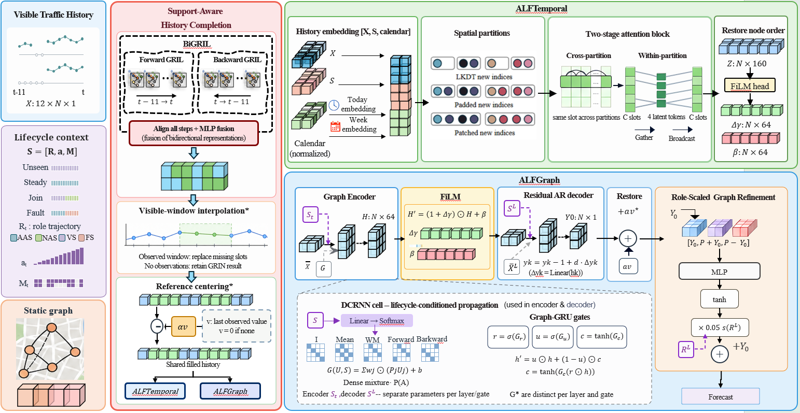
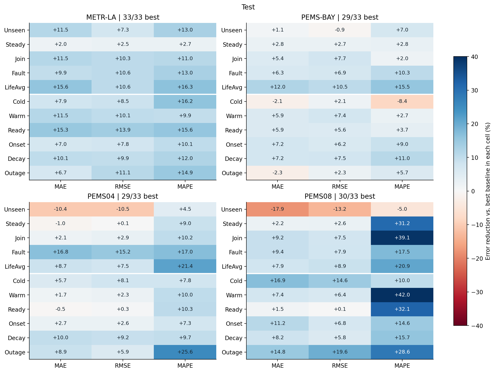
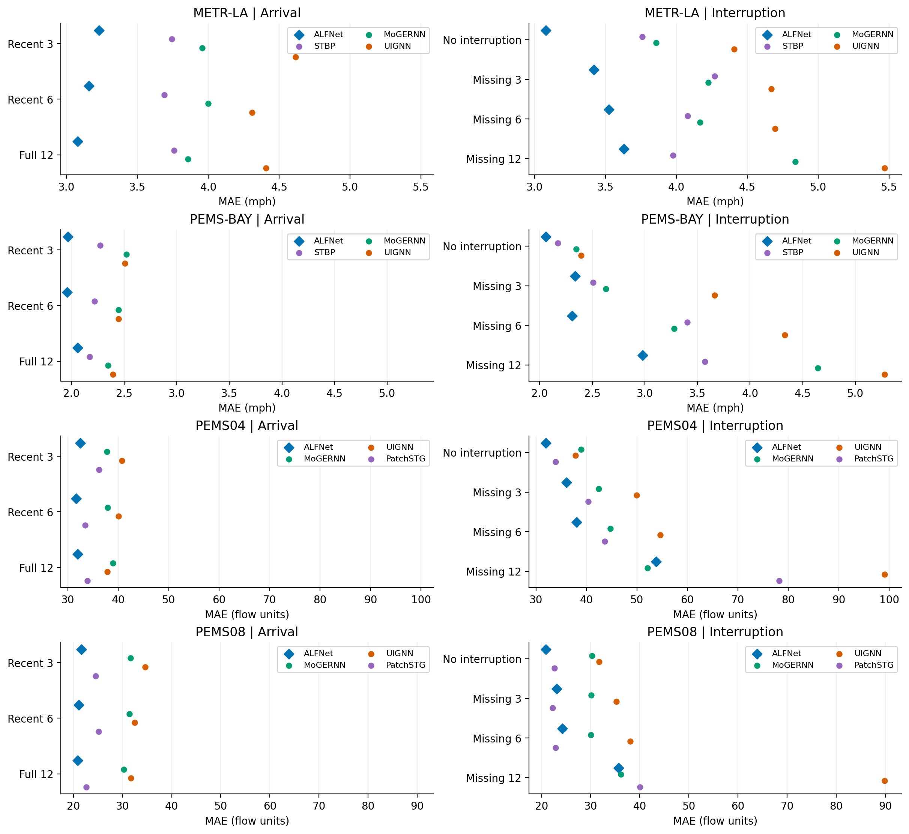
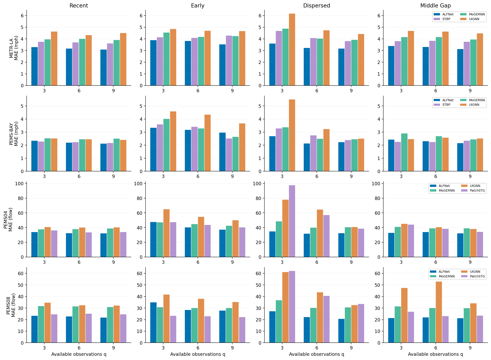
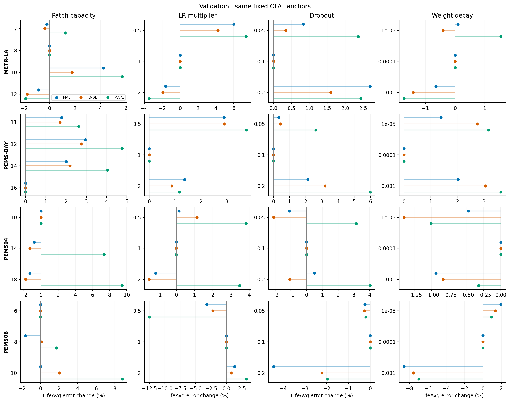
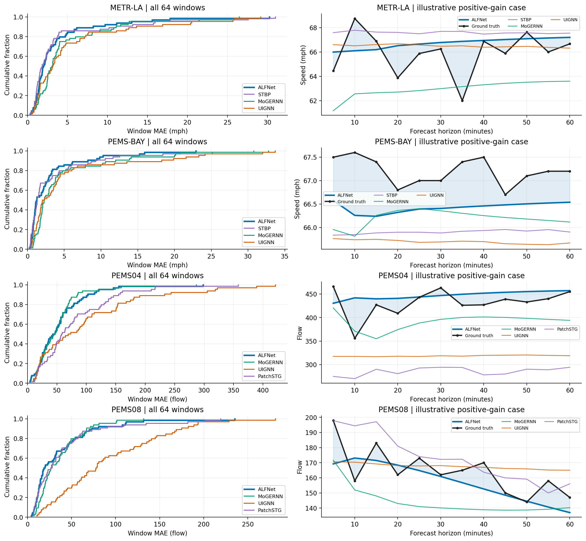

# ALFNet：动态观测支持下的归纳时空预测

<!-- v6 中文工作稿，第二轮修改（2026-10-25）。本文件是编辑源头，sections/*.tex 由 _scripts/md_to_tex.py 从本文件生成。修改前的版本保存在 snapshot_20261020_before_r2/。本轮修改：统一四类传感器与场景、阶段的中英文名称；“观测支持”缩写为 OS；“状态年龄”改为“状态进度”；方法章重写（图1移至第3节开头、去除其他模型名称、补全公式）。逐条依据见 ../notes/V6_CHANGELOG_CN.md。 -->

## 摘要

实际路网中，各位置的观测情况各不相同，而且在不断变化：持续可用传感器（AAS）在训练与推理期间稳定提供读数；新增传感器（NAS）在训练期没有记录，接入后才开始积累读数；失效传感器（FS）原本正常工作，后因设备故障或通信异常中断读数；虚拟传感器（VS）则是没有可读观测、只需要预测的位置。因此，预测窗口内可用观测的位置、数量与时间分布，即观测支持（OS），会随节点在这四类状态之间的转换而变化。本文研究路网拓扑已知、部分节点不参与训练时动态 OS 下的归纳时空预测，并提出 ALFNet。ALFNet 以逐步的观测角色（AAS、NAS、VS 或 FS）、状态进度与观测掩码描述 OS，并把它作为组织预测计算的条件：观测支持感知历史补全（SAHC）为全部节点补全一份共享历史；空间上下文时间条件分支（ALFTemporal）从按空间分区组织的跨节点历史中生成条件特征，经特征级线性调制（FiLM）作用于图编码状态；观测条件化图预测（ALFGraph）依据逐步的观测角色、状态进度与掩码组合五种图传播算子，以残差自回归方式解码，并在输出端施加由末步观测角色控制幅度的有界图修正。按目标节点在窗口内的观测角色轨迹，我们定义四类评价场景：零历史（Unseen）场景中目标节点全程为 VS，稳定观测（Steady）场景中全程为 AAS，新增接入（Join）场景中由 VS 转为 NAS，故障中断（Fault）场景中由 AAS 转为 FS。Join 与 Fault 的本地证据随事件持续步数 $m$ 积累或流失，因此再按 $m$ 把 Join 分为冷启动（Cold）、预热（Warm）与就绪（Ready）三个阶段，把 Fault 分为中断初期（Onset）、证据衰减（Decay）与完全中断（Outage）三个阶段，分别对应 $m=1$、$2\le m\le 11$ 与 $m=12$，以检验模型能否随本地证据的多少调整预测。在 METR-LA、PEMS-BAY、PEMS04 和 PEMS08 四个真实世界数据集上的统一评价表明，ALFNet 跨场景平均误差（LifeAvg）的三项误差指标均优于八个代表性比较方法，平均绝对误差（MAE）降低7.86%–15.63%；Join 与 Fault 场景的三项指标在四个数据集上均为最优。组件消融表明跨节点时间上下文的贡献最大，OS 条件化传播与状态进度带来较小但方向基本一致的改进。

## 1 引言

交通预测为路网运行管理、出行规划与拥堵预警提供前瞻性信息。然而，预测系统能够获得的历史观测并不总是连续且完整。随着传感网络的建设与维护，路网中的传感器处于不同的观测状态 [7]：持续可用传感器（AAS）在训练与推理期间稳定提供读数；新增传感器（NAS）在训练期没有记录，接入后才开始积累读数；失效传感器（FS）原本正常工作，后因设备故障或通信异常中断读数；虚拟传感器（VS）则是没有可读观测、只需要预测的位置。已有关于未观测位置预测和动态传感器网络的研究已认识到这些问题 [6,7,9]。同一位置在不同预测窗口中可以处于不同状态，所提供的信息条件并不相同。本文将历史窗口内实际可用观测的位置、数量及其时间分布统称为观测支持（OS）。OS 的变化不仅产生需要处理的空缺，也决定模型能从本地历史与关联位置获得怎样的预测依据。

围绕不完整交通观测，已有研究形成了互补的解决途径。缺失感知方法通过图循环重建、条件扩散或联合重建与预测，利用时空关联补充不可用信息 [1–4]；归纳与部分感知预测将预测范围扩展至缺少训练信号或推理期持续观测的位置 [6–9]；自适应图学习及空间分块表示则改善空间关系和多尺度上下文的组织 [10–14]。这些研究已经证明，缺失处理、空间信息传递与未观测位置预测能够协同工作。因而，进一步的关键并非判断模型是否能够接受缺失输入，而是明确：当 OS 在预测窗口内变化时，模型应如何相应调整信息利用方式。

这一问题在归纳预测中尤其突出。目标节点没有参与动态信号训练，并不意味着它在推理时始终没有观测；同样，训练期已有记录也不保证推理时始终拥有完整历史。现有方法分别强调训练信号覆盖、缺失恢复、传感器配置适应或空间交互，但这些能力并不直接回答“同一目标对应不同 OS 时，预测计算应如何变化”。即使可用观测数相同，近期集中、早期集中和分散分布的历史也可能对未来状态提供不同依据。本文因此研究**动态 OS 下的归纳时空预测**：在路网拓扑已知、部分节点动态信号不参与训练的条件下，利用变化的 OS 组织空间推理与预测上下文。该设置连接节点归纳与窗口内 OS 的变化，强调固定模型参数下的预测行为。

我们的核心认识是，**OS 应同时作为输入有效性的描述和预测计算的条件**。观测掩码标明哪些读数可用；在此基础上，观测角色与状态进度可以为模型组织历史信息提供显式的结构化线索。观测角色记录每个节点在每一步属于 AAS、NAS、VS 还是 FS；状态进度（state progress）描述接入或中断已持续的比例。它们提供一种可检验的归纳偏置，而不要求包含完整掩码之外的额外信息。沿这一思路，历史补全负责提供可用表示，空间传播决定如何交换关联信息，跨节点时间上下文则为预测过程提供条件。三者的协作，使模型能够在本地证据与空间证据之间建立依赖当前 OS 的信息利用方式。

据此，我们提出 ALFNet（Adaptive Lifecycle Forecasting Network），其中“自适应”指计算随输入的 OS 而变化，推理时模型参数保持固定。ALFNet 由三个模块组成，分别对应 OS 变化带来的三个问题。第一，不同节点、不同时刻的缺失程度各不相同，若各分支分别处理缺失，同一窗口会得到不一致的输入。观测支持感知历史补全（SAHC）因此依据可见读数、观测角色、状态进度与路网关联，对全部节点只补全一次历史，供另外两个模块共享。第二，当目标节点的本地历史很少或已经中断时，预测需要来自关联位置的依据。空间上下文时间条件分支（ALFTemporal）把节点组织为空间分区，在分区之间与分区内部交换时间特征，生成逐节点的条件特征，并经特征级线性调制（FiLM）作用于图编码状态；它本身不产生预测。第三，补全之后，真实读数与补全值在数值上难以区分，同一种图传播方式也难以同时适合持续可用、刚接入与刚失效的节点。观测条件化图预测（ALFGraph）因此由每一步的观测角色、状态进度与掩码决定五种图传播算子的组合，在编码与解码中逐步调整空间信息的交换方式，并以残差自回归方式生成预测；输出端再由末步观测角色控制一个有界的图修正。三个模块组合后，SAHC 提供一致的输入，ALFTemporal 提供跨节点的预测依据，ALFGraph 决定这些信息在每个节点、每一步如何参与传播，使同一组固定参数能够随 OS 调整对本地历史与空间上下文的利用。本文的重点是这一条件化组织方式；所用的图循环补全、扩散卷积门控循环、空间分区注意力与特征级线性调制等基础算子均来自已有工作 [1,14,16,18–20]。

本文的贡献概括为三点：（1）围绕拓扑已知、训练信号覆盖不完整的路网，将窗口内变化的 OS 纳入归纳预测设置，按目标节点的观测角色轨迹定义零历史（Unseen）、稳定观测（Steady）、新增接入（Join）与故障中断（Fault）四类场景，并按事件持续步数细分 Join 与 Fault 的阶段，以刻画不同 OS 下的预测要求；（2）提出 ALFNet，将 SAHC、ALFTemporal 与 ALFGraph 组织为以 OS 为条件的协同预测框架；（3）在 METR-LA、PEMS-BAY、PEMS04 与 PEMS08 四个数据集上开展统一的场景与阶段评价，并结合组件消融、配对观测干预和样本层面分析，考察总体收益、机制归因及 OS 对预测行为的影响。

结果表明，在统一的数据暴露与评价协议下，ALFNet 在四个真实世界数据集上跨场景平均误差（LifeAvg）的三项误差指标均优于八个代表性比较方法，平均绝对误差（MAE）降低7.86%–15.63%；在本地证据逐步积累或中断的 Join 与 Fault 场景下，改进在四个数据集的三项指标上一致。

## 2 相关工作

### 2.1 不完整观测下的重建与预测

不完整观测建模包含历史恢复与未来预测两个相关但不同的目标。GRIN 通过图循环计算和消息传递重建多变量序列，PriSTI 则利用条件扩散和时空关联建模缺失数据 [1,2]。二者说明，关联位置能够为局部缺失提供信息来源；但重建历史的目标与预测未来并不相同，插补质量也不能直接代替预测性能评价。

面向未来预测，GCN-M 联合建模缺失处理与交通预测，通过观测掩码、多尺度历史记忆和图卷积利用局部与全局信息 [3]。GinAR 针对部分变量历史不可用的情况，将插值注意力和自适应图卷积引入递归预测 [4]。UIGNN 同时面向缺失位置预测与不确定性估计，与未观测位置泛化形成交叉 [6]。这些工作已经建立了缺失处理和空间推理的联系，并以掩码区分可见与缺失读数。本文在此基础上关注 OS 的时间结构：可见读数数量相同但位于窗口内不同位置时，预测所依据的信息并不相同；重建之外，观测角色与状态进度如何参与传播组合，跨节点上下文如何进一步条件化未来预测。相应地，实验分别干预状态进度、OS 条件化传播与跨节点上下文，以区分各机制的贡献，并在固定可见数量下比较不同时间布局。

### 2.2 归纳与部分感知预测

归纳建模研究如何将已观测位置上学习的规律用于缺少训练信号的位置。IGNNK 通过子图采样学习可迁移的消息传递，解决未采样位置的时空插值 [5]；UIGNN 和 MoGERNN 则进一步预测未来交通状态 [6,7]。其中，MoGERNN 采用图专家混合与图循环编码—解码结构，并考察传感器加入和失效情形，说明变化的传感器配置已是归纳交通预测的重要研究对象。MoGERNN 依据节点输入特征稀疏地选择图专家，并在进入编码—解码器之前为未观测节点构造表示；ALFGraph 则把传播算子的组合放进图循环单元的每个门，由逐步的观测角色、状态进度与掩码稠密路由，不读取信号值。

不同方法对训练和推理阶段的观测条件有不同假设。SLPF 研究长期部分感知预测，利用训练期较充分的数据学习向推理期未感知位置的空间转移 [8]。SIML-MSIGN 将不同观测布局组织为任务，通过掩码门控扩散与结构归纳元学习开展跨布局预测及适应 [9]。SC-SAMG 利用少量目标位置数据生成节点与图表示，并进行少步参数适应 [24]；其中的“支持”指用于适应的目标样本，与本文窗口内的 OS 含义不同。因此，本文并不将“变化观测下的预测”视为未经研究的领域。ALFNet 的侧重点是固定参数下的窗口级 OS 条件化：在统一输入预算内，研究可用历史的状态和布局如何影响空间—时间计算。总体评价考察这一设计在归纳设置中的效果，已知节点配对实验则用于分离 OS 变化本身带来的预测响应。

### 2.3 空间依赖与时空表示学习

空间依赖建模为交通预测提供了利用关联位置的基本途径。STGCN 结合图卷积与时间卷积；Graph WaveNet 和 AGCRN 利用可学习表示构建自适应关系，降低对固定邻接的依赖 [10,11,12]。PDFormer 将传播时延纳入长程空间交互，PatchSTG 通过空间分块及块内、块间交互组织局部与全局信息 [13,14]。这些方法分别改善空间关系、交互范围和计算粒度，但学习到自适应图，并不自动意味着传播会根据每个窗口的 OS 进行调整。空间交互还需与时间表示能力共同考察。STID 通过简洁的时空身份表示建立有竞争力的预测基线 [15]；STBP 利用可扩展上下文模式库支持城市持续预测 [17]。本文关注的不是无限扩大空间交互范围或在线更新模式库，而是如何将可用的跨节点历史用于当前预测条件化。ALFTemporal 生成的上下文经 FiLM [16] 调制图循环预测，ALFGraph 则承担以 OS 为条件的空间传播。实验中的同容量局部上下文替代直接检验跨节点信息的作用，避免将模型收益仅归结为更大的表示规模。

## 3 方法

图1给出 ALFNet 的总体架构。3.1节定义问题与 OS 的表示，对应图中左列的输入；3.2–3.4节依次介绍 SAHC、ALFTemporal 与 ALFGraph，分别对应图中第二列、右上与右下部分；3.5节与3.6节说明训练目标与数据集特定设置。

<!-- 图1：PPT 版架构图，模块标注待与正文统一；图中 Restore 之后的 Y0 对应正文的 Ỹ。 -->

**图1　ALFNet 总体架构。** 左列为输入：可见历史 $\mathbf{X}$、生命周期上下文 $\mathbf{S}=[\mathbf{R},\mathbf{a},\mathbf{M}]$ 与静态路网（3.1节）；第二列为 SAHC（3.2节）；右上为 ALFTemporal 及其 FiLM 参数头（3.3节）；右下为 ALFGraph，包括 OS 条件化的图编码器、FiLM 调制、残差自回归解码、参考恢复与角色缩放图修正（3.4节）。带\*的步骤只在部分数据集上启用（3.6节）。图中省略批量维度，曲线与矩阵元素为示意。

### 3.1 问题设置

路网表示为有向加权图 $\mathcal{G}=(\mathcal{V},\mathbf{A})$，其中 $|\mathcal{V}|=N$，$\mathbf{A}\in\mathbb{R}_{\ge 0}^{N\times N}$ 为加权邻接矩阵；全部节点的拓扑及可用静态属性在训练与推理中均可见（图1左下）。记行归一化算子 $\mathrm{rn}(\mathbf{B})=\mathrm{diag}(\mathbf{B}\mathbf{1})^{-1}\mathbf{B}$（行和为零的行保持为零），前向与后向转移矩阵分别为 $\mathbf{P}_{\mathrm f}=\mathrm{rn}(\mathbf{A})$ 与 $\mathbf{P}_{\mathrm b}=\mathrm{rn}(\mathbf{A}^{\top})$。节点划分为已知节点 $\mathcal{V}_K$ 以及验证、测试保留节点 $\mathcal{V}_V$、$\mathcal{V}_T$：训练只读取 $\mathcal{V}_K$ 的动态信号，验证与测试分别加入 $\mathcal{V}_V$ 与 $\mathcal{V}_T$ 的历史；标准化统计量仅由训练时段的 $\mathcal{V}_K$ 计算。给定历史长度 $L=12$ 与预测长度 $H=12$，记标准化后的历史为 $\mathbf{X}\in\mathbb{R}^{L\times N}$，未来目标为 $\mathbf{Y}\in\mathbb{R}^{H\times N}$，观测掩码为 $\mathbf{M}\in\{0,1\}^{L\times N}$（图1左上）；$\mathbf{x}_t$ 与 $\mathbf{m}_t$ 为第 $t$ 步全部节点的读数与掩码。不可用位置的输入值置零，并由 $\mathbf{M}$ 标识。

**观测角色与状态进度。** 除掩码外，OS 还由两类逐步的显式描述刻画（图1左列中部）。在第 $t$ 步，每个节点属于以下四类观测角色之一：AAS 表示节点处于当前阶段的信号暴露范围内，且没有发生接入或失效事件；NAS 表示节点在窗口内接入，接入后开始提供读数；FS 表示节点原本可读，在窗口内失效后不再提供读数；VS 表示节点在该步没有可读历史，包括尚未接入的节点以及不在当前阶段信号暴露范围内的节点（如训练时的保留节点）。$\mathbf{R}_t\in\{0,1\}^{N\times4}$ 依次按 AAS、NAS、VS、FS 对观测角色做 one-hot 编码。状态进度 $\mathbf{a}_t\in[0,1]^{N}$ 描述接入或失效已持续的比例：
$$
a_{t,n}=\begin{cases}1, & \text{节点 } n \text{ 在第 } t \text{ 步为 AAS},\\ 0, & \text{节点 } n \text{ 在第 } t \text{ 步为 VS},\\ k/L, & \text{节点 } n \text{ 在第 } t \text{ 步为 NAS 或 FS，且处于接入或失效后的第 } k \text{ 步}.\end{cases}
\tag{1}
$$
观测掩码由读数的自然有效性与观测角色共同决定：$M_{t,n}=1$ 当且仅当该读数自然有效且节点在第 $t$ 步为 AAS 或 NAS。自然缺失只改变 $\mathbf{M}$，不改变观测角色，因此 AAS 的偶发缺测仍记为 AAS。三者逐步拼接为生命周期上下文
$$
\mathbf{S}_t=[\mathbf{R}_t,\ \mathbf{a}_t,\ \mathbf{m}_t]\in\mathbb{R}^{N\times 6},\qquad t=1,\dots,L.
\tag{2}
$$

**场景与阶段。** 评价按目标节点在窗口内的观测角色轨迹构造四类场景，事件持续步数 $m$ 在 $1$ 至 $L$ 内均匀抽取：Unseen 中目标节点全程为 VS；Steady 中全程为 AAS；Join 中前 $L-m$ 步为 VS、最后 $m$ 步为 NAS；Fault 中前 $L-m$ 步为 AAS、最后 $m$ 步为 FS。Join 与 Fault 的本地证据随 $m$ 积累或流失：Join 在 $m=1$ 时只有一个新读数，$m=L$ 时整个窗口都处于可读状态；Fault 在 $m=1$ 时只缺最后一步，$m=L$ 时整个窗口都没有读数。因此再按 $m$ 划分阶段：Join 分为冷启动（Cold）、预热（Warm）与就绪（Ready），Fault 分为中断初期（Onset）、证据衰减（Decay）与完全中断（Outage），分别对应 $m=1$、$2\le m\le L-1$ 与 $m=L$。训练阶段四类场景均在已知节点上模拟；评价时，Unseen 与 Join 在对应阶段的保留节点上构造，Steady 与 Fault 在已知节点上构造。窗口内可见读数数 $q_n=\sum_{t}M_{t,n}$ 只用于描述 OS 的多少，不作为额外输入。评价中的观测角色与状态进度由协议精确给出；在实际应用中，它们需要由接入记录与故障检测提供，可能存在延迟或误判，本文没有评估这类误差的影响。

**预测任务。** 在上述设置下，预测是在固定模型参数下学习映射
$$
\hat{\mathbf{Y}}=f_{\boldsymbol{\Theta}}\big(\mathbf{X}\odot\mathbf{M},\ \mathbf{S}_{1:L},\ \mathbf{A},\ \mathcal{T}\big)\in\mathbb{R}^{H\times N},
\tag{3}
$$
其中 $\mathcal{T}$ 为窗口内各步的日历信息（日内时段与星期）。同一节点在不同窗口中可以处于不同观测角色与布局，因此模型应依据当前窗口的 OS 组织计算，而不是依据节点是否参与过训练。

### 3.2 观测支持感知历史补全（SAHC）

SAHC（图1第二列）对全部 $N$ 个节点、完整的 $L$ 步历史只运行一次，依次包括双向图循环补全、窗口内插值与参考中心化；后两步只在部分数据集上启用（图中以\*标记，取值见3.6节）。

**双向图循环补全。** SAHC 沿时间正、反两个方向各运行一个图循环补全层 [1]。以正向为例，记外生输入 $\boldsymbol{\eta}_t=[\mathbf{R}_t,\mathbf{a}_t]\in\mathbb{R}^{N\times5}$，隐藏状态 $\mathbf{h}_0=\mathbf{0}\in\mathbb{R}^{N\times64}$。对 $t=1,\dots,L$，先由上一隐藏状态给出初步估计，并保留可见位置的观测值：
$$
\hat{\mathbf{x}}^{(1)}_t=\mathbf{h}_{t-1}\mathbf{W}_1,\qquad \mathbf{x}^{(1)}_t=\mathbf{m}_t\odot\mathbf{x}_t+(\mathbf{1}-\mathbf{m}_t)\odot\hat{\mathbf{x}}^{(1)}_t.
\tag{4}
$$
随后通过一次空间消息传递修正估计：
$$
\begin{aligned}
\mathbf{z}_t&=[\mathbf{x}^{(1)}_t,\ \mathbf{m}_t,\ \boldsymbol{\eta}_t,\ \mathbf{h}_{t-1}]\,\mathbf{W}_{\mathrm{in}},\\
\boldsymbol{\rho}_t&=\Big[\mathrm{PReLU}\big(\big[[\mathbf{P}_{\mathrm f}\mathbf{z}_t,\ \mathbf{P}_{\mathrm b}\mathbf{z}_t]\,\mathbf{W}_{\mathrm s},\ \mathbf{h}_{t-1}\big]\,\mathbf{W}_{\mathrm o}\big),\ \mathbf{h}_{t-1}\Big],\qquad \hat{\mathbf{x}}^{(2)}_t=\boldsymbol{\rho}_t\mathbf{W}_2,
\end{aligned}
\tag{5}
$$
其中 $\boldsymbol{\rho}_t\in\mathbb{R}^{N\times128}$ 为该步的节点表示。修正后的估计同样只填入缺失位置，再与掩码和外生输入一起更新隐藏状态：
$$
\mathbf{x}^{(2)}_t=\mathbf{m}_t\odot\mathbf{x}_t+(\mathbf{1}-\mathbf{m}_t)\odot\hat{\mathbf{x}}^{(2)}_t,\qquad \mathbf{h}_t=\mathrm{GRU}_{\mathcal{D}}\big([\mathbf{x}^{(2)}_t,\ \mathbf{m}_t,\ \boldsymbol{\eta}_t],\ \mathbf{h}_{t-1}\big),
\tag{6}
$$
其中 $\mathrm{GRU}_{\mathcal{D}}$ 为门控循环单元（GRU）[19]，门控形式与式(19)相同，但三个门中的线性变换替换为二阶扩散卷积 $\mathcal{D}(\mathbf{U})=[\mathbf{U},\mathbf{P}_{\mathrm f}\mathbf{U},\mathbf{P}_{\mathrm f}^{2}\mathbf{U},\mathbf{P}_{\mathrm b}\mathbf{U},\mathbf{P}_{\mathrm b}^{2}\mathbf{U}]\,\mathbf{W}_{\mathcal{D}}$ [18]，各门的 $\mathbf{W}_{\mathcal{D}}$ 相互独立。反向层在时间反转的序列上执行相同计算，参数独立。记正向与反向在第 $t$ 步的表示为 $\overrightarrow{\boldsymbol{\rho}}_t$ 与 $\overleftarrow{\boldsymbol{\rho}}_t$，二者在每个历史位置上与掩码拼接，经多层感知机（MLP）融合为重建值，最后保留可见读数：
$$
\mathbf{X}^{\mathrm{rec}}_t=\mathrm{ReLU}\big([\overrightarrow{\boldsymbol{\rho}}_t,\ \overleftarrow{\boldsymbol{\rho}}_t,\ \mathbf{m}_t]\,\mathbf{W}_3\big)\mathbf{W}_4,\qquad \mathbf{X}^{\mathrm{c}}=\mathbf{M}\odot\mathbf{X}+(\mathbf{1}-\mathbf{M})\odot\mathbf{X}^{\mathrm{rec}},
\tag{7}
$$
其中 $\mathbf{X}^{\mathrm{rec}}_t$ 为 $\mathbf{X}^{\mathrm{rec}}$ 的第 $t$ 行。式(4)–(7)中的 $\mathbf{W}_{\ast}$ 均为可学习矩阵，偏置省略，隐藏宽度与融合 MLP 的宽度均为64。观测角色与状态进度作为外生输入进入两个方向的递推，掩码则单独用于保留可见读数与融合。SAHC 没有独立的重建损失，只通过下游预测损失训练。

**窗口内插值。** 插值开启时，对至少有一个可见读数（$q_n>0$）的节点，用窗口内可见读数的线性插值覆盖其缺失位置：
$$
X^{\mathrm{fill}}_{t,n}=\begin{cases}X_{t^{-},n}+\dfrac{t-t^{-}}{t^{+}-t^{-}}\big(X_{t^{+},n}-X_{t^{-},n}\big), & M_{t,n}=0,\ q_n>0,\\[6pt] X^{\mathrm{c}}_{t,n}, & \text{其他情况},\end{cases}
\tag{8}
$$
其中 $t^{-}$ 与 $t^{+}$ 为 $t$ 之前与之后最近的可见步；$t$ 位于第一个可见步之前或最后一个可见步之后时，二者都取最近的可见步并令分式为0，即取最近的可见值。没有可见读数的节点保留 $\mathbf{X}^{\mathrm{c}}$ 中的补全值，因此插值与图循环补全不是按 $q_n$ 互斥的两条支路。插值关闭时 $\mathbf{X}^{\mathrm{fill}}=\mathbf{X}^{\mathrm{c}}$。

**参考中心化。** 记 $t^{\ast}_n=\max\{t:M_{t,n}=1\}$ 为节点 $n$ 的最后一个可见步，参考值与中心化后的共享历史为
$$
v_n=\begin{cases}X_{t^{\ast}_n,n}, & q_n>0,\\ 0, & q_n=0,\end{cases}\qquad \bar{\mathbf{X}}=\mathbf{X}^{\mathrm{fill}}-\alpha\,\mathbf{1}_L\mathbf{v}^{\top},
\tag{9}
$$
其中 $\alpha$ 为固定的中心化强度，$\mathbf{1}_L$ 为全1列向量，即 $\mathbf{v}$ 沿时间维广播；$\mathbf{S}$ 保持不变。中心化在输出端由式(24)加回。上述处理均不使用未来或被遮蔽的真值。保留观测值发生在中心化之前，中心化后可见位置的数值也随之平移。ALFTemporal 与 ALFGraph 读取同一份 $\bar{\mathbf{X}}$（图1第二列底部）；插值关闭且 $\alpha=0$ 时，$\bar{\mathbf{X}}=\mathbf{X}^{\mathrm{c}}$。

### 3.3 空间上下文时间条件分支（ALFTemporal）

ALFTemporal（图1右上）从跨节点历史生成逐节点的条件特征。它只为 ALFGraph 提供条件，不产生独立预测；计算上先由它得到调制参数，再执行 ALFGraph（3.4节）。

**时间嵌入。** 对每个节点 $n$，ALFTemporal 读取 $\mathbf{F}_n=[\bar{\mathbf{X}}_{:,n},\ \mathbf{S}_{1:L,n},\ \boldsymbol{\tau}/288,\ \boldsymbol{\delta}/7]\in\mathbb{R}^{L\times9}$，其中 $\tau_t=12\cdot\mathrm{hour}_t+\lfloor\mathrm{minute}_t/5\rfloor\in\{0,\dots,287\}$ 为日内时段，$\delta_t\in\{0,\dots,6\}$ 为星期。卷积核长度与步长均为 $L$ 的时间卷积把整个窗口映射为一个64维向量，等价于
$$
\mathbf{e}_n=\mathrm{vec}(\mathbf{F}_n)\,\mathbf{W}_e+\mathbf{b}_e\in\mathbb{R}^{64},\qquad \mathbf{W}_e\in\mathbb{R}^{9L\times64},
\tag{10}
$$
因此每个节点只有一个时间 patch，窗口内读数的位置信息由 $\mathbf{W}_e$ 的不同行保留。随后拼接日历与结构嵌入：
$$
\mathbf{z}^{0}_n=\big[\mathbf{e}_n\ \|\ \mathbf{E}^{\mathrm{tod}}_{\tau_L}\ \|\ \mathbf{E}^{\mathrm{dow}}_{\delta_L}\ \|\ \phi(\mathbf{g}_n)\big]\in\mathbb{R}^{160},
\tag{11}
$$
其中 $\|$ 表示拼接，$\mathbf{E}^{\mathrm{tod}}\in\mathbb{R}^{288\times32}$ 与 $\mathbf{E}^{\mathrm{dow}}\in\mathbb{R}^{7\times32}$ 为可学习的日历嵌入表，按末步的日内时段与星期取行。

**结构嵌入。** 模型不使用逐节点可训练的身份嵌入，以免为保留节点引入可训练的身份参数；结构嵌入由所有节点共享的映射 $\phi$ 作用于静态结构特征 $\mathbf{g}_n\in\mathbb{R}^{7}$ 得到。记 $d^{\mathrm{in}}_n=\sum_{k\ne n}A_{kn}$、$d^{\mathrm{out}}_n=\sum_{k\ne n}A_{nk}$、$d^{\mathrm{tot}}_n=d^{\mathrm{in}}_n+d^{\mathrm{out}}_n$，$(o^{1}_n,o^{2}_n)$ 为节点的两维坐标（无坐标的数据集置零），则
$$
\begin{aligned}
\mathbf{g}_n&=\big[\nu(\mathbf{o}^{1})_n,\ \nu(\mathbf{o}^{2})_n,\ \nu(\mathbf{d}^{\mathrm{in}})_n,\ \nu(\mathbf{d}^{\mathrm{out}})_n,\ \nu(\mathbf{d}^{\mathrm{tot}})_n,\ \nu\big(\log(1+\mathbf{d}^{\mathrm{tot}})\big)_n,\ \mathbb{I}[d^{\mathrm{tot}}_n=0]\big],\\
\nu(\mathbf{s})_n&=\frac{s_n-\bar{s}}{\max_{k}|s_k-\bar{s}|},
\end{aligned}
\tag{12}
$$
其中 $\bar{s}$ 为向量 $\mathbf{s}$ 在全部节点上的均值，$\mathbb{I}[\cdot]$ 为指示函数；$\phi$ 为两层 MLP（$7\to64\to32$，ReLU 激活）。

**空间分区。** 训练前，节点被划分为 $P=32$ 个分区，每个分区含 $C$ 个槽位 [14]：速度数据依据已核验的地理坐标以 KD-tree 划分，流量数据依据图拓扑做考虑连通分量的广度优先搜索（BFS）划分。记 $\pi(p,c)$ 为第 $p$ 个分区第 $c$ 个槽位对应的节点；节点不足 $C$ 个的分区以邻接排序的真实节点补足，这些补足副本只提供上下文，不产生输出。按 $\pi$ 排列得到 $\mathbf{T}\in\mathbb{R}^{P\times C\times160}$，其中 $\mathbf{T}_{p,c}=\mathbf{z}^{0}_{\pi(p,c)}$（图1右上 Spatial partitions）。

**两阶段注意力。** 分区特征经一个两阶段注意力块处理 [20]（图1右上 Two-stage attention block）。记单头注意力与前馈层为
$$
\mathrm{Attn}(\mathbf{Q},\mathbf{K},\mathbf{V})=\mathrm{softmax}\Big(\frac{(\mathbf{Q}\mathbf{W}^{Q})(\mathbf{K}\mathbf{W}^{K})^{\top}}{\sqrt{160}}\Big)\mathbf{V}\mathbf{W}^{V}\mathbf{W}^{O},\qquad \mathrm{FFN}(\cdot)=\mathrm{GELU}\big((\cdot)\,\mathbf{W}^{F}_{1}\big)\mathbf{W}^{F}_{2},
\tag{13}
$$
其中各投影矩阵均为 $160\times160$，偏置省略；每次出现的 Attn 与 FFN 各有独立参数。第一阶段为跨分区注意力：对每个槽位索引 $c$，在 $P$ 个分区的同位 token $\mathbf{T}_{:,c}\in\mathbb{R}^{P\times160}$ 之间做自注意力，
$$
\tilde{\mathbf{T}}_{:,c}=\mathrm{LN}\big(\mathbf{T}_{:,c}+\mathrm{Attn}_1(\mathbf{T}_{:,c},\mathbf{T}_{:,c},\mathbf{T}_{:,c})\big),\qquad \mathbf{T}'_{:,c}=\mathrm{LN}\big(\tilde{\mathbf{T}}_{:,c}+\mathrm{FFN}_1(\tilde{\mathbf{T}}_{:,c})\big),
\tag{14}
$$
其中 LN 为层归一化。第二阶段为分区内潜在汇聚与回传：每个分区 $p$ 有4个可学习的潜在 token $\mathbf{Q}_p\in\mathbb{R}^{4\times160}$，先从分区内 $C$ 个槽位汇聚信息，再回传给各槽位，
$$
\begin{aligned}
\mathbf{B}_p&=\mathrm{Attn}_2(\mathbf{Q}_p,\mathbf{T}'_{p},\mathbf{T}'_{p}),\\
\tilde{\mathbf{T}}_p&=\mathrm{LN}\big(\mathbf{T}'_p+\mathrm{Attn}_3(\mathbf{T}'_p,\mathbf{B}_p,\mathbf{B}_p)\big),\qquad \mathbf{T}''_p=\mathrm{LN}\big(\tilde{\mathbf{T}}_p+\mathrm{FFN}_2(\tilde{\mathbf{T}}_p)\big),
\end{aligned}
\tag{15}
$$
其中 $\mathbf{T}'_p\in\mathbb{R}^{C\times160}$ 为第一阶段输出中分区 $p$ 的槽位特征。分区内的交互因此经过4个 token 的瓶颈，而不是 $C\times C$ 的直接注意力。注意力权重与各残差分支上使用 dropout。最后按 $\pi$ 取回每个真实节点的输出，恢复原始节点顺序，得到条件特征 $\mathbf{Z}\in\mathbb{R}^{N\times160}$，其第 $n$ 行记为 $\mathbf{z}_n$。

**FiLM 参数头。** FiLM 参数头（图1右上 FiLM head）把 $\mathbf{z}_n$ 映射为逐节点的缩放与平移参数 [16]：
$$
[\Delta\boldsymbol{\gamma}_n,\ \boldsymbol{\beta}_n]=\mathrm{ReLU}\big(\mathbf{z}_n\mathbf{W}_{\gamma,1}+\mathbf{b}_{\gamma,1}\big)\mathbf{W}_{\gamma,2}+\mathbf{b}_{\gamma,2},\qquad \Delta\boldsymbol{\gamma}_n,\ \boldsymbol{\beta}_n\in\mathbb{R}^{64},
\tag{16}
$$
其中 $\mathbf{W}_{\gamma,1}\in\mathbb{R}^{160\times32}$，$\mathbf{W}_{\gamma,2}\in\mathbb{R}^{32\times128}$。最后一层零初始化，训练开始时调制为恒等映射。OS 对调制参数的影响只经由 ALFTemporal 的输入 $\mathbf{S}$，参数头本身不读取 $\mathbf{S}$。

### 3.4 观测条件化图预测（ALFGraph）

ALFGraph（图1右下）由 OS 条件化的图编码器、FiLM 调制、残差自回归解码器、参考恢复与角色缩放图修正组成，输出唯一的预测 $\hat{\mathbf{Y}}$。

**OS 条件化图传播。** ALFGraph 中每个门控变换都是一个条件化传播模块（图1右下虚线框），对五种传播支持加权组合。五种支持依次为恒等矩阵 $\mathbf{P}_1=\mathbf{I}$、二值邻接的行归一化 $\mathbf{P}_2=\mathrm{rn}(\mathbb{I}[\mathbf{A}>0])$、加权邻接的行归一化 $\mathbf{P}_3=\mathrm{rn}(\mathbf{A})$，以及前向与后向转移矩阵 $\mathbf{P}_4=\mathbf{P}_{\mathrm f}$、$\mathbf{P}_5=\mathbf{P}_{\mathrm b}$，其中 $\mathbb{I}[\cdot]$ 逐元素取值。$\mathbf{P}_3$ 与 $\mathbf{P}_4$ 数值相同，但具有独立的投影参数与路由权重。对第 $t$ 步，路由器只读取生命周期上下文：
$$
\mathbf{w}_t=\mathrm{softmax}\big(\mathbf{S}_t\mathbf{W}_g\big)\in\mathbb{R}^{N\times5},
\tag{17}
$$
其中 $\mathbf{W}_g\in\mathbb{R}^{6\times5}$，softmax 沿支持维对每个节点分别计算。给定门控输入 $\mathbf{U}\in\mathbb{R}^{N\times F}$，条件化传播为
$$
G(\mathbf{U},\mathbf{S}_t)=\sum_{j=1}^{5}\mathbf{w}_{t,j}\odot\big(\mathbf{P}_j\,\mathbf{U}\,\boldsymbol{\Theta}_j\big)+\mathbf{b},
\tag{18}
$$
其中 $\mathbf{w}_{t,j}\in\mathbb{R}^{N}$ 为 $\mathbf{w}_t$ 的第 $j$ 列，沿特征维广播；$\boldsymbol{\Theta}_j\in\mathbb{R}^{F\times64}$ 为第 $j$ 个支持的投影，$\mathbf{b}\in\mathbb{R}^{64}$ 为偏置。五个支持全部参与加权，不做 top-$k$ 截断，也不加入噪声。路由器读取 OS 而非信号值：经过 SAHC 后，一个 NAS 节点与一个 AAS 节点可能具有相似的输入数值，而二者的生命周期上下文仍然不同。

**图门控循环单元与编码器。** 每个图门控循环单元以条件化传播替代 GRU 中的线性变换：
$$
\begin{aligned}
\mathbf{r}&=\sigma\big(G_r([\mathbf{x},\mathbf{h}],\mathbf{S})\big),\qquad \mathbf{u}=\sigma\big(G_u([\mathbf{x},\mathbf{h}],\mathbf{S})\big),\\
\tilde{\mathbf{h}}&=\tanh\big(G_c([\mathbf{x},\mathbf{r}\odot\mathbf{h}],\mathbf{S})\big),\qquad \mathbf{h}'=\mathbf{u}\odot\mathbf{h}+(\mathbf{1}-\mathbf{u})\odot\tilde{\mathbf{h}},
\end{aligned}
\tag{19}
$$
其中 $\mathbf{x}$ 与 $\mathbf{h}$ 为单元输入与上一隐藏状态，$\sigma(\cdot)$ 为 sigmoid，隐藏宽度为64；$G_r$、$G_u$、$G_c$ 是三个各带路由器的条件化传播模块。将式(19)记为 $\mathbf{h}'=\mathrm{Cell}(\mathbf{x},\mathbf{h},\mathbf{S})$。编码器与解码器各有两层，每层一个单元，共12个条件化传播模块；各模块参数在递推步之间共享。编码器（图1右下 Graph Encoder）从零状态出发，对 $t=1,\dots,L$ 递推
$$
\mathbf{h}^{(1)}_t=\mathrm{Cell}^{(1)}_{\mathrm{enc}}\big([\bar{\mathbf{x}}_t,\mathbf{S}_t],\ \mathbf{h}^{(1)}_{t-1},\ \mathbf{S}_t\big),\qquad \mathbf{h}^{(2)}_t=\mathrm{Cell}^{(2)}_{\mathrm{enc}}\big(\mathbf{h}^{(1)}_t,\ \mathbf{h}^{(2)}_{t-1},\ \mathbf{S}_t\big),
\tag{20}
$$
其中 $\bar{\mathbf{x}}_t$ 为 $\bar{\mathbf{X}}$ 的第 $t$ 行，第一层输入 $[\bar{\mathbf{x}}_t,\mathbf{S}_t]\in\mathbb{R}^{N\times7}$。由于观测角色与状态进度逐步进入路由，Join 节点在接入前后、Fault 节点在失效前后会使用不同的传播组合。

**FiLM 调制。** 编码完成后，ALFTemporal 给出的参数在解码开始前一次性调制两层编码末状态（图1右下 FiLM）：
$$
\mathbf{h}^{(l)}_{\mathrm{mod}}=(\mathbf{1}+\Delta\boldsymbol{\gamma})\odot\mathbf{h}^{(l)}_L+\boldsymbol{\beta},\qquad l=1,2,
\tag{21}
$$
其中 $\Delta\boldsymbol{\gamma},\boldsymbol{\beta}\in\mathbb{R}^{N\times64}$ 由式(16)逐节点堆叠得到。同一组参数广播到两层，不在每个预测步重新生成。

**残差自回归解码。** 解码器（图1右下 Residual AR decoder）以调制后的状态为初始隐藏状态，记 $\mathbf{h}^{(l)}_{L}\leftarrow\mathbf{h}^{(l)}_{\mathrm{mod}}$，并以 $\mathbf{y}_0=\bar{\mathbf{x}}_L$ 为初值；该初值来自补全与中心化后的历史，不一定是最后一次真实观测。对 $k=1,\dots,H$，
$$
\begin{aligned}
\mathbf{h}^{(1)}_{L+k}&=\mathrm{Cell}^{(1)}_{\mathrm{dec}}\big(\mathbf{y}^{\mathrm{in}}_{k-1},\ \mathbf{h}^{(1)}_{L+k-1},\ \mathbf{S}_L\big),\qquad \mathbf{h}^{(2)}_{L+k}=\mathrm{Cell}^{(2)}_{\mathrm{dec}}\big(\mathbf{h}^{(1)}_{L+k},\ \mathbf{h}^{(2)}_{L+k-1},\ \mathbf{S}_L\big),\\
\mathbf{y}_k&=\mathbf{y}^{\mathrm{in}}_{k-1}+d\cdot\big(\mathbf{h}^{(2)}_{L+k}\mathbf{W}_y+b_y\big),
\end{aligned}
\tag{22}
$$
其中 $\mathbf{y}^{\mathrm{in}}_0=\mathbf{y}_0$，$\mathbf{W}_y\in\mathbb{R}^{64\times1}$，$d$ 为固定的解码残差倍率；$\mathbf{h}^{(l)}_{L+k}$ 表示解码第 $k$ 步第 $l$ 层的隐藏状态，解码单元与编码单元参数独立。解码阶段没有未来的生命周期上下文，路由统一使用末步上下文 $\mathbf{S}_L$，不对未来观测角色的演变建模。下一步的输入 $\mathbf{y}^{\mathrm{in}}_k$ 在推理时等于未经修正的 $\mathbf{y}_k$；训练时采用受合法目标掩码约束的教师强制：
$$
\mathbf{y}^{\mathrm{in}}_k=\boldsymbol{\kappa}_k\odot\big(\mathbf{y}^{\ast}_k-\alpha\mathbf{v}\big)+(\mathbf{1}-\boldsymbol{\kappa}_k)\odot\mathbf{y}_k,\qquad \boldsymbol{\kappa}_k=\xi_k\,\boldsymbol{\mu}_k,\qquad \xi_k\sim\mathrm{Bernoulli}\big(\max(0,\,1-i/40)\big),
\tag{23}
$$
其中 $\mathbf{y}^{\ast}_k$ 为 $\mathbf{Y}$ 的第 $k$ 行，减去 $\alpha\mathbf{v}$ 使其与解码器处于同一中心化尺度；$\boldsymbol{\mu}_k\in\{0,1\}^{N}$ 标记第 $k$ 步可合法读取的目标；$i$ 为训练轮次，每个样本的每个预测步独立抽取 $\xi_k$。因此教师强制比例在前40轮线性衰减至零，推理时 $\boldsymbol{\kappa}_k=\mathbf{0}$。

**参考恢复。** 完成 $H$ 步解码后加回中心化参考值（图1右下 Restore）：
$$
\tilde{\mathbf{Y}}=[\mathbf{y}_1;\dots;\mathbf{y}_H]+\alpha\,\mathbf{1}_H\mathbf{v}^{\top}.
\tag{24}
$$
这一步只恢复式(9)减去的参考值，不是标准化的逆变换；误差计算时再用训练时段的标准化统计量还原到原始单位。

**角色缩放图修正。** 输出端施加一个有界的邻域修正（图1右下 Role-Scaled Graph Refinement）。令 $\mathbf{P}^{+}=\mathrm{rn}(\mathbf{A}+\mathbf{I})$、$\mathbf{P}^{-}=\mathrm{rn}\big((\mathbf{A}+\mathbf{I})^{\top}\big)$，$\tilde{\mathbf{y}}_k$ 为 $\tilde{\mathbf{Y}}$ 的第 $k$ 行，对每个预测步，
$$
\mathbf{D}_k=\mathrm{GELU}\big([\tilde{\mathbf{y}}_k,\ \mathbf{P}^{+}\tilde{\mathbf{y}}_k,\ \mathbf{P}^{-}\tilde{\mathbf{y}}_k]\,\mathbf{W}_{r,1}+\mathbf{b}_{r,1}\big)\mathbf{W}_{r,2}+\mathbf{b}_{r,2},\qquad \hat{\mathbf{y}}_k=\tilde{\mathbf{y}}_k+0.05\cdot s(\mathbf{R}_L)\odot\tanh(\mathbf{D}_k),
\tag{25}
$$
其中拼接沿每个节点的特征维进行，$\mathbf{W}_{r,1}\in\mathbb{R}^{3\times32}$，$\mathbf{W}_{r,2}\in\mathbb{R}^{32\times1}$ 与 $\mathbf{b}_{r,2}$ 零初始化；$s(\mathbf{R}_L)=\mathbf{R}_L\boldsymbol{\varsigma}$ 按末步观测角色取固定倍率，$\boldsymbol{\varsigma}=(0,1,1,0.25)^{\top}$ 依次对应 AAS、NAS、VS、FS。最终预测为 $\hat{\mathbf{Y}}=[\hat{\mathbf{y}}_1;\dots;\hat{\mathbf{y}}_H]$。由于 tanh 有界，修正量的绝对值在标准化单位下不超过0.05。末步为 AAS 的节点自身不被修正，但仍作为邻居参与其他节点的修正。该模块只读取末步观测角色，不读取状态进度与掩码，也没有独立的路由器；修正结果不回送解码器。

### 3.5 训练目标

令 $e=|\hat{y}-y|$ 为原始单位下的绝对误差，$\sigma_{\mathrm{data}}$ 为训练时段目标变量的标准差。逐元素损失为
$$
\ell(e)=\frac{e}{\sigma_{\mathrm{data}}}\tanh(0.1\,e).
\tag{26}
$$
该损失在小误差附近近似 $0.1e^2/\sigma_{\mathrm{data}}$，大误差时趋近标准化 MAE；权重项参与梯度计算。四个数据集取相同系数，但 $e$ 分别以各自的速度或流量单位计量，因此相同系数并不意味着跨量纲的同等加权。记 $\Omega$ 为一个批次内有效的目标元素，$\Omega_r$ 为其中末步观测角色为 $r$ 的节点所对应的元素，$\mathcal{R}_b$ 为该批次实际出现的观测角色集合，则
$$
\mathcal{L}_{\mathrm{mean}}=\frac{1}{|\Omega|}\sum_{\Omega}\ell(e),\qquad
\mathcal{L}_{\mathrm{role}}=\frac{1}{|\mathcal{R}_b|}\sum_{r\in\mathcal{R}_b}\frac{1}{|\Omega_r|}\sum_{\Omega_r}\ell(e).
\tag{27}
$$
$\mathcal{L}_{\mathrm{role}}$ 使样本较少的观测角色在优化中获得与其他角色相同的权重。$\mathcal{L}_{\mathrm{route}}$ 为路由平衡项 [21,22]。对条件化传播模块的一次调用，记路由权重为 $w_{n,j}$（$n$ 遍历批次中全部样本的全部节点，$j=1,\dots,5$），则
$$
\mathrm{imp}_j=\sum_{n}w_{n,j},\qquad \mathrm{load}_j=\sum_{n}\mathbb{I}[w_{n,j}>0],\qquad \mathrm{CV}^2(\mathbf{c})=\frac{\mathrm{Var}(\mathbf{c})}{\mathrm{mean}(\mathbf{c})^{2}+10^{-10}},
\tag{28}
$$
每次调用的平衡损失为 $0.01\,[\mathrm{CV}^2(\mathbf{imp})+\mathrm{CV}^2(\mathbf{load})]$，$\mathcal{L}_{\mathrm{route}}$ 先对每个模块在递推调用间取平均，再对12个模块取平均。由于五个支持全部参与加权，$\mathbf{load}$ 的各分量相同，$\mathrm{CV}^2(\mathbf{load})=0$，起作用的是 importance 项。总训练目标为
$$
\mathcal{L}=0.9\,\mathcal{L}_{\mathrm{mean}}+0.1\,\mathcal{L}_{\mathrm{role}}+\mathcal{L}_{\mathrm{route}}.
\tag{29}
$$
训练目标不含独立的重建损失或额外预测头。该目标是对现有训练方式的描述，不作为独立的方法贡献。

### 3.6 数据集特定设置

四个数据集共享3.2–3.5节的同一可学习结构，参数量均为1,037,529。数据集之间的差异仅在于训练前固定的设置：分区容量 $C$（METR-LA、PEMS-BAY、PEMS04、PEMS08 依次为7、16、10、6），窗口插值（速度数据关闭、流量数据开启），解码残差倍率 $d$（0.3、0.3、1、1）与中心化强度 $\alpha$（0、0、0、0.5）。这些设置不可学习，也不在推理时由路由选择；完整取值与训练超参数见4.1节。它们按变量类型确定：速度数据不插值、解码残差倍率取0.3，流量数据采用窗口插值与倍率1，中心化只在 PEMS08 上使用。这些取值是在本文数据上经验选择的结果（选择过程见4.1节），没有可直接迁移到新路网的选择规则；在新路网上需要用验证集重新确定。

## 4 实验

OS 的变化不仅改变输入的缺失模式，也改变可用历史与空间信息参与预测的方式。实验围绕四个问题展开：**RQ1**，ALFNet 能否在动态 OS 下取得跨数据集、跨场景的预测收益；**RQ2**，哪些条件化组件贡献了这些收益；**RQ3**，模型是否利用 OS 的生命周期与时间布局，而不仅是重建缺失输入；**RQ4**，样本层面的预测行为如何。实验覆盖 METR-LA、PEMS-BAY、PEMS04 和 PEMS08 四个数据集。总体比较与消融使用测试集；固定权重的配对机制分析与单因素敏感性实验使用验证集，分别回答预测能力、行为解释与参数作用三类问题。

### 4.1 实验设置

**数据集与任务。** METR-LA 与 PEMS-BAY 来自 [18]，PEMS04 与 PEMS08 来自 [23]。四个数据集均以5分钟为采样间隔，使用过去12步预测未来12步。METR-LA 与 PEMS-BAY 预测交通速度，PEMS04 与 PEMS08 预测交通流量；速度与流量在各自原始单位下评价，不跨数据集平均绝对误差。

| 数据集 | 节点数 | 时间点数 | 预测变量 | 空间分区依据 |
|---|---:|---:|---|---|
| METR-LA | 207 | 34,272 | 速度 | 地理坐标，KD-tree |
| PEMS-BAY | 325 | 52,116 | 速度 | 地理坐标，KD-tree |
| PEMS04 | 307 | 16,992 | 流量 | 图拓扑，BFS |
| PEMS08 | 170 | 17,856 | 流量 | 图拓扑，BFS |

时间按60%／20%／20%顺序划分为训练、验证和测试时段。在拓扑已知的归纳设置下，训练仅使用已知节点的动态信号，验证与测试分别引入各自的保留节点；标准化统计量仅由训练时段的已知节点计算。所有实验使用随机种子32，未估计训练随机性带来的方差，因此不将较小的单次训练差异解释为统计显著；后文“全部变差”“12格中11格变差”等计数均指本次运行的结果，差异小于约1%的格子不作方向性解读。

**场景协议。** Unseen、Steady、Join 与 Fault 四类场景等配额。评价时，Unseen 与 Join 在保留节点上构造，Steady 与 Fault 在已知节点上构造（3.1节），因此场景之间的差异同时包含 OS 与节点群体的差异。Join 的 Cold、Warm、Ready 阶段与 Fault 的 Onset、Decay、Outage 阶段按事件持续步数 $m$ 划分，分别对应 $m=1$、$2\le m\le 11$ 与 $m=12$（3.1节）。自然缺失与协议共同决定最终掩码，因此阶段长度不总等于有效观测数。所有方法共享划分、预测目标、数据暴露边界与评价掩码。由于场景构造、保留节点与 LifeAvg 汇总方式不同于常见的全节点直推设置，本文的数值不能与各基线原论文报告的结果直接比较。

**比较方法。** 比较方法依据第2节的三个研究方向选取，共八个。不完整观测下的预测（2.1）选取 UIGNN 与 GinAR，分别代表面向缺失位置的不确定性预测和面向变量缺失的插值注意力—自适应图卷积递归预测；归纳与部分感知预测（2.2）选取 MoGERNN 与 SLPF，分别代表图专家混合的归纳预测和长期部分感知的空间转移预测；空间依赖与时空表示学习（2.3）选取 STGCN、STID、PatchSTG 与 STBP，分别代表固定图卷积、时空身份表示、空间分块交互和持续上下文模式库。第2节讨论但未纳入比较的方法及原因如下：GRIN、PriSTI 与 IGNNK 以历史恢复或同时刻插值为目标，不直接预测未来；GCN-M 的多尺度历史记忆需要读取12步输入窗口之外的历史，超出共同输入预算；SIML-MSIGN 未获得可核实的官方实现；PDFormer 与 PatchSTG 同属基于注意力的空间交互，以与 ALFTemporal 分区组织直接相关的 PatchSTG 为代表；Graph WaveNet 与 AGCRN 学习的空间关系在推理时不随输入窗口变化，这类与 OS 无关的可学习传播由4.4节的 w/o Adaptive Routing 在同一模型内检验，但该内部对照不能替代与这些方法本身的比较。各基线保留自身预测主干与目标函数，不引入 ALFNet 独有的生命周期特征、条件化模块或误差幅度加权目标；SLPF 使用单阶段预测适配，STBP 使用离线固定图适配，因而本实验比较的是这些方法在共同输入与评价边界下的适配版本，而非其原始训练或持续学习流程。在归纳设置下，保留节点在训练中没有动态信号，因此 GinAR、SLPF、STID、PatchSTG 与 STBP 中逐节点可训练的身份嵌入或模式库，统一替换为由静态图度数与可用坐标计算的共享结构编码（与 ALFTemporal 的结构嵌入同类）；UIGNN、MoGERNN 与 STGCN 不含逐节点身份参数。基线的结构超参数沿用源代码设置，个别结构项与训练设置（如嵌入宽度、分块因子、学习率与批大小）为适配共同协议而调整；各基线最多训练100轮，按验证集 LifeAvg MAE 选择检查点，MoGERNN 从第20轮起以耐心值3提前停止，其余基线的耐心值为10；GinAR 在流量数据上为数值稳定把学习率由0.006降为0.001。基线在每个数据集上只保留一组配置，未针对本文协议另做超参数搜索；ALFNet 的数据集特定设置与超参数则经过专门选择（4.7节），二者的调参预算并不对等。

**评价指标。** MAE、均方根误差（RMSE）与平均绝对百分比误差（MAPE）均在原速度（流量）尺度上计算，MAPE 以百分比表示，其分母为目标值的绝对值并以 $10^{-6}$ 为下限，因此流量数据的 MAPE 对低流量目标很敏感，部分基线的 MAPE 超过100%。各场景内按日历与事件进展分层平衡汇总，再对四类场景等权平均得到 LifeAvg；LifeAvg RMSE 是场景级 RMSE 的平均。三项指标分别反映绝对误差、大残差和相对误差。

**训练与实现。** 四个数据集的 ALFNet 均含1,037,529个模型参数，训练目标见3.5节，采用 AdamW，批大小64，最多训练100轮；第40轮起使用耐心值10的提前停止，按验证集 LifeAvg MAE 保存权重。教师强制率在前40轮线性衰减，评价时关闭。图预测分支与共享补全、ALFTemporal、FiLM 参数头与图修正等其余参数的基础学习率依次为 $5\times10^{-4}$、$10^{-4}$、$5\times10^{-5}$，各数据集的倍率见下表，训练不使用学习率调度器。四个数据集均使用32个空间分区；容量表示每个分区的节点槽位数，而非分区数量。ALFTemporal dropout 均为0.1。本文没有在固定设备与并发条件下做计时基准；由于共享补全与逐步路由需要按时间步串行递推，ALFNet 每轮训练的耗时高于多数基线。

| 数据集 | 分区数 | 分区容量 | 学习率倍率 | 权重衰减 | 窗口插值 | 解码残差倍率 | 中心化强度 |
|---|---:|---:|---:|---:|---|---:|---:|
| METR-LA | 32 | 7 | 1 | $10^{-4}$ | 关闭 | 0.3 | 0 |
| PEMS-BAY | 32 | 16 | 2 | $10^{-5}$ | 关闭 | 0.3 | 0 |
| PEMS04 | 32 | 10 | 1 | $10^{-4}$ | 开启 | 1 | 0 |
| PEMS08 | 32 | 6 | 1 | $10^{-3}$ | 开启 | 1 | 0.5 |

PEMS-BAY 的三组学习率因此为 $10^{-3}$、$2\times10^{-4}$、$10^{-4}$。流量数据的窗口内插值与中心化见3.2节：所有节点先经过共享补全，插值只覆盖有可见读数的节点的缺失位置，不使用未来或被遮蔽的真值；中心化在输出端对应还原。需要说明的是，测试结果参与过部分配置决策：METR-LA 与 PEMS-BAY 的最终超参数组合是在测试结果参与的探索性比较之后保留的；流量数据的窗口插值、解码残差倍率与中心化方案是在既往测试结果可见之后设计的，候选经验证集筛选后再接受测试评价；PEMS08 的权重衰减 $10^{-3}$ 在测试评价之后被采用。因此本文测试结果是既定研究流程下的最终评估，而非全程未参与选择的独立确认。

### 4.2 总体预测性能（RQ1）

在所列八个比较方法中，ALFNet 在速度与流量数据上均取得三项 LifeAvg 最优，表明围绕 OS 组织预测计算的综合收益能够覆盖不同预测变量与路网。表1中，四个数据集相对各指标最强基线的 MAE 降幅依次为15.63%、11.95%、8.66%和7.86%；RMSE 降幅为7.51%–10.56%，MAPE 降幅为15.49%–21.42%。三类误差同步改善，说明收益并非来自对某一种误差尺度的优化。

**表1　四个数据集的总体预测性能（测试集 LifeAvg）。** 最优加粗，次优加下划线，排名与正文降幅均按未舍入值计算；各数据集独立比较，速度与流量的绝对误差不可横向比较。

<table>
  <thead>
    <tr>
      <th rowspan="2" scope="col">模型</th>
      <th colspan="3" scope="colgroup">METR-LA</th>
      <th colspan="3" scope="colgroup">PEMS-BAY</th>
      <th colspan="3" scope="colgroup">PEMS04</th>
      <th colspan="3" scope="colgroup">PEMS08</th>
    </tr>
    <tr>
      <th>MAE↓</th><th>RMSE↓</th><th>MAPE(%)↓</th>
      <th>MAE↓</th><th>RMSE↓</th><th>MAPE(%)↓</th>
      <th>MAE↓</th><th>RMSE↓</th><th>MAPE(%)↓</th>
      <th>MAE↓</th><th>RMSE↓</th><th>MAPE(%)↓</th>
    </tr>
  </thead>
  <tbody>
    <tr><td>UIGNN</td><td>4.593</td><td>6.971</td><td>12.547</td><td><u>3.093</u></td><td>4.773</td><td>7.559</td><td><u>43.317</u></td><td><u>57.680</u></td><td><u>29.598</u></td><td>41.924</td><td>53.363</td><td><u>54.342</u></td></tr>
    <tr><td>GinAR</td><td>7.092</td><td>10.201</td><td>23.129</td><td>5.059</td><td>7.246</td><td>13.488</td><td>91.079</td><td>113.366</td><td>57.981</td><td>87.273</td><td>107.519</td><td>151.591</td></tr>
    <tr><td>MoGERNN</td><td><u>4.554</u></td><td><u>6.803</u></td><td><u>12.352</u></td><td>3.116</td><td><u>4.693</u></td><td><u>7.426</u></td><td>49.996</td><td>64.598</td><td>40.308</td><td>58.770</td><td>72.800</td><td>100.006</td></tr>
    <tr><td>SLPF</td><td>5.878</td><td>8.101</td><td>16.362</td><td>4.017</td><td>5.684</td><td>9.700</td><td>93.898</td><td>116.595</td><td>61.203</td><td>86.911</td><td>109.265</td><td>166.290</td></tr>
    <tr><td>STGCN</td><td>4.970</td><td>7.405</td><td>13.857</td><td>3.169</td><td>4.888</td><td>7.844</td><td>45.608</td><td>60.451</td><td>33.381</td><td>44.279</td><td>55.443</td><td>62.934</td></tr>
    <tr><td>STID</td><td>4.923</td><td>7.479</td><td>13.752</td><td>3.239</td><td>5.007</td><td>7.695</td><td>46.385</td><td>60.235</td><td>29.819</td><td><u>39.917</u></td><td><u>51.097</u></td><td>68.921</td></tr>
    <tr><td>PatchSTG</td><td>5.557</td><td>8.045</td><td>17.921</td><td>3.220</td><td>4.842</td><td>7.717</td><td>48.627</td><td>63.670</td><td>32.134</td><td>42.677</td><td>54.924</td><td>74.820</td></tr>
    <tr><td>STBP</td><td>4.965</td><td>7.546</td><td>13.697</td><td>3.186</td><td>4.887</td><td>7.722</td><td>46.905</td><td>61.023</td><td>31.755</td><td>41.698</td><td>53.428</td><td>61.022</td></tr>
    <tr><td>ALFNet</td><td><b>3.842</b></td><td><b>6.085</b></td><td><b>10.337</b></td><td><b>2.723</b></td><td><b>4.201</b></td><td><b>6.276</b></td><td><b>39.565</b></td><td><b>53.346</b></td><td><b>23.257</b></td><td><b>36.780</b></td><td><b>46.567</b></td><td><b>43.000</b></td></tr>
  </tbody>
</table>

一个值得注意的现象是，各数据集上的最强基线并不相同：次优 MAE 在 METR-LA 上来自 MoGERNN，在 PEMS-BAY 与 PEMS04 上来自 UIGNN，在 PEMS08 上来自 STID。缺失感知、归纳预测与通用时空表示三类已有能力各自在某些路网上有竞争力，而 ALFNet 在全部数据集上保持领先，与引言的判断一致：缺失处理、空间传递与归纳迁移是互补而非充分的，关键在于让预测计算随可用信息而调整。LifeAvg 对四类场景等权汇总，反映的是跨场景的综合表现；收益是否覆盖不同 OS，由下一节检验。

### 4.3 不同场景与阶段下的预测性能（RQ1）

总体优势是否仅由某个容易预测的场景拉低平均误差？图2将四个数据集的33项结果（4个场景、LifeAvg、6个阶段，各3项指标）置于同一版面，并以**每一格最强基线**为参照，比固定单一基线更严格地呈现优势的覆盖范围。

**图2　四数据集的场景与阶段收益（测试集）。** 数值为 $100\times(1-E_{\mathrm{ALFNet}}/\min_b E_b)$，正值表示优于八个基线中该格的最优者。四个面板共享对称色标，保留全部正负收益；每个面板上部为四类场景与 LifeAvg，下部为 Join 与 Fault 的阶段。

ALFNet 在 METR-LA、PEMS-BAY、PEMS04、PEMS08 上分别取得33/33、29/33、29/33、30/33项第一。最稳定的结果出现在本地证据逐步形成或被打断的场景：Join 与 Fault 的三项指标在四个数据集上均优于所列八个基线（比较中未包含节点自身历史均值或持续性预测等简单基线），说明当保留节点开始提供少量观测、或已知节点失去近期读数时，条件化的信息利用能够持续带来收益。这与引言提出的预测要求一致：Join 场景需要在有限的本地证据与空间上下文之间协调，Fault 场景则需要在历史连续性降低后维持预测依据。

边界同样清晰。在没有任何本地历史的 Unseen 场景下，优势依赖于数据集：METR-LA 上三项指标均为第一，PEMS-BAY 上 MAE 与 MAPE 为第一而 RMSE 比该指标最强基线高0.9%；流量数据上，PEMS04 的 MAE 与 RMSE 分别高10.4%和10.5%（MAPE 仍降低4.5%），PEMS08 的三项误差分别高17.9%、13.2%和5.0%。其余未取得第一的格子集中在本地历史接近缺失的端点（PEMS-BAY 的 Cold 与 Outage），以及 PEMS04 中 Steady 与 Ready 的 MAE（差距分别为1.0%和0.5%）。因此，流量数据上的收益主要来自本地证据存在或部分存在时对历史与空间信息的利用，Unseen 场景的泛化则是不同的问题，本文未对其差异来源做进一步拆分。

### 4.4 条件化组件的贡献（RQ2）

表2显示，跨节点时间上下文与时间条件分支对预测收益的贡献最大，由生命周期上下文决定的空间路由与状态进度带来幅度较小的改进。在本次运行中，移除 Adaptive Routing、Spatial Context 或 ALFTemporal–FiLM 均使四个数据集的三项 LifeAvg 变差；移除 State Progress 在12个数据集—指标格中使11格变差。所有变体与对应完整模型共享超参数、随机种子、数据划分和检查点准则。

**表2　四数据集四项组件消融（测试集 LifeAvg）。** 每行为一个变体，各数据集每项指标的最优值加粗、次优值加下划线，按未舍入值排名。PEMS08 的完整模型与四项消融均使用权重衰减 $10^{-3}$，与表1一致。

<table>
  <thead>
    <tr>
      <th rowspan="2" scope="col">模型</th>
      <th colspan="3" scope="colgroup">METR-LA</th>
      <th colspan="3" scope="colgroup">PEMS-BAY</th>
      <th colspan="3" scope="colgroup">PEMS04</th>
      <th colspan="3" scope="colgroup">PEMS08</th>
    </tr>
    <tr>
      <th scope="col">MAE↓</th><th scope="col">RMSE↓</th><th scope="col">MAPE(%)↓</th>
      <th scope="col">MAE↓</th><th scope="col">RMSE↓</th><th scope="col">MAPE(%)↓</th>
      <th scope="col">MAE↓</th><th scope="col">RMSE↓</th><th scope="col">MAPE(%)↓</th>
      <th scope="col">MAE↓</th><th scope="col">RMSE↓</th><th scope="col">MAPE(%)↓</th>
    </tr>
  </thead>
  <tbody>
    <tr>
      <td>ALFNet</td>
      <td><b>3.842</b></td><td><b>6.085</b></td><td><b>10.337</b></td>
      <td><b>2.723</b></td><td><b>4.201</b></td><td><b>6.276</b></td>
      <td><b>39.565</b></td><td><u>53.346</u></td><td><b>23.257</b></td>
      <td><b>36.780</b></td><td><b>46.567</b></td><td><b>43.000</b></td>
    </tr>
    <tr>
      <td>w/o State Progress</td>
      <td><u>3.878</u></td><td><u>6.097</u></td><td><u>10.423</u></td>
      <td><u>2.732</u></td><td><u>4.248</u></td><td><u>6.464</u></td>
      <td><u>39.757</u></td><td><b>53.136</b></td><td>24.957</td>
      <td><u>38.162</u></td><td><u>47.792</u></td><td><u>48.701</u></td>
    </tr>
    <tr>
      <td>w/o Adaptive Routing</td>
      <td>3.920</td><td>6.127</td><td>10.602</td>
      <td>2.770</td><td>4.280</td><td>6.514</td>
      <td>39.826</td><td>53.401</td><td><u>23.415</u></td>
      <td>38.783</td><td>49.591</td><td>58.378</td>
    </tr>
    <tr>
      <td>w/o Spatial Context</td>
      <td>4.400</td><td>6.645</td><td>12.529</td>
      <td>2.958</td><td>4.493</td><td>7.011</td>
      <td>40.292</td><td>54.694</td><td>24.877</td>
      <td>42.382</td><td>53.475</td><td>53.061</td>
    </tr>
    <tr>
      <td>w/o ALFTemporal–FiLM</td>
      <td>4.264</td><td>6.560</td><td>11.760</td>
      <td>2.890</td><td>4.487</td><td>6.992</td>
      <td>42.137</td><td>56.293</td><td>26.361</td>
      <td>40.906</td><td>51.874</td><td>52.003</td>
    </tr>
  </tbody>
</table>

在表2所列四项消融中，完整模型在 METR-LA、PEMS-BAY 与 PEMS08 上三项指标均最优，在 PEMS04 上取得 MAE 与 MAPE 最优；唯一例外是 PEMS04 的 w/o State Progress 的 RMSE（53.136，较完整模型低0.39%）。本文按观测值报告，未将小差异解释为统计显著。表2只覆盖状态进度、OS 条件化传播与时间上下文四项干预，不据此推断其余设计（例如 SAHC 与角色缩放图修正）均有必要。

**跨节点上下文与时间条件分支贡献最稳定。** w/o Spatial Context 保持参数规模不变，只让同一组时间处理模块逐节点工作，不再利用跨节点分区上下文；其 MAE 增幅在四个数据集上为1.84%–15.23%，在 METR-LA 与 PEMS08 上超过14%。w/o ALFTemporal–FiLM 移除整个时间条件分支及其调制，MAE 增幅为6.1%–11.2%。前者排除了“单纯参数增多”的解释，后者说明完整分支对预测有实质作用；两项干预的范围有重叠，不视作互不相关的贡献相加。

**OS 条件化的传播在本次运行的四个数据集上均降低误差。** w/o Adaptive Routing 保留五种传播支持，仅以与输入无关的全局可学习混合替代由生命周期上下文决定的路由，四个数据集的三项误差均上升；除 PEMS08 外，上升幅度为0.10%–3.80%，PEMS08 的 MAPE 增幅则达35.76%。在传播算子不变的前提下，随 OS 变化的组合方式仍然有益，支持依据 OS 调整空间信息交换的设计。

**状态进度提供补充性的阶段区分信息。** w/o State Progress 用掩码替代状态进度通道并保留观测角色输入，在 METR-LA、PEMS-BAY 和 PEMS08 上使三项指标同时上升，在 PEMS08 上对 MAPE 的影响尤为明显（增幅13.26%）。这支持状态进度在不同历史阶段之间提供区分信息；PEMS04 的 RMSE 例外说明该补充并非在所有误差尺度上同等重要，也不能由这一干预单独推断观测角色编码本身的贡献。

**OS 条件化本身的作用仍有待隔离。** 直接作用于 OS 条件化的两项干预幅度较小：w/o State Progress 使 MAE 在 METR-LA、PEMS-BAY、PEMS04 上上升0.32%–0.94%，w/o Adaptive Routing 上升0.66%–2.03%，只有 PEMS08 分别达到3.76%与5.45%；这些差异来自单次运行。本文也没有整体移除 OS 条件的对照。因此，表2支持跨节点上下文与时间分支在完整框架中的作用，以及 OS 条件化带来方向基本一致的较小改进，但尚不能把总体收益主要归因于以 OS 为条件这一点。

### 4.5 观测轨迹下的预测响应（RQ3）

条件平均无法区分交通目标变化和观测变化的影响。为隔离 OS 变化，每个数据集固定64个历史与未来自然完整的已知节点验证窗口，保持预测目标、图结构和其他节点输入不变，只干预焦点节点；样本按固定随机规则选取，不依据预测误差筛选。加入干预保留最近3步或6步，以完整12步为参照；中断干预删除最近3步、6步或全部历史，并同步更新观测角色与状态进度。模型参数固定，因此结果反映对可用证据的响应而非在线学习效果；这是已知节点上的受控输入实验，不等同于保留节点上的 Join 或 Unseen 场景。

对比的代表基线按各数据集完整验证集 LifeAvg MAE 在三类方法中各取最优：前两类为 UIGNN 与 MoGERNN，第三类在速度数据上为 STBP，在流量数据上为 PatchSTG。后文4.6与4.8沿用这一选择。图3、图4与图6均使用与表1一致的最终权重，包括 PEMS08 的权重衰减 $10^{-3}$ 配置；正文统一展示验证集，按相同抽样与干预规则得到的测试集结果在4.8节末段核验。两套结果完整保留，不在不同图或数据集之间按结果择优切换划分。

**图3　固定目标下的观测加入与中断（验证集）。** 每行为一个数据集，左列为加入，右列为中断。点为同一组64个窗口、全部12个预测步上的平均 MAE，越靠左越好；同一行共享横轴尺度，离散干预点不连成在线学习曲线。

在加入干预下，ALFNet 在四个数据集的三个设置中均低于三个代表基线，其误差在 METR-LA 与 PEMS08 上随近期历史增加而下降。在中断干预下，速度数据的全部设置中 ALFNet 保持最低误差，完全中断时 MAE 分别为3.628（METR-LA）和2.979（PEMS-BAY）；流量数据上，PEMS08 在完全中断时仍优于三个代表基线，PEMS04 则在部分历史可用时保持优势，完全中断端点略高于 MoGERNN。PEMS08 的部分中断劣于 PatchSTG：中断3步与6步时 MAE 分别为23.126／22.232和24.270／22.880，误差高约4.0%与6.1%，因此不能概括为所有中断强度均占优。上述比较均为64个窗口上的点估计，未给出区间估计。整体上，新增本地观测的利用与失去本地观测后的空间补偿共同决定模型响应，而不是单一的缺失率决定性能。这些受控响应与条件化设计相符，但点图本身不能证明某个内部机制的因果作用，需要与表2中移除跨节点上下文和条件分支的干预结合解读。

### 4.6 观测数量与时间布局（RQ3）

相同数量的观测并不提供相同的信息。沿用图3的配对窗口，固定 AAS 观测角色与状态进度，只改变可见读数在12步历史中的位置：Recent 保留近期历史，Early 保留早期历史，Dispersed 分散保留，Middle Gap 保留中间连续缺口两侧的读数。所有布局只删除自然存在的读数，不合成新观测。

**图4　观测数量与时间布局的比较（验证集）。** 行为数据集、列为布局，每组比较相同 $q=3,6,9$ 下的四个模型；柱轴从零开始，同一数据集的各布局共享尺度。共享端点 $q=0$ 与 $q=12$ 不在四种布局中重复展示。

四个数据集都体现出近期信息的价值：固定 $q=6$ 时，ALFNet 在 Recent 与 Early 布局下的 MAE 分别为3.164／3.808（METR-LA）、2.188／3.165（PEMS-BAY）、32.336／40.265（PEMS04）和22.822／28.404（PEMS08），Recent 一致更低。除 METR-LA 外，其余三个数据集上的分散历史略优于单独保留近期历史，说明新近程度与时间覆盖共同决定有效信息，单纯统计可见数量不足以刻画预测条件。这一观察对应引言的论点：观测数量只描述有多少信息，时间布局还决定信息来自何时。

在各数据集12个数量—布局组合中，ALFNet 分别在12、8、11、9个组合上取得最低 MAE，收益覆盖近期、分散与连续缺口等不同模式。未取得最低的组合主要出现在 PEMS-BAY（由 STBP 取得）以及 PEMS08 的 Early 布局（由 PatchSTG 取得），即该布局中最近观测缺失、仅保留早期读数的情形；这与4.3中优势在本地证据偏弱时更不稳定的观察方向一致，但本文未将布局与基线内部机制的差异做进一步拆分。

### 4.7 超参数敏感性

在各数据集固定锚点上，每次只改变分区容量、学习率倍率、ALFTemporal dropout 或 AdamW 权重衰减中的一项，其余设置不变。所有配置以相同种子训练，并按验证集 LifeAvg MAE 选择检查点。速度数据复用已完成的固定锚点实验，流量数据使用最终插值、倍率与中心化方案下的单因素实验。

| 数据集 | 锚点（容量／LR／dropout／权重衰减） | 容量候选 | LR 候选 | dropout 候选 | 权重衰减候选 |
|---|---|---|---|---|---|
| METR-LA | 8 / 1 / 0.1 / 1e-4 | 7、8、10、12 | 0.5、1、2 | 0.05、0.1、0.2 | 1e-5、1e-4、1e-3 |
| PEMS-BAY | 16 / 1 / 0.1 / 1e-4 | 11、12、14、16 | 0.5、1、2 | 0.05、0.1、0.2 | 1e-5、1e-4、1e-3 |
| PEMS04 | 10 / 1 / 0.1 / 1e-4 | 10、14、18 | 0.5、1、2 | 0.05、0.1、0.2 | 1e-5、1e-4、1e-3 |
| PEMS08 | 6 / 1 / 0.1 / 1e-4 | 6、8、10 | 0.5、1、2 | 0.05、0.1、0.2 | 1e-5、1e-4、1e-3 |

**图5　单因素敏感性（验证集）。** 行为数据集、列为参数；每个参数值用三种颜色表示 LifeAvg MAE、RMSE、MAPE 相对本数据集锚点的百分比变化。零线为锚点，负值更优；线段连接零线与实测值，不表示参数间插值或置信区间。

参数作用具有数据集依赖性。速度数据上，MAE 的变化多在3%以内，例外是 METR-LA 的学习率减半（MAE 上升6.00%）与容量10（上升4.23%）；两个数据集均在 dropout 0.1 下取得三项指标的最低值。PEMS-BAY 的锚点容量16为所测最大值，较小容量在三项指标上均变差，说明该数据集上更大的分区容量有利。流量数据则呈现更明显的容量—误差尺度取舍：PEMS04 增大容量降低 MAE 与 RMSE，却使 MAPE 上升（容量18时约上升9.5%）；PEMS08 对正则化更敏感，权重衰减 $10^{-3}$ 将三项指标分别降低8.60%、7.56%和6.99%，这也是其最终采用该取值的依据。

同时，部分非锚点配置在验证集上优于锚点（如 METR-LA 的学习率加倍），说明速度数据的锚点并非验证最优，其与表1最终配置也有所不同。单因素实验因此用于解释参数作用，而不用于宣称最终配置在所有指标上全局最优；同一实验内部始终使用各自锚点，不将其误差变化当作相对最终模型的收益。本节不以额外的测试集搜索代替验证分析。

### 4.8 样本层面的预测行为（RQ4）

为观察本地历史完全不可用时预测如何偏离真实值，我们将分析分为全部窗口的误差分布与具体预测目标两部分。图6使用图3相同的64个已知节点窗口，在完全中断干预下比较各模型。

**图6　完全中断干预下的分布与案例分析（验证集）。** 左列为全部64个窗口 MAE 的经验累积分布，同一误差阈值下曲线越高表示更多窗口达到该精度，不截去大误差。右列为优势示例：先确定本数据集该干预下平均 MAE 最低的代表基线，再从 ALFNet 优于它的窗口中选取收益最接近正收益中位数的一个。该选择用于展示实际存在的优势，不代表随机案例或总体胜率；黑线为真值，浅蓝色带为 ALFNet 与真值的差距，不是置信区间。

从分布看，速度数据上 ALFNet 的窗口 MAE 第90百分位均低于三个代表基线，表明速度数据的总体收益包含对较大窗口误差的控制。相对该干预下平均 MAE 最低的代表基线，ALFNet 在四个数据集上的窗口胜率依次为54.7%、51.6%、50.0%和62.5%，说明总体平均排序不等同于逐窗口占优；仅由这些胜率不能推断所有数据集的收益均来自尾部误差抑制。案例曲线仅用于直观展示预测水平：PEMS04 示例中 ALFNet 较好地维持了真实流量区间，减轻了其他方法的持续低估；PEMS08 示例中其预测跟随流量下降趋势，并减轻部分基线持续低估的偏差。局部波动仍无法完全追随，但预测依据并未因焦点节点失去历史而消失。由于案例按正收益中位数选取，本文不据此推导逐样本结论。

**跨划分核验。** 在相同最终权重和抽样规则下，测试集图3的四数据集六个唯一干预点均取得最低MAE；图4的最优组合数依次为12、5、12、9，与验证集的12、8、11、9并不一致。因此，轨迹收益在测试集上得到补充支持，但布局优势具有样本和划分依赖性；两套结果不能通过逐图择优拼成一组结论。

## 5 结论

本文研究路网拓扑已知、部分节点不参与动态信号训练时，窗口内 OS 变化下的归纳时空预测，并提出 ALFNet。ALFNet 以逐步的观测角色、状态进度和观测掩码描述 OS：SAHC 为两个分支提供同一份历史，ALFTemporal 从跨节点历史生成条件特征并经 FiLM 调制图编码状态，ALFGraph 依据生命周期上下文组合图传播算子并解码，输出端再施加由末步观测角色控制的有界修正。本文的贡献不在于提出新的基础算子，而在于以 OS 组织补全、传播与上下文的计算方式。

实验证据与引言的论点逐一对应。总体与场景评价表明，与八个比较方法（共同协议下的适配版本）相比，ALFNet 在四个数据集的 LifeAvg 三项指标上均为最优，Join 与 Fault 场景的优势在四个数据集上一致；组件消融表明，跨节点时间上下文与时间条件分支的作用最大，OS 条件化传播与状态进度带来较小但方向基本一致的改进；在预测目标与非干预输入保持不变的配对干预中，加入或删除本地历史、改变可见读数的时间位置都伴随相应的预测响应，但布局上的优势在验证集与测试集之间并不一致。这些结果与本文的核心主张一致：OS 应同时作为输入有效性的描述和预测计算的条件，而不能仅由训练身份或掩码比例刻画；不过，OS 条件化本身的独立作用较小，仍需整体移除 OS 条件的对照与多次重复训练加以确认。

结果的边界同样明确。未取得第一的结果集中在本地历史接近缺失的端点：两个流量数据集的 Unseen 场景、PEMS-BAY 的 Cold 与 Outage 阶段，以及 PEMS04 的完全中断干预；PEMS08 的部分中断与仅保留早期读数的 Early 布局也劣于代表基线。ALFNet 的优势在本地证据部分存在时最为稳定，Unseen 场景下的泛化仍需改进。此外，实验使用单一随机种子，部分历史配置的保留曾参考测试结果，因此测试结果是既定研究流程下的最终评估，而非全程未触碰的独立确认；比较方法是共同输入与评价边界下的适配版本，SLPF 与 STBP 未执行其原始的多阶段或持续学习流程，基线未像 ALFNet 一样经过针对性调参，比较中也未包含 Graph WaveNet、AGCRN 等自适应图方法以及历史均值等简单基线；速度与流量数据在窗口插值、解码残差倍率和中心化上使用不同的固定设置；机制分析在已知节点的验证窗口上进行，且只有点估计；评价中的观测角色与状态进度由协议精确给出，实际应用中由接入记录与故障检测带来的延迟或误判没有评估。本文只在交通速度与流量数据上验证，结论能否推广到其他传感网络，取决于能否获得可靠的接入与故障状态。后续工作可着重改进本地历史完全缺失时对空间证据的利用；当前解码阶段固定使用末步生命周期上下文，未来也可引入对预测窗口内观测角色演变的建模。

## 参考文献

[1] Cini et al. Filling the G_ap_s: Multivariate Time Series Imputation by Graph Neural Networks. ICLR, 2022.

[2] Liu et al. PriSTI: A Conditional Diffusion Framework for Spatiotemporal Imputation. ICDE, 2023.

[3] Zuo et al. Graph Convolutional Networks for Traffic Forecasting with Missing Values. Data Mining and Knowledge Discovery, 2023.

[4] Yu et al. GinAR: An End-To-End Multivariate Time Series Forecasting Model Suitable for Variable Missing. KDD, 2024.

[5] Wu et al. Inductive Graph Neural Networks for Spatiotemporal Kriging. AAAI, 2021.

[6] Mei et al. Uncertainty-aware Traffic Prediction under Missing Data. ICDM, 2023.

[7] Zhou et al. MoGERNN: An Inductive Traffic Predictor for Unobserved Locations. Transportation Research Part C, 2025. doi:10.1016/j.trc.2025.105080.

[8] Liu et al. Spatio-temporal Partial Sensing Forecast of Long-term Traffic. TMLR, 2025.

[9] Zhao et al. Structure-inductive Meta-learning Empowers Partial-to-global Traffic State Forecasting in Dynamic Sensor Networks. Transportation Research Part C, 2026.

[10] Yu et al. Spatio-Temporal Graph Convolutional Networks: A Deep Learning Framework for Traffic Forecasting. IJCAI, 2018.

[11] Wu et al. Graph WaveNet for Deep Spatial-Temporal Graph Modeling. IJCAI, 2019.

[12] Bai et al. Adaptive Graph Convolutional Recurrent Network for Traffic Forecasting. NeurIPS, 2020.

[13] Jiang et al. PDFormer: Propagation Delay-Aware Dynamic Long-Range Transformer for Traffic Flow Prediction. AAAI, 2023.

[14] Fang et al. Efficient Large-Scale Traffic Forecasting with Transformers: A Spatial Data Management Perspective. KDD, 2025.

[15] Shao et al. Spatial-Temporal Identity: A Simple yet Effective Baseline for Multivariate Time Series Forecasting. CIKM, 2022.

[16] Perez et al. FiLM: Visual Reasoning with a General Conditioning Layer. AAAI, 2018.

[17] Liu et al. A General Spatio-Temporal Backbone with Scalable Contextual Pattern Bank for Urban Continual Forecasting. ICLR, 2026.

[18] Li, Yu, Shahabi, Liu. Diffusion Convolutional Recurrent Neural Network: Data-Driven Traffic Forecasting. ICLR, 2018. arXiv:1707.01926.

[19] Cho et al. Learning Phrase Representations using RNN Encoder–Decoder for Statistical Machine Translation. EMNLP, 2014, pp. 1724–1734. doi:10.3115/v1/D14-1179.

[20] Zhang, Yan. Crossformer: Transformer Utilizing Cross-Dimension Dependency for Multivariate Time Series Forecasting. ICLR, 2023.

[21] Shazeer et al. Outrageously Large Neural Networks: The Sparsely-Gated Mixture-of-Experts Layer. ICLR, 2017. arXiv:1701.06538.

[22] Wang et al. Graph Mixture of Experts: Learning on Large-Scale Graphs with Explicit Diversity Modeling. NeurIPS, 2023. arXiv:2304.02806.

[23] Guo et al. Attention Based Spatial-Temporal Graph Convolutional Networks for Traffic Flow Forecasting. AAAI, 2019, 33(01): 922–929. doi:10.1609/aaai.v33i01.3301922.

[24] Wang et al. Cold-Start Traffic State Forecasting at Unseen Sensor Locations via Support-Conditioned Meta-Graph Learning. Sensors, 2026.
