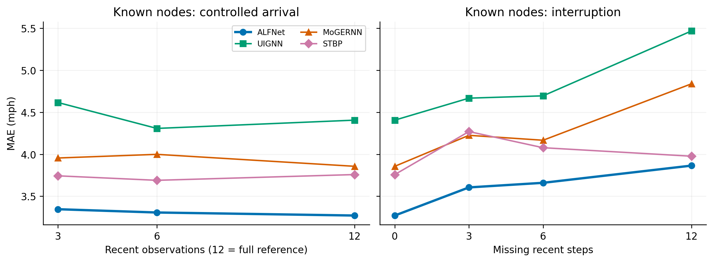
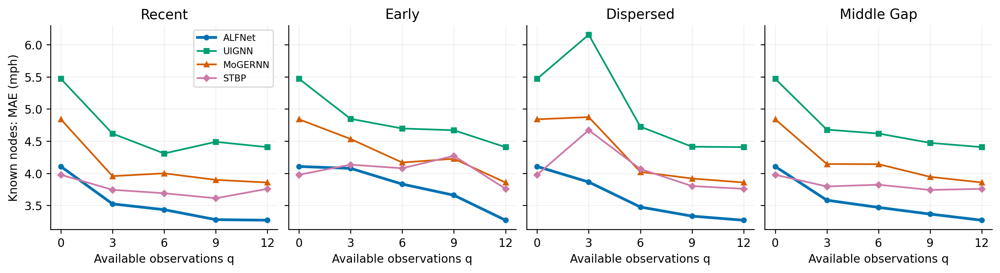
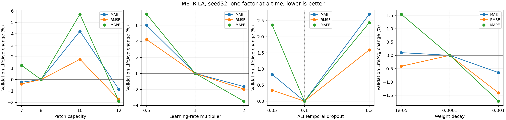
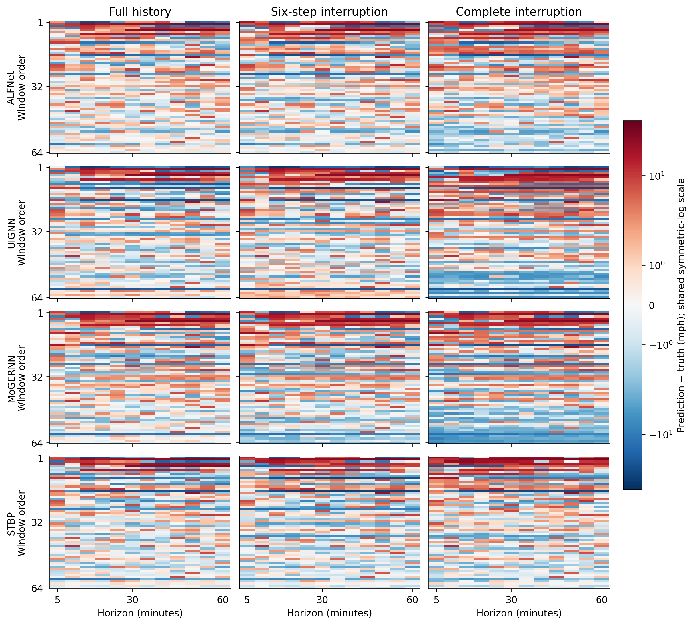

# ALFNet：动态观测支持下的归纳时空预测

## 1 引言

交通预测为路网运行管理、出行规划与拥堵预警提供前瞻性信息。然而，预测系统能够获得的历史数据并不总是连续且完整：传感器逐步部署使部分位置缺少训练期记录，设备失效和通信异常又会改变运行期间的数据可用性。已有关于未观测位置预测和动态传感器网络的研究已认识到这些问题 [6,7,10]。对于同一个预测位置，新近加入、持续观测和近期中断所提供的信息条件并不相同。本文将历史窗口内实际可用观测的位置、数量及其时间分布统称为**观测支持**。观测支持的变化不仅产生需要处理的空缺，也决定模型能从本地历史与关联位置获得怎样的预测依据。

围绕不完整交通观测，已有研究形成了互补的解决途径。缺失感知方法通过图循环重建、条件扩散或联合重建与预测，利用时空关联补充不可用信息 [1–4]；归纳与部分感知预测将预测范围扩展至缺少训练信号或部署期持续观测的位置 [6–10]；自适应图学习及空间分块表示则改善空间关系和多尺度上下文的组织 [11–15]。这些研究已经证明，缺失处理、空间信息传递与未观测位置预测能够协同工作。因而，进一步的关键并非判断模型是否能够接受缺失输入，而是明确：当历史支持在预测窗口内变化时，模型应如何相应调整信息利用方式。

这一问题在归纳预测中尤其突出。目标节点没有参与动态信号训练，并不意味着它在推理时始终没有观测；同样，训练期已有记录也不保证部署时始终拥有完整历史。现有方法分别强调训练信号覆盖、缺失恢复、传感器配置适应或空间交互，但这些能力并不直接回答"同一目标对应不同历史支持时，预测计算应如何变化"。即使可用观测数相同，近期集中、早期集中和分散分布的历史也可能对未来状态提供不同依据。本文因此研究**动态观测支持下的归纳时空预测**：在路网拓扑已知、部分节点动态信号不参与训练的条件下，利用变化的历史观测支持组织空间推理与预测上下文。该设置连接节点归纳与窗口内支持变化，强调固定模型参数下的预测行为。

我们的核心认识是，**观测支持应同时作为输入有效性的描述和预测计算的条件**。观测掩码标明哪些读数可用；在此基础上，观测角色与状态持续时间可以为模型组织历史信息提供显式的结构化线索。这里的角色表示持续观测、新加入、未观测或中断等状态，状态持续时间描述加入或中断过程的进展。它们的作用在于提供一种可检验的归纳偏置，而不要求包含完整掩码之外的额外信息。沿这一思路，历史重建负责提供可用表示，空间传播决定如何交换关联信息，跨节点时间上下文则为预测过程提供条件。三者的协作，使模型能够在本地证据与空间证据之间建立依赖当前支持条件的信息利用方式。

据此，我们提出观测支持感知预测框架 ALFNet。**观测感知历史重建（Observation-Aware Historical Reconstruction，ALFRecon）**借鉴图循环插补思想 [1]，利用可见观测及图关联构建两个分支共享的历史输入。**观测条件化图推理（ALFGraph）**受图专家混合与图循环建模启发 [7]，将观测状态纳入输入相关的传播组合。**空间上下文增强时间表示（ALFTemporal）**借鉴空间分块交互思想 [15]，从跨节点历史提取条件表示，并通过特征级线性调制（FiLM）[17]作用于图循环预测过程。图推理与时间表示围绕共同的历史支持协作，最终形成单一预测输出。本文的重点是这一条件化组织方式，而非重新提出图循环、分块注意力或线性调制等基础算子。

本文的贡献概括为三点：（1）围绕拓扑已知、训练信号覆盖不完整的路网，将窗口内变化的观测支持纳入归纳预测设置，并以零历史、持续观测、逐步加入和中断条件刻画其预测要求；（2）提出 ALFNet，将共享历史重建、观测条件化空间推理和跨节点时间上下文组织为协同预测框架；（3）在 METR-LA 与 PEMS-BAY 上开展统一条件评价，并结合组件消融、配对观测干预和残差分析，考察总体收益、机制归因及支持结构对预测行为的影响。总体结果显示，ALFNet 在两个数据集的跨条件平均误差上均优于全部比较方法；组件消融支持跨节点时间上下文与学习式历史重建在完整框架中的作用；配对干预与残差分析表明，这种收益与模型对支持条件变化的响应相关，这一响应是在预测目标与非干预输入保持不变时观察到的。

## 2 相关工作

### 2.1 不完整观测下的重建与预测

不完整观测建模包含历史恢复与未来预测两个相关但不同的目标。GRIN 通过图循环计算和消息传递重建多变量序列，PriSTI 则利用条件扩散和时空关联建模缺失数据 [1,2]。二者说明，关联位置能够为局部缺失提供信息来源；但重建历史的目标与预测未来并不相同，插补质量也不能直接代替预测性能评价。

面向未来预测，GCN-M 联合建模缺失处理与交通预测，通过观测掩码、多尺度历史记忆和图卷积利用局部与全局信息 [3]。GinAR 针对部分变量历史不可用的情况，将插值注意力和自适应图卷积引入递归预测 [4]。UIGNN 同时面向缺失位置预测与不确定性估计，与未观测位置泛化形成交叉 [6]。这些工作已经建立了缺失处理和空间推理的联系。本文在此基础上关注历史支持的时间结构：重建之外，观测状态如何参与传播组合，跨节点上下文如何进一步条件化未来预测。相应地，实验将学习式重建与上下文利用分别干预，以区分两者的贡献。

### 2.2 归纳与部分感知预测

归纳建模研究如何将已观测位置上学习的规律用于缺少训练信号的位置。IGNNK 通过子图采样学习可迁移的消息传递，解决未采样位置的时空插值 [5]；UIGNN 和 MoGERNN 则进一步预测未来交通状态 [6,7]。其中，MoGERNN 采用图专家混合与图循环编码—解码结构，并考察传感器加入和失效情形，说明变化的传感器配置已是归纳交通预测的重要研究对象。

不同方法对训练和推理阶段的观测条件有不同假设。ST-FiT 面向缺少节点训练数据的泛化，利用时间增强和拓扑学习迁移时空规律 [8]。SLPF 研究长期部分感知预测，利用训练期较充分的数据学习向部署期未感知位置的空间转移 [9]。SIML-MSIGN 将不同观测布局组织为任务，通过掩码门控扩散与结构归纳元学习开展跨布局预测及适应 [10]。因此，本文并不将"变化观测下的预测"视为未经研究的领域。ALFNet 的侧重点是固定参数下的窗口级支持条件化：在统一输入预算内，研究可用历史的状态和布局如何影响空间—时间计算。总体评价考察这一设计在归纳设置中的效果，已知节点配对实验则用于分离支持变化本身带来的预测响应。

### 2.3 空间依赖与时空表示学习

空间依赖建模为交通预测提供了利用关联位置的基本途径。STGCN 结合图卷积与时间卷积；Graph WaveNet 和 AGCRN 利用可学习表示构建自适应关系，降低对固定邻接的依赖 [11–13]。PDFormer 将传播时延纳入长程空间交互，PatchSTG 通过空间分块及块内、块间交互组织局部与全局信息 [14,15]。这些方法分别改善空间关系、交互范围和计算粒度，但学习到自适应图，并不自动意味着传播会根据每个窗口的观测支持进行调整。空间交互还需与时间表示能力共同考察。STID 通过简洁的时空身份表示建立有竞争力的预测基线 [16]；STBP 利用可扩展上下文模式库支持城市持续预测 [18]。本文关注的不是无限扩大空间交互范围或在线更新模式库，而是如何将可用的跨节点历史用于当前预测条件化。ALFTemporal 生成的上下文经 FiLM [17] 调制图循环预测，ALFGraph 则承担观测条件下的空间传播。实验中的同容量局部上下文替代直接检验跨节点信息的作用，避免将模型收益仅归结为更大的表示规模。

## 4 实验

实验设计围绕三个层次展开，分别对应引言提出的问题定义、方法设计与核心论点：总体条件评价（4.2–4.3）考察变化观测支持下的归纳预测是否带来可衡量的收益；架构消融（4.4）检验协同框架中各机制的具体贡献；配对观测干预、支持布局与残差分析（4.5、4.6及4.8）进一步考察支持结构本身如何影响固定参数模型的预测行为。具体地，实验回答：**RQ1**，变化观测支持下的跨条件预测是否改善；**RQ2**，哪些信息利用机制贡献了这种改善；**RQ3**，支持数量和时间结构如何影响固定模型的预测；**RQ4**，平均收益是否伴随较大预测误差的改善。总体比较覆盖 METR-LA 与 PEMS-BAY，其余分析使用 METR-LA。主表与消融报告测试结果，配对支持分析和敏感性研究使用验证数据。

### 4.1 实验设置

**数据与任务。** METR-LA 和 PEMS-BAY 分别包含207和325个交通传感器，时间点数为34,272和52,116，采样间隔为5分钟。输入为过去12步，预测未来12步交通速度。时间按60%／20%／20%顺序划分为训练、验证和测试时段；训练仅使用训练节点的动态信号，验证和测试分别引入对应保留节点，路网拓扑始终可见。标准化统计量仅由训练时段、训练节点计算。所有报告结果使用随机种子32。

**观测支持与指标。** 在共同窗口上构造 Unseen、Steady、Join、Fault 四类等配额条件，分别表示零历史、持续观测、逐步加入和中断，对应引言中刻画的四种预测要求。Join 的 Cold、Warm、Ready 阶段对应加入后的1、2–11、12步；Fault 的 Onset、Decay、Outage 对应中断后的相同进展区间。状态进展长度与最终有效观测数不同，后者还受自然缺失影响。所有方法共享观测支持、预测目标与评价掩码。采用原速度尺度上的 MAE、RMSE 和 MAPE，其中 MAPE 以百分比表示。各条件内按日历和事件进展分层平衡汇总，再对四类条件等权平均得到 LifeAvg；LifeAvg RMSE 是条件级 RMSE 的平均。三项指标共同反映绝对误差、大残差及相对误差。

**比较方法。** 依据第2节划分的三个研究方向，分别选取代表方法：不完整观测下的重建与预测（2.1）选取 UIGNN、GinAR，分别代表以不确定性建模应对缺失位置和以插值注意力—自适应图卷积应对变量缺失两种路线；归纳与部分感知预测（2.2）选取 MoGERNN、ST-FiT、SLPF，分别代表图专家混合归纳、时间增强—拓扑迁移归纳，以及长期部分感知空间转移三种设计；空间依赖与时空表示学习（2.3）选取 STGCN、STID、PatchSTG、STBP，分别代表固定图卷积、时空身份表示、空间分块交互与持续上下文模式库四种代表性设计。这九个方法覆盖三个方向的主要设计思路，但不是对每个方向所有子类方法的穷尽比较——例如，自适应图学习方向的 PDFormer、AGCRN、Graph WaveNet 未单独纳入比较，STGCN 与 STID 不能替代对这些方法的检验。分类允许交叉，UIGNN 同时涉及未观测位置泛化。各方法保留自身预测主干和目标，在共同输入与评价边界下适配；SLPF 为单阶段预测主干版本，STBP 为离线固定图版本，因而本实验比较其相应适配，而非原方法的全部训练或持续学习流程。

**训练配置。** ALFNet 含1,037,529个可训练参数，采用 AdamW，批大小64、权重衰减 $10^{-4}$，最多训练100轮；第40轮起使用耐心值10的提前停止，按验证集 LifeAvg MAE 保存权重。教师强制率在前40轮线性衰减，评价时关闭。图推理与共享重建、ALFTemporal、FiLM融合及其余参数的学习率依次为 $5\times10^{-4}$、$10^{-4}$、$5\times10^{-5}$。两数据集均使用32个空间分区，每分区容量分别为8和16。

**误差幅度加权训练目标。** 为明确不同残差在优化中的相对权重，定义单元素损失

$$
\ell(e)=\frac{e}{s}\tanh(\alpha e),\qquad e=|\hat y-y|,\quad\alpha=0.1,
$$

其中 $e$ 为原速度尺度上的绝对误差，$s$ 为训练标准差，$\alpha$ 的数值对应以 mph 表示的速度。该权重随残差增大而趋近1，小残差附近损失近似二次形式，大残差处趋近标准化 MAE；权重参与梯度计算。预测目标由样本均值项和按观测角色平衡的均值项以0.9／0.1混合，并保留模型辅助损失。这是现有训练目标的描述，不作为独立方法贡献。我们还在 METR-LA 上训练了两种损失设计的替代版本（普通 MAE 替代误差幅度加权；去除角色平衡的均值项）作为稳健性检查，两种替代在 METR-LA 上仍优于表1中的外部基线，完整结果见附录 A.12，正文不再展开分析。

### 4.2 总体预测性能（RQ1）

表1显示，ALFNet 在两个路网的六项 LifeAvg 指标上均优于所比较基线。相对各指标最强对手，MAE 分别降低13.66%和10.84%，RMSE、MAPE 也同步改善。这说明总体收益既不依赖单一误差度量，也不局限于一个数据集。

**表1　METR-LA 与 PEMS-BAY 的跨观测条件平均预测误差（测试集）。** 各列最优结果加粗，次优结果加下划线；按未舍入值排名。

| 方法 | METR-LA MAE↓ | RMSE↓ | MAPE(%)↓ | PEMS-BAY MAE↓ | RMSE↓ | MAPE(%)↓ |
|---|---:|---:|---:|---:|---:|---:|
| UIGNN | 4.593 | 6.971 | 12.547 | <u>3.093</u> | 4.773 | 7.559 |
| GinAR | 7.092 | 10.201 | 23.129 | 5.059 | 7.246 | 13.488 |
| MoGERNN | <u>4.554</u> | <u>6.803</u> | <u>12.352</u> | 3.116 | <u>4.693</u> | <u>7.426</u> |
| ST-FiT | 5.016 | 7.583 | 14.962 | 3.184 | 5.009 | 8.463 |
| SLPF（单阶段） | 5.878 | 8.101 | 16.362 | 4.017 | 5.684 | 9.700 |
| STGCN | 4.970 | 7.405 | 13.857 | 3.169 | 4.888 | 7.844 |
| STID | 4.923 | 7.479 | 13.752 | 3.239 | 5.007 | 7.695 |
| PatchSTG | 5.557 | 8.045 | 17.921 | 3.220 | 4.842 | 7.717 |
| STBP（离线） | 4.965 | 7.546 | 13.697 | 3.186 | 4.887 | 7.722 |
| ALFNet | **3.931** | **6.192** | **10.426** | **2.758** | **4.260** | **6.441** |

这一比较体现了三类已有能力与本文设置的联系。缺失感知模型可以补充不可用信息，归纳模型能够迁移已观测位置的规律，时空表示模型则提供不同范围的上下文。在这些方法共同接受变化观测支持的情况下，ALFNet 仍取得较低的平均误差，表明围绕支持条件组织预测计算具有实际价值。由于 LifeAvg 对四类条件等权汇总，该结果反映跨条件的综合表现；收益来自何种信息利用机制，需要进一步结合条件分解与组件消融判断。

### 4.3 观测条件变化下的收益分布（RQ1）

图2考察总体收益是否集中于某一种支持条件。以 MoGERNN 为固定参照，ALFNet 在 METR-LA 的四类主条件和六个阶段中均取得三指标正收益。跨阶段的一致方向表明，该收益不仅来自有完整历史的常规预测，也覆盖没有本地历史以及历史逐渐形成或丢失的情形。

**图2　METR-LA 不同观测条件下相对 MoGERNN 的误差降低比例（测试集，%）。** 按 $(E_{\mathrm{MoGERNN}}-E_{\mathrm{ALFNet}})/E_{\mathrm{MoGERNN}}\times100\%$ 计算，正值表示相对该固定参照改善。各面板使用同一参照方法，便于比较不同支持条件。

这些条件对应不同的信息需求：Unseen 主要依赖关联位置，Join 需要利用逐渐积累的本地证据，Fault 则要求在近期观测丢失后继续组织历史与空间信息。图2的共同改善方向与 ALFNet 的协同设计一致，即保持共享历史输入，同时让空间传播与时间上下文参与预测。它为"观测支持影响信息利用方式"提供跨条件的性能依据，而4.4通过消融具体能力进一步检验这一解释来自哪个机制。

### 4.4 消融实验（RQ2）

为区分信息来源与表示规模的影响，消融采用保留任务接口的替代设计。表2的六项对照分别替代或移除一项功能设计：历史重建方式、状态年龄编码、空间传播的输入相关性、跨节点时间上下文与FiLM调制（作为完整分支共同移除）、图输出修正；所有变体共享数据划分、随机种子及检查点选择准则。

**表2　METR-LA 架构消融（测试集 LifeAvg）。** 六项对照分别替代或移除一项功能设计，其中时间表示与FiLM作为完整分支共同移除；误差指标各列最优结果加粗，次优结果加下划线，保留三位小数；参数量为可训练参数总数，不参与最优排序。

| 模型变体 | MAE↓ | RMSE↓ | MAPE(%)↓ | 参数量 |
|---|---:|---:|---:|---:|
| ALFNet (Full) | **3.931** | **6.192** | 10.426 | 1,037,529 |
| w/o State Age | 4.013 | <u>6.219</u> | 10.804 | 1,037,529 |
| w/o Adaptive Routing | <u>3.970</u> | 6.254 | **10.257** | 1,036,869 |
| w/o Spatial Context | 4.424 | 6.699 | 12.775 | 1,037,529 |
| w/o ALFRecon | 4.085 | 6.427 | 10.896 | 841,618 |
| w/o ALFTemporal–FiLM | 4.237 | 6.532 | 11.734 | 575,225 |
| w/o Graph Refinement | 3.998 | 6.267 | <u>10.422</u> | 1,037,368 |

表中名称对应如下功能：State Age为状态年龄输入；Adaptive Routing为ALFGraph中的输入相关传播混合；Spatial Context为ALFTemporal中的跨节点上下文；ALFRecon为共享历史重建模块；ALFTemporal–FiLM为时间表示及其调制分支；Graph Refinement为图输出修正模块。这里的“w/o”表示移除相应信息或计算能力，并不一律删除所属分支：w/o State Age以掩码特征替代年龄通道，w/o Adaptive Routing保留图传播算子并改用全局可学习混合，w/o Spatial Context保留时间分支并逐节点处理，w/o ALFRecon采用训练均值填充；其余两项分别移除整条时间表示—调制分支和图输出修正。

ALFNet (Full) 在表2所列六项功能对照中取得最低 MAE 和 RMSE。另有一项联合角色—年龄条件替代（同时改变角色、年龄与图修正）在三项 LifeAvg 指标上均低于完整模型；由于该对照同时改变多个因素，不满足表2单一功能替代的对照设计原则，故单独报告于附录，不计入此处的六项排序。MAPE 上，表2六项对照中最优为 w/o Adaptive Routing（10.257%），次优为 w/o Graph Refinement（10.422%），完整模型（10.426%）分别比二者高1.62%和0.04%（以完整模型 MAPE 为分母计算的相对差值）。

这两处差距的含义并不相同。w/o Adaptive Routing 以全局可学习权重替代输入相关的传播组合，仅减少660个参数，但其 MAE、RMSE 相对完整模型分别上升约1.0%（同样以完整模型为分母），换取 MAPE 下降1.62%；这一权衡表明该对照并非全面更优的替代设计，而是以牺牲绝对误差和大残差控制为代价改善相对误差的方案。w/o Graph Refinement 与完整模型的 MAPE 差距仅0.04%，同时其 MAE、RMSE 均劣于完整模型；本文未对这一量级的差异做显著性检验，仅报告观测到的数值，不据此判断该对照在整体上优于完整模型。因此，ALFNet (Full) 在架构消融范围内的相对定位是：在 MAE、RMSE 上一致最优，在 MAPE 上与两个特定对照存在方向不同、幅度较小的权衡；这一权衡不影响表1中 ALFNet 相对全部基线在 MAPE 上的最优结果，差距只出现在同一架构内部的细粒度对照中。

**跨节点上下文是主要收益来源。** w/o Spatial Context 对照取消空间分区的索引扩展与重排，使相同注意力投影、潜在路由及前馈模块逐节点处理，保留历史嵌入和 FiLM。其参数量仍为1,037,529，但 MAE、RMSE、MAPE 分别上升12.52%、8.20%、22.53%，是六项对照中差距最大的一组。该结果将上下文作用与容量变化区分开：仅具备同样大小的时间表示分支，不足以替代跨节点历史的参与。w/o ALFTemporal–FiLM 也使三项误差全面上升，说明将这类上下文接入预测计算具有实际贡献。

**学习式历史重建提供一致收益，状态年龄的收益需限定解读范围。** w/o ALFRecon 的三项误差全面上升，表明历史重建质量持续影响预测。w/o State Age 同样使三项误差全面上升，说明状态年龄在当前配置中提供了收益；由于该消融仅替换年龄通道、保留角色标签不变，这一结果本身不能单独证明角色编码的贡献，角色的作用需结合联合角色—年龄对照（见附录）综合判断。

综合表2，最直接的证据是跨节点上下文与学习式重建的贡献；状态年龄编码在当前配置中提供了有用的归纳偏置。本文的方法贡献落在观测支持下的协同预测框架，而非每个附加编码在所有指标上的独立优越性。

### 4.5 配对观测轨迹下的预测响应（RQ3）

条件平均无法区分交通目标变化和观测变化的影响。为固定预测难度的来源，我们选取64个历史与未来自然完整的训练已知节点验证窗口，保持节点、预测时刻、真实未来、路网和其他节点输入不变，仅删减焦点节点历史，并按协议更新角色和年龄。近期3步、6步与完整12步形成受控加入轨迹；删除近期3步、6步及全部历史形成中断轨迹，此时观测角色和年龄按协议更新为对应的中断状态。模型参数保持固定，因此曲线反映对可用证据的响应，而不是在线学习效果。这里的加入发生在已知节点，分析对象是支持变化本身。

比较 UIGNN、MoGERNN 和 STBP，分别为三类方法中在 METR-LA 完整验证集 LifeAvg MAE 上最优的代表，以下4.6、4.8节沿用同一组代表方法。图3、4报告这组配对窗口的平均 MAE，与主表的条件平衡 LifeAvg 使用不同聚合方式。

**图3　固定预测目标下的观测加入与中断响应。** 使用同一组64个 METR-LA 已知节点验证窗口；左图逐步增加近期观测，右图逐步删除近期观测。12步完整历史是共同参照，两图共享 MAE 纵轴。

ALFNet 随近期观测增加逐步降低误差，并在完整历史到完全中断的四种条件下始终低于三个代表方法。这一现象揭示两方面能力：新增的本地证据能够进入预测，证据消失后仍可利用保留的空间与历史上下文。在完全中断时，ALFNet 的 MAE 为3.865，相对 MoGERNN 降低20.13%。由于同一预测目标和非干预节点保持不变，这一结果表明配对比较中观察到的误差差异来自支持条件本身，排除了"不同条件恰好对应不同交通目标"这一混淆解释。

图3展示的是完整模型的输入响应，表2则检验跨节点上下文和条件分支的作用。二者结合，支持历史重建之外的信息组织价值：模型不仅需要获得可用表示，还需要在支持条件改变时利用表示开展预测。下一节进一步固定观测角色和年龄，仅改变观测的数量与时间位置。

### 4.6 观测数量与时间布局（RQ3）

相同的观测数量并不代表相同的预测依据。沿用64个配对窗口与4.5选定的代表方法（UIGNN、MoGERNN、STBP），令可用历史数 $q\in\{0,3,6,9,12\}$，比较近期、早期、分散和中间缺口布局：分别保留窗口末端、起始端、分布于窗口的读数，以及中部连续缺口两侧的读数。各设置仅删减自然存在的观测，固定成熟活跃角色和年龄，以区分支持结构与状态标签的影响。

**图4　METR-LA 已知节点的观测数量—时间布局分析。** 四面板共享 MAE 纵轴，每个点使用相同64个验证窗口；$q=0$ 和 $q=12$ 分别是全缺失与完整历史的共享端点，合计14种不同支持组合。

在 $q=6$ 时，ALFNet 使用近期观测的 MAE 为3.434，仅使用早期观测时为3.832；分散与中间缺口布局则接近近期布局。预测误差因此取决于历史的新近程度与覆盖方式，而非仅由缺失比例决定。这一观察直接对应引言中的问题：支持数量只描述"有多少信息"，时间布局还决定"信息来自何时"。

ALFNet 在14种支持组合中的13种取得最低 MAE，覆盖近期、早期、分散和中间缺口四类布局在 $q>0$ 时的全部组合；唯一例外是全缺失端点（$q=0$），由 STBP 取得更低误差（ALFNet为4.106，STBP为3.977）。本节的布局实验将观测角色和年龄固定为成熟活跃状态，因此该端点与4.5节的完全中断轨迹并非同一设置：后者的角色和年龄按协议更新为中断状态，此时 ALFNet 的 MAE 为3.865，低于 STBP。两组实验都不含本地历史，但状态标签不同、相对优劣的方向也不同，说明观测数量并非唯一决定因素，状态处理方式同样影响支持结构切换后的相对表现；本文未将观测数量与状态标签的影响单独拆分，因此不将该端点的相对劣势仅归因于缺少本地锚点。结合相同参数量的局部上下文对照（表2），结果支持通过跨节点时间表示利用不同布局下的历史证据，但这一优势不延伸到本节固定状态设置下的全缺失端点。

### 4.7 超参数敏感性

图5在固定架构与训练目标下考察分区容量、学习率倍率、ALFTemporal dropout 和权重衰减对验证集 LifeAvg 的影响。容量取 $\{7,8,10,12\}$（默认8），学习率倍率取 $\{0.5,1,2\}$ 并同时作用于三组参数，dropout 取 $\{0.05,0.1,0.2\}$（默认0.1），权重衰减取 $\{10^{-5},10^{-4},10^{-3}\}$。各设置单独改变一个因素，采用相同随机种子和验证集选择准则。

**图5　METR-LA 超参数变化对验证集 LifeAvg 的影响。** 纵轴表示相对默认配置的误差变化，越低越好；各点为实际运行的配置，连接线辅助比较。零线和竖虚线分别表示默认误差和默认取值。

结果并非在所有因素上都同样平坦。权重衰减在所测范围内引起的平均 MAE 变化小于1%；默认 dropout 0.1 在三个取值中表现最好，容量7与默认容量8也较为接近。容量10使验证集 MAE 相对默认配置上升4.23%，学习率减半则使验证集 MAE 上升6.00%，二者的变化幅度均超过权重衰减和 dropout 的扰动，表明分区容量与优化尺度均会影响预测表现，且容量的效应并非单调——更多的槽位数不必然带来更准确的预测。在所测范围内，权重衰减的影响较小，而分区容量与学习率表现出更明显的敏感性；由于本实验只改变完整模型的单一配置，未重新比较所有基线和消融的排序，这一观察不直接推广为表1、表2整体排名的稳健性结论。

### 4.8 观测中断下的残差分布（RQ4）

平均误差下降是否也体现在较难预测的窗口上？图6将同一组64个已知节点窗口的全部12步残差展开，比较完整历史、六步中断与完全中断三种条件下 ALFNet、UIGNN、MoGERNN、STBP（4.5、4.6选定的代表方法）的表现；窗口按真实未来平均速度从低到高排列。

**图6　观测中断下的窗口—预测步残差图谱。** 面板行依次为 ALFNet、UIGNN、MoGERNN、STBP，列依次为完整历史、六步中断、完全中断。每个面板含64个窗口×12步；窗口共享按真实未来均速升序排列的顺序。颜色为预测值减真实值，红色表示高估、蓝色表示低估；共享对称对数色标，±2 mph内为线性区间，所有残差均保留。

真实速度较低的窗口（图谱上部）在多种方法和多种条件下都出现跨预测步的红色区域，表明这类窗口的未来低速状态容易被持续高估，这一模式在完全中断条件下依然存在。真正区分方法的是大残差的严重程度，而非这类偏差是否出现：完全中断后，ALFNet 的第90百分位绝对残差为9.355 mph，三个对照为10.331–14.394 mph，第95百分位具有相同排序；这一优势也出现在完整历史和六步中断条件。这一百分位统计是将64个窗口×12个预测步共768个残差单元合并计算，未按窗口难度分组，因此总体误差收益不仅体现在平均误差，也体现在这组配对样本的较大绝对残差区域。

### 4.9 结果与引言论点的呼应

总体与条件评价表明，变化观测支持下的归纳预测确有收益空间；架构消融支持跨节点时间上下文与学习式历史重建在完整框架中的作用，状态年龄编码的价值更多体现在预测行为本身，而不是单一平均误差指标的进一步压低；配对观测轨迹与残差分布表明，在预测目标与非干预输入保持不变时，观测支持的变化伴随预测误差的相应变化。这组证据共同支持本文的核心主张：观测支持应同时作为输入有效性描述和预测计算条件，而不能仅由训练身份或掩码比例单独刻画。

同时，ALFNet 的优势存在明确边界，且边界的位置与观测状态的定义方式有关，而不只取决于观测数量：

| 设置 | 观测数量 | 角色／年龄状态 | ALFNet MAE | STBP MAE |
|---|---|---|---:|---:|
| 4.5 轨迹干预：完全中断 | 0 | 按协议更新为中断状态 | 3.865 | 3.977 |
| 4.6 布局实验：$q=0$ | 0 | 固定为成熟活跃状态 | 4.106 | 3.977 |

两种设置都不含本地历史，但状态标签不同，且相对优劣的方向也不同：ALFNet 在按协议更新的中断状态下占优，在固定成熟活跃状态下不占优。这表明观测数量并非唯一决定因素，状态处理方式同样影响支持结构切换后的相对表现；预测方法的相对优劣会随支持结构（包括观测数量与状态标签的组合）切换，而非存在对所有支持条件一致最优的单一设计。

## 参考文献

[1] Cini et al. Filling the G_ap_s: Multivariate Time Series Imputation by Graph Neural Networks. ICLR, 2022. [论文](https://openreview.net/forum?id=kOu3-S3wJ7).

[2] Liu et al. PriSTI: A Conditional Diffusion Framework for Spatiotemporal Imputation. ICDE, 2023. [作者论文](https://arxiv.org/abs/2302.09746).

[3] Zuo et al. Graph Convolutional Networks for Traffic Forecasting with Missing Values. Data Mining and Knowledge Discovery, 2023. [正式引文与代码](https://github.com/JingweiZuo/GCN-M).

[4] Yu et al. GinAR: An End-To-End Multivariate Time Series Forecasting Model Suitable for Variable Missing. KDD, 2024. [作者全文](https://arxiv.org/html/2405.11333v1).

[5] Wu et al. Inductive Graph Neural Networks for Spatiotemporal Kriging. AAAI, 2021. [论文](https://ojs.aaai.org/index.php/AAAI/article/view/16575).

[6] Mei et al. Uncertainty-aware Traffic Prediction under Missing Data. ICDM, 2023. [作者全文](https://arxiv.org/html/2309.06800).

[7] Zhou et al. MoGERNN: An Inductive Traffic Predictor for Unobserved Locations. Transportation Research Part C, 2025. [论文](https://doi.org/10.1016/j.trc.2025.105080).

[8] Lei et al. ST-FiT: Inductive Spatial-Temporal Forecasting with Limited Training Data. AAAI, 2025. [论文](https://doi.org/10.1609/aaai.v39i11.33310).

[9] Liu et al. Spatio-temporal Partial Sensing Forecast of Long-term Traffic. TMLR, 2025. [论文](https://openreview.net/forum?id=Ff08aPjVjD).

[10] Zhao et al. Structure-inductive Meta-learning Empowers Partial-to-global Traffic State Forecasting in Dynamic Sensor Networks. Transportation Research Part C, 2026. [论文](https://www.sciencedirect.com/science/article/abs/pii/S0968090X26000525).

[11] Yu et al. Spatio-Temporal Graph Convolutional Networks: A Deep Learning Framework for Traffic Forecasting. IJCAI, 2018. [作者论文](https://arxiv.org/abs/1709.04875).

[12] Wu et al. Graph WaveNet for Deep Spatial-Temporal Graph Modeling. IJCAI, 2019. [论文](https://www.ijcai.org/proceedings/2019/264).

[13] Bai et al. Adaptive Graph Convolutional Recurrent Network for Traffic Forecasting. NeurIPS, 2020. [作者实现与论文](https://github.com/LeiBAI/AGCRN).

[14] Jiang et al. PDFormer: Propagation Delay-Aware Dynamic Long-Range Transformer for Traffic Flow Prediction. AAAI, 2023. [论文](https://ojs.aaai.org/index.php/AAAI/article/view/25556).

[15] Fang et al. Efficient Large-Scale Traffic Forecasting with Transformers: A Spatial Data Management Perspective. KDD, 2025. [作者全文](https://arxiv.org/html/2412.09972v1).

[16] Shao et al. Spatial-Temporal Identity: A Simple yet Effective Baseline for Multivariate Time Series Forecasting. CIKM, 2022. [作者实现与论文](https://github.com/GestaltCogTeam/STID).

[17] Perez et al. FiLM: Visual Reasoning with a General Conditioning Layer. AAAI, 2018. [作者论文](https://arxiv.org/abs/1709.07871).

[18] Liu et al. A General Spatio-Temporal Backbone with Scalable Contextual Pattern Bank for Urban Continual Forecasting. ICLR, 2026（作者仓库标注）. [作者实现与论文](https://github.com/Aoyu-Liu/STBP).

---

**作者备注（不进入正文）：** 本稿在 manuscript_draft_cn-2-v3.md 基础上，依据 Codex 第二轮核对结果完成第四轮修订。主要改动：（1）局部时间上下文的 MAE 增幅由12.54%订正为12.52%（按未舍入结果计算）；（2）4.7节容量10相对默认配置的MAE增幅4.23%保留，但删除"四个因素中变化幅度最大"的错误表述，改为与学习率减半的6.00%对比，并将"表1、表2主要结论对多数超参数扰动稳健"这一超出实验范围的结论替换为"权重衰减影响较小、容量与学习率更敏感，且本实验未重新比较基线与消融排序"；（3）表2开头机制列表补上"跨节点时间上下文与FiLM调制"作为完整分支共同移除的说明，措辞由"每行只改变一个机制"改为"六项对照分别替代或移除一项功能设计"；（4）明确"MAE、RMSE一致最优"的范围限定于表2所列六项对照，联合角色—年龄替代（三项LifeAvg均更低）单独说明报告于附录、不计入此处排序；"状态编码提供一致收益"收窄为"状态年龄在当前配置中提供收益"，并说明该消融不能单独证明角色编码本身的贡献；（5）4.1训练目标替代版本的引用由"附录C"改为"附录A.12"，并加上"仅在METR-LA上验证""仍优于表1外部基线"的限定；（6）4.9新增轨迹干预与布局实验的状态对照表（完全中断 vs. 固定成熟活跃状态下的q=0），将"完全缺失端点不占优"的表述限定为"在固定成熟活跃角色和年龄的布局实验中"，4.6同步修正为不再主要用"缺少本地锚点"解释端点差异；（7）4.8结论由"体现在最难预测的窗口上"改为"体现在这组配对样本的较大绝对残差区域"，并说明百分位数是768个窗口—预测步单元的合并统计、未按窗口难度分组；（8）引言与4.9中"主要归因于……协同"改为"支持……在完整框架中的作用"，"而非仅反映训练分布差异"改为"这一响应是在预测目标与非干预输入保持不变时观察到的"；（9）第4节开头"4.5–4.8"改为"4.5、4.6及4.8"；4.1比较方法段删除"仅以固定图卷积和身份表示两种参照代表该方向"这一遗漏PatchSTG、STBP的表述；（10）表2为静态传播混合的MAE（3.970）与去除状态年龄的RMSE（6.219）补充次优下划线标注。现有结果仍为单种子，且开发期间已发生测试反馈及补充配置测试；提交前须按此披露，并与方法章节核对正式符号及完整训练目标。
